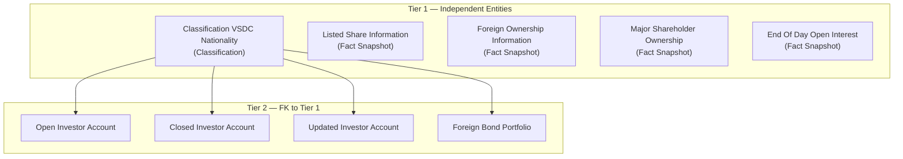

# VSDC HLD — Overview

**Source system:** VSDC (Dữ liệu Trung tâm Lưu ký chứng khoán Việt Nam — vùng staging `uat_vsdc_stg`)
**Mô tả:** VSDC cung cấp các báo cáo lưu ký/đăng ký chứng khoán đã chuẩn hóa vào vùng staging: cơ cấu cổ phiếu, sở hữu nước ngoài, cổ đông lớn, vị thế mở cuối ngày phái sinh, danh sách tài khoản nhà đầu tư mở/đóng/thay đổi và danh mục trái phiếu của nhà đầu tư nước ngoài. Overview này cũng là nơi định nghĩa entity `Listed Share Information`, dùng chung với HNX và HOSE (`listed_securities_list`).

---

## Tổng quan Atomic Entities

| Tier | Atomic Entity | BCV Core Object | BCV Concept | table_type | Source Table(s) | Ghi chú |
|---|---|---|---|---|---|---|
| T1 | Classification VSDC Nationality | Common | [Common] Nationality | Classification | VSDC.nationality | Danh mục quốc tịch VSDC (`autoid`, `name`) — tên theo chỉ định Data Modeler |
| T1 | End Of Day Open Interest | Documentation | [Documentation] Regulatory Report | Fact Snapshot | VSDC.end_of_day_open_interest | Vị thế mở cuối ngày theo mã hợp đồng |
| T1 | Foreign Ownership Information | Documentation | [Documentation] Regulatory Report | Fact Snapshot | VSDC.foreign_investor_info | Sở hữu NĐTNN theo mã |
| T1 | Listed Share Information | Documentation | [Documentation] Regulatory Report | Fact Snapshot | VSDC.outstanding_shares, HNX.listed_securities_list, HOSE.listed_securities_list | Entity dùng chung 3 nguồn, phân biệt qua `src_stm_code` |
| T1 | Major Shareholder Ownership | Involved Party | [Involved Party] Organization Ownership | Fact Snapshot | VSDC.major_shareholder | Cổ đông lớn theo mã × kỳ |
| T2 | Closed Investor Account | Arrangement | [Arrangement] Trading Account Arrangement | Fact Snapshot | VSDC.closed_investors | Tài khoản đóng trong kỳ |
| T2 | Foreign Bond Portfolio | Documentation | [Documentation] Regulatory Report | Fact Snapshot | VSDC.foreign_investor_bond_portfolio | Danh mục trái phiếu NĐTNN |
| T2 | Open Investor Account | Arrangement | [Arrangement] Trading Account Arrangement | Fact Snapshot | VSDC.open_investors | Tài khoản mở mới trong kỳ |
| T2 | Updated Investor Account | Arrangement | [Arrangement] Trading Account Arrangement | Fact Snapshot | VSDC.updated_investors | Tài khoản thay đổi thông tin trong kỳ |

**Tổng: 9 Atomic entities** (5 Tier 1, 4 Tier 2)
*(Trong đó: 0 shared entities extend từ source khác — `Listed Share Information` được VSDC định nghĩa, HNX/HOSE bổ sung source_table)*

---

## Diagram Phân tầng Dependencies (Mermaid)

---

## Quyết định thiết kế chính

| # | Quyết định | Lý do |
|---|---|---|
| D-01 | `open_investors`, `closed_investors`, `updated_investors` map thành 3 entity độc lập `<trạng thái>_investor_account`, không gộp thành 1 entity `investor_account` + `investor_account_hstr` | Quyết định Data Modeler 2026-10-17: mỗi bảng nguồn có cột đặc thù riêng (`open_date` / `close_date` + `notes` / `update_date` + `notes`) |
| D-02 | `nationality` nâng cấp từ Classification Value lên entity thật `Classification VSDC Nationality`; cột `nationality` ở các bảng tiêu thụ crosswalk theo `nationality = autoid` | Chỉ định Data Modeler; `autoid` là khóa nội bộ nên cần join qua bảng danh mục trước khi lấy mã |
| D-03 | Entity gộp từ nhiều nguồn (`Listed Share Information`) định nghĩa ở source đầu tiên (VSDC); HNX/HOSE chỉ bổ sung `source_table` | Quy tắc không tạo dòng trùng trong `atomic_entities.yaml` |
| D-04 | Không dùng FK giữa các entity cùng mức theo `ticker_symbol` | Staging VSDC không có bảng master mã chứng khoán; join thực hiện ở Gold (tương tự MDDS D-02) |
| D-05 | Bảng báo cáo định kỳ (ngày/tháng/quý) → `Fact Snapshot` (partition `ds_snpst_dt`) | Mỗi dòng là 1 lần chụp theo kỳ, giữ lịch sử, không overwrite |

---

#### 7a. Bảng tổng quan Atomic entities

| Tier | BCV Core Object | BCV Concept | Category | Source Table | Source Table Change Mode | Mô tả bảng nguồn | Atomic Entity | Table Type | BCV Term |
|---|---|---|---|---|---|---|---|---|---|
| T1 | Common | [Common] Nationality | Common | nationality | Append | Danh mục quốc tịch VSDC (`autoid`, `name`) | Classification VSDC Nationality | Classification | Core Object Common theo chỉ định Data Modeler; BCV không có term "Nationality" |
| T1 | Documentation | [Documentation] Regulatory Report | Documentation | end_of_day_open_interest | Append | Vị thế mở cuối ngày theo mã hợp đồng phái sinh | End Of Day Open Interest | Fact Snapshot | Regulatory Report (9297) — Core Object Documentation theo chỉ định Data Modeler |
| T1 | Documentation | [Documentation] Regulatory Report | Documentation | foreign_investor_info | Append | Sở hữu nước ngoài theo mã chứng khoán | Foreign Ownership Information | Fact Snapshot | Regulatory Report (9297) — Core Object Documentation theo chỉ định Data Modeler |
| T1 | Documentation | [Documentation] Regulatory Report | Documentation | outstanding_shares | Append | Cơ cấu cổ phiếu theo mã và ngày chốt | Listed Share Information | Fact Snapshot | Regulatory Report (9297) — Core Object Documentation theo chỉ định Data Modeler |
| T1 | Involved Party | [Involved Party] Organization Ownership | Involved Party | major_shareholder | Append | Cổ đông lớn theo mã chứng khoán và kỳ | Major Shareholder Ownership | Fact Snapshot | Organization Ownership (11558) — Core Object Involved Party theo chỉ định Data Modeler |
| T2 | Arrangement | [Arrangement] Trading Account Arrangement | Arrangement | closed_investors | Append | Danh sách tài khoản đóng trong kỳ | Closed Investor Account | Fact Snapshot | Trading Account Arrangement (7562) |
| T2 | Documentation | [Documentation] Regulatory Report | Documentation | foreign_investor_bond_portfolio | Append | Danh mục trái phiếu nắm giữ của NĐTNN theo tháng | Foreign Bond Portfolio | Fact Snapshot | Regulatory Report (9297) — Core Object Documentation theo chỉ định Data Modeler |
| T2 | Arrangement | [Arrangement] Trading Account Arrangement | Arrangement | open_investors | Append | Danh sách tài khoản mở mới trong kỳ | Open Investor Account | Fact Snapshot | Trading Account Arrangement (7562) |
| T2 | Arrangement | [Arrangement] Trading Account Arrangement | Arrangement | updated_investors | Append | Danh sách tài khoản thay đổi thông tin trong kỳ | Updated Investor Account | Fact Snapshot | Trading Account Arrangement (7562) |

#### 7b. Diagram Atomic tổng (Mermaid)

```mermaid
erDiagram
    Classification_VSDC_Nationality {
        string cl_vsdc_nationality_code PK
    }
    Listed_Share_Information {
        string listed_share_information_id PK
    }
    Foreign_Ownership_Information {
        string foreign_ownership_information_id PK
    }
    Major_Shareholder_Ownership {
        string major_shareholder_ownership_id PK
    }
    End_Of_Day_Open_Interest {
        string end_of_day_open_interest_id PK
    }
    Open_Investor_Account {
        string open_investor_account_id PK
    }
    Closed_Investor_Account {
        string closed_investor_account_id PK
    }
    Updated_Investor_Account {
        string updated_investor_account_id PK
    }
    Foreign_Bond_Portfolio {
        string foreign_bond_portfolio_id PK
    }

    Classification_VSDC_Nationality ||--o{ Open_Investor_Account : "nationality_code"
    Classification_VSDC_Nationality ||--o{ Closed_Investor_Account : "nationality_code"
    Classification_VSDC_Nationality ||--o{ Updated_Investor_Account : "nationality_code"
    Classification_VSDC_Nationality ||--o{ Foreign_Bond_Portfolio : "nationality_code"
```

#### 7c. Bảng Classification Value

| Source Table | Mô tả | BCV Term | Xử lý Atomic |
|---|---|---|---|
| nationality | Danh mục quốc tịch VSDC | [Common] Nationality | Nâng cấp thành entity thật `Classification VSDC Nationality` (không dùng scheme) |

#### 7d. Junction Tables

Không có junction table.

#### 7e. Điểm cần xác nhận

| # | Tier | Câu hỏi | Ảnh hưởng |
|---|---|---|---|
| 1 | T1 | Tên `Classification VSDC Nationality` chèn tên nguồn, trái quy tắc #7; `Classification Nationality` (SCMS) đã tồn tại cùng concept | Theo chỉ định Data Modeler giữ tên này; phương án thay thế: bổ sung `VSDC.nationality` vào `Classification Nationality` |
| 2 | T1 | `nationality` Change Mode `Append` nhưng table_type `Classification` (Upsert) | Cơ chế nạp ETL (lấy bản mới nhất theo `autoid`) |
| 3 | T1 | `Listed Share Information` gộp VSDC + HNX + HOSE vào 1 entity (nhiều cột nullable theo nguồn) | Có thể phải tách entity nếu không chấp nhận nullable |
| 4 | T2 | Kiểu `nationality_code` (INT = `autoid` hay STRING) và áp dụng crosswalk cho `foreign_investor_bond_portfolio` | Thiết kế attribute LLD, rủi ro cast |
| 5 | T1/T2 | Tên vật lý lấy theo DDL atomic hiện có; 3 phân hệ không có domain_prefix | Có thể phải rename ở LLD |

#### 7f. Bảng ngoài scope

| Nhóm | Source Table | Mô tả bảng nguồn | Lý do ngoài scope |
|---|---|---|---|
| Fact Data | account_opening_closing_status | Trạng thái mở/đóng tài khoản (đã bỏ khỏi mapping) | Bỏ không còn khai thác theo quyết định Data Modeler — không còn trong DDL nguồn hiện tại |

---

## Entities

> Single source of truth cho metadata entity. `aggregate_atomic.py` parse section này để sinh `atomic_entities.yaml`.

### 1. Classification VSDC Nationality
**Tier:** 1 | **Source:** `VSDC.nationality` | **BCV Concept:** [Common] Nationality | **BCO:** Common | **Table Type:** Classification
**Domain Prefix:** (none)
**Description:** Danh mục quốc tịch của VSDC gồm mã nội bộ (`autoid`) và tên quốc gia, được các bảng tài khoản nhà đầu tư và danh mục trái phiếu nhà đầu tư nước ngoài tham chiếu qua crosswalk `nationality = autoid`.

**Grain:** 1 dòng = 1 quốc tịch.

**Attributes chính:** Mã quốc tịch (`autoid`), tên quốc gia.

### 2. End Of Day Open Interest
**Tier:** 1 | **Source:** `VSDC.end_of_day_open_interest` | **BCV Concept:** [Documentation] Regulatory Report | **BCO:** Documentation | **Table Type:** Fact Snapshot
**Domain Prefix:** (none)
**Description:** Khối lượng vị thế mở (open interest) cuối ngày theo mã hợp đồng phái sinh, do VSDC cung cấp.

**Grain:** 1 dòng = 1 mã hợp đồng × 1 ngày báo cáo.

**Attributes chính:** Mã hợp đồng (BK `ticker_symbol`), khối lượng vị thế mở, ETL-derived `src_stm_code`, `ds_snpst_dt`.

### 3. Foreign Ownership Information
**Tier:** 1 | **Source:** `VSDC.foreign_investor_info` | **BCV Concept:** [Documentation] Regulatory Report | **BCO:** Documentation | **Table Type:** Fact Snapshot
**Domain Prefix:** (none)
**Description:** Thông tin sở hữu của nhà đầu tư nước ngoài theo mã chứng khoán: tổng số cổ phiếu phát hành, tỷ lệ sở hữu nước ngoài tối đa, số cổ phiếu tối đa được nắm giữ, đang nắm giữ và còn lại.

**Grain:** 1 dòng = 1 mã chứng khoán × 1 ngày báo cáo.

**Attributes chính:** `ticker_symbol` (BK), `isin_code`, tỷ lệ sở hữu nước ngoài tối đa, các số lượng cổ phiếu, ETL-derived `src_stm_code`.

### 4. Listed Share Information
**Tier:** 1 | **Source:** `VSDC.outstanding_shares`, `HNX.listed_securities_list`, `HOSE.listed_securities_list` | **BCV Concept:** [Documentation] Regulatory Report | **BCO:** Documentation | **Table Type:** Fact Snapshot
**Domain Prefix:** (none)
**Description:** Thông tin cổ phiếu niêm yết theo mã chứng khoán: cơ cấu số lượng cổ phiếu (phát hành, quỹ, lưu hành, tự do chuyển nhượng, hạn chế chuyển nhượng, biểu quyết) từ VSDC và số lượng niêm yết, giá tham chiếu từ HNX/HOSE.

**Grain:** 1 dòng = 1 mã chứng khoán × 1 ngày chốt × 1 nguồn.

**Attributes chính:** `ticker_symbol` (BK), `isin_code`, các số lượng cổ phiếu, `issuer_name`, số lượng niêm yết, giá tham chiếu, ETL-derived `src_stm_code` (VSDC/HNX/HOSE).

### 5. Major Shareholder Ownership
**Tier:** 1 | **Source:** `VSDC.major_shareholder` | **BCV Concept:** [Involved Party] Organization Ownership | **BCO:** Involved Party | **Table Type:** Fact Snapshot
**Domain Prefix:** (none)
**Description:** Danh sách cổ đông lớn theo mã chứng khoán: tên cổ đông, số giấy tờ, địa chỉ liên hệ, số cổ phiếu và tỷ lệ sở hữu đầu kỳ và cuối kỳ.

**Grain:** 1 dòng = 1 cổ đông × 1 mã chứng khoán × 1 kỳ báo cáo.

**Attributes chính:** `ticker_symbol`, `identification_nbr` (BK ghép), số cổ phiếu/tỷ lệ đầu–cuối kỳ, `isin_code`.

### 6. Closed Investor Account
**Tier:** 2 | **Source:** `VSDC.closed_investors` | **BCV Concept:** [Arrangement] Trading Account Arrangement | **BCO:** Arrangement | **Table Type:** Fact Snapshot
**Domain Prefix:** (none)
**Description:** Danh sách tài khoản giao dịch chứng khoán của nhà đầu tư đã đóng trong kỳ, gồm thông tin chủ tài khoản, ngày đóng và ghi chú đóng tài khoản.

**Grain:** 1 dòng = 1 tài khoản đóng × 1 kỳ báo cáo.

**Attributes chính:** `investor_account_nbr` (BK), tên, loại hình, giấy tờ, `close_dt`, `close_note`, FK `nationality_code` → Classification VSDC Nationality.

### 7. Foreign Bond Portfolio
**Tier:** 2 | **Source:** `VSDC.foreign_investor_bond_portfolio` | **BCV Concept:** [Documentation] Regulatory Report | **BCO:** Documentation | **Table Type:** Fact Snapshot
**Domain Prefix:** (none)
**Description:** Danh mục trái phiếu nắm giữ của nhà đầu tư nước ngoài theo tháng: thông tin nhà đầu tư, đại diện giao dịch, mã trái phiếu và khối lượng sở hữu.

**Grain:** 1 dòng = 1 nhà đầu tư nước ngoài × 1 mã trái phiếu × 1 tháng báo cáo.

**Attributes chính:** `foreign_investor_code` (BK), tên, phân loại NĐT, FK `nationality_code`, mã trái phiếu, khối lượng sở hữu, tháng báo cáo.

### 8. Open Investor Account
**Tier:** 2 | **Source:** `VSDC.open_investors` | **BCV Concept:** [Arrangement] Trading Account Arrangement | **BCO:** Arrangement | **Table Type:** Fact Snapshot
**Domain Prefix:** (none)
**Description:** Danh sách tài khoản giao dịch chứng khoán của nhà đầu tư mở mới trong kỳ, gồm thông tin chủ tài khoản và ngày mở tài khoản.

**Grain:** 1 dòng = 1 tài khoản mở mới × 1 kỳ báo cáo.

**Attributes chính:** `investor_account_nbr` (BK), tên, loại hình, giấy tờ, `open_dt`, FK `nationality_code` → Classification VSDC Nationality.

### 9. Updated Investor Account
**Tier:** 2 | **Source:** `VSDC.updated_investors` | **BCV Concept:** [Arrangement] Trading Account Arrangement | **BCO:** Arrangement | **Table Type:** Fact Snapshot
**Domain Prefix:** (none)
**Description:** Danh sách tài khoản giao dịch chứng khoán của nhà đầu tư có thay đổi thông tin trong kỳ, gồm thông tin chủ tài khoản, ngày thay đổi và ghi chú thay đổi.

**Grain:** 1 dòng = 1 tài khoản thay đổi × 1 kỳ báo cáo.

**Attributes chính:** `investor_account_nbr` (BK), tên, loại hình, giấy tờ, `update_dt`, `update_note`, FK `nationality_code` → Classification VSDC Nationality.
