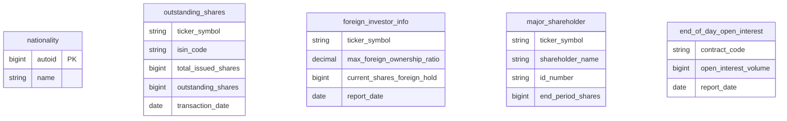
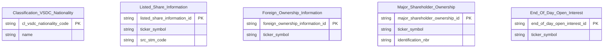

# VSDC HLD — Tier 1

**Source system:** VSDC (Dữ liệu Trung tâm Lưu ký chứng khoán Việt Nam — vùng staging `uat_vsdc_stg`)
**Tier 1:** Entity độc lập — danh mục quốc tịch (Classification) và các bảng báo cáo cấp mã chứng khoán/hợp đồng (cơ cấu cổ phiếu, sở hữu nước ngoài, cổ đông lớn, vị thế mở cuối ngày); không FK đến bảng nghiệp vụ khác

---

## 6a. Bảng tổng quan BCV Concept

| BCV Core Object | BCV Concept | Category | Source Table | Source Table Change Mode | Mô tả bảng nguồn | Atomic Entity | Table Type | BCV Term |
|---|---|---|---|---|---|---|---|---|
| Common | [Common] Nationality | Common | nationality | Append | Danh mục quốc tịch của VSDC: `autoid` (Id), `name` (tên quốc gia) | Classification VSDC Nationality | Classification | (1) Core Object Common theo chỉ định Data Modeler (2026-10-18); BCV không có term "Nationality" — gần nhất `Country` (Location, id 11719) và `Citizenship` (Involved Party). (2) Cấu trúc chỉ có `autoid` + `name` — danh mục thuần, không có instance data → reference data set, promote thành entity thật vì được nhiều entity tham chiếu (investor account, foreign bond portfolio). (3) Table Type Classification; tên entity `Classification VSDC Nationality` theo chỉ định tường minh (ngoại lệ quy tắc #7 — xem 6f T1-01). |
| Documentation | [Documentation] Regulatory Report | Documentation | outstanding_shares | Append | Cơ cấu cổ phiếu theo mã chứng khoán và ngày chốt: tổng phát hành, quỹ, lưu hành, tự do chuyển nhượng, hạn chế chuyển nhượng, biểu quyết, ISIN. Atomic cũng nhận `listed_securities_list` của HNX/HOSE (số lượng niêm yết, giá tham chiếu) | Listed Share Information | Fact Snapshot | (1) BCV term: **Regulatory Report** (Documentation, id 9297) — *"Regulatory Information which is a report on regulations"*. (2) Cấu trúc trường: cơ cấu số lượng cổ phiếu theo mã/ngày (VSDC) và số lượng niêm yết, giá tham chiếu (HNX/HOSE) — bảng báo cáo do Sở/VSDC cung cấp. (3) Theo chỉ định Data Modeler (2026-10-18): Core Object Documentation, table_type Fact Snapshot cho toàn bộ bảng báo cáo VSDC/HNX/HOSE. |
| Documentation | [Documentation] Regulatory Report | Documentation | foreign_investor_info | Append | Sở hữu nước ngoài theo mã chứng khoán và ngày báo cáo: tỷ lệ tối đa, số cổ phiếu tối đa NĐTNN được sở hữu, đang sở hữu, còn lại | Foreign Ownership Information | Fact Snapshot | (1) BCV term: **Regulatory Report** (Documentation, id 9297) — *"Regulatory Information which is a report on regulations"*. (2) Cấu trúc trường: số cổ phiếu và tỷ lệ sở hữu nước ngoài tối đa/hiện tại/còn lại theo mã — bảng báo cáo do Sở/VSDC cung cấp. (3) Theo chỉ định Data Modeler (2026-10-18): Core Object Documentation, table_type Fact Snapshot cho toàn bộ bảng báo cáo VSDC/HNX/HOSE. |
| Involved Party | [Involved Party] Organization Ownership | Involved Party | major_shareholder | Append | Cổ đông lớn theo mã chứng khoán: tên, số giấy tờ, địa chỉ liên hệ, số cổ phiếu và tỷ lệ sở hữu đầu kỳ/cuối kỳ | Major Shareholder Ownership | Fact Snapshot | (1) BCV term: **Organization Ownership** (Involved Party, id 11558) — *"Involved Party who has financial control or administrative control over the Organization"*; ứng viên `Organization Shareholder` (10990). (2) Cấu trúc trường: cổ đông (tên, số giấy tờ, địa chỉ liên hệ) + số cổ phiếu/tỷ lệ sở hữu đầu–cuối kỳ của 1 mã. (3) Core Object Involved Party theo chỉ định Data Modeler (2026-10-18); grain là khoản sở hữu × kỳ nên không tách shared IP entity (Bước 5). |
| Documentation | [Documentation] Regulatory Report | Documentation | end_of_day_open_interest | Append | Khối lượng vị thế mở cuối ngày theo mã hợp đồng phái sinh | End Of Day Open Interest | Fact Snapshot | (1) BCV term: **Regulatory Report** (Documentation, id 9297) — *"Regulatory Information which is a report on regulations"*. (2) Cấu trúc trường: khối lượng vị thế mở cuối ngày theo mã hợp đồng phái sinh — bảng báo cáo do Sở/VSDC cung cấp. (3) Theo chỉ định Data Modeler (2026-10-18): Core Object Documentation, table_type Fact Snapshot cho toàn bộ bảng báo cáo VSDC/HNX/HOSE. |

---

## 6b. Diagram Source (Mermaid)

> Các bảng staging VSDC không khai báo FK; `ticker_symbol` là business key dùng chung nhưng không có bảng master mã chứng khoán trong scope.

---

## 6c. Diagram Atomic (Mermaid)

---

## 6d. Mục Danh mục & Tham chiếu (Reference Data)

| Source Field / Bảng | Mô tả | Scheme Code | source_type | Ghi chú |
|---|---|---|---|---|
| nationality | Danh mục quốc tịch VSDC | (không dùng scheme — entity thật) | source_table | Nâng cấp thành entity `Classification VSDC Nationality` (xem 6a). Entity tiêu thụ (Tier 2) dùng FK/Code theo crosswalk `nationality = autoid`. |

---

## 6e. Bảng chờ thiết kế

| Source Table | Mô tả bảng nguồn | Lý do chưa thiết kế |
|---|---|---|

*(Không có)*

---

## 6f. Điểm cần xác nhận

| # | Câu hỏi | Kết quả |
|---|---|---|
| T1-01 | Tên `Classification VSDC Nationality` chèn tên nguồn "VSDC", trái quy tắc #7 (Domain Prefix `Classification` trần) và `Classification Nationality` (SCMS) đã tồn tại với cùng concept `[Common] Nationality` | Theo chỉ định tường minh của Data Modeler, giữ tên `Classification VSDC Nationality` (physical dự kiến `cl_vsdc_nationality`). Phương án thay thế theo quy tắc: bổ sung `VSDC.nationality` vào `source_table` của `Classification Nationality` (shared entity) — cần xác nhận lại nếu có thay đổi |
| T1-02 | `nationality` có Change Mode `Append` nhưng table_type `Classification` (ETL Upsert) | Cần xác nhận cơ chế nạp: nếu nguồn chỉ append snapshot theo `ds_snpst_dt` thì ETL phải lấy bản mới nhất theo `autoid` |
| T1-03 | `Listed Share Information` gộp 3 bảng (VSDC.outstanding_shares + HNX/HOSE.listed_securities_list) — BK `ticker_symbol`, phân biệt qua `src_stm_code`; các cột chỉ có ở 1 phía (`total_issued_share_quantity…` / `issuer_name, listed_share_quantity, reference_price`) sẽ NULL phía còn lại | Cần xác nhận cách gộp (1 entity nullable) thay vì tách 2 entity |
| T1-04 | Tên vật lý atomic (`listed_share_information`, `foreign_ownership_information`, …) lấy theo `vsdc_atomic.sql` đã duyệt; 3 phân hệ không có domain_prefix | Nếu cần áp quy tắc, đổi ở bước LLD (entity chưa approved) |
