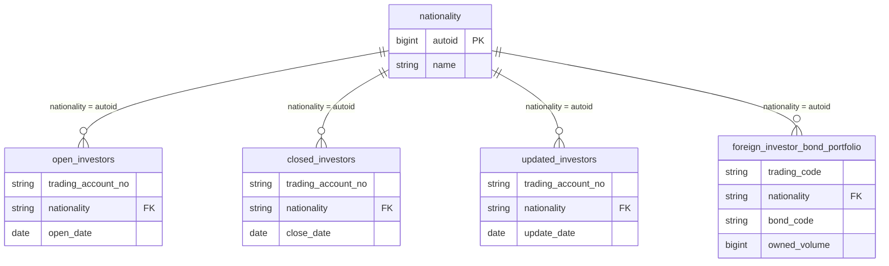
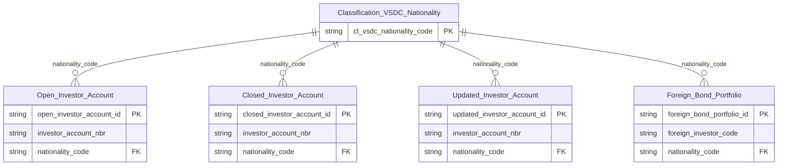

# VSDC HLD — Tier 2

**Source system:** VSDC (Dữ liệu Trung tâm Lưu ký chứng khoán Việt Nam — vùng staging `uat_vsdc_stg`)
**Tier 2:** Entity có tham chiếu danh mục quốc tịch (`nationality` → `Classification VSDC Nationality`, Tier 1): 3 danh sách tài khoản nhà đầu tư theo trạng thái (mở/đóng/thay đổi) và danh mục trái phiếu của NĐTNN

---

## 6a. Bảng tổng quan BCV Concept

| BCV Core Object | BCV Concept | Category | Source Table | Source Table Change Mode | Mô tả bảng nguồn | Atomic Entity | Table Type | BCV Term |
|---|---|---|---|---|---|---|---|---|
| Arrangement | [Arrangement] Trading Account Arrangement | Arrangement | open_investors | Append | Danh sách tài khoản giao dịch mở mới trong kỳ: tên khách hàng, loại hình, mã tài khoản, địa chỉ, số đăng ký sở hữu, ngày cấp, nơi cấp, ngày mở, quốc tịch, điện thoại, email | Open Investor Account | Fact Snapshot | (1) BCV term: **Trading Account Arrangement** (Arrangement, id 7562) — *"Account Arrangement storing information on a group of securities"*; khớp với Concept `Arrangement` đã ghi chú trong `vsdc_atomic.sql`. (2) Cấu trúc: mã tài khoản giao dịch là BK, kèm thông tin chủ tài khoản denormalized và `open_date`. (3) Chọn Trading Account Arrangement; grain = 1 tài khoản × kỳ báo cáo (Fact Snapshot). Tách thành 3 entity độc lập theo trạng thái (xem D-01 Overview). |
| Arrangement | [Arrangement] Trading Account Arrangement | Arrangement | closed_investors | Append | Danh sách tài khoản giao dịch đóng trong kỳ — cùng cấu trúc, thay `open_date` bằng `close_date`, thêm `notes` (ghi chú đóng tài khoản) | Closed Investor Account | Fact Snapshot | Như `Open Investor Account`: Trading Account Arrangement (7562); trạng thái "đóng" nằm ở tên entity, ngày đóng `close_dt`, ghi chú `close_note`. |
| Arrangement | [Arrangement] Trading Account Arrangement | Arrangement | updated_investors | Append | Danh sách tài khoản có thay đổi thông tin trong kỳ — cùng cấu trúc, `update_date` (ngày thay đổi) và `notes` (ghi chú thay đổi) | Updated Investor Account | Fact Snapshot | Như `Open Investor Account`: Trading Account Arrangement (7562); ngày thay đổi `update_dt`, ghi chú `update_note`. |
| Documentation | [Documentation] Regulatory Report | Documentation | foreign_investor_bond_portfolio | Append | Danh mục trái phiếu nắm giữ của nhà đầu tư nước ngoài theo tháng: nhà đầu tư, loại, mã giao dịch, quốc tịch, địa chỉ, đại diện giao dịch, loại NĐT tổ chức, mã trái phiếu, khối lượng sở hữu | Foreign Bond Portfolio | Fact Snapshot | (1) BCV term: **Regulatory Report** (Documentation, id 9297) — *"Regulatory Information which is a report on regulations"*. (2) Cấu trúc trường: danh mục trái phiếu nắm giữ của NĐTNN theo tháng — bảng báo cáo do Sở/VSDC cung cấp. (3) Theo chỉ định Data Modeler (2026-10-18): Core Object Documentation, table_type Fact Snapshot cho toàn bộ bảng báo cáo VSDC/HNX/HOSE. |

---

## 6b. Diagram Source (Mermaid)

> FK `nationality` → `nationality.autoid` là crosswalk theo Data Modeler (cột nguồn STRING, `autoid` BIGINT — cần CAST khi join). Nguồn không khai báo FK vật lý.

---

## 6c. Diagram Atomic (Mermaid)

---

## 6d. Mục Danh mục & Tham chiếu (Reference Data)

| Source Field / Bảng | Mô tả | Scheme Code | source_type | Ghi chú |
|---|---|---|---|---|
| *.nationality | Quốc tịch | (không dùng scheme — FK entity `Classification VSDC Nationality`) | source_table | Crosswalk `nationality = autoid` |

---

## 6e. Bảng chờ thiết kế

| Source Table | Mô tả bảng nguồn | Lý do chưa thiết kế |
|---|---|---|

*(Không có)*

---

## 6f. Điểm cần xác nhận

| # | Câu hỏi | Kết quả |
|---|---|---|
| T2-01 | Cột `nationality` ở 4 bảng nguồn là STRING, `nationality.autoid` là BIGINT | ETL cần CAST và validate không có giá trị non-numeric / không khớp `autoid`. Trước đây mapping dùng cột `nationality_code` kiểu INT; kiểu của `nationality_code` (INT = `autoid`, hay STRING code) cần xác nhận khi làm LLD |
| T2-02 | `foreign_investor_bond_portfolio.nationality` chưa được Data Modeler xác nhận áp dụng crosswalk như 3 bảng investor (mapping hiện kiểu STRING) | Giả định áp dụng crosswalk giống nhau trong HLD này — cần xác nhận |
| T2-03 | 3 bảng investor map thành 3 entity độc lập theo trạng thái thay vì 1 entity + cột trạng thái | Theo quyết định Data Modeler (xem D-01) |
