# DTM_NHNCK_HLD — High Level Design
**Module:** NHNCK — Người hành nghề chứng khoán  
**Phiên bản:** 6.4  
**Ngày:** 27/04/2026 (cập nhật 09/09/2026)  
**Phạm vi:** Tab THỐNG KÊ CHUNG + Tab TRA CỨU HỒ SƠ 360° + Tab DATA EXPLORER
**Thay đổi v6.4 (09/09/2026 — đồng bộ HLD theo `BRD/BA/NHNCK_CodeDriftReport_2026-09-04 1.md`, sau khi LLD/flat-table đã được cập nhật trước đó nhưng HLD bị bỏ sót):** Bổ sung 2 cột kỹ thuật lên `Fact Practitioner Daily Snapshot` (erDiagram tại cả 3 Nhóm dùng chung — 1b/2/4): `First_License_Date` (cột `Violation_Record_Date` đã gỡ 23/10/2026 — Atomic `sp_violation` không còn ngày lập biên bản) (`MIN(issue_dt)` từ `atm_sp_license_certificate_document`). Không khai KPI mới — BA hiện hành không có chỉ tiêu tương ứng ở Nhóm 1b/2/4; giữ làm attribute nền tảng, xem ghi chú tại từng Nhóm.

---

## Section 1 — Data Lineage: Source → Atomic → Data Mart

##### Cụm 1: Chứng chỉ hành nghề — Thống kê tổng hợp (`Fact Practitioner License Certificate Snapshot`)

Phục vụ **Tab THỐNG KÊ CHUNG** — Nhóm 1a (KPI thẻ đếm CCHN theo trạng thái) và Nhóm 3 (Cơ cấu theo loại hình CCHN).

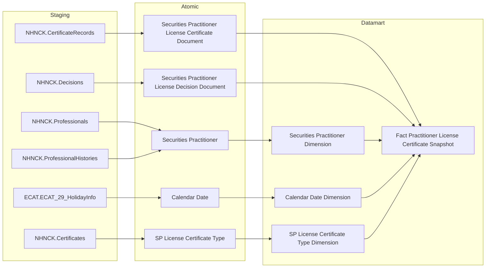

**(Sửa 2026-08)** `Is Reissue Indicator`/`Certificate Issue Date` nay lấy từ `Securities Practitioner License Certificate Document`/`Securities Practitioner License Decision Document` (join qua `issue_sp_license_decision_document_id`, filter Decision Type Code = '1' Cấp mới / '3' Cấp lại) — không còn qua `Securities Practitioner License Application` (xem O_NHNCK_20, O_NHNCK_29).

---

##### Cụm 2: Người hành nghề — Thống kê tổng hợp (`Fact Practitioner Daily Snapshot`)

Phục vụ **Tab THỐNG KÊ CHUNG** — Nhóm 1b (Tổng NHN, Cảnh báo NHNCK), Nhóm 2 (Trình độ chuyên môn), Nhóm 4 (Phân bổ độ tuổi).

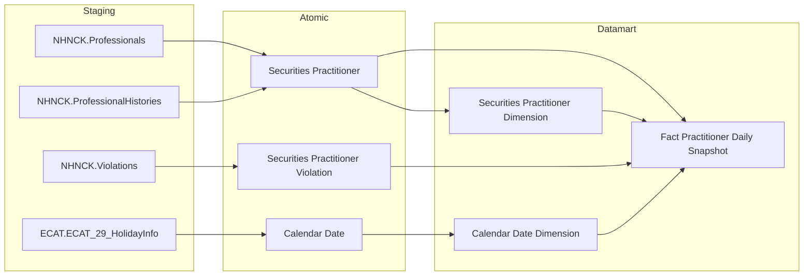

---

##### Cụm 3: Tra cứu NHN 360° — Danh sách & Header (`Operational Practitioner 360 Profile`)

Phục vụ **Tab TRA CỨU HỒ SƠ 360°** — Nhóm 5 (màn hình danh sách tra cứu và header thông tin tổng quát của từng NHN).

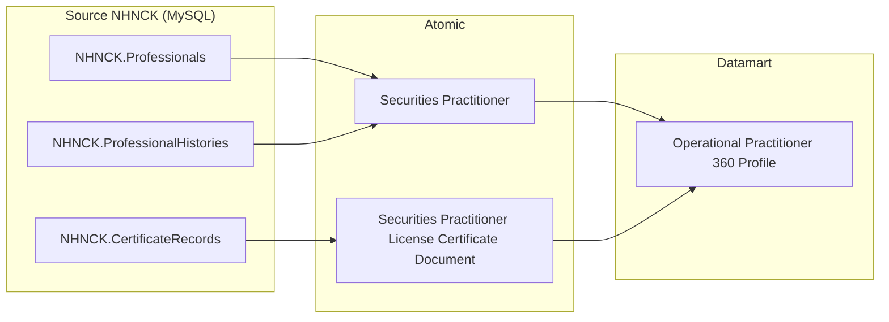

---

##### Cụm 4: Mạng lưới người liên quan (`Operational Practitioner Related Party Profile`)

Phục vụ **Tab TRA CỨU HỒ SƠ 360°** — Nhóm 6 (Mạng lưới người liên quan).

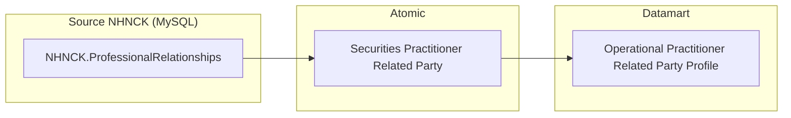

---

##### Cụm 5: Vai trò tại DN niêm yết (`Operational Practitioner Listed Company Role`)

Phục vụ **Tab TRA CỨU HỒ SƠ 360°** — Nhóm 7, panel "Vai trò tại DN niêm yết" (cổ đông cá nhân của DN niêm yết, nguồn SCMS). Panel "Tài khoản" (VSDC) tách sang Cụm 11 (`Operational Practitioner Account Holding`).

> **(Sửa 2026-08-12)** Đổi nguồn từ `NHNCK.OrganizationReports` sang chuỗi SCMS — xem O_NHNCK_34. Chuỗi join qua CCCD (`Involved Party Alternative Identification`) trực tiếp tới `Securities Company Shareholder`, không qua `Securities Company Insider Related Person` — `sc_shareholder.sc_id` đã là FK trực tiếp tới `Securities Company`, không cần entity trung gian. **(Sửa 2026-11-03)** Quyết định 2026-11-02 (driving `Securities Practitioner Organization Employment Report`, O_NHNCK_42) được đảo lại theo BA mới: driving `Securities Company Shareholder` (`sc_shareholder`), grain 1 NHN × 1 bản ghi cổ đông cá nhân của DN niêm yết, lọc `individual_ind = 1`, `listed_ind = 1`, `shares_held` và `sc_short_nm` không NULL — xem O_NHNCK_43.

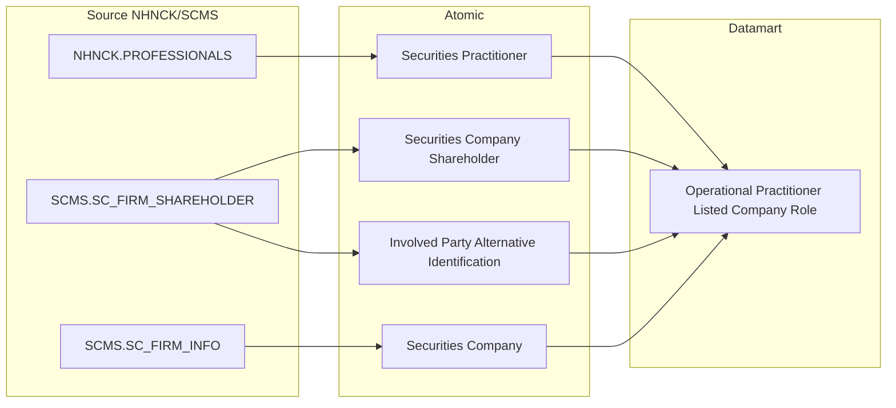

---

##### Cụm 6: Lịch sử cấp CCHN (`Operational Practitioner Certificate History`)

Phục vụ **Tab TRA CỨU HỒ SƠ 360°** — Nhóm 9 (sub-tab Lịch sử cấp chứng chỉ hành nghề).

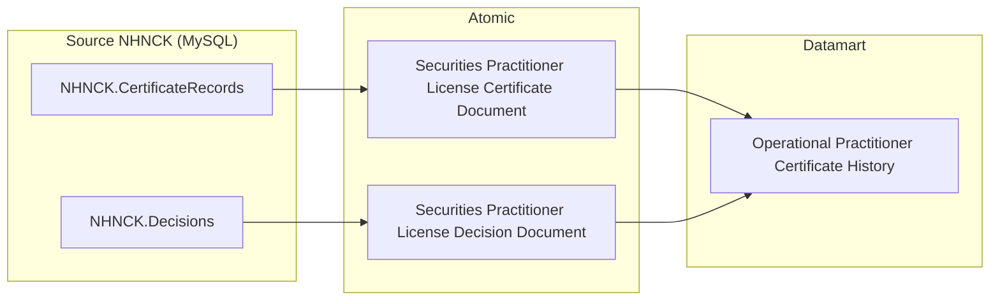

---

##### Cụm 7: Quá trình hành nghề (`Operational Practitioner Employment History`)

Phục vụ **Tab TRA CỨU HỒ SƠ 360°** — Nhóm 8 (sub-tab Quá trình hành nghề).

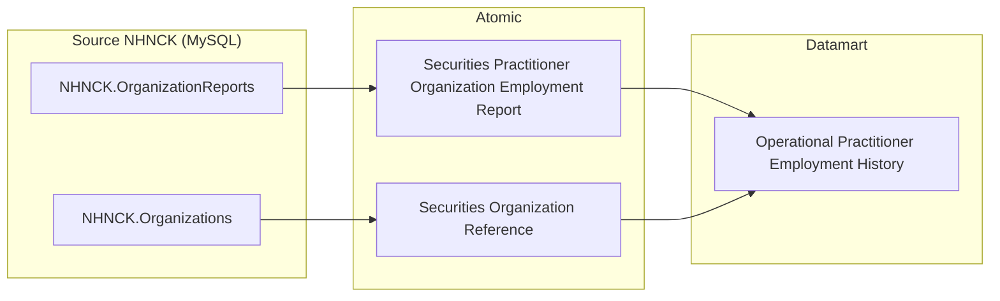

> **Ghi chú Cụm 7:** Nguồn chính từ `NHNCK.OrganizationReports`; join thêm `Securities Organization Reference` để lấy tên tổ chức và phân loại. Không có Atomic entity từ `ProfessionalWorkHistories` trong scope này.

---

##### Cụm 8: Lịch sử vi phạm & xử phạt (`Operational Practitioner Violation History`)

Phục vụ **Tab TRA CỨU HỒ SƠ 360°** — Nhóm 12 (sub-tab Lịch sử vi phạm & xử phạt hành chính).

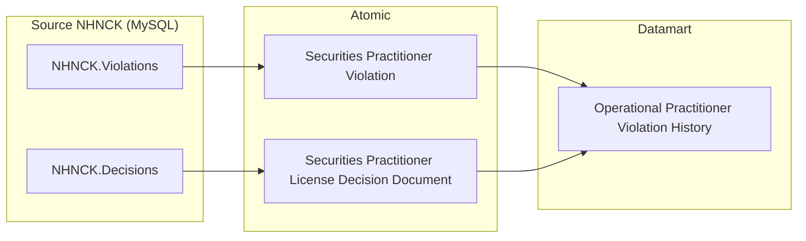

---

##### Cụm 9: Đợt thi sát hạch (`Operational Practitioner Exam History`)

Phục vụ **Tab TRA CỨU HỒ SƠ 360°** — Nhóm 10 (sub-tab Đợt thi sát hạch).

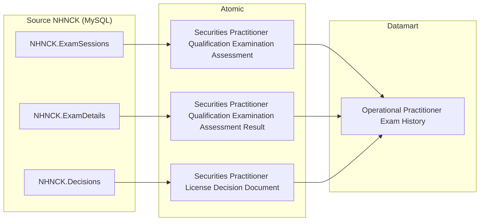

---

##### Cụm 10: Cập nhật kiến thức hành nghề (`Operational Practitioner Training History`)

Phục vụ **Tab TRA CỨU HỒ SƠ 360°** — Nhóm 11 (sub-tab Cập nhật kiến thức hành nghề).

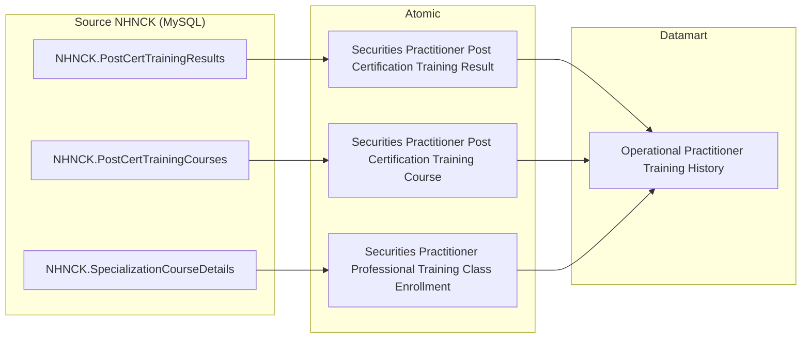

**(Sửa 2026-08)** Driving đổi từ `Securities Practitioner Professional Training Class Enrollment` sang `Securities Practitioner Post Certification Training Result` — theo BA SQL tham khảo mới (xem O_NHNCK_9). Enrollment nay chỉ còn là JOIN phụ qua `sp_code` (fan-out) để lấy Exam Score/Kết quả kiểm tra.

---

##### Cụm 11: Tài khoản và mã CK nắm giữ — Hồ sơ & Danh mục (`Operational Practitioner Account Holding`)

Phục vụ **Tab TRA CỨU HỒ SƠ 360°** — Nhóm 7, panel "Tài khoản" (số tài khoản, tên chủ tài khoản, mã CK nắm giữ chính, số lượng CK VSDC cuối kỳ). Nguồn VSDC: driving `open_investor_account` (tài khoản cá nhân), LEFT JOIN `major_shareholder_ownership` theo `identification_nbr`; NHN nối qua `ip_alternative_identification` (NHNCK_PROFESSIONALS). Grain 1 NHN × 1 tài khoản × (0..n mã CK cổ đông lớn); tách khỏi Cụm 5 để không nhân dòng (O_NHNCK_43).

> **(Sửa 2026-11-07)** Cụm 11 từng là `Operational Practitioner Data Explorer` (Nhóm 13; bãi bỏ 2026-11-03, O_NHNCK_45). Bảng được khôi phục dạng Gold-to-Gold ở Cụm 12 (O_NHNCK_47); Cụm 11 chỉ còn là Account Holding.

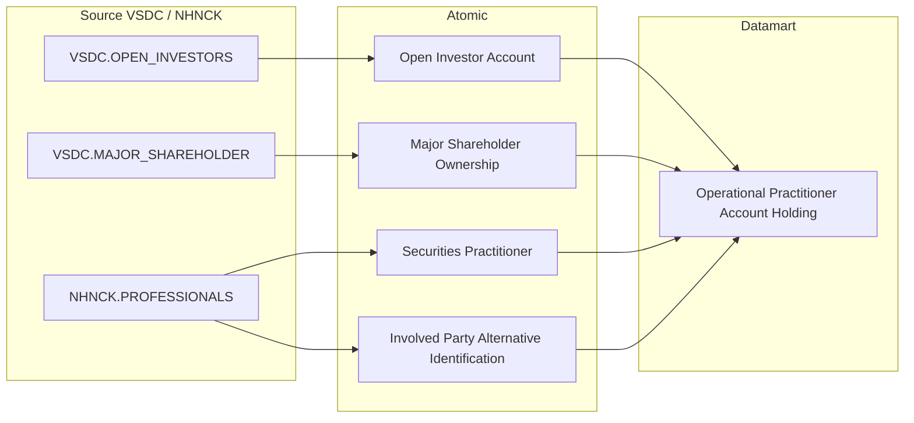

---

##### Cụm 12: Data Explorer — Tra cứu danh sách NHN (`Operational Practitioner Data Explorer`)

Phục vụ **Tab DATA EXPLORER** — Nhóm 13 (bảng tra cứu toàn bộ NHN theo filter Loại chứng chỉ, Trạng thái, Ngày cấp, Loại vi phạm; gồm cả NHN chưa có CCHN nào). (Khôi phục 2026-11-07, O_NHNCK_47) **Gold-to-Gold:** ETL đọc các bảng Datamart đã có — `Operational Practitioner 360 Profile` (driving), Certificate/Employment/Exam/Violation History và `Fact Practitioner Daily Snapshot` (qua `Securities Practitioner Dimension`) — không đọc Atomic, để số liệu khớp Nhóm 1/5/8/9 và không có logic dẫn xuất lặp. Grain: 1 NHN × 1 CCHN × 1 lần thi sát hạch × 1 vi phạm. Bảng chạy sau các bảng nguồn cùng `etl_date`.

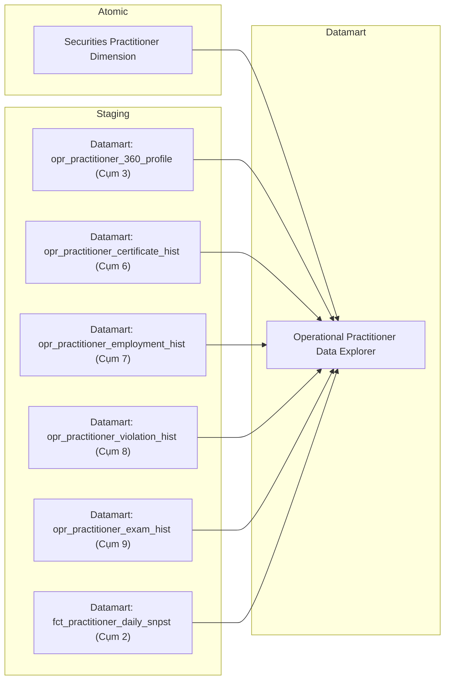

---

## Section 2 — Tổng quan báo cáo

### Tab: THỐNG KÊ CHUNG

**Slicer chung:** Năm (Year) — lấy từ `Calendar Date Dimension`. KPI lũy kế tính đến cuối năm đã chọn; KPI YTD (năm hiện tại) tính từ 01/01 đến today; KPI năm quá khứ tính đến 31/12/Y.

---

#### Nhóm 1a — Chứng chỉ hành nghề — Thống kê tổng hợp (KPI thẻ CCHN)

> Phân loại: **Phân tích**
> Atomic: `Securities Practitioner License Certificate Document` ← NHNCK.CertificateRecords — **READY**
> Atomic: `Securities Practitioner License Decision Document` ← NHNCK.Decisions — **READY**
> Atomic: `Securities Practitioner` ← NHNCK.Professionals / NHNCK.ProfessionalHistories — **READY** (dùng cho K_NHNCK_7)
> Atomic: `SP License Certificate Type` ← NHNCK.CERTIFICATES — **READY**
> Ghi chú: FK đến `SP License Certificate Type Dimension` qua surrogate Id `Certificate_Type_Dimension_Id` — không lưu `Certificate_Type_Code` dư thừa trên Fact (đã xoá 2026-08, filter/display theo loại CCHN phải join Dimension). Certificate Status không lưu trong Fact — staging đã lọc chỉ bản ghi hiệu lực.

**Mockup:**

| KPI thẻ | Giá trị | So sánh cùng kỳ |
|---|---|---|
| Tổng CCHN cấp (phát sinh) | 1,580 CCHN (Cấp mới: 1,290 / Cấp lại: 290) | +13.7% |
| Tổng Số CCHN (lũy kế) | … CCHN | — |
| Thu hồi (lũy kế) | 95 CCHN | +8% |
| Thu hồi cấp lại | 312 CCHN | -12.2% |
| Thu hồi không cấp lại | 98 CCHN | +11.4% |
| Hủy bỏ (lũy kế) | 750 CCHN | -5% |

**Source:** `Fact Practitioner License Certificate Snapshot` → `Securities Practitioner Dimension`, `Calendar Date Dimension`, `SP License Certificate Type Dimension`

**Bảng KPI:**

| KPI ID | Tên KPI | Đơn vị | Tính chất | Công thức | Ghi chú |
|---|---|---|---|---|---|
| K_NHNCK_2 | Tổng CCHN cấp (phát sinh) | CCHN | Phái sinh | COUNT(DISTINCT Certificate Number) WHERE Decision Type = '1' (Cấp mới) AND Issue Date trong năm chọn + COUNT(DISTINCT Certificate Number) WHERE Decision Type = '3' (Cấp lại) AND Issue Date trong năm chọn (= K_NHNCK_2a + K_NHNCK_2b) | (Đổi tên 2026-10-29, BA dòng 10 UAT 27/10 — trước: 'Chứng chỉ cấp mới (YTD)'; kỳ tra cứu Ngày/Tháng/Năm qua :date_from/:date_to, công thức không đổi) (Sửa 2026-08) Đổi nguồn phân loại Cấp mới/Cấp lại từ Application Type sang Decision Type — đúng theo BA join Certificate_Records.REVOCATION_DECISION_ID = DECISIONS.ID, filter DECISION_TYPE_ID. Application Type đo hồ sơ nộp, không phải quyết định đã cấp — có thể lệch khi hồ sơ bị từ chối hoặc đổi loại giữa quy trình xử lý. (Sửa 2026-07-30) Tổng 2 COUNT(DISTINCT...) tách theo nhánh cấp mới/cấp lại — đảm bảo luôn bằng đúng 2a+2b kể cả khi 1 CCHN vừa cấp mới vừa cấp lại trong cùng năm. (Sửa 2026-08 — review `/datamart-review`) BA đổi lại join key từ `REVOCATION_DECISION_ID` sang `ISSUE_DECISION_ID` — xem O_NHNCK_29. Xem O_NHNCK_19, O_NHNCK_20, O_NHNCK_29. Lưu ý khi viết Detail Mapping: viết đủ công thức physical theo 2 nhánh, KHÔNG refer trực tiếp KPI_ID K_NHNCK_2a/2b trong cột `logic` (vi phạm quy tắc DERIVED của datamart-lld-design) |
| K_NHNCK_2a | Cấp mới (lần đầu) | CCHN | Phái sinh | COUNT(DISTINCT Certificate Number) WHERE Decision Type = '1' (Cấp mới) AND Issue Date trong năm chọn | Sub-component của K_NHNCK_2 — đếm số CCHN khác nhau có ít nhất 1 lần cấp mới trong năm |
| K_NHNCK_2b | Cấp lại | CCHN | Phái sinh | COUNT(DISTINCT Certificate Number) WHERE Decision Type = '3' (Cấp lại) AND Issue Date trong năm chọn | Sub-component của K_NHNCK_2 — đếm số CCHN khác nhau có ít nhất 1 lần cấp lại trong năm. Lưu ý: 1 CCHN vừa cấp mới vừa cấp lại trong cùng năm được đếm ở CẢ 2a và 2b (không loại trừ lẫn nhau) — theo thiết kế K_NHNCK_2 = 2a + 2b |
| K_NHNCK_2_YOY | So sánh cùng kỳ — Tổng CCHN cấp (phát sinh) | % | Phái sinh | (K_NHNCK_2[Y] − K_NHNCK_2[Y−1]) / K_NHNCK_2[Y−1] × 100% | (Đổi tên 2026-10-29) |
| K_NHNCK_3 | Thu hồi (lũy kế) | CCHN | Phái sinh | COUNT(DISTINCT Certificate Number) WHERE Certificate Status Code IN ('2','3') AND Revocation Date ≤ cuối kỳ tra cứu | (Đổi 2026-10-29, BA dòng 13 — trước: 'Bị thu hồi', Decision Type = '2') = Thu hồi cấp lại + Thu hồi không cấp lại. Nguồn: `Certificate Status Code` (CERTIFICATE_RECORDS.STATUS) — không còn suy từ Practice Status Code của NHN / Decision Type (O_NHNCK_38). |
| K_NHNCK_3_YOY | So sánh cùng kỳ — Thu hồi (lũy kế) | % | Phái sinh | (K_NHNCK_3[Y] − K_NHNCK_3[Y−1]) / K_NHNCK_3[Y−1] × 100% | (Đổi tên 2026-10-29) |
| K_NHNCK_6 | Thu hồi cấp lại | CCHN | Phái sinh | COUNT(DISTINCT Certificate Number) WHERE Certificate Status Code = '2' AND Revocation Date ≤ cuối kỳ tra cứu | (Đổi 2026-10-29, BA dòng 15 — trước: 'Thu hồi thuộc trường hợp được cấp lại', STATUS_WORK = 2 + Decision Type = '2') CCHN thu hồi thuộc trường hợp được cấp lại. Nguồn: `Certificate Status Code` (CERTIFICATE_RECORDS.STATUS) — không còn suy từ Practice Status Code của NHN / Decision Type (O_NHNCK_38). |
| K_NHNCK_6_YOY | So sánh cùng kỳ — Thu hồi cấp lại | % | Phái sinh | (K_NHNCK_6[Y] − K_NHNCK_6[Y−1]) / K_NHNCK_6[Y−1] × 100% | (Đổi tên 2026-10-29) |
| K_NHNCK_7 | Thu hồi không cấp lại | CCHN | Phái sinh | COUNT(DISTINCT Certificate Number) WHERE Certificate Status Code = '3' AND Revocation Date ≤ cuối kỳ tra cứu | (Đổi 2026-10-29, BA dòng 16 — trước: 'Thu hồi thuộc trường hợp không được cấp lại', STATUS_WORK = 3) CCHN thu hồi không cấp lại. Nguồn: `Certificate Status Code` (CERTIFICATE_RECORDS.STATUS) — không còn suy từ Practice Status Code của NHN / Decision Type (O_NHNCK_38). Vẫn đếm CCHN (không phải NHN) |
| K_NHNCK_7_YOY | So sánh cùng kỳ — Thu hồi không cấp lại | % | Phái sinh | (K_NHNCK_7[Y] − K_NHNCK_7[Y−1]) / K_NHNCK_7[Y−1] × 100% | (Đổi tên 2026-10-29) |
| K_NHNCK_8 | Hủy bỏ (lũy kế) | CCHN | Phái sinh | COUNT(DISTINCT Certificate Number) WHERE Certificate Status Code = '4' AND Revocation Date ≤ cuối kỳ tra cứu | (Đổi 2026-10-29, BA dòng 17 — trước: 'CCHN Đã bị hủy', Decision Type = '6') CCHN đã hủy; một CCHN bị hủy nhiều lần chỉ đếm 1 lần. Nguồn: `Certificate Status Code` (CERTIFICATE_RECORDS.STATUS) — không còn suy từ Practice Status Code của NHN / Decision Type (O_NHNCK_38). |
| K_NHNCK_8_YOY | So sánh cùng kỳ — Hủy bỏ (lũy kế) | % | Phái sinh | (K_NHNCK_8[Y] − K_NHNCK_8[Y−1]) / K_NHNCK_8[Y−1] × 100% | (Đổi tên 2026-10-29) |
| K_NHNCK_130 | Tổng Số CCHN (lũy kế) | CCHN | Phái sinh | COUNT(DISTINCT Certificate Number) WHERE Certificate Issue Date ≤ cuối kỳ tra cứu AND Snapshot Date = 31/12/Y (quá khứ) hoặc MAX(Snapshot Date) trong Y (hiện tại) | (Mới 2026-10-29, BA dòng 9 UAT 27/10 'Bổ sung chỉ tiêu') Tổng số CCHN gồm tất cả các trạng thái lũy kế từ trước đến nay (grain BA = Số CCHN) |

> **[BỎ 2026-10-29 — BA dòng 14 'Bỏ chỉ tiêu']** Chỉ tiêu 'CCHN đang hoạt động (lũy kế)' (ID số 5) và bản so sánh cùng kỳ đã gỡ khỏi HLD và Detail Mapping; ID số 5 không tái sử dụng (như 15, 16).
>
> **Ghi chú KPI:** K_NHNCK_7 đếm **CCHN** (không phải NHN) — nguồn `Professionals.STATUS_WORK='3'` nhưng đếm Certificate_Number. ETL join `securities_practitioner (Practice_Status_Code='3') → sp_license_certificate_document` để lấy danh sách CCHN của các NHN thuộc trường hợp thu hồi không được cấp lại. K_NHNCK_15 và K_NHNCK_16 không sử dụng — gap do điều chỉnh phân loại, không re-number.

**Star Schema — Nhóm 1a (Fact Practitioner License Certificate Snapshot):**

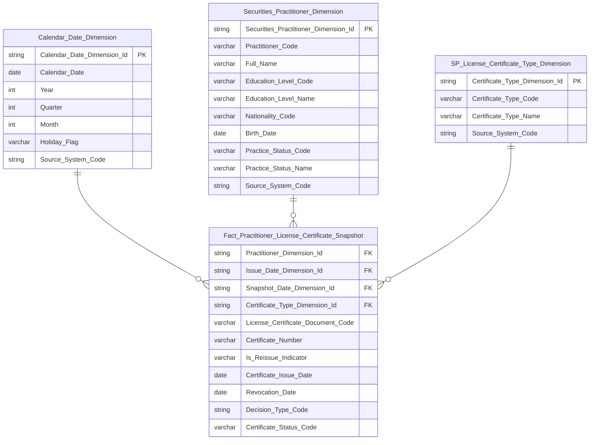

> **Ghi chú erDiagram:** Fact có FK đến `SP_License_Certificate_Type_Dimension` qua `Certificate_Type_Dimension_Id` — (Sửa 2026-08) đã xoá `Certificate_Type_Code` dư thừa khỏi Fact; filter/display theo loại CCHN (K_NHNCK_17–22) phải JOIN Dimension, không đọc trực tiếp trên Fact. Certificate Status không lưu trong Fact — staging đã lọc chỉ bản ghi hiệu lực. `License_Certificate_Document_Code` là DD — business key của **bản ghi** `CERTIFICATE_RECORDS` (1 dòng Fact = 1 lần cấp/cấp lại), KHÔNG phải business key của CCHN — 1 CCHN có thể có nhiều `License_Certificate_Document_Code` khác nhau qua các lần cấp/thu hồi/cấp lại. `Certificate_Number` (Sửa 2026-08, review `/datamart-review` — phát hiện BA đếm `COUNT(DISTINCT Certificate_Number)` trong khi Fact trước đó chỉ có `License_Certificate_Document_Code`) — số CCHN nghiệp vụ thật, `direct` từ `Securities Practitioner License Certificate Document.Certificate Number` (`certificate_nbr`); đây mới là DD dùng để `COUNT(DISTINCT ...)` cho mọi KPI đếm số CCHN (K_NHNCK_2/2a/2b/3/5/6/7/8/17/18/19) — `License_Certificate_Document_Code` giữ vai trò PK/degenerate key của Fact, không dùng làm đơn vị đếm nữa. `Is_Reissue_Indicator` — (Sửa 2026-08, review `/datamart-review`) ETL-derived từ Decision Type (JOIN `Securities Practitioner License Decision Document` qua `issue_sp_license_decision_document_id` — đổi từ `revocation_sp_license_decision_document_id`, xem O_NHNCK_29): Y nếu Decision Type Code = '3' (Cấp lại), N nếu = '1' (Cấp mới), NULL nếu chưa có quyết định — không còn dựa trên Application Type, xem O_NHNCK_20. `Certificate_Issue_Date`/`Issue_Date_Dimension_Id` — (Sửa 2026-08) lấy trực tiếp từ `Securities Practitioner License Certificate Document.Issue Date`, không còn qua Application. `Decision_Type_Code` — Classification Value (scheme: LICENSE_CERTIFICATE_DECISION_TYPE: 2=Thu hồi, 6=Hủy CCHN), NULL nếu chưa có quyết định — không còn dùng cho K_NHNCK_3/6/7/8 từ 2026-10-29 (chỉ còn phân loại cấp mới/cấp lại của K_NHNCK_2). **[MỚI 2026-10-29, BA sau UAT 27/10]** `Certificate_Status_Code` (Classification Value, CERTIFICATE_RECORDS.STATUS: 0=chưa sử dụng, 1=đang sử dụng, 2=thu hồi được cấp lại, 3=thu hồi không cấp lại, 4=đã hủy, 5=hết hạn) phục vụ K_NHNCK_3 (IN 2,3), K_NHNCK_6 (=2), K_NHNCK_7 (=3), K_NHNCK_8 (=4); thay cho cách suy từ `Securities_Practitioner_Dimension.Practice_Status_Code` — O_NHNCK_38. Fact có 2 FK date: `Issue_Date_Dimension_Id` (ngày cấp) và `Snapshot_Date_Dimension_Id` (ngày chụp trạng thái) — cả 2 đều trỏ về `Calendar_Date_Dimension`. (Sửa 2026-07-17) `Allow_Reissue_Indicator` đã loại khỏi schema — K_NHNCK_6 đổi sang dùng `Practice_Status_Code` (join `Securities_Practitioner_Dimension`), xem O_NHNCK_1 (revised).

**Lineage Mart → Báo cáo — Nhóm 1a:**

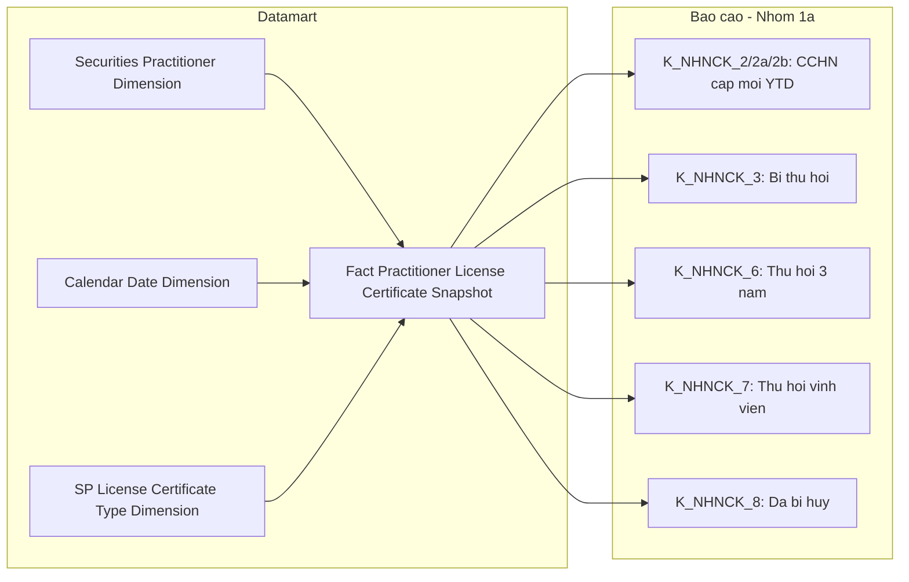

**Bảng grain — Nhóm 1a:**

| Tên bảng | Grain |
|---|---|
| `Fact Practitioner License Certificate Snapshot` | 1 CCHN × 1 tháng snapshot (cuối tháng) |
| `Securities Practitioner Dimension` | 1 NHN per SCD4A (current state) |
| `Calendar Date Dimension` | 1 ngày |
| `SP License Certificate Type Dimension` | 1 loại CCHN per SCD4A (current state) |

---

#### Nhóm 1b — Người hành nghề — Thống kê tổng hợp (KPI thẻ NHN)

> Phân loại: **Phân tích**
> Atomic: `Securities Practitioner` ← NHNCK.Professionals / NHNCK.ProfessionalHistories — **READY**
> Atomic: `Securities Practitioner Violation` ← NHNCK.Violations — **READY** (chỉ còn phục vụ Nhóm 12; K_NHNCK_4 không còn dùng)
> Atomic: `Securities Practitioner Organization Employment Report` ← NHNCK.OrganizationReports — **READY** (K_NHNCK_120/122/126)
> Atomic: `Securities Practitioner Post Certification Training Result` ← NHNCK.PostCertTrainingResults — **READY** (K_NHNCK_121)
> Atomic: `Securities Practitioner License Certificate Document` ← NHNCK.CertificateRecords — **READY** (K_NHNCK_121/122, First License Date)

**Mockup:**

| KPI thẻ | Giá trị | So sánh cùng kỳ |
|---|---|---|
| Tổng người hành nghề | 21,340 NHN | +7.7% |
| Cảnh báo NHNCK (= LV đồng thời + Không đáp ứng tập huấn + Không hành nghề 3 năm) | 148 NHN | +8.8% |
| LV đồng thời tại 2 TCSD NHN / Không đáp ứng yêu cầu tập huấn tối thiểu / Không hành nghề 3 năm liên tục | 40 / 78 / 30 NHN | — |
| VN / NN; Tổng NHNCK đang hành nghề / chưa hành nghề | … | — |

**Source:** `Fact Practitioner Daily Snapshot` → `Securities Practitioner Dimension`, `Calendar Date Dimension`

**Bảng KPI:**

| KPI ID | Tên KPI | Đơn vị | Tính chất | Công thức | Ghi chú |
|---|---|---|---|---|---|
| K_NHNCK_1 | Tổng người được cấp CCHN (lũy kế) | NHN | Phái sinh | COUNT(DISTINCT Practitioner Code) WHERE First License Date ≤ Snapshot Date AND Snapshot Date = :report_end_dt (MAX(Snapshot Date) ≤ ngày tra cứu / cuối tháng / cuối năm) | (Đổi 2026-10-29, BA sau UAT 27/10 — đổi tên từ 'Tổng người hành nghề', dòng BA 4) Tổng NHN có ít nhất 1 CCHN lũy kế đến ngày cuối kỳ tra cứu (BA: Professionals JOIN Certificate_Records, issue_date ≤ ngày tra cứu) — dùng `First_License_Date` có sẵn, không đếm NHN chưa từng có CCHN. Kỳ tra cứu Ngày/Tháng/Năm (xem O_NHNCK_35). Giá trị trước đây (đếm mọi NHN trong Professionals, O_NHNCK xác nhận 2026-07-17) bị thay bằng rule mới của BA |
| K_NHNCK_1_YOY | So sánh cùng kỳ — Tổng NHN | % | Phái sinh | (K_NHNCK_1[:report_end_dt] − K_NHNCK_1[:report_end_dt_py]) / K_NHNCK_1[:report_end_dt_py] × 100% | (Đổi 2026-10-29) So sánh với cùng ngày năm trước thay cho năm Y−1 |
| K_NHNCK_4 | Cảnh báo NHNCK | NHN | Phái sinh | COUNT(DISTINCT Practitioner Code WHERE LV Đồng Thời Indicator = 'Y') + COUNT(DISTINCT … WHERE Insufficient Training Indicator = 'Y') + COUNT(DISTINCT … WHERE No Practice 3 Years Indicator = 'Y'), tại Snapshot Date = :report_end_dt (= K_NHNCK_120 + K_NHNCK_121 + K_NHNCK_122) | (ĐỔI RULE 2026-10-29, BA dòng 18 'Thay đổi rule') Cảnh báo NHNCK = số NHN có vi phạm lũy kế = Tổng (LV đồng thời tại 2 TCSD NHN + Không đáp ứng yêu cầu tập huấn tối thiểu + Không hành nghề 3 năm liên tục). Công thức cộng 3 chỉ tiêu nên NHN vi phạm nhiều loại bị đếm nhiều lần (theo BA). Không còn dùng `Has_Active_Violation` (vi phạm bản ghi Violations) — cột giữ lại ở Fact nhưng 0 KPI dùng. Xem O_NHNCK_35 |
| K_NHNCK_4_YOY | So sánh cùng kỳ — Cảnh báo | % | Phái sinh | (Cảnh báo[:report_end_dt] − Cảnh báo[:report_end_dt_py]) / Cảnh báo[:report_end_dt_py] × 100%, Cảnh báo = số NHN có ít nhất 1 trong 3 loại vi phạm | (Đổi 2026-10-29) Dùng OR 3 Indicator (không đếm trùng NHN) thay vì tổng 3 loại — chờ BA xác nhận, O_NHNCK_35 |
| K_NHNCK_120 | LV đồng thời tại 2 TCSD NHN | NHN | Phái sinh | COUNT(DISTINCT Practitioner Code) WHERE Concurrent Employment Indicator = 'Y' AND Snapshot Date = :report_end_dt | (Mới 2026-10-29, BA dòng 19, UAT 27/10 'Bổ sung chỉ tiêu') NHN làm việc đồng thời tại ≥ 2 tổ chức sử dụng NHN khác nhau (kỳ làm việc giao nhau) trong cửa sổ lũy kế từ 01/01 của năm đến ngày tra cứu; báo cáo tổ chức đã xác nhận. Nguồn Atomic `Securities Practitioner Organization Employment Report`. Cũng là giá trị slicer 'Loại vi phạm' của Nhóm 13 (K_NHNCK_123). O_NHNCK_35 |
| K_NHNCK_121 | Không đáp ứng yêu cầu tập huấn tối thiểu | NHN | Phái sinh | COUNT(DISTINCT Practitioner Code) WHERE Insufficient Training Indicator = 'Y' AND Snapshot Date = :report_end_dt | (Mới 2026-10-29, BA dòng 20) NHN không đủ 8 giờ cập nhật kiến thức/năm (Σ Training Hours Hoàn thành từ 01/01 đến ngày tra cứu < 8; miễn nếu chỉ có 1 CCHN cấp trong năm; chỉ xét NHN có CCHN còn hiệu lực cấp trước 01/01). Nguồn Atomic `Securities Practitioner Post Certification Training Result` + `Securities Practitioner License Certificate Document`. O_NHNCK_35. (BA 2026-11-03) BA đổi biên trên cửa sổ tập huấn `DEN_NGAY` sang `NGAY_TRA_CUU + 1` / đầu tháng sau / đầu năm sau (bản cũ `TRUNC(ngày,'YYYY')` cho kỳ Ngày là lỗi biên) nhưng Mô tả BA vẫn là 'lũy kế từ 01/01 đến ngày tra cứu' → giữ `training_end_dt` ≤ ngày snapshot (Mô tả ưu tiên SQL, H10); chờ BA xác nhận — O_NHNCK_46 |
| K_NHNCK_122 | Không hành nghề 3 năm liên tục | NHN | Phái sinh | COUNT(DISTINCT Practitioner Code) WHERE No Practice 3 Years Indicator = 'Y' AND Snapshot Date = :report_end_dt | (Mới 2026-10-29, BA dòng 21) NHN không làm việc tại CTCK/CTQLQ 3 năm liên tục: không có kỳ làm việc hiện tại và (nghỉ đủ 3 năm kể từ ngày kết thúc gần nhất, hoặc khoảng trống giữa hai kỳ ≥ 3 năm, hoặc chưa từng có báo cáo tổ chức và CCHN cấp đủ 3 năm). O_NHNCK_35 |
| K_NHNCK_124 | VN | NHN | Phái sinh | COUNT(DISTINCT Practitioner Code) WHERE Nationality Code = 'VN' AND First License Date ≤ Snapshot Date AND Snapshot Date = :report_end_dt | (Mới 2026-10-29, BA dòng 5) Tổng NHN có ít nhất 1 CCHN và quốc tịch Việt Nam |
| K_NHNCK_125 | NN | NHN | Phái sinh | COUNT(DISTINCT Practitioner Code) WHERE Nationality Code IS NOT NULL AND ≠ 'VN' AND First License Date ≤ Snapshot Date AND Snapshot Date = :report_end_dt | (Mới 2026-10-29, BA dòng 6) Tổng NHN có ít nhất 1 CCHN và quốc tịch nước ngoài (BA CASE: khác 'VN' → NUOC_NGOAI) |
| K_NHNCK_126 | Tổng NHNCK đang hành nghề | NHN | Phái sinh | COUNT(DISTINCT Practitioner Code) WHERE First License Date ≤ Snapshot Date AND Practicing Indicator = 'Y' AND Snapshot Date = :report_end_dt | (Mới 2026-10-29, BA dòng 7) NHN có ít nhất 1 CCHN và đang hành nghề tại 1 tổ chức. BA SQL có `(HIRE_DATE IS NOT NULL OR HIRE_DATE <= ngày)` — thiết kế dùng AND (đã vào làm trước ngày tra cứu); nhánh `STATUS_WORK = '1'` của BA giữ. O_NHNCK_36 |
| K_NHNCK_127 | Tổng NHNCK chưa hành nghề | NHN | Phái sinh | K_NHNCK_1 − K_NHNCK_126 (COUNT(DISTINCT … WHERE First License Date ≤ Snapshot Date) − COUNT(DISTINCT … WHERE First License Date ≤ Snapshot Date AND Practicing Indicator = 'Y')) | (Mới 2026-10-29, BA dòng 8) = Tổng người được cấp CCHN (lũy kế) − Tổng NHNCK đang hành nghề |

**Star Schema — Nhóm 1b (Fact Practitioner Daily Snapshot):**

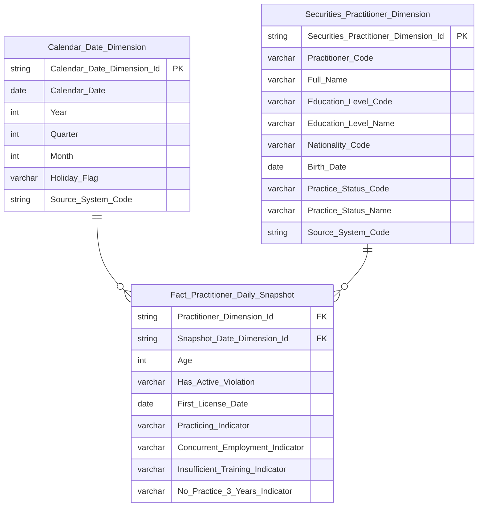

> **Ghi chú erDiagram:**
> - `Has_Active_Violation` = ETL-derived Indicator (Y/N): Y nếu NHN có ít nhất 1 bản ghi `Conduct Violation` (bất kỳ), N nếu không có — bám sát SQL BA gốc (`JOIN Violations`, không filter trạng thái). Phục vụ K_NHNCK_4 (filter = 'Y'). (Sửa 2026-07-17: đổi từ boolean sang Y/N cho đúng data domain Indicator; Sửa 2026-07-21: bỏ mô tả "đang active" — Atomic `sp_violation` không có field trạng thái vi phạm và SQL BA cũng không yêu cầu lọc, xem O_NHNCK_5)
> - **[GỠ 2026-10-23 — Atomic chốt]** Cột `Violation_Record_Date` đã gỡ khỏi `Fact Practitioner Daily Snapshot`: Atomic `sp_violation` (NHNCK.VIOLATIONS) không còn ngày lập biên bản vi phạm; 0 KPI dùng cột này. Không đổi logic K_NHNCK_4.
> - **[MỚI 2026-09-08, đồng bộ code↔design]** `First_License_Date` = ETL-derived Date, `MIN(Issue Date)` từ `License Certificate Document` (lọc `Source System Code='NHNCK_CERTIFICATE_RECORDS'`, `Record Status='ACTIVE'`) GROUP BY NHN — Ngày cấp CCHN đầu tiên. Chưa gắn KPI/dashboard nào trong BA hiện hành (BA không có dòng con nào yêu cầu chỉ tiêu này ở Nhóm 1b/2/4) — giữ làm attribute nền tảng, cần BA xác nhận nếu muốn khai KPI mới (VD: thâm niên hành nghề). Xem `BRD/BA/NHNCK_CodeDriftReport_2026-09-04 1.md`
> - `Age` = ETL-derived: Year(Snapshot_Date) − Year(Birth_Date). Phục vụ Nhóm 4.
> - **[MỚI 2026-10-29, BA sau UAT 27/10/2026]** 4 cột Indicator Y/N tính theo ngày snapshot (as-of, cửa sổ lũy kế từ 01/01 của năm snapshot): `Practicing_Indicator` (đang hành nghề tại 1 tổ chức — K_NHNCK_126/127), `Concurrent_Employment_Indicator` (LV đồng thời tại 2 TCSD NHN — K_NHNCK_120), `Insufficient_Training_Indicator` (không đủ 8 giờ cập nhật kiến thức/năm — K_NHNCK_121), `No_Practice_3_Years_Indicator` (không hành nghề 3 năm liên tục — K_NHNCK_122); `Has_Active_Violation` không còn KPI dùng (K_NHNCK_4 đổi sang tổng 3 loại vi phạm). Dev cần ETL + ALTER flat + nạp lại lịch sử nếu tra cứu kỳ quá khứ. Xem O_NHNCK_35, O_NHNCK_36.

**Lineage Mart → Báo cáo — Nhóm 1b:**

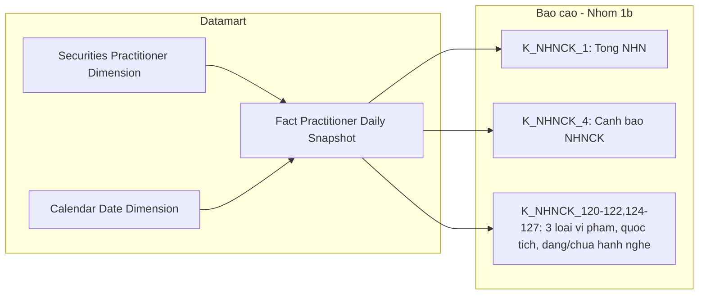

**Bảng grain — Nhóm 1b:**

| Tên bảng | Grain |
|---|---|
| `Fact Practitioner Daily Snapshot` | 1 NHN × 1 ngày snapshot |
| `Securities Practitioner Dimension` | 1 NHN per SCD4A (current state) |
| `Calendar Date Dimension` | 1 ngày |

---

#### Nhóm 2 — Biểu đồ Trình độ chuyên môn

> Phân loại: **Phân tích**
> Atomic: `Securities Practitioner` ← NHNCK.Professionals / NHNCK.ProfessionalHistories — **READY**

**Source:** `Fact Practitioner Daily Snapshot` → `Securities Practitioner Dimension`, `Calendar Date Dimension`

**Mockup:**

| Trình độ | Số NHN | Tỷ lệ |
|---|---|---|
| Tiến sĩ | 450 | 2.1% |
| Thạc sĩ | 5,200 | 24.4% |
| Đại học (gồm Cử nhân, Kỹ sư) | 15,690 | 73.5% |
| Khác | … | … |

**Bảng KPI:**

| KPI ID | Tên KPI | Đơn vị | Tính chất | Công thức | Ghi chú |
|---|---|---|---|---|---|
| K_NHNCK_9 | Số lượng NHN Tiến sĩ | Người | Base | COUNT(DISTINCT Dim.Practitioner Code) WHERE Dim.Education Level Code = 'Tiến sĩ' AND Snapshot_Date = 31/12/Y (quá khứ) hoặc MAX(Snapshot_Date) trong Y (hiện tại) | (Sửa 2026-08) Đổi code từ 'DOCTORATE' (bịa, không tồn tại) sang giá trị thật 'Tiến sĩ' — Atomic lưu cl_code trực tiếp bằng tiếng Việt, không phải code tiếng Anh. Xem O_NHNCK_21 |
| K_NHNCK_10 | Số lượng NHN Thạc sĩ | Người | Base | COUNT(DISTINCT Dim.Practitioner Code) WHERE Dim.Education Level Code = 'Thạc sĩ' AND Snapshot_Date = 31/12/Y (quá khứ) hoặc MAX(Snapshot_Date) trong Y (hiện tại) | (Sửa 2026-08) Đổi code từ 'MASTER' (bịa) sang giá trị thật 'Thạc sĩ'. Xem O_NHNCK_21 |
| K_NHNCK_11 | Số lượng NHN Đại học | Người | Base | COUNT(DISTINCT Dim.Practitioner Code) WHERE Dim.Education Level Code IN ('Đại học','Cử nhân','Kỹ sư') AND First License Date ≤ Snapshot_Date AND Snapshot_Date = 31/12/Y (quá khứ) hoặc MAX(Snapshot_Date) trong Y (hiện tại) | (Đổi 2026-10-29, BA dòng 24 'Thay đổi Rule' — CTE trinh_do: Đại học = ('Đại học','Cử nhân','Kỹ sư'), thay cho 'CHỈ tính đúng Đại học, KHÔNG gộp Cử nhân' của 2026-08) Cử nhân/Kỹ sư nay gộp vào Đại học; Thạc sỹ/Tiến sỹ khớp theo hậu tố; còn lại = Khác (K_NHNCK_128). Cả 3 KPI K_NHNCK_9–11 chỉ tính NHN đã có ít nhất 1 CCHN (First License Date ≤ snapshot) theo BA. BA viết 'sỹ' còn Atomic 'sĩ' → chấp nhận cả hai, xem O_NHNCK_37 |
| K_NHNCK_12 | Tỷ lệ Tiến sĩ | % | Derived | K_NHNCK_9 / K_NHNCK_1 × 100% | |
| K_NHNCK_13 | Tỷ lệ Thạc sĩ | % | Derived | K_NHNCK_10 / K_NHNCK_1 × 100% | |
| K_NHNCK_14 | Tỷ lệ Đại học | % | Derived | K_NHNCK_11 / K_NHNCK_1 × 100% | |
| K_NHNCK_128 | Số lượng khác | Người | Base | COUNT(DISTINCT Dim.Practitioner Code) WHERE Dim.Education Level Code KHÔNG thuộc (Tiến sĩ/sỹ, Thạc sĩ/sỹ, Đại học, Cử nhân, Kỹ sư) AND First License Date ≤ Snapshot_Date AND Snapshot_Date = 31/12/Y (quá khứ) hoặc MAX(Snapshot_Date) trong Y (hiện tại) | (Mới 2026-10-29, BA dòng 25 'Bổ sung chỉ tiêu') NHN trình độ khác = ELSE của CTE trinh_do. O_NHNCK_37 |
| K_NHNCK_129 | Tỷ lệ khác (%) | % | Derived | K_NHNCK_128 / K_NHNCK_1 × 100% | (Mới 2026-10-29, BA dòng 29 'Bổ sung chỉ tiêu') 'Hệ thống tự tính'; K_NHNCK_12–14 và K_NHNCK_129 cộng lại = 100% khi mẫu số = Tổng người được cấp CCHN |

**Star Schema — Nhóm 2 (Fact Practitioner Daily Snapshot):**


> **Ghi chú Fact Practitioner Daily Snapshot:**
> - Grain ngày: ETL append 1 row per NHN mỗi ngày. Slicer "chọn năm Y" = filter `Snapshot_Date = 31/12/Y` (năm quá khứ) hoặc `Snapshot_Date = MAX(Snapshot_Date) WHERE Year = Y` (năm hiện tại = ngày mới nhất có dữ liệu).
> - `Age` = ETL-derived int = Year(Snapshot_Date) − Year(Birth_Date), tính từ `ProfessionalHistories.BirthDate`. Presentation layer tự nhóm thành age bands.
> - `Has_Active_Violation` = ETL-derived Indicator (Y/N): Y nếu NHN có ít nhất 1 bản ghi `Conduct Violation` (bất kỳ), N nếu không có — bám sát SQL BA gốc (`JOIN Violations`, không filter trạng thái). Xem O_NHNCK_5. Phục vụ K_NHNCK_4 (filter = 'Y'). (Sửa 2026-07-17: đổi từ boolean sang Y/N; Sửa 2026-07-21: bỏ mô tả "Violation_Status_Code=1 (ACTIVE)" — Atomic không có field này và SQL BA cũng không yêu cầu lọc trạng thái)
> - **[GỠ 2026-10-23 — Atomic chốt]** Cột `Violation_Record_Date` đã gỡ khỏi `Fact Practitioner Daily Snapshot`: Atomic `sp_violation` (NHNCK.VIOLATIONS) không còn ngày lập biên bản vi phạm; 0 KPI dùng cột này. Không đổi logic K_NHNCK_4.
> - **[MỚI 2026-09-08, đồng bộ code↔design]** `First_License_Date` = ETL-derived Date, `MIN(Issue Date)` từ `License Certificate Document` (lọc `Source System Code='NHNCK_CERTIFICATE_RECORDS'`, `Record Status='ACTIVE'`) GROUP BY NHN — Ngày cấp CCHN đầu tiên. Chưa gắn KPI/dashboard nào trong BA hiện hành (BA không có dòng con nào yêu cầu chỉ tiêu này ở Nhóm 1b/2/4) — giữ làm attribute nền tảng, cần BA xác nhận nếu muốn khai KPI mới (VD: thâm niên hành nghề). Xem `BRD/BA/NHNCK_CodeDriftReport_2026-09-04 1.md`
> - Thông tin Education_Level_Code/Name, Nationality_Code, Practitioner_Code, Practice_Status_Code/Name đọc qua JOIN `Securities Practitioner Dimension`. (Bổ sung 2026-08) `Education_Level_Name`/`Practice_Status_Name` — ETL-derived, denormalize từ Classification tại thời điểm populate Dimension; không gắn KPI riêng, chỉ là metadata mô tả bổ sung theo coverage rule cho Dimension.

**Lineage Mart → Báo cáo — Nhóm 2:**

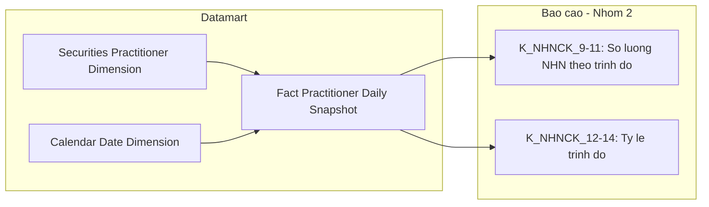

**Bảng grain — Nhóm 2:**

| Tên bảng | Grain |
|---|---|
| `Fact Practitioner Daily Snapshot` | 1 NHN × 1 ngày snapshot |
| `Securities Practitioner Dimension` | 1 NHN per SCD4A (current state) |
| `Calendar Date Dimension` | 1 ngày |

---

#### Nhóm 3 — Biểu đồ cơ cấu theo loại hình CCHN

> Phân loại: **Phân tích**
> Atomic: `Securities Practitioner License Certificate Document` ← NHNCK.CertificateRecords — **READY**
> Ghi chú: Dùng chung `Fact Practitioner License Certificate Snapshot` với Nhóm 1 — không thiết kế bảng mới.

**Source:** `Fact Practitioner License Certificate Snapshot` → `Securities Practitioner Dimension`, `Calendar Date Dimension`, `SP License Certificate Type Dimension`

**Bảng KPI:**

| KPI ID | Tên KPI | Đơn vị | Tính chất | Công thức | Ghi chú |
|---|---|---|---|---|---|
| K_NHNCK_17 | Số lượng CCHN là Môi giới | CCHN | Base | COUNT(DISTINCT Certificate Number) WHERE (JOIN SP License Certificate Type Dimension qua Certificate Type Dimension Id) Certificate Type Code = 'MGCK' AND Snapshot Date = 31/12/Y (quá khứ) hoặc MAX(Snapshot_Date) trong Y (hiện tại) — staging đã lọc bản ghi hiệu lực | (Sửa 2026-08) Filter qua Dimension, không đọc trực tiếp Certificate Type Code trên Fact (cột đã xoá) |
| K_NHNCK_18 | Số lượng CCHN là Phân tích | CCHN | Base | COUNT(DISTINCT Certificate Number) WHERE (JOIN SP License Certificate Type Dimension qua Certificate Type Dimension Id) Certificate Type Code = 'PTTC' AND Snapshot Date = 31/12/Y (quá khứ) hoặc MAX(Snapshot_Date) trong Y (hiện tại) — staging đã lọc bản ghi hiệu lực | (Sửa 2026-08) Filter qua Dimension, không đọc trực tiếp Certificate Type Code trên Fact (cột đã xoá) |
| K_NHNCK_19 | Số lượng CCHN là QLQ | CCHN | Base | COUNT(DISTINCT Certificate Number) WHERE (JOIN SP License Certificate Type Dimension qua Certificate Type Dimension Id) Certificate Type Code = 'QLQ' AND Snapshot Date = 31/12/Y (quá khứ) hoặc MAX(Snapshot_Date) trong Y (hiện tại) — staging đã lọc bản ghi hiệu lực | (Sửa 2026-08) Filter qua Dimension, không đọc trực tiếp Certificate Type Code trên Fact (cột đã xoá) |
| K_NHNCK_20 | Tỷ lệ CCHN Môi giới | % | Derived | K_NHNCK_17 / K_NHNCK_130 × 100% | (Đổi 2026-10-29) Mẫu số đổi từ chỉ tiêu 'CCHN đang hoạt động' (ID số 5, bị BA bỏ) sang K_NHNCK_130 'Tổng Số CCHN (lũy kế)' — khớp SQL BA `COUNT / SUM(COUNT) OVER ()` (tổng mọi loại hình); Detail Mapping đã dùng tổng CCHN từ trước |
| K_NHNCK_21 | Tỷ lệ CCHN Phân tích | % | Derived | K_NHNCK_18 / K_NHNCK_130 × 100% | (Đổi 2026-10-29) Mẫu số đổi từ chỉ tiêu 'CCHN đang hoạt động' (ID số 5, bị BA bỏ) sang K_NHNCK_130 'Tổng Số CCHN (lũy kế)' — khớp SQL BA `COUNT / SUM(COUNT) OVER ()` (tổng mọi loại hình); Detail Mapping đã dùng tổng CCHN từ trước |
| K_NHNCK_22 | Tỷ lệ CCHN QLQ | % | Derived | K_NHNCK_19 / K_NHNCK_130 × 100% | (Đổi 2026-10-29) Mẫu số đổi từ chỉ tiêu 'CCHN đang hoạt động' (ID số 5, bị BA bỏ) sang K_NHNCK_130 'Tổng Số CCHN (lũy kế)' — khớp SQL BA `COUNT / SUM(COUNT) OVER ()` (tổng mọi loại hình); Detail Mapping đã dùng tổng CCHN từ trước |

**Star Schema — Nhóm 3 (Fact Practitioner License Certificate Snapshot):**


> **Ghi chú erDiagram Nhóm 3:** Dùng chung schema với Nhóm 1a. Fact có FK đến `SP_License_Certificate_Type_Dimension` (không dùng `Classification_Dimension`): `Certificate_Type_Dimension_Id` — chiều lọc chính cho KPI K_NHNCK_17–22, JOIN Dimension để lấy `Certificate_Type_Code` (Sửa 2026-08: đã xoá khỏi Fact, không còn lưu dư thừa). Không có trường trạng thái CCHN — staging đã lọc chỉ bản ghi hiệu lực. `Certificate_Number` (Sửa 2026-08, xem ghi chú Nhóm 1a) — DD dùng để `COUNT(DISTINCT ...)` cho K_NHNCK_17/18/19, thay cho `License_Certificate_Document_Code` (chỉ là PK/degenerate key của bản ghi, không phải business key của CCHN).

**Lineage Mart → Báo cáo — Nhóm 3:**

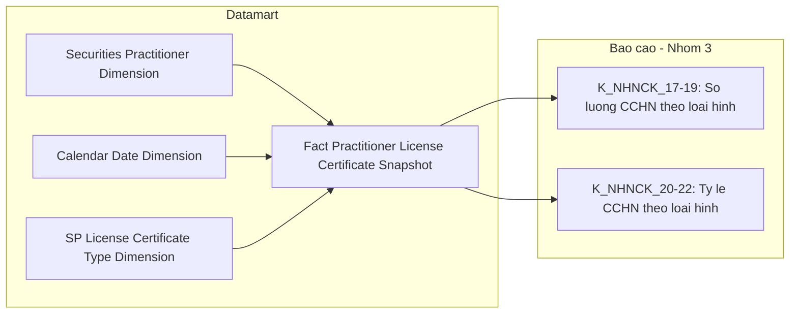

**Bảng grain — Nhóm 3:**

| Tên bảng | Grain |
|---|---|
| `Fact Practitioner License Certificate Snapshot` | 1 CCHN × 1 tháng snapshot (cuối tháng) — dùng chung với Nhóm 1 |
| `SP License Certificate Type Dimension` | 1 loại CCHN per SCD4A (current state) |

---

#### Nhóm 4 — Biểu đồ Phân bổ độ tuổi

> Phân loại: **Phân tích**
> Atomic: `Securities Practitioner` ← NHNCK.Professionals / NHNCK.ProfessionalHistories — **READY**

**Source:** `Fact Practitioner Daily Snapshot` → `Securities Practitioner Dimension`, `Calendar Date Dimension`

**Mockup:**

| Nhóm tuổi | Quốc tịch VN | Nước ngoài |
|---|---|---|
| 18–21 | 120 | 5 |
| 22–30 | 4,500 | 85 |
| 31–40 | 9,800 | 210 |
| 41–50 | 5,200 | 180 |
| 50+ | 1,200 | 40 |

**Bảng KPI:**

| KPI ID | Tên KPI | Đơn vị | Tính chất | Công thức | Ghi chú |
|---|---|---|---|---|---|
| K_NHNCK_23 | Số NHN 18–21 quốc tịch VN | Người | Base | COUNT(DISTINCT Dim.Practitioner Code) WHERE Age BETWEEN 18 AND 21 AND Dim.Nationality Code = 'VN' AND Snapshot_Date = 31/12/Y (quá khứ) hoặc MAX(Snapshot_Date) trong Y (hiện tại) |  |
| K_NHNCK_24 | Số NHN 22–30 quốc tịch VN | Người | Base | COUNT(DISTINCT Dim.Practitioner Code) WHERE Age BETWEEN 22 AND 30 AND Dim.Nationality Code = 'VN' AND Snapshot_Date = 31/12/Y (quá khứ) hoặc MAX(Snapshot_Date) trong Y (hiện tại) |  |
| K_NHNCK_25 | Số NHN 31–40 quốc tịch VN | Người | Base | COUNT(DISTINCT Dim.Practitioner Code) WHERE Age BETWEEN 31 AND 40 AND Dim.Nationality Code = 'VN' AND Snapshot_Date = 31/12/Y (quá khứ) hoặc MAX(Snapshot_Date) trong Y (hiện tại) |  |
| K_NHNCK_26 | Số NHN 41–50 quốc tịch VN | Người | Base | COUNT(DISTINCT Dim.Practitioner Code) WHERE Age BETWEEN 41 AND 50 AND Dim.Nationality Code = 'VN' AND Snapshot_Date = 31/12/Y (quá khứ) hoặc MAX(Snapshot_Date) trong Y (hiện tại) |  |
| K_NHNCK_27 | Số NHN 50+ quốc tịch VN | Người | Base | COUNT(DISTINCT Dim.Practitioner Code) WHERE Age > 50 AND Dim.Nationality Code = 'VN' AND Snapshot_Date = 31/12/Y (quá khứ) hoặc MAX(Snapshot_Date) trong Y (hiện tại) |  |
| K_NHNCK_28 | Số NHN 18–21 nước ngoài | Người | Base | COUNT(DISTINCT Dim.Practitioner Code) WHERE Age BETWEEN 18 AND 21 AND Dim.Nationality Code != 'VN' AND Snapshot_Date = 31/12/Y (quá khứ) hoặc MAX(Snapshot_Date) trong Y (hiện tại) |  |
| K_NHNCK_29 | Số NHN 22–30 nước ngoài | Người | Base | COUNT(DISTINCT Dim.Practitioner Code) WHERE Age BETWEEN 22 AND 30 AND Dim.Nationality Code != 'VN' AND Snapshot_Date = 31/12/Y (quá khứ) hoặc MAX(Snapshot_Date) trong Y (hiện tại) |  |
| K_NHNCK_30 | Số NHN 31–40 nước ngoài | Người | Base | COUNT(DISTINCT Dim.Practitioner Code) WHERE Age BETWEEN 31 AND 40 AND Dim.Nationality Code != 'VN' AND Snapshot_Date = 31/12/Y (quá khứ) hoặc MAX(Snapshot_Date) trong Y (hiện tại) |  |
| K_NHNCK_31 | Số NHN 41–50 nước ngoài | Người | Base | COUNT(DISTINCT Dim.Practitioner Code) WHERE Age BETWEEN 41 AND 50 AND Dim.Nationality Code != 'VN' AND Snapshot_Date = 31/12/Y (quá khứ) hoặc MAX(Snapshot_Date) trong Y (hiện tại) |  |
| K_NHNCK_32 | Số NHN 50+ nước ngoài | Người | Base | COUNT(DISTINCT Dim.Practitioner Code) WHERE Age > 50 AND Dim.Nationality Code != 'VN' AND Snapshot_Date = 31/12/Y (quá khứ) hoặc MAX(Snapshot_Date) trong Y (hiện tại) |  |

**Star Schema — Nhóm 4 (Fact Practitioner Daily Snapshot):**

```mermaid
erDiagram
    Calendar_Date_Dimension ||--o{ Fact_Practitioner_Daily_Snapshot : " "
    Securities_Practitioner_Dimension ||--o{ Fact_Practitioner_Daily_Snapshot : " "

    Fact_Practitioner_Daily_Snapshot {
        string Practitioner_Dimension_Id FK
        string Snapshot_Date_Dimension_Id FK
        int Age
        varchar Has_Active_Violation
        date First_License_Date
        varchar Practicing_Indicator
        varchar Concurrent_Employment_Indicator
        varchar Insufficient_Training_Indicator
        varchar No_Practice_3_Years_Indicator
    }

    Calendar_Date_Dimension {
        string Calendar_Date_Dimension_Id PK
        date Calendar_Date
        int Year
        int Quarter
        int Month
        varchar Holiday_Flag
        string Source_System_Code
    }

    Securities_Practitioner_Dimension {
        string Securities_Practitioner_Dimension_Id PK
        varchar Practitioner_Code
        varchar Full_Name
        varchar Education_Level_Code
        varchar Education_Level_Name
        varchar Nationality_Code
        date Birth_Date
        varchar Practice_Status_Code
        varchar Practice_Status_Name
        string Source_System_Code
    }
```

> **Ghi chú Fact Practitioner Daily Snapshot:**
> - Grain ngày: ETL append 1 row per NHN mỗi ngày. Slicer "chọn năm Y" = filter `Snapshot_Date = 31/12/Y` (năm quá khứ) hoặc `Snapshot_Date = MAX(Snapshot_Date) WHERE Year = Y` (năm hiện tại = ngày mới nhất có dữ liệu).
> - `Age` = ETL-derived int = Year(Snapshot_Date) − Year(Birth_Date), tính từ `ProfessionalHistories.BirthDate`. Presentation layer tự nhóm thành age bands.
> - `Has_Active_Violation` = ETL-derived Indicator (Y/N): Y nếu NHN có ít nhất 1 bản ghi `Conduct Violation` (bất kỳ), N nếu không có — bám sát SQL BA gốc (`JOIN Violations`, không filter trạng thái). Xem O_NHNCK_5. Phục vụ K_NHNCK_4 (filter = 'Y'). (Sửa 2026-07-17: đổi từ boolean sang Y/N; Sửa 2026-07-21: bỏ mô tả "Violation_Status_Code=1 (ACTIVE)" — Atomic không có field này và SQL BA cũng không yêu cầu lọc trạng thái)
> - **[GỠ 2026-10-23 — Atomic chốt]** Cột `Violation_Record_Date` đã gỡ khỏi `Fact Practitioner Daily Snapshot`: Atomic `sp_violation` (NHNCK.VIOLATIONS) không còn ngày lập biên bản vi phạm; 0 KPI dùng cột này. Không đổi logic K_NHNCK_4.
> - **[MỚI 2026-09-08, đồng bộ code↔design]** `First_License_Date` = ETL-derived Date, `MIN(Issue Date)` từ `License Certificate Document` (lọc `Source System Code='NHNCK_CERTIFICATE_RECORDS'`, `Record Status='ACTIVE'`) GROUP BY NHN — Ngày cấp CCHN đầu tiên. Chưa gắn KPI/dashboard nào trong BA hiện hành (BA không có dòng con nào yêu cầu chỉ tiêu này ở Nhóm 1b/2/4) — giữ làm attribute nền tảng, cần BA xác nhận nếu muốn khai KPI mới (VD: thâm niên hành nghề). Xem `BRD/BA/NHNCK_CodeDriftReport_2026-09-04 1.md`
> - Thông tin Education_Level_Code/Name, Nationality_Code, Practitioner_Code, Practice_Status_Code/Name đọc qua JOIN `Securities Practitioner Dimension`. (Bổ sung 2026-08) `Education_Level_Name`/`Practice_Status_Name` — ETL-derived, denormalize từ Classification tại thời điểm populate Dimension; không gắn KPI riêng, chỉ là metadata mô tả bổ sung theo coverage rule cho Dimension.

**Lineage Mart → Báo cáo — Nhóm 4:**

```mermaid
flowchart LR
    subgraph Datamart["Datamart"]
        G1["Fact Practitioner Daily Snapshot"]
        G2["Securities Practitioner Dimension"]
        G3["Calendar Date Dimension"]
    end
    subgraph RPT["Bao cao - Nhom 4"]
        R1["K_NHNCK_23-32: Phan bo do tuoi VN va nuoc ngoai"]
    end
    G1 --> R1
    G2 --> G1
    G3 --> G1
```

**Bảng grain — Nhóm 4:**

| Tên bảng | Grain |
|---|---|
| `Fact Practitioner Daily Snapshot` | 1 NHN × 1 ngày snapshot |
| `Securities Practitioner Dimension` | 1 NHN per SCD4A (current state) |
| `Calendar Date Dimension` | 1 ngày |

---

### Tab: TRA CỨU HỒ SƠ 360°

**Slicer:** Tìm kiếm theo Tên, Số CCHN, Nơi công tác. Filter Loại chứng chỉ. Không có slicer thời gian.

---

#### Nhóm 5 — Dashboard Tra cứu hồ sơ 360° — Thông tin chung của NHNCK

> Phân loại: **Tác nghiệp**
> STT BA: 5
> Atomic: `Securities Practitioner` ← NHNCK.Professionals / NHNCK.ProfessionalHistories — **READY**
> Atomic: `Securities Practitioner License Certificate Document` ← NHNCK.CertificateRecords — **READY**

**Mockup — Danh sách:**

| Tên | Tuổi | Quốc tịch | Loại CCHN | Số CCHN | Nơi công tác | Trạng thái |
|---|---|---|---|---|---|---|
| Nguyễn Văn A | 34 tuổi | Việt Nam | Môi giới | CCHN-2023-001 | TESLA | Đang hoạt động |
| Lê Thị Thu B | 37 tuổi | Việt Nam | Phân tích | CCHN-2024-045 | META | Đang hoạt động |
| Trần Minh C | 42 tuổi | Nhật | Quản lý quỹ | CCHN-QLQ-2019-112 | GOOGLE | Đang hoạt động |

**Mockup — Header chi tiết NHN:**

```
[Avatar] Nguyễn Văn A  ● Môi giới chứng khoán
15/03/1991 (34y) | Việt Nam | 001091003456 | TESLA | ĐANG HOẠT ĐỘNG
```

**Source:** `Operational Practitioner 360 Profile` (Tác nghiệp — trực tiếp từ Atomic)

> **(Sửa 2026-08)** `Operational Practitioner 360 Profile` driving từ `Securities Practitioner` — toàn bộ NHN, kể cả chưa từng có CCHN (dùng chung cho Nhóm 13 Data Explorer cần lấy đủ, xem O_NHNCK_31). Riêng **Dashboard 360° (Nhóm 5) chỉ hiển thị NHN có CCHN** — mockup danh sách/header đều giả định có Loại CCHN/Số CCHN/Trạng thái, không có UI cho case chưa-có-CCHN. Bắt buộc filter `WHERE Active_Certificate_Number IS NOT NULL` tại bước Chỉ tiêu báo cáo khi khai thác Nhóm 5 — Data Explorer (Nhóm 13) KHÔNG áp filter này (giữ toàn bộ NHN theo đúng mục đích BA).

**Bảng KPI:**

| KPI ID | Tên KPI | Đơn vị | Tính chất | Nguồn | Ghi chú |
|---|---|---|---|---|---|
| K_NHNCK_33 | Họ tên NHN | Text | Base | `Securities Practitioner`.Full Name |  |
| K_NHNCK_34 | Ngày sinh | Date | Base | `Securities Practitioner`.Birth Date — dùng `birth_dt`; nếu null thì fallback `Birth Year` (`birth_year`) |  |
| K_NHNCK_35 | Tuổi | Int | Derived | ETL-derived: `COALESCE(YEAR(birth_dt), CAST(birth_year AS INT))` → tính `YEAR(CURRENT_DATE) − giá_trị_đó` khi populate bảng |  |
| K_NHNCK_36 | Quốc tịch | Text | Base | (Sửa 2026-08) `Geographic Area`.Geographic Area Code/Name — tự JOIN `geographic_area` qua `securities_practitioner.nationality_id`, filter `geographic_area_tp_code = 'COUNTRY'`; không dùng cột denormalized `securities_practitioner.nationality_code` cũ (chưa xác nhận đã populate đúng) |  |
| K_NHNCK_37 | Số định danh / Hộ chiếu | Text | Base | (Sửa 2026-08) `Involved Party Alternative Identification`.Identification Number — join qua `ip_id = securities_practitioner_id`, map thẳng theo BA (`PROFESSIONALS.IDENTITY_NUMBER`), KHÔNG lọc `Identification Type Code` | Xem O_NHNCK_23 |
| K_NHNCK_38 | Nơi công tác hiện tại | Text | Base | (Sửa 2026-08) `Securities Practitioner`.Workplace Name (`PROFESSIONALS.WORKPLACE`) — đổi lại theo đúng BA, không qua Organization Employment Report như quyết định 2026-07-20 |  |
| K_NHNCK_39 | Loại CCHN hiện tại | Text | Base | (Sửa 2026-08) `Securities Practitioner License Certificate Document` JOIN `SP License Certificate Type` — lấy bản ghi Certificate Document có Issue Date mới nhất per NHN (tránh fan-out khi 1 NHN có nhiều Certificate Records); đổi từ Organization Employment Report theo BA chốt lấy CERTIFICATE_RECORDS |  |
| K_NHNCK_40 | Số CCHN hiện tại | Text | Base | (Sửa 2026-08) `Securities Practitioner License Certificate Document`.Certificate Number — cùng bản ghi Issue Date mới nhất với K_NHNCK_39, đồng bộ nguồn |  |
| K_NHNCK_41 | Trạng thái NHNCK | Text | Base | `Securities Practitioner`.Practice Status Code (STATUS_WORK) kết hợp Hire Date / Termination Date của báo cáo tổ chức mới nhất (`Securities Practitioner Organization Employment Report`) — trạng thái hiển thị DẪN XUẤT: 0=Chưa hành nghề, 1=Đang hoạt động, 2=Thu hồi có cấp lại, 3=Thu hồi không cấp lại, 4=Đã nghỉ, 9=Trạng thái hành nghề khác; ETL ghi cả nhãn (Practice Status Name) | (Sửa 2026-10-30) Theo SQL BA dòng 51: thứ tự xét 2→3→0→1→4→9, so ngày với ngày chạy ETL; thay cho mã STATUS_WORK thô. O_NHNCK_39 |

**Schema bảng tác nghiệp:**

```mermaid
erDiagram
    Operational_Practitioner_360_Profile {
        varchar Practitioner_Code PK
        varchar Full_Name
        date Birth_Date
        int Age
        varchar Nationality_Code
        varchar Nationality_Name
        varchar Identification_Number
        varchar Identification_Type_Code
        varchar Education_Level_Code
        varchar Education_Level_Name
        varchar Workplace
        varchar Practice_Status_Code
        varchar Practice_Status_Name
        varchar Active_Certificate_Type_Code
        varchar Active_Certificate_Type_Name
        varchar Active_Certificate_Number
        string Source_System_Code

    }
```

> **Ghi chú schema:** (Sửa 2026-10-30) `Practice_Status_Code/Name` là ETL-derived, dẫn xuất tại ngày chạy ETL từ `Securities Practitioner`.Practice Status Code (STATUS_WORK) + Hire Date/Termination Date của báo cáo tổ chức mới nhất (Data Date lớn nhất) — Code: 0=Chưa hành nghề, 1=Đang hoạt động, 2=Thu hồi có cấp lại, 3=Thu hồi không cấp lại, 4=Đã nghỉ, 9=Khác; Name là nhãn cố định, không còn denormalize từ Classification (Atomic gọi mã 4 là 'Có thời hạn'). Mã STATUS_WORK thô còn ở `securities_practitioner_dim`. NHN chưa có báo cáo tổ chức nào → 'Chưa hành nghề' (BA nối inner nên loại NHN này; bảng gốc giữ toàn bộ NHN). O_NHNCK_39. (Sửa 2026-08) `Nationality_Code/Name`: tự JOIN `geographic_area` qua `securities_practitioner.nationality_id`, filter `geographic_area_tp_code = 'COUNTRY'` — không dùng cột denormalized `securities_practitioner.nationality_code` cũ (chưa xác nhận đã populate đúng ở tầng Atomic). (Sửa 2026-08) `Workplace` (K_NHNCK_38): đổi lại về `Securities Practitioner`.Workplace Name (`PROFESSIONALS.WORKPLACE`), không qua Organization Employment Report như quyết định 2026-07-20 — đúng theo BA. (Sửa 2026-08) `Active_Certificate_Type_Code/Name`, `Active_Certificate_Number` (K_NHNCK_39/40): đổi từ `Securities Practitioner Organization Employment Report` sang JOIN trực tiếp `Securities Practitioner License Certificate Document` (bản ghi có Issue Date mới nhất per NHN, tránh fan-out khi có nhiều Certificate Records) → `SP License Certificate Type` — theo BA chốt nguồn CERTIFICATE_RECORDS (xem O_NHNCK_20). `Education_Level_Code/Name` (Sửa 2026-07-22) — ETL denormalize từ Classification (scheme EDUCATION_LEVEL) tại thời điểm populate. Không có KPI riêng ở Nhóm 5 (BA không yêu cầu hiển thị trên dashboard 360°) — cột này tồn tại để phục vụ Nhóm 13 (Data Explorer), nơi khai sinh K_NHNCK_106. (Mới 2026-11-03) `Identification_Type_Code` (scheme IP_ALT_ID_TYPE: NATIONAL_ID=CMND, CITIZEN_ID=CCCD, PASSPORT=Hộ chiếu; LEFT JOIN `ip_alternative_identification` nguồn NHNCK_PROFESSIONALS theo `sp_id`, NULL nếu chưa có giấy tờ) chuyển từ `Operational Practitioner Data Explorer` (đã bãi bỏ) sang đây, không có KPI riêng ở Nhóm 5 — phục vụ K_NHNCK_101 của Nhóm 13 (O_NHNCK_25, O_NHNCK_45).

**Lineage Mart → Báo cáo — Nhóm 5:**

```mermaid
flowchart LR
    subgraph Datamart["Datamart"]
        G1["Operational Practitioner 360 Profile"]
    end
    subgraph RPT["Bao cao - Nhom 5"]
        R1["K_NHNCK_33-41: Thong tin chung NHN 360"]
    end
    G1 -- "filter Active_Certificate_Number IS NOT NULL" --> R1
```

**Bảng grain — Nhóm 5:**

| Tên bảng | Grain |
|---|---|
| `Operational Practitioner 360 Profile` | 1 NHN (latest state) — (Sửa 2026-08) bảng gốc chứa toàn bộ NHN; Nhóm 5 filter `Active_Certificate_Number IS NOT NULL` tại query time để chỉ hiển thị NHN có CCHN |

---

#### Nhóm 6 — Sub-tab Mạng lưới người liên quan

> Phân loại: **Tác nghiệp**
> Atomic: `Securities Practitioner Related Party` ← NHNCK.ProfessionalRelationships — **READY**
> Atomic: `Securities Practitioner Organization Employment Report` ← NHNCK.OrganizationReports — **READY** (K_NHNCK_132, 133 — Mới 2026-11-03; cùng bảng `Operational Practitioner Employment History` của Nhóm 8)
> Ghi chú: Phục vụ phần "Mạng lưới người liên quan" trong sub-tab Hồ sơ. Mỗi row = 1 người liên quan của NHN (vợ/chồng, con, bố/mẹ...). **(Sửa 2026-11-03)** Đơn vị công tác / Chức vụ của NHN (BA dòng 52/53, Bảng nguồn + SQL = ORGANIZATION_REPORTS: `O.Workplace`, `O.POSITION`) trước đây reuse K_NHNCK_81/82 của Nhóm 7; Nhóm 7 quay về chuỗi SCMS (O_NHNCK_43) nên hai dòng này có KPI riêng K_NHNCK_132/133 đọc `Operational Practitioner Employment History` (1-N theo báo cáo tổ chức, JOIN theo `Practitioner Code`, chấp nhận fan-out). Mô tả BA dòng 52/53 chép nguyên mô tả 'DN niêm yết/UPCOM' của Nhóm 7 nhưng cột nguồn và SQL là báo cáo tổ chức — giữ theo SQL (A25), chờ BA xác nhận — O_NHNCK_44.

**Mockup:**

| Họ và tên | Mối quan hệ | Nghề nghiệp | Nơi làm việc |
|---|---|---|---|
| Lê Thị Hồng A | Vợ | Kinh doanh tự do | — |
| Nguyễn Thế B | Con trai | Du học sinh | — |
| Trần Văn C | Em rể | Giám đốc DN tư nhân | — |

**Source:** `Operational Practitioner Related Party Profile` (Tác nghiệp — trực tiếp từ Atomic)

**Bảng KPI:**

| KPI ID | Tên KPI | Đơn vị | Tính chất | Nguồn | Ghi chú |
|---|---|---|---|---|---|
| K_NHNCK_75 | Họ và tên người liên quan | Text | Base | `Securities Practitioner Related Party`.Related Individual Full Name | |
| K_NHNCK_76 | Mối quan hệ | Text | Base | `Securities Practitioner Related Party`.Relationship Type Code — ETL denormalize Relationship Type Name (scheme: RELATIONSHIP_TYPE) khi populate bảng | |
| K_NHNCK_77 | Nghề nghiệp người liên quan | Text | Base | `Securities Practitioner Related Party`.Related Individual Occupation | |
| K_NHNCK_78 | Nơi làm việc người liên quan | Text | Base | `Securities Practitioner Related Party`.Related Individual Workplace | |
| K_NHNCK_79 | CCCD/CMND người liên quan | Text | Base | (Sửa 2026-08) `Securities Practitioner Related Party`.Related Individual Identity Number — direct từ `PROFESSIONAL_RELATIONSHIPS.IDENTITY_ID`, không crosswalk qua `IDENTITY_INFO_C06S`. Đóng O_NHNCK_11 |
| K_NHNCK_80 | Quốc tịch người liên quan | Text | Base | (Sửa 2026-08) `Geographic Area`.Geographic Area Code/Name — tự JOIN qua `sp_related_party.country_id`, filter `geographic_area_tp_code = 'COUNTRY'`; không dùng cột denormalized `sp_related_party.country_code` cũ (Atomic chưa xác nhận value set khớp danh mục ECAT) | Xem O_NHNCK_24 |
| K_NHNCK_86 | Địa chỉ người liên quan | Text | Base | `Securities Practitioner Related Party`.Related Individual Address | |
| K_NHNCK_132 | Đơn vị công tác | Text | Base | (Mới 2026-11-03) `Securities Practitioner Organization Employment Report`.Practitioner Workplace At Report (ORGANIZATION_REPORTS.Workplace) — bảng `Operational Practitioner Employment History` | BA Nhóm 6 dòng 52, SQL `O.Workplace AS DON_VI_CT`. Thay reuse K_NHNCK_81 (đã quay về chuỗi SCMS ở Nhóm 7). 1-N theo báo cáo tổ chức, chấp nhận fan-out; xem O_NHNCK_44 |
| K_NHNCK_133 | Chức vụ, vai trò | Text | Base | (Mới 2026-11-03) `Securities Practitioner Organization Employment Report`.Practitioner Position At Report (ORGANIZATION_REPORTS.Position) — bảng `Operational Practitioner Employment History` | BA Nhóm 6 dòng 53, SQL `O.POSITION AS CHUC_VU`. Thay reuse K_NHNCK_82; cùng cột với K_NHNCK_50 (Nhóm 8); xem O_NHNCK_44 |

**Schema bảng tác nghiệp:**

```mermaid
erDiagram
    Operational_Practitioner_Related_Party_Profile {
        varchar Practitioner_Code PK
        varchar Securities_Practitioner_Related_Party_Code PK
        varchar Related_Individual_Full_Name
        varchar Relationship_Type_Code
        varchar Relationship_Type_Name
        varchar Related_Individual_Occupation
        varchar Related_Individual_Workplace
        varchar Related_Individual_Identity_Number
        varchar Country_Code
        varchar Country_Name
        varchar Related_Individual_Address
        string Source_System_Code

    }
```

> **Ghi chú schema Nhóm 6:** `Relationship_Type_Name` ETL-derived — denormalize từ Classification (scheme: RELATIONSHIP_TYPE). (Sửa 2026-08) `Country_Code/Name`: tự JOIN `geographic_area` qua `sp_related_party.country_id`, filter `geographic_area_tp_code = 'COUNTRY'` — không dùng cột denormalized `sp_related_party.country_code` cũ (Atomic chưa xác nhận value set khớp danh mục ECAT, xem O_NHNCK_24). (Sửa 2026-11-03) K_NHNCK_132, K_NHNCK_133 phục vụ hiển thị bổ sung trong màn hình mạng lưới — đọc trực tiếp từ `Operational Practitioner Employment History` (Nhóm 8), không gộp vào `Operational Practitioner Related Party Profile`.

**Lineage Mart → Báo cáo — Nhóm 6:**

```mermaid
flowchart LR
    subgraph Datamart["Datamart"]
        G1["Operational Practitioner Related Party Profile"]
        G2["Operational Practitioner Employment History (Reuse Nhóm 8)"]
    end
    subgraph RPT["Bao cao - Nhom 6"]
        R1["K_NHNCK_75-80,86,132,133: Mang luoi nguoi lien quan"]
    end
    G1 --> R1
    G2 --> R1
```

**Bảng grain — Nhóm 6:**

| Tên bảng | Grain |
|---|---|
| `Operational Practitioner Related Party Profile` | 1 người liên quan per NHN (toàn bộ) |
| `Operational Practitioner Employment History` | (Sửa 2026-11-03) Reuse từ Nhóm 8 — 1 báo cáo tổ chức per NHN (JOIN theo `Practitioner Code`, chấp nhận fan-out) |

---

#### Nhóm 7 — Dashboard Hồ sơ & Danh mục của NHNCK

> Phân loại: **Tác nghiệp** (2 bảng tác nghiệp riêng cho panel "Vai trò tại DN niêm yết" và panel "Tài khoản"; panel "Mạng lưới người liên quan" reuse Nhóm 6)
> Atomic chính (K_NHNCK_81/82/84/85 — Sửa 2026-11-03): `Securities Company Shareholder` (`sc_shareholder`) ← SCMS.SC_FIRM_SHAREHOLDER — **READY** (driving; grain 1 NHN × 1 bản ghi cổ đông cá nhân của DN niêm yết). `Securities Company` (`securities_company`) ← SCMS.SC_FIRM_INFO — **READY** (lọc `listed_ind = 1`). Nối NHN ↔ cổ đông qua số giấy tờ định danh: `Involved Party Alternative Identification` (`ip_alternative_identification`) nguồn NHNCK_PROFESSIONALS = nguồn SCMS_SC_FIRM_SHAREHOLDER (chuỗi 2 hop đã dùng cho K_NHNCK_85, xem O_NHNCK_6/O_NHNCK_34) — **READY**.
> Atomic (K_NHNCK_83): `Securities Practitioner` (`securities_practitioner`) lấy Practice Status Code (STATUS_WORK) kết hợp `Securities Practitioner Organization Employment Report` mới nhất để dẫn xuất trạng thái hiển thị (cùng quy tắc K_NHNCK_41/73) — **READY**.
> Atomic phụ (K_NHNCK_87/88/89/103 — bảng `Operational Practitioner Account Holding`, Mới 2026-11-03): `open_investor_account` ← VSDC.OPEN_INVESTORS và `major_shareholder_ownership` ← VSDC.MAJOR_SHAREHOLDER — **READY** (đã có YAML Atomic `dm_atm_open_investor_account-VSDC.OPEN_INVESTORS.yaml` và `dm_atm_major_shareholder_ownership-VSDC.MAJOR_SHAREHOLDER.yaml`; xem O_NHNCK_33).
> Ghi chú: Dashboard có 3 panel; thiết kế tách bảng theo grain thật của từng panel (SQL BA dòng 61 / 66 / 71). **(Sửa 2026-11-03, BA NHNCK ngày 03/11/2026)** BA bỏ cột 'Mapping (nghiệp vụ) Thay đổi sau UAT' và sửa lại SQL tham khảo dòng chiều 'Danh sách Vai trò…' (dòng 61) về chuỗi SCMS: `PROFESSIONALS → SC_FIRM_SHAREHOLDER (nối theo số giấy tờ) → SC_FIRM_INFO`, lọc `INDIVIDUAL = 1`, `LISTED = 1`, `SHARES_HELD` và `SHORT_NAME` không NULL; các dòng 62/63/65 cũng ghi nguồn SC_FIRM_INFO / SC_FIRM_SHAREHOLDER. Quyết định 2026-11-02 (đổi theo cột UAT sang ORGANIZATION_REPORTS, grain 'báo cáo tổ chức per NHN') được **đảo lại**: `Operational Practitioner Listed Company Role` đổi driving về `sc_shareholder`, PK (`Practitioner_Code`, `Securities_Company_Shareholder_Code`); K_NHNCK_81/82/84 đọc SC_FIRM_INFO / SC_FIRM_SHAREHOLDER; K_NHNCK_85 về READY (nối theo số giấy tờ, không cần khóa mã tổ chức NHNCK ↔ SCMS). Các cột tài khoản/chứng khoán VSDC (K_NHNCK_87/88/89/103) **tách khỏi** bảng này sang bảng mới `Operational Practitioner Account Holding` (grain NHN × tài khoản × mã CK) để không nhân dòng khi 1 NHN có nhiều tài khoản hoặc nhiều mã CK — đúng rủi ro đã nêu ở O_NHNCK_42 mục (4). K_NHNCK_81/82 không còn đọc ORGANIZATION_REPORTS nên Nhóm 6 có KPI riêng K_NHNCK_132/133 (O_NHNCK_44). Lịch sử: 2026-08-12 chuỗi SCMS (O_NHNCK_34) → 2026-11-02 ORGANIZATION_REPORTS (O_NHNCK_42) → 2026-11-03 quay lại SCMS (O_NHNCK_43).

**Bảng KPI:**

| KPI ID | Tên KPI | Tính chất | Trạng thái | Nguồn | Ghi chú |
|---|---|---|---|---|---|
| K_NHNCK_81 | Tên DN niêm yết | Base | READY | (Sửa 2026-11-03) `Securities Company`.Securities Company Short Name (`securities_company_short_nm` ← SC_FIRM_INFO.SHORT_NAME) — join qua `Securities Company Shareholder`.sc_id; chỉ cổ đông cá nhân của DN niêm yết | Khai sinh tại Nhóm 7 — quay về chuỗi SCMS theo SQL BA dòng 61 (đảo quyết định 2026-11-02 theo ORGANIZATION_REPORTS); xem O_NHNCK_43 |
| K_NHNCK_82 | Vai trò tại DN | Base | READY | (Sửa 2026-11-03) `Securities Company Shareholder`.Representative Position (`representative_position` ← SC_FIRM_SHAREHOLDER.REPRESENTATIVE_POSITION) — direct trên driving | Khai sinh tại Nhóm 7 — theo BA dòng 63 (nguồn SC_FIRM_SHAREHOLDER); xem O_NHNCK_43 |
| K_NHNCK_83 | Trạng thái vai trò | Base | READY | (Sửa 2026-11-03) `Securities Practitioner`.Practice Status Code (STATUS_WORK) kết hợp báo cáo tổ chức mới nhất (`Securities Practitioner Organization Employment Report`) — trạng thái hiển thị DẪN XUẤT tại ngày chạy ETL, NHN-level: 0=Chưa hành nghề, 1=Đang hoạt động, 2=Thu hồi có cấp lại, 3=Thu hồi không cấp lại, 4=Đã nghỉ, 9=Trạng thái hành nghề khác; ETL ghi cả nhãn (Practice Status Name) | Cùng quy tắc K_NHNCK_41/73 (thứ tự xét 2→3→0→1→4→9), theo SQL BA dòng 64 — xem O_NHNCK_39. Khác BA: không nối `Professional_Histories`, không lấy `status_organization` (trang_thai_DN); NHN-level nên lặp trên mọi dòng cổ đông của NHN (không còn per báo cáo tổ chức như 2026-11-02) — O_NHNCK_43 |
| K_NHNCK_84 | Mã CTCK | Base | READY | (Sửa 2026-11-03) `Securities Company`.Securities Company Code (`securities_company_code` ← SC_FIRM_INFO.CODE) — join qua `Securities Company Shareholder`.sc_id | Giữ theo SQL BA dòng 61/71. BA dòng 72 mô tả 'CTCK mà NHN mở tài khoản', cột nguồn ghi `major_shareholder.ma_ck`, Note ghi Organizations.OrganizationTypeId — 3 nguồn mâu thuẫn với SQL, chờ BA xác nhận; xem O_NHNCK_43 |
| K_NHNCK_85 | Số lượng cổ phiếu sở hữu | Base | READY | (Sửa 2026-11-03) `Securities Company Shareholder`.Shares Held (`shares_held` ← SC_FIRM_SHAREHOLDER.SHARES_HELD) — direct trên driving | (Sửa 2026-11-03) PENDING → READY: nối cổ đông ↔ NHN theo số giấy tờ định danh (SQL BA dòng 61), không cần khóa mã tổ chức NHNCK ↔ SCMS — đóng ý (1) O_NHNCK_42, xem O_NHNCK_43 |
| K_NHNCK_75 | Họ và tên người liên quan | Base | READY | `Securities Practitioner Related Party`.Related Individual Full Name | Reuse từ Nhóm 6 |
| K_NHNCK_76 | Mối quan hệ | Base | READY | `Securities Practitioner Related Party`.Relationship Type Code — ETL denormalize Relationship Type Name (scheme: RELATIONSHIP_TYPE) khi populate bảng | Reuse từ Nhóm 6 |
| K_NHNCK_77 | Nghề nghiệp người liên quan | Base | READY | `Securities Practitioner Related Party`.Related Individual Occupation | Reuse từ Nhóm 6 |
| K_NHNCK_79 | CCCD/CMND người liên quan | Base | READY | `Securities Practitioner Related Party`.Related Individual Identity Number | (Sửa 2026-08) Reuse từ Nhóm 6 — đóng O_NHNCK_11 |
| K_NHNCK_87 | Số tài khoản | Base | READY | `open_investor_account`.`investor_account_nbr` — bảng `Operational Practitioner Account Holding` | (Sửa 2026-11-03) Chuyển sang bảng riêng (grain NHN × tài khoản × mã CK, SQL BA dòng 71); filter tài khoản cá nhân `investor_tp_code IN (3,4)` trong ETL (O_NHNCK_33); BA ghi biểu mẫu VSDC_BM 5 — O_NHNCK_43 |
| K_NHNCK_88 | Tên chủ tài khoản | Base | READY | `open_investor_account`.`investor_nm` — bảng `Operational Practitioner Account Holding` | (Sửa 2026-11-03) Chuyển sang bảng riêng — xem ghi chú K_NHNCK_87 |
| K_NHNCK_89 | Mã CK nắm giữ chính | Base | READY | `major_shareholder_ownership`.`ticker_symbol` — bảng `Operational Practitioner Account Holding` | (Sửa 2026-11-03) Chuyển sang bảng riêng; BA ghi biểu mẫu VSDC_BM 8. 'Hiển thị tối đa 2 mã CK có giá trị lớn nhất' (BA dòng 75) xử lý ở Detail Mapping: xếp theo `closing_share_quantity` (số lượng, vì Atomic VSDC không có giá) giảm dần, `LIMIT 2 BY Practitioner Code` — xấp xỉ 'giá trị', chờ BA xác nhận (O_NHNCK_43) |
| K_NHNCK_103 | Số lượng chứng khoán VSDC sở hữu (Cuối kỳ) | Base | READY | `major_shareholder_ownership`.`closing_share_quantity` — bảng `Operational Practitioner Account Holding` | (Thêm 2026-07-20) BA row 60, cùng nguồn `VSDC_BM 8` với K_NHNCK_89 — BA quên điền tên KPI ở cột "Thông tin", đã bổ sung theo "Trường nguồn". (Sửa 2026-11-03) Chuyển sang bảng riêng, kiểu bigint theo Atomic |

**Schema bảng tác nghiệp:**

```mermaid
erDiagram
    Operational_Practitioner_Listed_Company_Role {
        varchar Practitioner_Code PK
        varchar Securities_Company_Shareholder_Code PK
        varchar Securities_Company_Code
        varchar Securities_Company_Short_Name
        varchar Representative_Position
        varchar Practice_Status_Code
        varchar Practice_Status_Name
        decimal Shares_Held
        string Source_System_Code

    }
    Operational_Practitioner_Account_Holding {
        varchar Practitioner_Account_Holding_Id PK
        varchar Practitioner_Code
        varchar Account_Number
        varchar Account_Holder_Name
        varchar Main_Held_Securities_Code
        decimal Vsdc_Held_Securities_Volume
        string Source_System_Code

    }
```

> **Ghi chú schema Nhóm 7 (Sửa 2026-11-03):** **`Operational_Practitioner_Listed_Company_Role`** — driving `sc_shareholder` (SCMS.SC_FIRM_SHAREHOLDER), `Source_System_Code = 'SCMS_SC_FIRM_SHAREHOLDER'`; ETL chỉ nạp cổ đông cá nhân (`individual_ind = 1`) của DN niêm yết (`listed_ind = 1`) có `shares_held` và `sc_short_nm` không NULL (SQL BA dòng 61). `Practitioner_Code` ← `securities_practitioner.sp_code`, nối qua `ip_alternative_identification` nguồn NHNCK_PROFESSIONALS = `ip_alternative_identification` nguồn SCMS_SC_FIRM_SHAREHOLDER theo số giấy tờ. `Securities_Company_Short_Name` (K_NHNCK_81) và `Securities_Company_Code` (K_NHNCK_84) lấy từ `securities_company` qua `sc_shareholder.sc_id`; `Representative_Position` (K_NHNCK_82) và `Shares_Held` (K_NHNCK_85) direct từ driving. `Practice_Status_Code/Name` (K_NHNCK_83) ETL-derived tại ngày chạy ETL (`:etl_date`), NHN-level, lặp trên mọi dòng cổ đông của NHN: xét theo thứ tự 2→3→0→1→4→9 (2/3 theo mã STATUS_WORK; 0 khi STATUS_WORK=0 hoặc báo cáo tổ chức mới nhất không có Hire Date lẫn Termination Date; 1 khi STATUS_WORK=1 hoặc Hire Date < ngày chạy và (Termination Date rỗng hoặc > ngày chạy); 4 khi STATUS_WORK=4 hoặc (STATUS_WORK rỗng và (Hire Date ≥ ngày chạy hoặc có Termination Date)); còn lại 9); Name là nhãn cố định, không join Classification. **`Operational_Practitioner_Account_Holding`** (bảng mới) — driving `open_investor_account` (VSDC.OPEN_INVESTORS), `Source_System_Code = 'VSDC_OPEN_INVESTORS'`; ETL nạp tài khoản cá nhân (`investor_tp_code IN (3,4)`), nối NHN qua `identification_nbr` ↔ `ip_alternative_identification` nguồn NHNCK_PROFESSIONALS; LEFT JOIN `major_shareholder_ownership` theo `identification_nbr` nên mỗi mã CK 1 dòng và tài khoản không có mã CK vẫn có 1 dòng (mã CK NULL). PK `Practitioner_Account_Holding_Id` là surrogate sinh từ `Practitioner_Code` + id tài khoản + id cổ đông lớn (nếu có) + `Source_System_Code`. `Main_Held_Securities_Code`/`Vsdc_Held_Securities_Volume` ETL nạp đủ mọi mã CK; 'tối đa 2 mã CK lớn nhất' (BA dòng 75) cắt ở Detail Mapping (A31). `Shares_Held` và `Vsdc_Held_Securities_Volume` là bigint ở LLD/Atomic (erDiagram ghi `decimal` vì Mermaid không nhận bigint). Dev: flat `nhnck_opr_practitioner_list_company_role_flat` đổi PK/ORDER BY và bỏ 4 cột VSDC → DROP rồi CREATE lại; thêm flat mới `nhnck_opr_practitioner_account_holding_flat`; ETL đổi driving — xem O_NHNCK_43.

**Lineage Mart → Báo cáo — Nhóm 7:**

```mermaid
flowchart LR
    subgraph Datamart["Datamart"]
        G1["Operational Practitioner Listed Company Role"]
        G2["Operational Practitioner Related Party Profile (Reuse Nhóm 6)"]
        G3["Operational Practitioner Account Holding"]
    end
    subgraph RPT["Bao cao - Nhom 7"]
        R1["K_NHNCK_75-89,103: Ho so va Danh muc NHNCK"]
    end
    G1 --> R1
    G2 --> R1
    G3 --> R1
```

**Bảng grain — Nhóm 7:**

| Tên bảng | Grain | Trạng thái |
|---|---|---|
| `Operational Practitioner Listed Company Role` | (Sửa 2026-11-03) 1 NHN × 1 bản ghi cổ đông cá nhân của DN niêm yết (SCMS.SC_FIRM_SHAREHOLDER) — PK `Practitioner_Code` + `Securities_Company_Shareholder_Code` | new |
| `Operational Practitioner Account Holding` | (Mới 2026-11-03) 1 NHN × 1 tài khoản VSDC cá nhân × (0..n mã CK cổ đông lớn cùng `identification_nbr`) — PK surrogate `Practitioner_Account_Holding_Id` | new |
| `Operational Practitioner Related Party Profile` | Reuse từ Nhóm 6 | reuse |

---

#### Nhóm 8 — Sub-tab Quá trình hành nghề

> Phân loại: **Tác nghiệp**
> Atomic chính: `Securities Practitioner Organization Employment Report` (`sp_organization_employment_report`) ← NHNCK.OrganizationReports — **READY**
> Atomic phụ: `Securities Organization Reference` (`securities_organization_reference`) ← NHNCK.Organizations — join để lấy tên tổ chức và phân loại tổ chức
> Ghi chú: Nguồn là `NHNCK.OrganizationReports` — không phải `ProfessionalWorkHistories`. Tên tổ chức và phân loại ETL-derived qua join `securities_organization_reference` theo `securities_organization_reference_code`.

**Mockup:**

| Tổ chức | Phân loại | Vị trí | Phòng ban | Từ tháng | Đến tháng | Trạng thái |
|---|---|---|---|---|---|---|
| Tesla | CTCK | Môi giới chứng khoán | Phòng Môi giới | 12/05/2023 | Hiện nay | Hiện tại |
| Công ty CP Chứng khoán AAA | CTCK | Trưởng phòng Môi giới | Phòng Môi giới | 12/01/2018 | 11/05/2023 | Quá khứ |
| Vụ Giám sát TTCK - UBCKNN | Khác | Chuyên viên chính | — | 30/10/2012 | 11/01/2018 | Quá khứ |

**Source:** `Operational Practitioner Employment History` (Tác nghiệp)

**Bảng KPI:**

| KPI ID | Tên KPI | Đơn vị | Tính chất | Nguồn | Ghi chú |
|---|---|---|---|---|---|
| K_NHNCK_49 | Tên tổ chức | Text | Base | `Securities Practitioner Organization Employment Report`.Securities Organization Reference Code — ETL join `Securities Organization Reference`.Securities Organization Reference Name theo `securities_organization_reference_code` khi populate bảng | Khai sinh tại Nhóm 8 |
| K_NHNCK_90 | Phân loại tổ chức | Text | Base | `Securities Organization Reference`.Organization Type Code — ETL join `securities_organization_reference` theo `securities_organization_reference_code`, denormalize Organization Type Name (scheme: ORGANIZATION_TYPE) khi populate bảng | Khai sinh tại Nhóm 8 |
| K_NHNCK_50 | Vị trí công tác | Text | Base | `Securities Practitioner Organization Employment Report`.Practitioner Position At Report | Khai sinh tại Nhóm 8 |
| K_NHNCK_91 | Phòng ban | Text | Base | `Securities Practitioner Organization Employment Report`.Practitioner Department At Report | Khai sinh tại Nhóm 8 |
| K_NHNCK_51 | Từ tháng | Date | Base | `Securities Practitioner Organization Employment Report`.Hire Date | Khai sinh tại Nhóm 8 |
| K_NHNCK_52 | Đến tháng | Date | Base | `Securities Practitioner Organization Employment Report`.Termination Date — NULL hiển thị "Hiện nay" tại presentation layer | Khai sinh tại Nhóm 8 |
| K_NHNCK_53 | Trạng thái làm việc | Text | Derived | Derived: `Termination Date IS NULL → "Hiện tại"`, có giá trị → "Quá khứ" — derive tại presentation layer | |

**Schema bảng tác nghiệp:**

```mermaid
erDiagram
    Operational_Practitioner_Employment_History {
        varchar Practitioner_Code PK
        varchar Organization_Employment_Report_Code PK
        varchar Securities_Organization_Reference_Code
        varchar Securities_Organization_Name
        varchar Organization_Type_Code
        varchar Organization_Type_Name
        varchar Practitioner_Workplace_At_Report
        varchar Practitioner_Position_At_Report
        varchar Practitioner_Department_At_Report
        date Hire_Date
        date Termination_Date
        string Source_System_Code

    }
```

> **Ghi chú schema Nhóm 8:** `Securities_Organization_Name` ETL-derived — join `securities_organization_reference.securities_organization_reference_nm` theo `securities_organization_reference_code`. `Organization_Type_Name` ETL-derived — denormalize từ Classification (scheme: ORGANIZATION_TYPE) tại thời điểm populate. Presentation layer đọc trực tiếp, không join Atomic ở query time. (Mới 2026-11-03) `Practitioner_Workplace_At_Report` (direct từ ORGANIZATION_REPORTS.Workplace, text tự do tại thời điểm báo cáo) không có KPI riêng ở Nhóm 8 — phục vụ K_NHNCK_132 'Đơn vị công tác' của Nhóm 6 (O_NHNCK_44); khác `Securities_Organization_Name` (tên tổ chức theo mã tổ chức, K_NHNCK_49).

**Lineage Mart → Báo cáo — Nhóm 8:**

```mermaid
flowchart LR
    subgraph Datamart["Datamart"]
        G1["Operational Practitioner Employment History"]
    end
    subgraph RPT["Bao cao - Nhom 8"]
        R1["K_NHNCK_49,50,51,52,53,90,91: Qua trinh hanh nghe"]
    end
    G1 --> R1
```

**Bảng grain — Nhóm 8:**

| Tên bảng | Grain |
|---|---|
| `Operational Practitioner Employment History` | 1 lần công tác per NHN (toàn bộ lịch sử) |

---

#### Nhóm 9 — Sub-tab Lịch sử cấp chứng chỉ hành nghề

> Phân loại: **Tác nghiệp**
> Atomic chính: `Securities Practitioner License Certificate Document` (`sp_license_certificate_document`) ← NHNCK.CertificateRecords — **READY**
> Atomic phụ: `Securities Practitioner License Decision Document` (`sp_license_decision_document`) ← NHNCK.Decisions — join 3 lần (`issue_` / `revocation_` / `cancellation_sp_license_decision_document_id`) để lấy số quyết định cấp, thu hồi, hủy (`decision_nbr`) và ngày ký quyết định (`decision_signed_dt`) làm ngày thu hồi/hủy dự phòng
> Ghi chú: Cột "Trạng thái" trong Mockup (K_NHNCK_48) — (Sửa 2026-08) READY, xem O_NHNCK_16. (Sửa 2026-08-11, K_NHNCK_43; **sửa lại 2026-11-10**, O_NHNCK_48) Certificate Number lấy trực tiếp từ `sp_license_certificate_document.certificate_nbr` (CERTIFICATE_NUMBER, cột trên CERTIFICATE_RECORDS — không join `sp_organization_employment_report`); không dùng `sp_license_certificate_document_code` vì từ Atomic 2026-11-08 cột này là ID nguồn. **(Sửa 2026-10-30 — BA sau UAT 27/10)** BA đổi 'Độ chi tiết' cả 7 dòng từ 'Mã người hành nghề' sang 'Số CCHN' → grain 1 dòng mỗi Số CCHN (khớp grain hiện tại, PK `Practitioner_Code` + `License_Certificate_Document_Code`); thêm điều kiện nối 'Số quyết định cấp' qua ISSUE_DECISION_ID và 'Số quyết định thu hồi' qua REVOCATION_DECISION_ID (đúng thiết kế K_NHNCK_47/92); (lúc đó) SQL tham khảo BA không đổi nội dung. O_NHNCK_41. **(Sửa 2026-11-10 — BA cập nhật Nhóm 9, O_NHNCK_48)** BA thêm 2 dòng 'Ngày hủy' (K_NHNCK_134) và 'Quyết định hủy' (K_NHNCK_135) và viết lại SQL tham khảo: (1) bỏ nối `CERTIFICATE_RECORD_STATUS_HISTORIES`, trạng thái lấy từ `cr.status` → K_NHNCK_48 đọc `status_code` của bản ghi CCHN (mỗi Số CCHN 1 dòng; không còn bản ghi lịch sử mới nhất, không có trạng thái cũ); (2) 'Ngày thu hồi' chỉ có khi trạng thái 2/3 (`NVL(revocation_date, d2.signed_date)`), 'Ngày hủy' chỉ có khi trạng thái 4 (`NVL(revocation_date, d3.signed_date)` — CERTIFICATE_RECORDS không có cột ngày hủy riêng); (3) 'Quyết định cấp / thu hồi / hủy' = `DECISIONS.DECISION_NUMBER` qua `ISSUE_` / `REVOCATION_` / `CANCELLATION_DECISION_ID` (3 lần nối DECISIONS) — đọc `decision_nbr`, không phải `sp_license_decision_document_code` (ID nguồn từ Atomic 2026-11-08); (4) 'Loại hình' hiển thị 'mã - tên' (`CONCAT_WS(' - ', …)`), ghép ở câu lệnh khai thác từ 2 cột. SQL còn xuất `NGAY_THU_HOI2` (ngày ký quyết định thu hồi thô) mà BA không có dòng KPI — chưa thêm. **Giải trình Δ Gate 10:** BA Nhóm 9 có 9 dòng ↔ 9 KPI HLD (K_NHNCK_43–48, 92, 134, 135; S4 sạch); Detail Mapping 13 dòng vì K_NHNCK_43 có thêm JOIN_KEY + FILTER (khóa tra cứu, `src_stm_code`) và K_NHNCK_44, K_NHNCK_48 mỗi KPI 2 dòng (mã + tên) → +4 so với số KPI, không phải KPI thiếu.

**Mockup:**

| Số CCHN | Loại hình | Ngày cấp | Quyết định cấp | Ngày thu hồi | Quyết định thu hồi | Ngày hủy | Quyết định hủy | Trạng thái |
|---|---|---|---|---|---|---|---|---|
| CCHN-2023-001 | Môi giới chứng khoán | 12/05/2023 | 145/QĐ-UBCK | — | — | — | — | Đang sử dụng |
| CCHN-2020-045 | Phân tích chứng khoán | 20/10/2020 | 89/QĐ-UBCK | 20/10/2023 | 91/QĐ-UBCK | — | — | Thu hồi có cấp lại |
| CCHN-2017-012 | Môi giới chứng khoán | 15/01/2017 | 12/QĐ-UBCK | 15/01/2020 | 15/QĐ-UBCK | — | — | Thu hồi không cấp lại |
| CCHN-2019-088 | Quản lý quỹ | 03/03/2019 | 30/QĐ-UBCK | — | — | 18/08/2022 | 66/QĐ-UBCK | Đã hủy |

**Source:** `Operational Practitioner Certificate History` (Tác nghiệp)

**Bảng KPI:**

| KPI ID | Tên KPI | Đơn vị | Tính chất | Nguồn | Ghi chú |
|---|---|---|---|---|---|
| K_NHNCK_43 | Số CCHN | Text | Base | `Securities Practitioner License Certificate Document`.Certificate Number (`certificate_nbr` ← CERTIFICATE_NUMBER) — direct, cột gốc trên chính driving table (CERTIFICATE_RECORDS), không join `Securities Practitioner Organization Employment Report` | Khai sinh tại Nhóm 9 — (Sửa 2026-11-10) trước đây đọc `sp_license_certificate_document_code`, từ Atomic 2026-11-08 là ID nguồn (CERTIFICATE_RECORDS.ID); BA dòng 84, SQL `cr.certificate_number`. O_NHNCK_48 |
| K_NHNCK_44 | Loại hình hành nghề | Text | Base | `Securities Practitioner License Certificate Document`.Certificate Type Code — ETL join `SP License Certificate Type` (Fundamental entity), denormalize Certificate Type Name khi populate bảng | Khai sinh tại Nhóm 9 — (2026-11-10) BA dòng 85: hiển thị 'mã - tên' (`CONCAT_WS(' - ', …)`) ghép ở câu lệnh khai thác từ `Certificate Type Code` + `Certificate Type Name`. O_NHNCK_48 |
| K_NHNCK_45 | Ngày cấp | Date | Base | `Securities Practitioner License Certificate Document`.Issue Date | Khai sinh tại Nhóm 9 |
| K_NHNCK_46 | Ngày thu hồi | Date | Base | `Securities Practitioner License Certificate Document`.Revocation Date — chỉ khi trạng thái CCHN (`Status Code`) là 2 hoặc 3; thiếu ngày trên bản ghi thì lấy `Securities Practitioner License Decision Document`.Decision Signed Date của quyết định thu hồi (join `revocation_sp_license_decision_document_id`); NULL với trạng thái khác | Khai sinh tại Nhóm 9 — (Sửa 2026-11-10) BA dòng 88, SQL `CASE WHEN cr.status IN ('2','3') THEN NVL(cr.revocation_date, d2.signed_date) END`; trước đây lấy thẳng `Revocation Date`, không kiểm trạng thái. O_NHNCK_48 |
| K_NHNCK_47 | Số quyết định cấp | Text | Base | (Sửa 2026-08; sửa lại 2026-11-10) `Securities Practitioner License Certificate Document`.Issue Securities Practitioner License Decision Document Id — ETL join `Securities Practitioner License Decision Document`.Decision Number (`decision_nbr`) theo `issue_sp_license_decision_document_id` khi populate bảng | Khai sinh tại Nhóm 9 — BA dòng 87: nối qua ISSUE_DECISION_ID; (2026-11-10) trước đây đọc `sp_license_decision_document_code` (ID nguồn từ Atomic 2026-11-08), nay `decision_nbr` theo SQL `d.decision_number`. O_NHNCK_48 |
| K_NHNCK_92 | Số quyết định thu hồi | Text | Base | (Sửa 2026-08; sửa lại 2026-11-10) `Securities Practitioner License Certificate Document`.Revocation Securities Practitioner License Decision Document Id — ETL join `Securities Practitioner License Decision Document`.Decision Number (`decision_nbr`) theo `revocation_sp_license_decision_document_id` khi populate bảng; NULL nếu chưa thu hồi | Khai sinh tại Nhóm 9 — BA dòng 89: nối qua REVOCATION_DECISION_ID (thay điều kiện cũ STATUS_WORK = 3); (2026-11-10) SQL `d2.decision_number`, đọc `decision_nbr` thay vì `sp_license_decision_document_code` (ID nguồn). O_NHNCK_48 |
| K_NHNCK_48 | Trạng thái CCHN | Text | Base | (Sửa 2026-11-10) `Securities Practitioner License Certificate Document`.Status Code (scheme CERTIFICATE_STATUS, 0-5: Chưa sử dụng/Đang sử dụng/Thu hồi có cấp lại/Thu hồi không cấp lại/Đã hủy/Hết hiệu lực) — trạng thái hiện tại của bản ghi CCHN, mỗi Số CCHN 1 dòng; tên trạng thái denormalize từ Classification, mã ngoài 0–5 hoặc NULL hiển thị 'Trạng thái khác' | (Sửa 2026-11-10) BA dòng 92 vẫn ghi nguồn `CERTIFICATE_RECORD_STATUS_HISTORIES` NEW_STATUS/OLD_STATUS nhưng SQL đã bỏ nối bảng này và lấy `cr.status` → thiết kế theo SQL (thay cho bản ghi lịch sử mới nhất của O_NHNCK_16/41; không còn trạng thái cũ); cùng nguồn với Fact CCHN (`certificate_status_code`). O_NHNCK_48 |
| K_NHNCK_134 | Ngày hủy | Date | Base | `Securities Practitioner License Certificate Document`.Revocation Date — chỉ khi trạng thái CCHN (`Status Code`) = 4; thiếu ngày trên bản ghi thì lấy `Securities Practitioner License Decision Document`.Decision Signed Date của quyết định hủy (join `cancellation_sp_license_decision_document_id`); NULL với trạng thái khác | [MỚI 2026-11-10] BA dòng 90 (Mô tả BA để trống), SQL `CASE WHEN cr.status = '4' THEN NVL(cr.revocation_date, d3.signed_date) END`; CERTIFICATE_RECORDS không có cột ngày hủy riêng. O_NHNCK_48 |
| K_NHNCK_135 | Quyết định hủy | Text | Base | `Securities Practitioner License Certificate Document`.Cancellation Securities Practitioner License Decision Document Id — ETL join `Securities Practitioner License Decision Document`.Decision Number (`decision_nbr`) theo `cancellation_sp_license_decision_document_id` khi populate bảng; NULL nếu chưa có quyết định hủy | [MỚI 2026-11-10] BA dòng 91 (Mô tả BA để trống), SQL `d3.decision_number AS SO_QD_HUY` (LEFT JOIN, không lọc trạng thái). O_NHNCK_48 |

**Schema bảng tác nghiệp:**

```mermaid
erDiagram
    Operational_Practitioner_Certificate_History {
        varchar Practitioner_Code PK
        varchar License_Certificate_Document_Code PK
        varchar Certificate_Number
        varchar Certificate_Type_Code
        varchar Certificate_Type_Name
        date Issue_Date
        date Revocation_Date
        varchar Issuance_Decision_Number
        varchar Revocation_Decision_Number
        date Cancellation_Date
        varchar Cancellation_Decision_Number
        varchar Certificate_Status_Code
        varchar Certificate_Status_Name
        string Source_System_Code

    }
```

> **Ghi chú schema Nhóm 9:** `Certificate_Type_Name` là ETL-derived — denormalize từ Classification tại thời điểm populate bảng Tác nghiệp. `Revocation_Decision_Number` NULL nếu CCHN chưa có quyết định thu hồi; `Revocation_Date` chỉ có khi trạng thái CCHN là 2/3 (ngày ghi trên bản ghi, thiếu thì ngày ký quyết định thu hồi). `Cancellation_Date` chỉ có khi trạng thái là 4 (ngày ghi trên bản ghi CCHN — CERTIFICATE_RECORDS không có cột ngày hủy riêng — thiếu thì ngày ký quyết định hủy); `Cancellation_Decision_Number` NULL nếu chưa có quyết định hủy. Presentation layer đọc trực tiếp từ bảng này, không join Classification ở query time. (Sửa 2026-11-10) `Certificate_Status_Code` (K_NHNCK_48) = `status_code` của bản ghi CCHN (scheme CERTIFICATE_STATUS: 0-5) — BA bỏ nối bảng lịch sử trạng thái nên thay cho bản ghi lịch sử mới nhất của thiết kế 2026-08; `Certificate_Status_Name` ETL-derived: denormalize từ Classification (scheme CERTIFICATE_STATUS) theo mã trạng thái đó. Thay cho `Process_Status_Code`/`Process_Status_Name` (đã loại khỏi schema từ trước — khác ý nghĩa, không dùng). Đóng O_NHNCK_16 (2026-08); đổi nguồn tại O_NHNCK_48. (Sửa 2026-11-10) Số CCHN và số quyết định cấp/thu hồi/hủy đọc `certificate_nbr` / `decision_nbr`, không đọc `*_code` (= ID nguồn từ Atomic 2026-11-08).

**Lineage Mart → Báo cáo — Nhóm 9:**

```mermaid
flowchart LR
    subgraph Datamart["Datamart"]
        G1["Operational Practitioner Certificate History"]
    end
    subgraph RPT["Bao cao - Nhom 9"]
        R1["K_NHNCK_43-48,92,134,135: Lich su cap CCHN"]
    end
    G1 --> R1
```

**Bảng grain — Nhóm 9:**

| Tên bảng | Grain |
|---|---|
| `Operational Practitioner Certificate History` | 1 CCHN (Số CCHN) per NHN (toàn bộ lịch sử) — BA Độ chi tiết = Số CCHN |

---

#### Nhóm 10 — Sub-tab Đợt thi sát hạch

> Phân loại: **Tác nghiệp**
> Atomic chính: `Securities Practitioner Qualification Examination Assessment Result` (`sp_qualification_examination_assessment_result`) ← NHNCK.ExamDetails — **READY**
> Atomic phụ: `Securities Practitioner Qualification Examination Assessment` (`sp_qualification_examination_assessment`) ← NHNCK.ExamSessions — join để lấy tên đợt thi, ngày thi, số quyết định công bố
> Atomic phụ: `Securities Practitioner License Decision Document` (`sp_license_decision_document`) ← NHNCK.Decisions — join qua `License Decision Code` để lấy số quyết định và ngày ký

**Mockup:**

| Đợt thi | Ngày bắt đầu thi | Ngày kết thúc thi | Điểm luật | KQ luật | Điểm CM | KQ CM | Số quyết định công bố | Trạng thái |
|---|---|---|---|---|---|---|---|---|
| Đợt 1/2025 | 15/03/2025 | 16/03/2025 | 82 | Đạt | 78 | Đạt | 45/QĐ-UBCK · 20/03/2025 | Đạt |
| Đợt 2/2024 | 10/09/2023 | 11/09/2023 | 45 | Không đạt | 40 | Không đạt | — | Không đạt |
| Đợt 1/2023 | 18/03/2023 | 19/03/2023 | 75 | Đạt | 70 | Đạt | 28/QĐ-UBCK · 25/03/2023 | Đạt |

**Source:** `Operational Practitioner Exam History` (Tác nghiệp)

**Bảng KPI:**

| KPI ID | Tên KPI | Đơn vị | Tính chất | Nguồn | Ghi chú |
|---|---|---|---|---|---|
| K_NHNCK_59 | Tên đợt thi | Text | Base | `Securities Practitioner Qualification Examination Assessment`.Assessment Name | Khai sinh tại Nhóm 10 |
| K_NHNCK_102 | Kỳ thi | Text | Derived | `Securities Practitioner Qualification Examination Assessment`.Report Year + Examination Session Number — ETL concat thành chuỗi hiển thị (VD: "2025_1") khi populate bảng | Khai sinh tại Nhóm 10 |
| K_NHNCK_60 | Ngày bắt đầu thi | Date | Base | `Securities Practitioner Qualification Examination Assessment`.Examination Start Date | (Sửa 2026-08-07) Đổi tên từ "Ngày thi" — BA tách rõ 2 mốc ngày, xem K_NHNCK_118. Khai sinh tại Nhóm 10 |
| K_NHNCK_118 | Ngày kết thúc thi | Date | Base | `Securities Practitioner Qualification Examination Assessment`.Examination End Date | (Thêm 2026-08-07) BA bổ sung yêu cầu hiển thị — field đã có sẵn trên schema (join cùng pattern K_NHNCK_60) nhưng trước đây chưa có KPI riêng. Khai sinh tại Nhóm 10 |
| K_NHNCK_61 | Điểm thi luật | Text | Base | `Securities Practitioner Qualification Examination Assessment Result`.Law Score | Khai sinh tại Nhóm 10 |
| K_NHNCK_94 | Kết quả thi luật | Text | Base | `Securities Practitioner Qualification Examination Assessment Result`.Law Result Code — ETL denormalize Law Result Name (scheme: EXAM_RESULT: -1=Không thi, 0=Không đạt, 1=Đạt) khi populate bảng | Khai sinh tại Nhóm 10 |
| K_NHNCK_119 | Điểm thi chuyên môn | Text | Base | `Securities Practitioner Qualification Examination Assessment Result`.Specialization Score | (Thêm 2026-08-07) BA bổ sung — cùng entity với K_NHNCK_61 (Điểm thi luật). Khai sinh tại Nhóm 10 |
| K_NHNCK_95 | Kết quả thi chuyên môn | Text | Base | `Securities Practitioner Qualification Examination Assessment Result`.Specialization Result Code — ETL denormalize Specialization Result Name (scheme: EXAM_RESULT) khi populate bảng | Khai sinh tại Nhóm 10 |
| K_NHNCK_62 | Số quyết định công bố | Text | Base | (Sửa 2026-08) `Securities Practitioner Qualification Examination Assessment`.Securities Practitioner License Decision Document Id — ETL join `Securities Practitioner License Decision Document`.Decision Number theo `sp_license_decision_document_id` khi populate bảng; INNER JOIN — chỉ giữ lại lần thi đã có quyết định công bố kết quả | Khai sinh tại Nhóm 10 |
| K_NHNCK_63 | Trạng thái Đạt/Không đạt | Text | Base | `Securities Practitioner Qualification Examination Assessment Result`.Overall Result Code — ETL denormalize Overall Result Name (scheme: EXAM_RESULT: -1=Không thi, 0=Không đạt, 1=Đạt) khi populate bảng | Khai sinh tại Nhóm 10 |

**Schema bảng tác nghiệp:**

```mermaid
erDiagram
    Operational_Practitioner_Exam_History {
        varchar Practitioner_Code PK
        varchar Examination_Assessment_Result_Code PK
        varchar Assessment_Name
        int Report_Year
        int Examination_Session_Number
        varchar Examination_Period
        date Examination_Start_Date
        date Examination_End_Date
        varchar Law_Score
        varchar Law_Result_Code
        varchar Law_Result_Name
        varchar Specialization_Score
        varchar Specialization_Result_Code
        varchar Specialization_Result_Name
        varchar Overall_Result_Code
        varchar Overall_Result_Name
        varchar Decision_Number
        date Decision_Signed_Date
        string Source_System_Code

    }
```

> **Ghi chú schema Nhóm 10:** `Law_Result_Name`, `Specialization_Result_Name`, `Overall_Result_Name` là ETL-derived — denormalize từ Classification (scheme: EXAM_RESULT, giá trị: -1=Không thi, 0=Không đạt, 1=Đạt) tại thời điểm populate bảng. `Decision_Number` NULL nếu đợt thi chưa có quyết định công bố. Presentation layer đọc trực tiếp, không join ở query time. `Examination_End_Date` (Sửa 2026-07-22) — direct từ Atomic driving-phụ `sp_qualification_examination_assessment`, cùng pattern JOIN với `Examination_Start_Date`. **(Sửa 2026-08-07)** BA cập nhật tách "Ngày thi" thành 2 cột riêng (Ngày bắt đầu/Ngày kết thúc) — khai sinh KPI K_NHNCK_118 cho `Examination_End_Date`, không còn là cột chỉ phục vụ JOIN nội bộ. `Specialization_Score` (Thêm 2026-08-07) — direct từ `sp_qualification_examination_assessment_result`, cùng entity với `Law_Score`, khai sinh K_NHNCK_119.

**Lineage Mart → Báo cáo — Nhóm 10:**

```mermaid
flowchart LR
    subgraph Datamart["Datamart"]
        G1["Operational Practitioner Exam History"]
    end
    subgraph RPT["Bao cao - Nhom 10"]
        R1["K_NHNCK_59-63,94-95,102,118-119: Dot thi sat hach"]
    end
    G1 --> R1
```

**Bảng grain — Nhóm 10:**

| Tên bảng | Grain |
|---|---|
| `Operational Practitioner Exam History` | 1 lần thi per NHN (toàn bộ lịch sử) |

---

#### Nhóm 11 — Sub-tab Cập nhật kiến thức hành nghề

> Phân loại: **Tác nghiệp**
> Atomic chính: `Securities Practitioner Post Certification Training Result` (`sp_post_certification_training_result`) ← NHNCK.POST_CERT_TRAINING_RESULTS — **READY** (đưa vào scope 2026-07-24)
> Atomic phụ: `Securities Practitioner Post Certification Training Course` (`sp_post_certification_training_course`) ← NHNCK.POST_CERT_TRAINING_COURSES — join lấy mã/tên khóa bồi dưỡng
> Ghi chú: **(Sửa 2026-08)** Driving đổi từ `sp_professional_training_class_enrollment` (SPECIALIZATION_COURSE_DETAILS) sang `sp_post_certification_training_result` (POST_CERT_TRAINING_RESULTS), theo đúng SQL tham khảo BA (`FROM Professionals P LEFT JOIN POST_CERT_TRAINING_RESULTS R LEFT JOIN POST_CERT_TRAINING_COURSES C`). Grain: 1 lần bồi dưỡng per NHN. Mã/tên khóa học từ POST_CERT_TRAINING_COURSES. `Training_Hours`/`Hours_Sufficiency_Indicator` có sẵn trên driving — đóng O_NHNCK_9. **(Sửa 2026-10-30 — BA sau UAT 27/10)** BA bỏ SPECIALIZATION_COURSE_DETAILS khỏi dòng 102/103 và xóa dòng 'Điểm thi' → Nhóm 11 không còn JOIN phụ qua `sp_code`, không còn `Exam_Score`; chỉ tiêu 'Điểm thi' đã gỡ (ID 99 không tái dùng). Dòng 102 'Mã người hành nghề' là khóa tra cứu (`Practitioner_Code`), không phải KPI riêng. Dòng 104 (trạng thái đủ 8h) và dòng 105 (số giờ học) là 2 chỉ tiêu riêng. O_NHNCK_40.

**Mockup — Màn hình:**

| Năm | Số giờ | Kết quả | Trạng thái |
|---|---|---|---|
| 2024 | 10/8h | Loại A | Đã đủ 8h |
| 2023 | 5/8h | Chưa kiểm tra | Chưa đủ 8h |
| 2022 | 0/8h | N/A | Chưa đủ 8h |
| 2021 | 8/8h | Loại B | Đã đủ 8h |

**Source:** `Operational Practitioner Training History` (Tác nghiệp)

**Bảng KPI:**

| KPI ID | Tên KPI | Đơn vị | Tính chất | Nguồn | Ghi chú |
|---|---|---|---|---|---|
| K_NHNCK_100 | Mã khóa học chuyên môn | Text | Base | (Sửa 2026-08) `Securities Practitioner Post Certification Training Course`.Training Course Code — LEFT JOIN qua `sp_post_certification_training_course_id`, đổi nguồn từ SPECIALIZATION_COURSES | Khai sinh tại Nhóm 11 |
| K_NHNCK_96 | Tên khóa học | Text | Base | (Sửa 2026-08) `Securities Practitioner Post Certification Training Course`.Training Course Name — đổi nguồn từ SPECIALIZATION_COURSES | Khai sinh tại Nhóm 11 |
| K_NHNCK_97 | Ngày bắt đầu bồi dưỡng | Date | Base | (Sửa 2026-08) `Securities Practitioner Post Certification Training Result`.Training Start Date — direct trên driving mới, thay Exam Start Date (SPECIALIZATION_COURSES) | Khai sinh tại Nhóm 11 — BA dòng 108 ghi Trường nguồn EXAM_DATE_FROM (chỉ có ở SPECIALIZATION_COURSES); giữ START_DATE theo SQL BA + Atomic. O_NHNCK_40 |
| K_NHNCK_98 | Ngày kết thúc bồi dưỡng | Date | Base | (Sửa 2026-08) `Securities Practitioner Post Certification Training Result`.Training End Date — direct trên driving mới, thay Exam End Date (SPECIALIZATION_COURSES); không còn kiểu Text | Khai sinh tại Nhóm 11 — BA dòng 109 ghi Trường nguồn EXAM_DATE_TO (chỉ có ở SPECIALIZATION_COURSES); giữ END_DATE theo SQL BA + Atomic. O_NHNCK_40 |
| K_NHNCK_66 | Kết quả kiểm tra, phân loại | Text | Base | `Securities Practitioner Post Certification Training Result`.Training Classification Result (`exam_result_nm`, nguồn CLASSIFICATION_RESULT) kèm Training Result Status Code (`exam_result_code`, nguồn RESULT_STATUS: 1=Đạt, 0=Không đạt) — lấy trực tiếp trên driving row | Khai sinh tại Nhóm 11 — (Sửa 2026-10-30) BA chỉ còn 1 dòng 103 nguồn CLASSIFICATION_RESULT (bỏ SPECIALIZATION_COURSE_DETAILS.RESULT, không còn JOIN phụ qua `sp_code`); giữ RESULT_STATUS vì SQL BA vẫn SELECT. Tên cột `exam_result_*` giữ theo code dev. Xem O_NHNCK_12, O_NHNCK_40 |
| K_NHNCK_67 | Trạng thái đủ 8h | Text | Phái sinh | `Securities Practitioner Post Certification Training Result`.Training Hours → Hours Sufficiency Indicator (ETL-derived: Y nếu >= 8, N nếu < 8 hoặc NULL) | (Sửa 2026-10-30) Khớp BA dòng 104; so trên từng lần bồi dưỡng theo SQL BA, không cộng theo năm. Số giờ tách thành chỉ tiêu riêng. Đóng O_NHNCK_9. O_NHNCK_40 |
| K_NHNCK_131 | Số giờ học | Int | Base | `Securities Practitioner Post Certification Training Result`.Training Hours (direct) | (Mới 2026-10-30) BA dòng 105 'Số giờ học' — tách khỏi chỉ tiêu trạng thái đủ 8h vì BA có 2 dòng riêng. O_NHNCK_40 |

**Schema bảng tác nghiệp:**

```mermaid
erDiagram
    Operational_Practitioner_Training_History {
        varchar Practitioner_Code PK
        varchar Training_Result_Code PK
        varchar Training_Class_Code
        varchar Training_Class_Name
        date Training_Start_Date
        date Training_End_Date
        int Training_Hours
        varchar Hours_Sufficiency_Indicator
        varchar Exam_Result_Code
        varchar Exam_Result_Name
        string Source_System_Code

    }
```

> **Ghi chú schema Nhóm 11:** **(Sửa 2026-08)** Driving đổi sang `sp_post_certification_training_result` — PK đổi từ `Training_Class_Enrollment_Code` sang `Training_Result_Code` (BK của driving mới), grain: 1 lần bồi dưỡng per NHN. `Training_Class_Code/Name` ETL-derived — join `sp_post_certification_training_course` (đổi nguồn từ SPECIALIZATION_COURSES). `Training_Hours` (K_NHNCK_131) và `Hours_Sufficiency_Indicator` (K_NHNCK_67) direct/ETL-derived trên driving mới — đóng O_NHNCK_9. `Exam_Result_Code/Name` (đổi tên từ `Training_Result_Code/Name`) lấy trực tiếp trên driving row: Code = RESULT_STATUS (0/1), Name = CLASSIFICATION_RESULT (cột hiển thị 'Kết quả kiểm tra, phân loại' của BA dòng 103; tên cột giữ nguyên theo code dev). (Sửa 2026-10-30) BA bỏ 'Điểm thi' và bỏ SPECIALIZATION_COURSE_DETAILS → hết JOIN phụ qua `sp_code`; `Exam_Score` đã gỡ khỏi schema. O_NHNCK_40. `Academic_Year` đã loại khỏi schema (thuộc SPECIALIZATION_COURSES, không còn join trực tiếp trên driving mới).

**Lineage Mart → Báo cáo — Nhóm 11:**

```mermaid
flowchart LR
    subgraph Datamart["Datamart"]
        G1["Operational Practitioner Training History"]
    end
    subgraph RPT["Bao cao - Nhom 11"]
        R1["K_NHNCK_66,67,96-98,100,131: Cap nhat kien thuc hanh nghe"]
    end
    G1 --> R1
```

**Bảng grain — Nhóm 11:**

| Tên bảng | Grain |
|---|---|
| `Operational Practitioner Training History` | (Sửa 2026-08) 1 lần bồi dưỡng per NHN (driving `sp_post_certification_training_result`) — không còn GROUP BY theo Academic_Year (cột đã loại khỏi schema) |

---

#### Nhóm 12 — Sub-tab Lịch sử vi phạm & xử phạt hành chính

> Phân loại: **Tác nghiệp**
> Atomic: `Securities Practitioner Violation` ← NHNCK.Violations — **READY**
> Atomic: `Securities Practitioner License Decision Document` ← NHNCK.Decisions — **READY**

**Mockup:**

| Ngày quyết định | Số quyết định | Nội dung vi phạm | Hình thức xử phạt | Trạng thái |
|---|---|---|---|---|
| 15/10/2023 | 142/QĐ-XPHC | Thao túng giá chứng khoán | 550,000,000 VND | Đã thực thi |
| 05/02/2021 | 24/QĐ-UBCK | Chậm công bố thông tin sở hữu | Cảnh cáo | Đã ban hành |
| 12/11/2019 | BC-0012/CTCK | Vi phạm quy trình mở tài khoản | Đình chỉ hành nghề 3 tháng | Đang thực thi |

**Source:** `Operational Practitioner Violation History` (Tác nghiệp)

**Bảng KPI:**

| KPI ID | Tên KPI | Đơn vị | Tính chất | Nguồn | Ghi chú |
|---|---|---|---|---|---|
| K_NHNCK_54 | Số quyết định xử phạt | Text | Base | `Securities Practitioner License Decision Document`.Decision Number (`decision_nbr`) ← DECISIONS.DECISION_NUMBER | |
| K_NHNCK_55 | Ngày quyết định | Date | Base | `Securities Practitioner License Decision Document`.Decision Signed Date (`decision_signed_dt`) ← DECISIONS.SIGNED_DATE | |
| K_NHNCK_56 | Nội dung vi phạm | Text | Base | `Securities Practitioner Violation`.Note (`note`) ← VIOLATIONS.Note | nullable |
| K_NHNCK_57 | Hình thức xử phạt | Text | Base | (Sửa 2026-08) `Securities Practitioner Violation`.Violation Type Code — Atomic đã có `violation_tp_code` (scheme VIOLATION_TYPE: 1=Hành chính/ADMINISTRATIVE, 2=Pháp luật/LEGAL). Đóng O_NHNCK_17. | |
| K_NHNCK_58 | Trạng thái vi phạm | Text | Base | (Sửa 2026-08) `Securities Practitioner Violation`.Violation Status Code — Atomic đã có `violation_status_code` (scheme VIOLATION_STATUS: 1=ACTIVE, 0=INACTIVE, -1=DELETED). Đóng O_NHNCK_15. | BA xác nhận lại (đã hỏi Liên - Tinh Vân): chỉ 3 mức kỹ thuật, KHÔNG phải 6 trạng thái "thực thi quyết định" như mô tả KPI ban đầu |

**Schema bảng tác nghiệp:**

```mermaid
erDiagram
    Operational_Practitioner_Violation_History {
        varchar Practitioner_Code PK
        varchar Conduct_Violation_Code PK
        varchar Violation_Type_Code
        varchar Violation_Type_Name
        varchar Note
        varchar Violation_Status_Code
        varchar Violation_Status_Name
        varchar Decision_Number
        date Decision_Signed_Date
        string Source_System_Code

    }
```

> **Ghi chú schema Nhóm 12:** (Sửa 2026-08) `Violation_Type_Code/Name` (K_NHNCK_57) và `Violation_Status_Code/Name` (K_NHNCK_58) đã đưa lại vào schema — Atomic `sp_violation` đã bổ sung `violation_tp_code`/`violation_status_code`, đóng O_NHNCK_17 và O_NHNCK_15. Đổi tên từ `Record_Type_Code`/`Record_Status_Code` để khớp đúng physical field Atomic. `Decision_Signed_Date` lấy từ `Securities Practitioner License Decision Document`.Decision Signed Date (`decision_signed_dt`). Presentation đọc trực tiếp.

**Lineage Mart → Báo cáo — Nhóm 12:**

```mermaid
flowchart LR
    subgraph Datamart["Datamart"]
        G1["Operational Practitioner Violation History"]
    end
    subgraph RPT["Bao cao - Nhom 12"]
        R1["K_NHNCK_54-58: Lich su vi pham"]
    end
    G1 --> R1
```

**Bảng grain — Nhóm 12:**

| Tên bảng | Grain |
|---|---|
| `Operational Practitioner Violation History` | 1 vi phạm per NHN (toàn bộ lịch sử) |

---

### Tab: DATA EXPLORER

**Slicer:** Loại chứng chỉ (Mọi loại / MGCK / PTTC / QLQ) + Trạng thái (Đang hoạt động / Thu hồi / Đã hủy). Hiển thị "KẾT QUẢ: N NHN" góc phải. Hỗ trợ export file.

---

#### Nhóm 13 — Operational Practitioner Data Explorer (bảng tra cứu tổng hợp)

> Phân loại: **Tác nghiệp — Gold-to-Gold** (Sửa 2026-11-07: khôi phục bảng riêng `Operational Practitioner Data Explorer`, nhưng nạp từ các bảng Datamart đã có chứ không đọc Atomic)
> Nguồn: không đọc Atomic. Driving = `Operational Practitioner 360 Profile` (1 dòng/NHN, kể cả NHN chưa có CCHN) LEFT JOIN `Operational Practitioner Certificate History` (NHN × CCHN), `Operational Practitioner Employment History` (công ty hiện tại), `Operational Practitioner Exam History` + `Operational Practitioner Violation History` (1-N, fan-out), và 3 Indicator vi phạm đọc từ `Fact Practitioner Daily Snapshot` qua `Securities Practitioner Dimension` tại snapshot ETL.
> Ghi chú: **(Sửa 2026-11-07, theo yêu cầu Data Modeler — O_NHNCK_47)** Nhóm 13 trước đó (2026-11-03, O_NHNCK_45) không có bảng riêng: BI tự JOIN 360 Profile + Certificate + Employment + Exam + Violation + Dim/Fact Daily Snapshot trên các bảng flat ClickHouse (5–7 bảng mỗi truy vấn, Exam × Violation nhân dòng ngay lúc truy vấn). Nay JOIN chuyển lên ETL Datamart: một bảng `Operational Practitioner Data Explorer` chứa toàn bộ cột Nhóm 13, câu lệnh khai thác chỉ đọc 1 bảng. Khác bảng bị bãi bỏ ngày 2026-11-03 ở chỗ **không tính lại logic từ Atomic**: trạng thái hành nghề + 5 cột NHN sao nguyên từ 360 Profile (K_NHNCK_41), thông tin CCHN từ Certificate History (Nhóm 9), công ty hiện tại từ Employment History (Nhóm 8), 3 Indicator từ Fact Daily Snapshot (K_NHNCK_120–122, Nhóm 1b) — số đếm Nhóm 1 vẫn khớp danh sách Nhóm 13 và không có logic dẫn xuất lặp. Grain bảng: **1 NHN × 1 CCHN × 1 lần thi sát hạch × 1 vi phạm** (LEFT JOIN, thiếu thì cột NULL, kể cả NHN chưa có CCHN nào), toàn bộ trạng thái — slicer Loại hình / Trạng thái / Ngày cấp / Loại vi phạm lọc tại query time, BA không có điều kiện lọc active. Fan-out Exam × Violation được chấp nhận; K_NHNCK_74 đếm `COUNT(DISTINCT Practitioner Code)`.
> *(Lịch sử)* 2026-07-20: grain 1 CCHN per NHN, toàn bộ CCHN (giống Nhóm 9). 2026-08: driving đổi sang `Securities Practitioner` để lần được cả NHN chưa có CCHN (O_NHNCK_31). 2026-07-22: không denormalize đợt thi/vi phạm vào bảng Data Explorer nạp từ Atomic để tránh fan-out — nay denormalize có kiểm soát ở tầng Gold-to-Gold theo yêu cầu 2026-11-07. 2026-11-03: bãi bỏ bảng (O_NHNCK_45).

**Mockup:**

| Tên cán bộ | Ngày sinh | Số định danh/Hộ chiếu | Học vấn | Tuổi | Quốc tịch | Số CCHN | Loại hình | Trạng thái CCHN | Công ty | Ngày cấp |
|---|---|---|---|---|---|---|---|---|---|---|
| Nguyễn Văn A | 12/05/1985 | 001085012345 | Đại học | 40 | Việt Nam | CCHN-2023-001 | Môi giới chứng khoán | Đang hoạt động | TESLA | 12/05/2023 |
| Lê Thị Thu B | 20/10/1990 | 001190067890 | Thạc sĩ | 35 | Việt Nam | CCHN-2024-045 | Phân tích chứng khoán | Đang hoạt động | META | 20/10/2022 |

> Đợt thi sát hạch và Vi phạm (nếu có) là các cột của cùng bảng; màn hình có thể hiển thị dạng bảng con khi drill-down 1 dòng NHN — xem Mockup Nhóm 10 / Nhóm 12.

**Source:** `Operational Practitioner Data Explorer` (Tác nghiệp, Gold-to-Gold) ← `Operational Practitioner 360 Profile` (driving) LEFT JOIN `Operational Practitioner Certificate History` + `Operational Practitioner Employment History` + `Operational Practitioner Exam History` + `Operational Practitioner Violation History` theo `Practitioner Code`; 3 Indicator từ `Fact Practitioner Daily Snapshot` qua `Securities Practitioner Dimension` (JOIN thực hiện tại ETL của bảng, không còn ở bước Chỉ tiêu báo cáo)

**Bảng KPI:**

| KPI ID | Tên KPI | Đơn vị | Tính chất | Nguồn | Ghi chú |
|---|---|---|---|---|---|
| K_NHNCK_68 | Tên cán bộ | Text | Base | `Operational Practitioner Data Explorer`.Full Name — sao từ 360 Profile (driving, 1 dòng/NHN) | (Sửa 2026-11-07) Đọc bảng Data Explorer khôi phục dạng Gold-to-Gold — O_NHNCK_47 |
| K_NHNCK_69 | Số CCHN | Text | Base | `Operational Practitioner Data Explorer`.Certificate Number — từ Certificate History (Nhóm 9) | (Sửa 2026-08) LEFT JOIN — NULL nếu NHN chưa có CCHN nào. (Sửa 2026-11-07) JOIN thực hiện tại ETL của bảng |
| K_NHNCK_70 | Loại hình hành nghề | Text | Base | `Operational Practitioner Data Explorer`.Certificate Type Code / Certificate Type Name — từ Certificate History | (Sửa 2026-08) LEFT JOIN — NULL nếu NHN chưa có CCHN nào. Tên loại hình đã denormalize sẵn |
| K_NHNCK_71 | Công ty (nơi công tác hiện tại) | Text | Base | `Operational Practitioner Data Explorer`.Current Organization Name — báo cáo tổ chức đang mở (Termination Date IS NULL) có Hire Date mới nhất, từ Employment History (Nhóm 8) | (Sửa 2026-11-07) Chọn báo cáo mới nhất tại ETL của bảng, không còn LIMIT 1 BY ở truy vấn; NULL nếu không có báo cáo đang mở — O_NHNCK_47 |
| K_NHNCK_72 | Ngày cấp CCHN | Date | Base | `Operational Practitioner Data Explorer`.Issue Date — từ Certificate History | (Sửa 2026-08) LEFT JOIN — NULL nếu NHN chưa có CCHN nào; slicer ngày cấp 'từ ngày … đến ngày …' lọc trên cột này |
| K_NHNCK_73 | Trạng thái NHN | Text | Base | `Operational Practitioner Data Explorer`.Practice Status Code — sao nguyên từ 360 Profile (K_NHNCK_41, Nhóm 5): 0=Chưa hành nghề, 1=Đang hoạt động, 2=Thu hồi có cấp lại, 3=Thu hồi không cấp lại, 4=Đã nghỉ, 9=Trạng thái hành nghề khác | (Sửa 2026-10-30) Dẫn xuất as-of ngày chạy ETL theo SQL BA ('Đã nghỉ' thay 'Dừng hoạt động'); giữ 1 trạng thái/NHN theo báo cáo tổ chức mới nhất. O_NHNCK_39. (Sửa 2026-11-07) Không tính lại, Nhóm 5 và Nhóm 13 luôn khớp |
| K_NHNCK_74 | Tổng số kết quả (NHN) | Int | Phái sinh | COUNT(DISTINCT Practitioner Code) sau khi áp slicer — hiển thị "KẾT QUẢ: N NHN" | (Sửa 2026-11-07) Bảng có fan-out (CCHN × lần thi × vi phạm) nên bắt buộc DISTINCT |
| K_NHNCK_101 | Mã định danh | Text | Base | `Operational Practitioner Data Explorer`.Identification Type Code — sao từ 360 Profile (Classification Value, scheme: IP_ALT_ID_TYPE — giá trị string thật: NATIONAL_ID=CMND, CITIZEN_ID=CCCD, PASSPORT=Hộ chiếu) | (Sửa 2026-08) Trước đây ghi sai code số 1/2/3 chưa từng được Atomic derive — xem O_NHNCK_25 |
| K_NHNCK_104 | Ngày sinh | Date | Base | `Operational Practitioner Data Explorer`.Birth Date — sao từ 360 Profile | Reuse cột Nhóm 5 (K_NHNCK_34) |
| K_NHNCK_105 | Số định danh/Hộ chiếu | Text | Base | `Operational Practitioner Data Explorer`.Identification Number — sao từ 360 Profile | Reuse cột Nhóm 5 (K_NHNCK_37). Khác K_NHNCK_101 (loại giấy tờ) |
| K_NHNCK_106 | Trình độ học vấn | Text | Base | `Operational Practitioner Data Explorer`.Education Level Name — sao từ 360 Profile | (Sửa 2026-07-22) Cột `Education Level Code/Name` bổ sung vào 360 Profile (Nhóm 5) để phục vụ Nhóm 13 |
| K_NHNCK_107 | Tuổi | Int | Derived | `Operational Practitioner Data Explorer`.Age — sao từ 360 Profile | Reuse cột Nhóm 5 (K_NHNCK_35), không tính lại |
| K_NHNCK_108 | Quốc tịch | Text | Base | `Operational Practitioner Data Explorer`.Nationality Name — sao từ 360 Profile | Reuse cột Nhóm 5 (K_NHNCK_36) |
| K_NHNCK_109 | Trạng thái CCHN | Text | Base | `Operational Practitioner Data Explorer`.Practice Status Name — nhãn cố định ứng với Practice Status Code (xem K_NHNCK_73) | (Sửa 2026-10-30) Nhãn cố định theo BA, không denormalize từ Classification. O_NHNCK_39 |
| K_NHNCK_110 | Đợt thi | Text | Base | `Operational Practitioner Data Explorer`.Exam Assessment Name — từ Exam History (Nhóm 10) | 1-N per NHN — hiển thị toàn bộ lịch sử, fan-out với vi phạm; NULL nếu chưa dự thi |
| K_NHNCK_111 | Kỳ thi | Text | Derived | `Operational Practitioner Data Explorer`.Exam Examination Period — từ Exam History | Cùng dòng fan-out với K_NHNCK_110 |
| K_NHNCK_112 | Ngày bắt đầu thi | Date | Base | `Operational Practitioner Data Explorer`.Exam Examination Start Date — từ Exam History | Cùng dòng fan-out với K_NHNCK_110 |
| K_NHNCK_113 | Ngày kết thúc thi | Date | Base | `Operational Practitioner Data Explorer`.Exam Examination End Date — từ Exam History | Cột `examination_end_dt` bổ sung vào Exam History (không có KPI riêng ở Nhóm 10); cùng dòng fan-out với K_NHNCK_110 |
| K_NHNCK_114 | Kết quả thi | Text | Base | `Operational Practitioner Data Explorer`.Exam Overall Result Name — từ Exam History | Cùng dòng fan-out với K_NHNCK_110 |
| K_NHNCK_115 | Số QĐ vi phạm | Text | Base | `Operational Practitioner Data Explorer`.Violation Decision Number — từ Violation History (Nhóm 12) | 1-N per NHN — hiển thị toàn bộ lịch sử, fan-out với lần thi; NULL nếu không có vi phạm |
| K_NHNCK_116 | Ngày QĐ vi phạm | Date | Base | `Operational Practitioner Data Explorer`.Violation Decision Signed Date — từ Violation History | Cùng dòng fan-out với K_NHNCK_115 |
| K_NHNCK_117 | Nội dung vi phạm | Text | Base | `Operational Practitioner Data Explorer`.Violation Note — từ Violation History | Cùng dòng fan-out với K_NHNCK_115 |
| K_NHNCK_123 | Điều kiện lọc: Loại vi phạm | Text | Base | `Operational Practitioner Data Explorer`.Concurrent Employment Indicator / Insufficient Training Indicator / No Practice 3 Years Indicator — đọc từ `Fact Practitioner Daily Snapshot` qua `Securities Practitioner Dimension` (Practitioner Code) tại snapshot ETL; slicer 3 giá trị (chọn nhiều = OR): 'LV đồng thời tại 2 TCSD NHN' (= 'Làm việc đồng thời 2 TCSD NHN trở lên'), 'Không đáp ứng yêu cầu tập huấn tối thiểu' (= 'Không đáp ứng yêu cầu cập nhật kiến thức hàng năm'), 'Không hành nghề 3 năm liên tục' | (Mới 2026-10-29, BA 'Cho phép tra cứu theo loại vi phạm'). (Sửa 2026-11-07) Indicator sao từ Fact Daily Snapshot ngay trong ETL của bảng (cùng nguồn K_NHNCK_120–122 của Nhóm 1b nên số đếm Nhóm 1 khớp danh sách Nhóm 13); kỳ tra cứu = snapshot của bảng, BA Nhóm 13 không có bộ chọn ngày riêng. Khác slicer 'Loại hình' (loại CCHN) và 'Trạng thái' (trạng thái hành nghề). O_NHNCK_35, O_NHNCK_47 |

**Schema bảng tác nghiệp:**

```mermaid
erDiagram
    Operational_Practitioner_Data_Explorer {
        varchar Practitioner_Data_Explorer_Id PK
        varchar Practitioner_Code
        varchar License_Certificate_Document_Code "nullable"
        varchar Examination_Assessment_Result_Code "nullable"
        varchar Conduct_Violation_Code "nullable"
        varchar Full_Name
        date Birth_Date
        int Age
        varchar Nationality_Name
        varchar Identification_Number
        varchar Identification_Type_Code
        varchar Education_Level_Name
        varchar Practice_Status_Code
        varchar Practice_Status_Name
        varchar Certificate_Number
        varchar Certificate_Type_Code
        varchar Certificate_Type_Name
        date Issue_Date
        varchar Current_Organization_Name
        varchar Concurrent_Employment_Indicator
        varchar Insufficient_Training_Indicator
        varchar No_Practice_3_Years_Indicator
        varchar Exam_Assessment_Name
        varchar Exam_Examination_Period
        date Exam_Examination_Start_Date
        date Exam_Examination_End_Date
        varchar Exam_Overall_Result_Name
        varchar Violation_Decision_Number
        date Violation_Decision_Signed_Date
        varchar Violation_Note
        varchar Source_System_Code
    }
```

> **Ghi chú schema (Sửa 2026-11-07):** PK `Practitioner_Data_Explorer_Id` là surrogate sinh từ `Practitioner_Code` + COALESCE(`License_Certificate_Document_Code`, '') + COALESCE(`Examination_Assessment_Result_Code`, '') + COALESCE(`Conduct_Violation_Code`, '') + `Source_System_Code` (3 mã thành phần grain nullable vì LEFT JOIN; `Practitioner_Code` là BK). Mọi cột là bản sao từ bảng Datamart nguồn, không tính lại từ Atomic. `Current_Organization_Name`: báo cáo tổ chức đang mở (Termination Date IS NULL) có Hire Date mới nhất, bằng nhau thì lấy mã báo cáo lớn hơn. 3 Indicator: Fact Daily Snapshot tại `Snapshot Date = :etl_date`, nối qua `Securities Practitioner Dimension` (BK Practitioner Code). **Phụ thuộc thứ tự chạy:** bảng chạy sau 360 Profile, Certificate/Employment/Exam/Violation History và Fact Daily Snapshot cùng `etl_date`. Dev cần: thay `dtm_opr_practitioner_data_explorer` (đang đọc Atomic) bằng ETL đọc các bảng Datamart trên, thêm 3 cột mã grain + PK; flat chỉ còn 1-1 từ bảng này; SQL khai thác bổ sung slicer Loại vi phạm (K_NHNCK_123) và K_NHNCK_74.

**Lineage Mart → Báo cáo — Nhóm 13:**

```mermaid
flowchart LR
    subgraph Datamart["Datamart"]
        G1["Operational Practitioner Data Explorer"]
    end
    subgraph RPT["Bao cao - Nhom 13"]
        R1["K_NHNCK_68-74,101,104-109,123: Thong tin NHN, CCHN, cong ty, loc loai vi pham"]
        R2["K_NHNCK_110-114: Dot thi sat hach"]
        R3["K_NHNCK_115-117: Vi pham"]
    end
    G1 --> R1
    G1 --> R2
    G1 --> R3
```

**Bảng grain — Nhóm 13:**

| Tên bảng | Grain |
|---|---|
| `Operational Practitioner Data Explorer` | 1 NHN × 1 CCHN × 1 lần thi sát hạch × 1 vi phạm — LEFT JOIN từ 360 Profile (driving), kể cả NHN chưa có CCHN/lần thi/vi phạm nào (cột NULL); PK surrogate `Practitioner_Data_Explorer_Id`; toàn bộ trạng thái (slicer filter tại query time) |

> Số dòng bảng = Σ theo NHN của (CCHN × max(1, lần thi) × max(1, vi phạm)); số NHN lấy bằng `COUNT(DISTINCT Practitioner Code)`. Chưa đo trên dữ liệu thật — dev đối chiếu `count()` với `count(DISTINCT practitioner_code)` trước khi go-live; nếu hệ số quá lớn, phương án dự phòng là bảng NHN × CCHN + drill-down Exam/Violation từ 2 bảng History hiện có (O_NHNCK_47).

---

## Section 3 — Mô hình tổng thể (READY only)

```mermaid
graph TB
    classDef dim fill:#E6F1FB,stroke:#185FA5,color:#0C447C
    classDef fact fill:#FAECE7,stroke:#993C1D,color:#4A1B0C
    classDef oper fill:#E8F5E9,stroke:#2E7D32,color:#1B5E20

    DIM_DATE["Calendar Date Dimension"]:::dim
    DIM_PRAC["Securities Practitioner Dimension"]:::dim
    DIM_CTFTP["SP License Certificate Type Dimension"]:::dim

    FACT_CERT["Fact Practitioner License Certificate Snapshot"]:::fact
    FACT_ANN["Fact Practitioner Daily Snapshot"]:::fact

    OPR1["Operational Practitioner 360 Profile"]:::oper
    OPR2["Operational Practitioner Certificate History"]:::oper
    OPR3["Operational Practitioner Employment History"]:::oper
    OPR4["Operational Practitioner Violation History"]:::oper
    OPR5["Operational Practitioner Exam History"]:::oper
    OPR6["Operational Practitioner Training History"]:::oper
    OPR7["Operational Practitioner Related Party Profile"]:::oper
    OPR8["Operational Practitioner Account Holding"]:::oper
    OPR9["Operational Practitioner Data Explorer"]:::oper

    DIM_DATE --> FACT_CERT
    DIM_DATE --> FACT_ANN
    DIM_PRAC --> FACT_CERT
    DIM_PRAC --> FACT_ANN
    DIM_CTFTP --> FACT_CERT
```

**Bảng Phân tích (Star Schema):**

| Bảng | Pattern | Grain | KPI | Trạng thái |
|---|---|---|---|---|
| `Fact Practitioner License Certificate Snapshot` | Periodic Snapshot | 1 CCHN × 1 lần cấp/cấp lại × 1 tháng | K_NHNCK_2, 2a, 2b, 3, 5, 6, 7, 8, 17–22 (Nhóm 1a, 3) | READY |
| `Fact Practitioner Daily Snapshot` | Periodic Snapshot | 1 NHN × 1 ngày | K_NHNCK_1, 4, 9–14, 23–32, 120–122, 124–129 (Nhóm 1b, 2, 4) | READY |

**Bảng Tác nghiệp (Denormalized):**

| Bảng | Grain | KPI | Trạng thái |
|---|---|---|---|
| `Operational Practitioner 360 Profile` | 1 NHN (latest state) | K_NHNCK_33–41 (Nhóm 5); (Sửa 2026-11-03) thêm cột Identification Type Code phục vụ K_NHNCK_101 và là bảng driving danh sách Nhóm 13 | READY |
| `Operational Practitioner Certificate History` | 1 CCHN per NHN | K_NHNCK_43–48 READY; K_NHNCK_92 (Số quyết định thu hồi) READY; (Sửa 2026-11-10) K_NHNCK_134 (Ngày hủy), K_NHNCK_135 (Quyết định hủy) READY, trạng thái đọc `status_code` của bản ghi CCHN (O_NHNCK_48) | READY |
| `Operational Practitioner Employment History` | 1 lần công tác per NHN | K_NHNCK_49–53, K_NHNCK_90 (Phân loại tổ chức), K_NHNCK_91 (Phòng ban); (Sửa 2026-11-03) K_NHNCK_132, K_NHNCK_133 (reuse Nhóm 6, cột Workplace At Report mới), K_NHNCK_71 (Nhóm 13) | READY |
| `Operational Practitioner Violation History` | 1 vi phạm per NHN | K_NHNCK_54, K_NHNCK_55, K_NHNCK_56, K_NHNCK_57, K_NHNCK_58 READY (Sửa 2026-08 — đóng O_NHNCK_17, O_NHNCK_15) | READY |
| `Operational Practitioner Exam History` | 1 lần thi per NHN | K_NHNCK_59–63 READY; K_NHNCK_94 (KQ luật), K_NHNCK_95 (KQ CM), K_NHNCK_102 (Kỳ thi) READY. (Sửa 2026-07-20) K_NHNCK_93 (Điểm CM) đã xóa — BA v2 không còn yêu cầu field này. **(Sửa 2026-08-07)** BA bổ sung lại yêu cầu điểm thi chuyên môn — khai sinh ID mới K_NHNCK_119 (không tái dùng K_NHNCK_93 đã gap). Thêm K_NHNCK_118 (Ngày kết thúc thi) | READY |
| `Operational Practitioner Training History` | (Sửa 2026-08) 1 lần bồi dưỡng per NHN | K_NHNCK_100, K_NHNCK_96, K_NHNCK_97, K_NHNCK_98, K_NHNCK_66, K_NHNCK_67, K_NHNCK_131 READY (đóng O_NHNCK_9) | READY |
| `Operational Practitioner Related Party Profile` | 1 người liên quan per NHN | K_NHNCK_75–80 READY; K_NHNCK_86 (Địa chỉ) READY | READY |
| `Operational Practitioner Listed Company Role` | (Sửa 2026-11-03) 1 NHN × 1 bản ghi cổ đông cá nhân của DN niêm yết (SCMS.SC_FIRM_SHAREHOLDER) | K_NHNCK_81–85 READY (Sửa 2026-11-03: K_NHNCK_85 PENDING → READY; K_NHNCK_87–89, 103 chuyển sang `Operational Practitioner Account Holding`) | READY |
| `Operational Practitioner Account Holding` | (Mới 2026-11-03) 1 NHN × 1 tài khoản VSDC cá nhân × (0..n mã CK cổ đông lớn cùng `identification_nbr`) — PK surrogate | K_NHNCK_87–89, K_NHNCK_103 READY (Sửa 2026-08-11, nguồn `open_investor_account`/`major_shareholder_ownership` — xem O_NHNCK_33) | READY |
| `Operational Practitioner Data Explorer` | (Khôi phục 2026-11-07) 1 NHN × 1 CCHN × 1 lần thi sát hạch × 1 vi phạm — Gold-to-Gold từ 360 Profile (driving) và các bảng History/Fact Daily Snapshot, PK surrogate | K_NHNCK_68–74, 101, 104–117, 123 READY (Nhóm 13 đọc 1 bảng; O_NHNCK_47) | READY |

> *(Khôi phục 2026-11-07)* `Operational Practitioner Data Explorer` được khôi phục dạng Gold-to-Gold (đã bãi bỏ 2026-11-03, O_NHNCK_45, khi còn đọc thẳng Atomic): nạp từ `Operational Practitioner 360 Profile` (driving), Certificate/Employment/Exam/Violation History và `Fact Practitioner Daily Snapshot`, không đọc Atomic — O_NHNCK_47.

**Bảng Dimension:**

| Dimension | Loại | Mô tả | Scheme | Trạng thái |
|---|---|---|---|---|
| `Calendar Date Dimension` | Conformed | Lịch ngày — năm/quý/tháng/ngày | — | READY |
| `Securities Practitioner Dimension` | Reference per module (SCD4A) | NHN — định danh, trình độ, quốc tịch, ngày sinh, trạng thái | — | READY |
| `SP License Certificate Type Dimension` | Reference per module (SCD4A) | Loại CCHN (Môi giới, Phân tích, QLQ...) — Fundamental entity riêng, nguồn `NHNCK.CERTIFICATES` (Atomic: `sp_license_certificate_type`). Không còn là Classification Value scheme (scheme `CERTIFICATE_TYPE`/`NHNCK_CERTIFICATE_TYPE` đã bị xóa khỏi `classification_schemes.yaml` từ 2026-07-07) | — | READY |

---

## Section 4 — Reuse Analysis

| Datamart Entity | datamart_table | reuse_status | Ghi chú |
|---|---|---|---|
| Calendar Date Dimension | cdr_dt_dim | new | Module đầu tiên — NHNCK thiết kế bảng này. Conformed Dim (SHARED), module khác có thể reuse |
| Securities Practitioner Dimension | securities_practitioner_dim | new | Đã có trong datamart_model.yaml |
| SP License Certificate Type Dimension | sp_license_certificate_type_dim | new | Đã có trong datamart_model.yaml. Atomic nguồn `sp_license_certificate_type` (`DataModel/working/Atomic`) coi là READY theo quy ước Datamart |
| Fact Practitioner License Certificate Snapshot | fct_practitioner_license_certificate_snpst | new | Đã có trong datamart_model.yaml |
| Fact Practitioner Daily Snapshot | fct_practitioner_daily_snpst | new | Đã có trong datamart_model.yaml |
| Operational Practitioner 360 Profile | opr_practitioner_360_profile | new | Đã có trong datamart_model.yaml |
| Operational Practitioner Certificate History | opr_practitioner_certificate_hist | new | Đã có trong datamart_model.yaml |
| Operational Practitioner Employment History | opr_practitioner_employment_hist | new | Đã có trong datamart_model.yaml |
| Operational Practitioner Violation History | opr_practitioner_violation_hist | new | Đã có trong datamart_model.yaml |
| Operational Practitioner Exam History | opr_practitioner_exam_hist | new | Đã có trong datamart_model.yaml |
| Operational Practitioner Training History | opr_practitioner_training_hist | new | Đã có trong datamart_model.yaml |
| Operational Practitioner Related Party Profile | opr_practitioner_related_party_profile | new | Đã có trong datamart_model.yaml |
| Operational Practitioner Listed Company Role | opr_practitioner_list_company_role | new | Đã có trong datamart_model.yaml |
| Operational Practitioner Account Holding | opr_practitioner_account_holding | new | Mới 2026-11-03 — tách khỏi Listed Company Role (O_NHNCK_43); đã có trong datamart_model.yaml |
| Operational Practitioner Data Explorer | opr_practitioner_data_explorer | new | Khôi phục 2026-11-07 (O_NHNCK_47) dạng Gold-to-Gold — nạp từ các bảng Datamart đã có (đã bãi bỏ 2026-11-03, O_NHNCK_45, khi còn đọc thẳng Atomic); đã có trong datamart_model.yaml |

---

## Section 5 — Vấn đề mở

| ID | Vấn đề | Giả định hiện tại | KPI liên quan | Trạng thái |
|---|---|---|---|---|
| O_NHNCK_1 | (Revised 2026-07-17) Phân biệt Thu hồi 3 năm vs Thu hồi vĩnh viễn. Quyết định trước đó (dùng `Reissuance_Allowed_Count` trên `sp_license_certificate_document`, cấp CCHN) đã được xem xét lại: BA gốc thực chất yêu cầu filter theo `PROFESSIONALS.STATUS_WORK` (cấp NHN) — Atomic `securities_practitioner.practice_status_code` chính là source column trực tiếp của `STATUS_WORK` nên đã sẵn sàng dùng, không cần đổi field. K_NHNCK_6 revert về `Practice_Status_Code='2'` (JOIN `Securities_Practitioner_Dimension`), khớp đúng BA gốc và nhất quán với K_NHNCK_7 (`Practice_Status_Code='3'`). Cột `Allow_Reissue_Indicator`/`Reissuance_Allowed_Count` không còn dùng — đã loại khỏi Fact schema. K_NHNCK_7 cũng bổ sung thêm filter `Decision_Type_Code='2'` (trước đó thiếu). K_NHNCK_5 bổ sung filter `Practice_Status_Code='1'` (trước đó không filter gì, ghi chú "staging đã lọc chỉ bản ghi hiệu lực" không đúng vì staging/ODS không filter RECORD_STATUS). | K_NHNCK_5, K_NHNCK_6, K_NHNCK_7 | Closed |
| O_NHNCK_2 | `Nationality_Code` nguồn từ `ProfessionalHistories.NationalityCode`. | Đã xác nhận — có trên Atomic. | K_NHNCK_23–32 | Closed |
| O_NHNCK_3 | Logic YTD: năm hiện tại đến today; năm quá khứ đến 31/12/Y. | Đã xác nhận. | K_NHNCK_2, 2a, 2b | Closed |
| O_NHNCK_4 | Tuổi tính từ `Birth_Date` (date) từ `ProfessionalHistories.BirthDate`. | `Age = Year(Snapshot_Date) − Year(Birth_Date)`. Đã xác nhận. | K_NHNCK_23–32, K_NHNCK_35 | Closed |
| O_NHNCK_5 | (Sửa 2026-07-21 — review datamart-review) `Has_Active_Violation`: thiết kế trước đó (2026-07-17) ghi công thức `Violation_Status_Code = 1 (ACTIVE)` — cột này không tồn tại trong Atomic `sp_conduct_violation` (chỉ 10 attribute: Id/Code, Source System Code, Practitioner Id/Code, License Decision Document Id/Code, Practitioner Name/Birth Date/Identity Number At Violation, Violation Record Date, Note). Đối chiếu lại SQL BA gốc (`SELECT COUNT(DISTINCT t.Certificate_Number) FROM Certificate_Records t JOIN Professionals a ON t.PROFESSIONAL_ID = a.ID JOIN Violations v ON a.ID = v.Professional_Id`) xác nhận BA **không có điều kiện lọc trạng thái** — chỉ cần tồn tại ít nhất 1 bản ghi vi phạm. Kết luận: `Has_Active_Violation = 'Y'` nếu NHN có ít nhất 1 `Conduct Violation` (bất kỳ, không phân biệt trạng thái), `'N'` nếu không có — khớp đúng SQL BA, không phải gap Atomic. Attributes/Detail Mapping (`IS NOT NULL`) đã triển khai đúng ngay từ đầu; chỉ có Ghi chú công thức trong HLD (Nhóm 1b/2/4) mô tả sai — đã sửa khớp BA. | Đã xác nhận khớp SQL BA gốc — không cần bổ sung Atomic. K_NHNCK_4 giữ READY. | K_NHNCK_4 | Closed |
| O_NHNCK_6 | (Cập nhật v6.5) K_NHNCK_81–84 đã READY. K_NHNCK_84 (Mã CTCK): `sp_organization_employment_report.securities_organization_reference_code` JOIN `securities_organization_reference` filter `Organization Type Code = 'CTCK'` — xác nhận Atomic có attribute này. Tên DN: `Practitioner Workplace At Report` (đã fix từ "Workplace Name"). (Cập nhật 2026-07-17) **K_NHNCK_85 reopen review — chuyển READY**: nguồn thật là SCMS (`SC_FIRM_SHAREHOLDER.SHARES_HELD`), không phải VSDC như ghi nhận trước đó — người thiết kế đã xác nhận qua kiểm tra Atomic. (Sửa 2026-07-20) **Fix gap logic join (2 lỗi)**: (1) chuỗi ban đầu đi qua `Sc Insider Related Person` rồi join `sc_id` (CTCK) tới `Securities Company Shareholder` — 2 entity này KHÔNG có FK trực tiếp, join theo `sc_id` chỉ đảm bảo cùng 1 CTCK (nhiều insider × nhiều shareholder) → sai người + fan-out; (2) driving-placeholder sai — `Securities Practitioner` không phải bảng nguồn khai báo của mapping này, phải bắt cầu qua `sp_id` có sẵn trên driving table `Securities Practitioner Organization Employment Report` (FK trực tiếp tới `Securities Practitioner`). Join đúng đã xác nhận: `Securities Practitioner Organization Employment Report`.sp_id (driving) → `Involved Party Alternative Identification` (NHNCK, CCCD) = `Involved Party Alternative Identification` (SCMS nguồn `SC_FIRM_SHAREHOLDER`, `ID_NUMBER`) → FK trực tiếp (`ip_id`) → `Securities Company Shareholder`.Shares Held — không qua `Sc Insider Related Person`. Cả 3 entity Atomic trong chuỗi join đều đã approved — không còn gap. PENDING trước đây: K_NHNCK_87/88/89 (Tài khoản cross-broker — VSDC/MSS, nguồn dạng biểu mẫu thủ công, chưa có CSDL). **(Sửa 2026-08-07)** BA bổ sung tên bảng/cột nguồn cụ thể (`open_investors.ma_tkgd`/`ten_khach_hang`, `major_shareholder.ma_ck`/`so_luong_ck_cuoi_ky`) — user xác nhận coi đây là Atomic thật, không chờ thiết kế Atomic LLD chính thức (ngoại lệ, tương tự `rsk_wgt_cfg`/PTTT). K_NHNCK_87/88/89/103 chuyển PENDING → READY. | K_NHNCK_81–85 READY. K_NHNCK_87–89, K_NHNCK_103 READY (2026-08-07). | K_NHNCK_81–89, K_NHNCK_103 | Closed |
| O_NHNCK_7 | Counter "N N/Quan": nguồn `Securities Practitioner Related Party` (NHNCK) READY. Cần BA xác nhận filter loại quan hệ: toàn bộ hay chỉ một số loại (vợ/chồng, con, bố/mẹ...)? Counter "N Doanh nghiệp": PENDING chờ Atomic SGDCK. | K_NHNCK_42 đã bị xóa khỏi BA analyst — KPI không còn tồn tại trong scope. Issue tự đóng. | K_NHNCK_42 | Closed |
| O_NHNCK_8 | Logic Đạt/Không đạt trong `Operational Practitioner Exam History`: Atomic `ExamDetails` có `Examination_Result_Code` (scheme: EXAMINATION_RESULT — 1: Đạt, 0: Không đạt) — đã có sẵn, không cần derive. | Dùng `Examination_Result_Code` trực tiếp từ Atomic. Đã xác nhận. | K_NHNCK_63 | Closed |
| O_NHNCK_9 | **[ĐÃ XỬ LÝ 2026-08]** (Sửa 2026-07-17) `POST_CERT_TRAINING_RESULTS` chưa có Atomic entity — blocking K_NHNCK_67 "Trạng thái đủ 8h". Atomic đã bổ sung entity `sp_post_certification_training_result` (2026-07-24). Đối chiếu lại BA đã cập nhật (BA_analyst_NHNCK.csv, Nhóm 11) xác nhận: driving Operational Practitioner Training History đổi hẳn sang `sp_post_certification_training_result` (grain: 1 lần bồi dưỡng per NHN, không còn 1 enrollment); tên/mã khóa học đổi nguồn sang `POST_CERT_TRAINING_COURSES` (không còn `SPECIALIZATION_COURSES`); Exam Score/Result Code trở thành JOIN phụ qua `sp_code` (chấp nhận fan-out, đúng SQL BA JOIN SPECIALIZATION_COURSE_DETAILS SD ON SD.PROFESSIONAL_ID = P.ID). | K_NHNCK_67 READY — `training_hours`/`hours_sufficiency_indicator` trên driving mới. K_NHNCK_96–100, K_NHNCK_66 cập nhật nguồn theo driving mới. | K_NHNCK_66, K_NHNCK_67, K_NHNCK_96, K_NHNCK_97, K_NHNCK_98, K_NHNCK_100 | Closed |
| O_NHNCK_10 | **[SUPERSEDED bởi O_NHNCK_20]** `Is_Reissue_Indicator` (Indicator Y/N) trên Fact Certificate Snapshot: ETL-derived bằng cách join `CertificateRecords → Applications` lấy `Application_Type_Code` (scheme: APPLICATION_TYPE). BA v2 xác nhận scheme APPLICATION_TYPE có 4 giá trị: (1) "Hồ sơ cấp mới" → `Is_Reissue_Indicator = 'N'`; (2) "Hồ sơ cấp lại do thu hồi", (3) "Hồ sơ cấp lại do hỏng mất", (4) "Hồ sơ cấp lại do thay đổi thông tin" → `Is_Reissue_Indicator = 'Y'`. ETL logic: nếu Application_Type_Code thuộc nhóm (2)/(3)/(4) thì 'Y', chỉ (1) là 'N'. K_NHNCK_2b đếm tất cả 3 loại cấp lại gộp chung. | `Is_Reissue_Indicator = 'Y'` nếu ApplicationType ∈ {cấp lại do thu hồi, do hỏng mất, do thay đổi thông tin}. Đã xác nhận logic với BA v2. **(2026-08) Logic này đã bị thay bằng Decision Type — xem O_NHNCK_20.** | K_NHNCK_2a, K_NHNCK_2b | Superseded |
| O_NHNCK_11 | **[ĐÃ XỬ LÝ 2026-08]** (Cập nhật review 2026-07-16) K_NHNCK_79 (CCCD/CMND) reopen PENDING vì `PROFESSIONAL_RELATIONSHIPS.IDENTITY_ID` chỉ là FK trỏ `IDENTITY_INFO_C06S.ID`, không phải số CMND/CCCD thật. Atomic entity `sp_related_party` (DataModel/Atomic, nguồn ưu tiên 1) thực tế đã có sẵn field `related_individual_identity_nbr` (direct từ `PROFESSIONAL_RELATIONSHIPS.IDENTITY_ID`, không crosswalk qua `individual`). Theo quyết định Data Modeler (2026-08), dùng trực tiếp field này — không chờ crosswalk `IDENTITY_INFO_C06S`. | K_NHNCK_75–80, 86 READY. K_NHNCK_79 dùng `sp_related_party.related_individual_identity_nbr` trực tiếp. | K_NHNCK_75–80, K_NHNCK_86 | Closed |
| O_NHNCK_12 | (Sửa 2026-07-17) K_NHNCK_101 (cũ) "Kết quả kiểm tra, phân loại" (BA row 86, Nhóm 11) và K_NHNCK_66 "Kết quả thi" (BA row 93, Nhóm 11) là 2 dòng mô tả BA khác câu chữ nhưng cùng trỏ về 1 nguồn vật lý duy nhất: `NHNCK.SPECIALIZATION_COURSE_DETAILS.RESULT` → Atomic `sp_professional_training_class_enrollment.trn_rslt_code` (scheme EXAM_RESULT) → cùng cột `training_result_code`/`training_result_nm` trên `opr_practitioner_training_hist`. Không giữ 2 KPI_ID song song cho cùng 1 cột vật lý (gây trùng slicer khi Detail Mapping join) → xóa K_NHNCK_101 (cũ), reuse thẳng K_NHNCK_66. **[Lưu ý 2026-08]** Tên cột vật lý `training_result_code`/`training_result_nm` trong ghi chú lịch sử này đã đổi thành `exam_result_code`/`exam_result_nm` (xem O_NHNCK_9) — driving `opr_practitioner_training_hist` đổi sang `sp_post_certification_training_result`, cột kết quả kiểm tra chuyển thành JOIN phụ qua `sp_code` (fan-out). (Renumber 2026-07-17: sau khi xóa, các ID phía sau dịch chuyển — K_NHNCK_102 (cũ, Mã định danh) → **K_NHNCK_101 (mới)**; K_NHNCK_103 (cũ, Kỳ thi) → **K_NHNCK_102 (mới)**. Số "K_NHNCK_101" trong toàn bộ ghi chú lịch sử từ đây trở về trước luôn chỉ ID cũ đã xóa, KHÔNG phải "Mã định danh".) | K_NHNCK_101 (cũ) đã xóa — reuse K_NHNCK_66. ID phía sau renumber lùi 1. | K_NHNCK_66, K_NHNCK_101 (cũ, removed), K_NHNCK_101/102 (mới, renumbered) | Closed |
| O_NHNCK_13 | K_NHNCK_57 "Hình thức xử phạt": BA (STT 12, row 406) ghi nguồn `Violations.RECORD_TYPE` → Atomic `record_tp_code` (scheme RECORD_TYPE: 1=Hành chính, 2=Pháp luật). Màn hình mockup hiển thị nội dung xử phạt chi tiết ("550,000,000 VND", "Cảnh cáo"...) nhưng đây là **dữ liệu giả lập** — không phải nguồn sự thật. Mapping `record_tp_code` theo BA là đúng. **[Lưu ý 2026-08]** Tên cột vật lý `record_tp_code` trong ghi chú lịch sử này đã lỗi thời — xem O_NHNCK_17: Atomic field thật là `violation_tp_code` (nguồn `VIOLATIONS.TYPE`), không phải `record_tp_code`. | Đã xác nhận — mapping theo BA. | K_NHNCK_57 | Closed |
| O_NHNCK_14 | K_NHNCK_73 "Trạng thái": BA ghi `PROFESSIONALS.RECORD_STATUS`; người thiết kế xác nhận đây là **trạng thái NHN** (không phải trạng thái CCHN). Đã đổi nguồn → `securities_practitioner_dim.practice_status_code` ← `PROFESSIONALS.STATUS_WORK` (scheme: 0=Chưa hành nghề, 1=Đang hành nghề, 2=Thu hồi có cấp lại, 3=Thu hồi không cấp lại). Tên KPI đổi từ "Trạng thái CCHN" → "Trạng thái NHN". | Đã xác nhận — mapping cập nhật về `practice_status_code`. | K_NHNCK_73 | Closed |
| O_NHNCK_15 | **[ĐÃ XỬ LÝ 2026-08]** (Sửa 2026-07-17) K_NHNCK_58 "Trạng thái vi phạm": BA mapping về `VIOLATIONS.STATUS` — chỉ có 2 giá trị kỹ thuật ghi nhận trước đó (1=Đang hoạt động/Hiệu lực, 0=Không hoạt động), không khớp 6 trạng thái nghiệp vụ BA yêu cầu ban đầu ("thực thi quyết định"). BA cập nhật lại (BA_analyst_NHNCK.csv, Nhóm 12, đã hỏi Liên - Tinh Vân) xác nhận: STATUS thực tế có **3 mức kỹ thuật** 1=ACTIVE, 0=INACTIVE, -1=DELETED — đây chính là ý nghĩa đúng, không phải 6 trạng thái thực thi. Đã bổ sung giá trị DELETED vào scheme `VIOLATION_STATUS`, đổi tên KPI hiển thị cho khớp ý nghĩa thật. | K_NHNCK_58 READY — dùng `sp_conduct_violation.violation_status_code`, đổi tên cột `record_status_code` → `violation_status_code`. | K_NHNCK_58 | Closed |
| O_NHNCK_16 | **[ĐÃ XỬ LÝ 2026-08; ĐỔI NGUỒN 2026-11-10 → O_NHNCK_48: K_NHNCK_48 đọc `status_code` của bản ghi CCHN, không còn bảng lịch sử]** (Phát hiện review 2026-07-16) K_NHNCK_48 "Trạng thái CCHN" (Nhóm 9): BA ghi nguồn `CERTIFICATE_RECORD_STATUS_HISTORIES.NEW_STATUS`, nhưng bảng này trước đây out-of-scope Atomic. Atomic đã đưa `CERTIFICATE_RECORD_STATUS_HISTORIES` vào scope (2026-07-24), entity `sp_license_certificate_status_change_history`, field `new_certificate_status_code` (scheme CERTIFICATE_STATUS: 0-5). Lấy bản ghi mới nhất theo BK tăng dần (entity là Fact Append, không có cột ngày — chấp nhận rủi ro nếu ID không đúng thứ tự thời gian tuyệt đối, xử lý sau nếu phát sinh). | K_NHNCK_48 READY — đổi tên cột `process_status_code` (sai ý nghĩa, đã loại khỏi schema) thành `certificate_status_code`, join `sp_license_certificate_status_change_history`. | K_NHNCK_48 | Closed |
| O_NHNCK_17 | **[ĐÃ XỬ LÝ 2026-08]** (Phát hiện review 2026-07-17) K_NHNCK_57 "Hình thức xử phạt" (Nhóm 12): Atomic `sp_conduct_violation` trước đây không có field cho `VIOLATIONS.TYPE`. Atomic đã bổ sung field `violation_tp_code` (scheme VIOLATION_TYPE: 1=Hành chính/ADMINISTRATIVE, 2=Pháp luật/LEGAL — đã xác nhận với BA). | K_NHNCK_57 READY — dùng `sp_conduct_violation.violation_tp_code`, đổi tên cột `record_tp_code` → `violation_tp_code`. | K_NHNCK_57 | Closed |
| O_NHNCK_18 | (Phát hiện review 2026-07-20) `SP License Certificate Type Dimension` — Atomic nguồn `sp_license_certificate_type` (NHNCK.CERTIFICATES, `DataModel/working/Atomic`) đã đổi pattern Id+Code+Unique Key → Id+Code (2026-07-13; Code nay = `sp_license_certificate_type_code` thay ID cũ) — coi là READY theo quy ước Datamart (working = đã review, chỉ chờ designer sign-off hành chính). Dimension đã có mermaid/grain trong HLD Section 3 nhưng chưa được khai sinh chính thức trong Entities.csv/datamart_model.yaml — đã bổ sung (2026-07-20). 5 dòng Attributes (`opr_practitioner_certificate_hist`, `opr_practitioner_data_explorer`, `opr_practitioner_360_profile` x2, `fct_practitioner_license_certificate_snpst`) đang tham chiếu `sp_license_certificate_type_unique_key` — cột không tồn tại trong Atomic YAML, đã sửa về `sp_license_certificate_type_code`. **[Lưu ý 2026-08]** Tên cột vật lý `sp_license_certificate_type_code` trong ghi chú lịch sử này đã lỗi thời — xem O_NHNCK_22: physical_name thật trong Atomic là `sp_license_certificate_tp_code` (không có đầy đủ "type", chỉ "tp"). | Đã khai sinh Dimension + sửa Attributes map đúng cột. K_NHNCK_17/18/19/39/44/70 READY. | K_NHNCK_17, K_NHNCK_18, K_NHNCK_19, K_NHNCK_39, K_NHNCK_44, K_NHNCK_70 | Closed |
| O_NHNCK_22 | (Phát hiện review `/datamart-review` 2026-08) Toàn bộ Attributes/registry NHNCK tham chiếu Atomic entity `sp_license_certificate_type`/`sp_license_certificate_document` qua tên cột `sp_license_certificate_type_code`/`sp_license_certificate_type_id` — nhưng physical_name thật trong Atomic YAML (`dm_atm_sp_license_certificate_type-NHNCK.CERTIFICATES.yaml`, `dm_atm_sp_license_certificate_document-NHNCK.CERTIFICATE_RECORDS.yaml`) là `sp_license_certificate_tp_code`/`sp_license_certificate_tp_id` (không có đầy đủ "type", chỉ viết tắt "tp"). Lỗi field-name thuần, không ảnh hưởng ý nghĩa/giá trị/logic join — đã tồn tại từ 2026-07-20 (O_NHNCK_18) qua nhiều lượt review mà không bị phát hiện vì tên cột "nghe hợp lý", không ai đối chiếu ngược lại chuỗi ký tự chính xác trong YAML. Ảnh hưởng 6 file: `fct_practitioner_license_certificate_snpst`, `sp_license_certificate_type_dim`, `opr_practitioner_certificate_hist`, `opr_practitioner_data_explorer`, `datamart_attributes.csv`, `datamart_model.yaml`. Đồng thời xác nhận giá trị filter Certificate Type Code cho K_NHNCK_17/18/19 (Nhóm 3) = 'MGCK'/'PTTC'/'QLQ' theo BA gốc (JOIN CERTIFICATE_RECORDS→CERTIFICATES, filter CERTIFICATE_CODE) — giữ nguyên, không đổi. Comment ví dụ trong YAML Atomic ("VD: QLQY, PTDT, MTCK") không khớp giá trị BA thật — đã sửa lại ví dụ cho khớp. | Đã sửa `sp_license_certificate_type_code`→`sp_license_certificate_tp_code`, `sp_license_certificate_type_id`→`sp_license_certificate_tp_id` ở toàn bộ 6 file trên. Giá trị filter 'MGCK'/'PTTC'/'QLQ' giữ nguyên — đã đúng. | K_NHNCK_17, K_NHNCK_18, K_NHNCK_19, K_NHNCK_39, K_NHNCK_44, K_NHNCK_70 | Closed |
| O_NHNCK_19 | (Phát hiện 2026-07-30) K_NHNCK_2 trước đây tự tính `COUNT(DISTINCT License Certificate Document Code)` độc lập trên toàn bộ Application Type IN ('0','1','2','3') — không đảm bảo luôn khớp `K_NHNCK_2a + K_NHNCK_2b` như định nghĩa BA (2 = 2a + 2b), vì DISTINCT tính theo 2 filter riêng (is_reissue='N' cho 2a, ='Y' cho 2b) có thể cho tổng khác với DISTINCT tính trên toàn bộ tập hợp (VD: 1 CCHN vừa cấp mới vừa cấp lại trong cùng năm — DISTINCT toàn cục đếm 1, nhưng 2a+2b đếm 2). Fix: K_NHNCK_2 đổi thành DERIVED = tổng 2 `COUNT(DISTINCT License Certificate Document Code)` tách theo nhánh `is_reissue_indicator = 'N'` và `= 'Y'` (viết đầy đủ công thức physical theo cả 2 nhánh trong Detail Mapping, KHÔNG refer trực tiếp KPI_ID `K_NHNCK_2a`/`K_NHNCK_2b` trong cột `logic` — vi phạm quy tắc DERIVED của `datamart-lld-design`, ngoại lệ refer KPI_ID chỉ áp dụng cho công thức YoY). K_NHNCK_2a/2b giữ nguyên `COUNT(DISTINCT License Certificate Document Code)` — mỗi CCHN chỉ đếm 1 lần trong từng nhóm dù có nhiều lần cấp lại/cấp mới cùng loại trong năm (người thiết kế xác nhận đây là ngữ nghĩa đúng, không đếm theo số sự kiện/application). Lưu ý: 1 CCHN vừa cấp mới vừa cấp lại trong cùng năm được đếm ở CẢ 2a và 2b — do đó K_NHNCK_2 (=2a+2b) có thể lớn hơn số CCHN khác nhau thực tế trong năm đó, đây là hành vi đã xác nhận đúng ý BA, không phải bug. Grain Fact xác nhận thực tế = 1 CCHN × 1 lần cấp/cấp lại × 1 tháng (mỗi lần cấp sinh 1 dòng Fact riêng qua join `sp_license_application`, dù cùng document_code) — đã cập nhật Entities.csv/Section 3 khớp thực tế ETL. | K_NHNCK_2/2a/2b đã sửa công thức. Vẫn READY. | K_NHNCK_2, K_NHNCK_2a, K_NHNCK_2b | Closed |
| O_NHNCK_20 | (Phát hiện review 2026-08) Đối chiếu lại BA gốc (STT 1, dòng SQL tham khảo `Certificate_Records t JOIN DECISIONS d ON d.ID = t.REVOCATION_DECISION_ID WHERE d.DECISION_TYPE_ID = '1'/'3'`) xác nhận nguồn phân loại Cấp mới/Cấp lại là **Decision Type** (`DECISIONS.DECISION_TYPE_ID`, join qua field `REVOCATION_DECISION_ID` — tên cột nguồn gây nhiễu nhưng BA dùng chung cho mọi loại quyết định, không riêng thu hồi), KHÔNG phải Application Type (`Applications.APPLICATION_TYPE`) như O_NHNCK_10. Application Type đo hồ sơ nộp (có thể bị từ chối/đổi loại giữa xử lý), Decision Type đo quyết định đã ban hành — hai KPI khác bản chất dù cùng tên "Cấp mới/Cấp lại". Đồng thời sửa `Certificate_Issue_Date`/`Issue_Date_Dimension_Id` lấy trực tiếp từ `Securities Practitioner License Certificate Document.Issue Date` (cùng bảng, có sẵn — trước đây lấy nhầm từ Application), và xoá cột `Certificate_Type_Code` dư thừa khỏi Fact (đã có FK `Certificate_Type_Dimension_Id` — K_NHNCK_17–22 đổi filter sang JOIN Dimension). Cùng đợt: `Nationality_Code/Name` (Nhóm 5, K_NHNCK_36) đổi sang tự JOIN `Geographic Area` filter `COUNTRY` (không dùng cột denormalized cũ); `Active_Certificate_Type_Code/Name`/`Active_Certificate_Number` (K_NHNCK_39/40) đổi từ Organization Employment Report sang JOIN trực tiếp Certificate Document (bản ghi Issue Date mới nhất per NHN) theo BA chốt nguồn CERTIFICATE_RECORDS; `Workplace` (K_NHNCK_38) đổi lại về `PROFESSIONALS.WORKPLACE` đúng theo BA, không qua Organization Employment Report như quyết định 2026-07-20. | `Is_Reissue_Indicator` derive từ Decision Type Code ('3'=Y Cấp lại, '1'=N Cấp mới, NULL nếu chưa có quyết định) qua JOIN `Securities Practitioner License Decision Document` bằng `revocation_sp_license_decision_document_id`. Cố ý dùng LEFT JOIN (không INNER JOIN như SQL tham khảo BA) vì cột nằm trên Fact dùng chung nhiều KPI khác — filter `is_reissue_indicator = 'N'`/`'Y'` tại K_NHNCK_2a/2b tự loại NULL, tương đương INNER JOIN đúng tại 2 KPI cần. Tất cả đã cập nhật `datamart_model.yaml`, LLD CSV, Detail Mapping, Entities.csv. | K_NHNCK_2, K_NHNCK_2a, K_NHNCK_2b, K_NHNCK_17–22, K_NHNCK_36, K_NHNCK_38, K_NHNCK_39, K_NHNCK_40 | Closed |
| O_NHNCK_21 | (Phát hiện review `/datamart-review` 2026-08) K_NHNCK_9/10/11 (Nhóm 2, Trình độ chuyên môn) filter `Education Level Code = 'DOCTORATE'/'MASTER'/'BACHELOR'` — 3 code tiếng Anh này **không tồn tại** trong Atomic: scheme `EDUCATION_LEVEL` (`classification_schemes.yaml`) có `values: []`, chưa từng enum hóa. User bổ sung dữ liệu `cl_value` export thật (src_stm_code=NHNCK_EDUCATION_LEVELS) xác nhận: (1) tên scheme đúng phải là `EDUCATIONAL_LEVEL` (không phải `EDUCATION_LEVEL`, thiếu "AL"); (2) `cl_code` lưu trực tiếp bằng tiếng Việt, không phải code tiếng Anh; (3) có **4 giá trị thật**: "Đại học", "Cử nhân", "Thạc sĩ", "Tiến sĩ" — nhiều hơn 3 dòng BA liệt kê (không có "Cử nhân"). Người thiết kế đã chốt: K_NHNCK_11 "Đại học" CHỈ filter đúng `= 'Đại học'`, KHÔNG gộp `'Cử nhân'` — "Cử nhân" hiện không có KPI riêng nào trong scope BA. Nếu sau này cần đo riêng "Cử nhân" hoặc gộp chung "trình độ Đại học" theo nghĩa rộng — cần hỏi lại BA trước khi thêm KPI mới. | `EDUCATIONAL_LEVEL` đã bổ sung đủ 4 giá trị vào `classification_schemes.yaml`. K_NHNCK_9/10/11/12/13/14 đổi filter sang giá trị tiếng Việt thật. Attributes/Detail Mapping/registry đã đồng bộ. | K_NHNCK_9, K_NHNCK_10, K_NHNCK_11, K_NHNCK_12, K_NHNCK_13, K_NHNCK_14 | Open (chờ BA xác nhận có cần KPI riêng cho "Cử nhân" hay không) |
| O_NHNCK_23 | (Phát hiện review `/datamart-review` 2026-08) K_NHNCK_37 (Nhóm 5, Số định danh/Hộ chiếu) filter `identification_tp_code IN ('CCCD','PASSPORT')` — Atomic field `ip_alternative_identification.identification_tp_code` (nguồn NHNCK.PROFESSIONALS) có comment rõ "PENDING — Data Modeler sẽ profile dữ liệu thực tế trước khi xác nhận mapping ETL... tạm thời KHÔNG derive giá trị (mapping cũ 1=NATIONAL_ID;2=CITIZEN_ID;3=PASSPORT chưa được xác nhận, tạm gỡ)" — `etl_derived_value: null`. Đồng thời scheme dùng chung `IP_ALT_ID_TYPE` không có giá trị `'CCCD'`, chỉ có `CITIZEN_ID` (=CCCD) và `PASSPORT` — filter cũ dùng sai cả tên code. Đối chiếu lại BA gốc (STT 5) xác nhận: BA chỉ map thẳng `PROFESSIONALS.IDENTITY_NUMBER`, KHÔNG có điều kiện lọc loại giấy tờ nào — filter `IN (...)` là suy diễn thừa không có cơ sở BA. Người thiết kế xác nhận: bỏ hẳn filter, lấy trực tiếp `identification_nbr` không lọc loại giấy tờ. | Đã bỏ điều kiện `identification_tp_code IN (...)` khỏi `etl_logic` — JOIN chỉ còn filter `ip_id`/`src_stm_code`. Attributes/registry đã đồng bộ. | K_NHNCK_37 | Closed |
| O_NHNCK_24 | (Phát hiện review `/datamart-review` 2026-08) K_NHNCK_80 (Nhóm 6, Quốc tịch người liên quan) dùng cột denormalized `sp_related_party.country_code` trực tiếp — nhưng Atomic field `country_id` cùng entity có comment "Chưa xác nhận value set khớp danh mục ECAT — cần profile dữ liệu trước go-live", giống hệt case `nationality_code` đã sửa ở O_NHNCK_20 (Nhóm 1/5). Người thiết kế xác nhận sửa theo cùng pattern. Cùng lúc phát hiện lỗi phụ: `source_atomic` list của entity `opr_practitioner_related_party_profile` trong `datamart_model.yaml` ghi `"geo"` (viết tắt tùy tiện, không nhất quán với các entity khác đều dùng đầy đủ `"geographic_area"`) — đã sửa. | Đổi sang tự JOIN `geographic_area` qua `country_id`, filter `geographic_area_tp_code='COUNTRY'`, lấy `geographic_area_code` thay cột denormalized cũ. Attributes/registry đã đồng bộ, `source_atomic` list đã sửa `"geo"`→`"geographic_area"`. | K_NHNCK_80 | Closed |
| O_NHNCK_25 | (Phát hiện review `/datamart-review` 2026-08) K_NHNCK_101 (Nhóm 13, Mã định danh — Identification Type Code) ghi giá trị code số giả định `1=CMND, 2=CCCD, 3=PASSPORT` — nhưng Atomic field `ip_alternative_identification.identification_tp_code` có `etl_derived_value: null`, comment "PENDING — Data Modeler sẽ profile dữ liệu thực tế... mapping cũ 1=NATIONAL_ID;2=CITIZEN_ID;3=PASSPORT chưa được xác nhận, tạm gỡ" — giống hệt case K_NHNCK_37/O_NHNCK_23, nhưng khác chỗ KPI này chính là hiển thị loại giấy tờ (không thể bỏ qua giá trị code như O_NHNCK_23). Scheme dùng chung `IP_ALT_ID_TYPE` đã enum hóa đầy đủ dạng string, không phải số: `NATIONAL_ID`=CMND, `CITIZEN_ID`=CCCD, `PASSPORT`=Hộ chiếu (cũng có `LEGACY_NATIONAL_ID`=CMND cũ hệ thống legacy, không dùng ở đây). Người thiết kế xác nhận: sửa hiển thị sang giá trị string thật, không chờ profile thêm. | Đổi mô tả/comment từ code số 1/2/3 sang string thật NATIONAL_ID/CITIZEN_ID/PASSPORT. Attributes/registry/Detail Mapping đã đồng bộ. | K_NHNCK_101 | Closed |
| O_NHNCK_29 | (Phát hiện review `/datamart-review` 2026-08) BA cập nhật lại cột SQL tham khảo cho K_NHNCK_2a "Cấp mới" và K_NHNCK_2b "Cấp lại" (BA_analyst_NHNCK.csv, STT 1, dòng 4/5) — đổi join key từ `Certificate_Records.REVOCATION_DECISION_ID` (dùng ở O_NHNCK_20) sang `Certificate_Records.ISSUE_DECISION_ID`. Người thiết kế xác nhận `ISSUE_DECISION_ID` hợp lý nghiệp vụ hơn: xác định CCHN là "Cấp mới" hay "Cấp lại" phải dựa trên quyết định CẤP chính thức (Issue Decision), không phải quyết định thu hồi (Revocation Decision) — tên field `REVOCATION_DECISION_ID` ở O_NHNCK_20 vốn đã bị nghi ngờ "gây nhiễu" nhưng trước đó BA dùng chung cho mọi loại quyết định; nay BA tự sửa lại đúng field ngữ nghĩa. Lưu ý: cột SQL test thực thi trên DB thật (NHNCK_UAT/UAT_NHNCK_STG) trong cùng dòng BA chưa được cập nhật theo (vẫn còn `REVOCATION_DECISION_ID`) — người thiết kế xác nhận ưu tiên SQL tham khảo, bỏ qua chênh lệch này. Atomic field `issue_sp_license_decision_document_id` (Issue Securities Practitioner License Decision Document Id) đã có sẵn trên `sp_license_certificate_document` — không cần bổ sung Atomic. Chỉ đổi nguồn của `Is_Reissue_Indicator` (phục vụ K_NHNCK_2/2a/2b) — `Decision_Type_Code` trên Fact (phục vụ K_NHNCK_3/6/7/8) tiếp tục dùng `revocation_sp_license_decision_document_id`/`cancellation_sp_license_decision_document_id` như cũ, không đổi. | `Is_Reissue_Indicator` đổi JOIN `Securities Practitioner License Decision Document` qua `issue_sp_license_decision_document_id` (thay vì `revocation_sp_license_decision_document_id`) — CASE WHEN Decision Type Code = '3' THEN 'Y' WHEN = '1' THEN 'N' ELSE NULL giữ nguyên. HLD (bảng KPI + ghi chú erDiagram) đã cập nhật. Attributes/Detail Mapping/registry cập nhật ở bước tiếp theo (`datamart-lld-design`). | K_NHNCK_2, K_NHNCK_2a, K_NHNCK_2b | Closed |
| O_NHNCK_30 | (Phát hiện review `/datamart-review` 2026-08 — user báo BA đang `COUNT(DISTINCT Certificate_Number)` có vẻ lệch với mapping hiện tại) Toàn bộ 10 KPI đếm số CCHN của Nhóm 1a + Nhóm 3 (K_NHNCK_2/2a/2b/3/5/6/7/8/17/18/19) dùng công thức `COUNT(DISTINCT License_Certificate_Document_Code)` — nhưng `License_Certificate_Document_Code` là business key của **bản ghi** `CERTIFICATE_RECORDS` (nguồn `CERTIFICATE_RECORDS.ID`), KHÔNG phải business key của CCHN (`CERTIFICATE_RECORDS.CERTIFICATE_NUMBER`). O_NHNCK_19 đã tự xác nhận grain Fact thực tế là "1 CCHN × 1 lần cấp/cấp lại × 1 tháng — mỗi lần cấp sinh 1 dòng Fact riêng" và BA Row 3 (STT 1) ghi rõ bằng chứng thực tế "Sai vì cấp mới = cấp mới + cấp lại" — xác nhận 1 `Certificate_Number` có thể trải nhiều bản ghi `CERTIFICATE_RECORDS` (nhiều `ID`/nhiều `License_Certificate_Document_Code`) qua các lần cấp mới/thu hồi/cấp lại. Do đó `COUNT(DISTINCT License_Certificate_Document_Code)` thực chất đếm số **bản ghi/sự kiện cấp**, không đếm số **CCHN duy nhất** như BA SQL gốc `COUNT(DISTINCT Certificate_Number)` — có thể đếm cao hơn thực tế khi 1 CCHN phát sinh nhiều bản ghi trong cùng điều kiện lọc. Atomic `sp_license_certificate_document` đã có sẵn attribute `Certificate Number` (`certificate_nbr`, `direct` từ `CERTIFICATE_RECORDS.CERTIFICATE_NUMBER`) — không cần bổ sung Atomic, chỉ cần thêm cột vào Fact. Người thiết kế xác nhận: KHÔNG thay thế `License_Certificate_Document_Code` (vẫn giữ làm PK/degenerate key của Fact — đang dùng làm PK ở cả `opr_practitioner_certificate_hist` và `opr_practitioner_data_explorer`), mà THÊM MỚI cột `Certificate_Number` vào Fact và đổi toàn bộ 10 công thức KPI sang đếm DISTINCT trên cột mới. | Đã thêm field `Certificate_Number` (varchar) vào `Fact_Practitioner_License_Certificate_Snapshot` — cả 2 khối erDiagram (Nhóm 1a, Nhóm 3), `direct` từ `Securities Practitioner License Certificate Document.Certificate Number` (`certificate_nbr`). Đổi công thức 10 KPI (K_NHNCK_2, 2a, 2b, 3, 5, 6, 7, 8, 17, 18, 19) từ `COUNT(DISTINCT License Certificate Document Code)` sang `COUNT(DISTINCT Certificate Number)`. Attributes/Detail Mapping/registry cập nhật ở bước tiếp theo (`datamart-lld-design`). | K_NHNCK_2, K_NHNCK_2a, K_NHNCK_2b, K_NHNCK_3, K_NHNCK_5, K_NHNCK_6, K_NHNCK_7, K_NHNCK_8, K_NHNCK_17, K_NHNCK_18, K_NHNCK_19 | Closed |
| O_NHNCK_26 | (Phát hiện sau khi Closed O_NHNCK_21) Người thiết kế chỉ ra việc sửa O_NHNCK_21 chưa triệt để — chỉ đổi *giá trị* code Education Level (DOCTORATE/MASTER/BACHELOR → tiếng Việt thật) nhưng chưa xét việc `securities_practitioner_dim` (Nhóm 1a/2/3/4) **thiếu hẳn cột `Education Level Name`** — trong khi mục đích thật của người thiết kế là cần hiển thị tên trình độ học vấn trên dashboard. Đối chiếu thêm phát hiện `Practice Status Code` trên cùng Dimension cũng thiếu cặp Name tương ứng (dù `opr_practitioner_360_profile`/`opr_practitioner_data_explorer` đã có đủ cặp Code/Name cho cả 2 field này) — không nhất quán giữa Dimension và Operational cùng module. Người thiết kế xác nhận bổ sung cả 2 cột theo pattern denormalize-tại-populate đã có sẵn (JOIN `cv` lấy `cl_nm` theo đúng `scm_code`), và xác nhận không cần gắn KPI_ID riêng — đây là metadata mô tả bổ sung cho Dimension theo coverage rule (Dimension được phép kéo dư thừa attribute mô tả dù KPI hiện tại chưa dùng tới), khác quy tắc "no dư thừa" chỉ áp dụng cho Fact. | Đã thêm `Education Level Name` (`education_level_nm`) và `Practice Status Name` (`practice_status_nm`) vào `securities_practitioner_dim` — join_atomic qua `cv`, denormalize tại thời điểm populate. Đồng bộ đủ: file Attributes detail, `datamart_attributes.csv`, `datamart_model.yaml` (source_atomic thêm `"cv"`), và cả 5 khối erDiagram `Securities_Practitioner_Dimension` trong HLD (Nhóm 1a/2/3/4). Nhân tiện sửa 2 lỗi nhỏ đi kèm: tên field logical `Date Of Birth`→`Birth Date` ở `datamart_attributes.csv`/`datamart_model.yaml` (đã đổi ở HLD từ trước nhưng bỏ sót 2 file này) để nhất quán toàn bộ. **[Lưu ý 2026-08]** Tên bảng vật lý `cv` và tên cột `scm_code` trong ghi chú lịch sử này đã lỗi thời — xem O_NHNCK_27 (đổi `cv`→`cl_value`) và O_NHNCK_28 (đổi `scm_code`→`schema_code`, bổ sung cấu trúc đầy đủ 11 cột). | — | Closed |
| O_NHNCK_27 | (Yêu cầu người thiết kế 2026-08) Atomic entity `cv` (Classification Value) đổi tên vật lý sang `cl_value` (`DataModel/working/Atomic/lld/entities/entity_cl_value.yaml`, `physical_name`) — toàn bộ mọi nơi lookup/JOIN trực tiếp tới bảng này trong module NHNCK phải cập nhật theo. Đã grep xác nhận: chỉ ảnh hưởng NHNCK (14 vị trí trong 9 file Attributes detail + `datamart_attributes.csv`) và `Classification Dimension` conformed (`cl_dim`, 5 cột — hiện `modules_using` chỉ có NHNCK, chưa module nào khác reuse). Detail Mapping và 2 file SQL flat-table không tham chiếu `cv` trực tiếp (denormalize đã có sẵn ở tầng Attributes) — không cần sửa. | Đổi `cv`→`cl_value` tại: Atomic YAML (`physical_name`), 9 file Attributes detail NHNCK, `datamart_attributes.csv` (14 dòng NHNCK + 5 dòng `cl_dim`), `Common/DTM_NHNCK_cl_dim.csv`, `datamart_model.yaml` (29 vị trí: `source_atomic` list + `source_atomic_table` + `source_atomic_column` + description). Verify: không còn literal `cv` nào sót (trừ tên logical "Classification Value" — không đổi) và YAML/CSV vẫn hợp lệ sau khi sửa. | — | Closed |
| O_NHNCK_28 | (Yêu cầu người thiết kế 2026-08, sau khi rà soát các module khác GSTT/GSDC/NDTNN/QLKD/TT/PTTT — chỉ QLCB có dùng `cl_value` nhưng qua tên cột khác) Người thiết kế cung cấp cấu trúc thật của bảng `cl_value` Atomic (export `cl_value_202608051133.md`) — 11 cột: `cl_code`, `schema_code`, `schema_nm`, `src_stm_code`, `cl_nm`, `cl_nm_english`, `cl_description`, `ds_rcrd_st`, `ds_rcrd_eff_dt`, `ds_rcrd_end_dt`, `ds_etl_pcs_tms`. Khác với `entity_cv.yaml` cũ (5 cột, đặt tên `scm_code`/`scm_nm`) — tên cột đúng là `schema_code`/`schema_nm`, không phải `scm_code`/`scm_nm`. File `DataModel/working/Atomic/lld/classification_schemes.yaml` được xác nhận không còn dùng (out of date). Cũng xác nhận `cl_code` là data_type string, chấp nhận cả dạng số-viết-dưới-text (VD: SO_OFFERING_METHOD dùng '1'..'10') và text thuần (VD: EDUCATIONAL_LEVEL dùng 'Đại học'...) tùy theo scheme. | Cập nhật `entity_cv.yaml` đủ 11 attribute theo cấu trúc thật. Đổi `scm_code`→`schema_code`, `scm_nm`→`schema_nm` tại: 9 file Attributes detail NHNCK (16 vị trí JOIN condition + 4 vị trí `atomic_table` sót "cv" ở `securities_practitioner_dim`), `Common/DTM_NHNCK_cl_dim.csv`, `datamart_attributes.csv` (19 dòng), `datamart_model.yaml` (entity `cl_dim`), `DTM_NHNCK_Entities.csv`/`.md`. Bổ sung 2 cột mới vào `cl_dim` theo coverage rule Dimension: `Classification Name English` (`cl_nm_english`), `Classification Description` (`cl_description`) — không đưa 4 audit field `ds_*` vào Dimension vì là technical field thuần, không phục vụ báo cáo. Đã rà soát các module khác (GSTT/GSDC/NDTNN/QLKD/TT/PTTT) — không module nào tham chiếu `scm_code`/`schema_code` ngoài NHNCK và QLCB; QLCB đã dùng đúng tên `schema_code` từ đầu, không cần sửa. | — | Closed |
| O_NHNCK_31 | **[2026-11-07: bảng `Operational Practitioner Data Explorer` khôi phục dạng Gold-to-Gold — 360 Profile LEFT JOIN Certificate History (+ Employment/Exam/Violation History, Fact Daily Snapshot), xem O_NHNCK_47; đã bãi bỏ tạm 2026-11-03, O_NHNCK_45]** (Yêu cầu người thiết kế 2026-08) BA cần Data Explorer lần được **tất cả** thông tin NHN, kể cả NHN chưa có CCHN — `Operational Practitioner Data Explorer` trước đây driving từ `Securities Practitioner License Certificate Document` (NHNCK.CERTIFICATE_RECORDS), nên NHN chưa từng có bản ghi CCHN nào bị loại hoàn toàn khỏi bảng (driving table không có dòng gốc cho họ). Người thiết kế xác nhận: (1) đổi driving table sang `Securities Practitioner` (toàn bộ NHN, giống cách `Operational Practitioner 360 Profile` — Nhóm 5 — đã làm từ đầu), LEFT JOIN `Securities Practitioner License Certificate Document` không giới hạn số dòng (giữ fan-out N CCHN/NHN theo yêu cầu BA lần đủ thông tin, không rút gọn về 1 dòng/NHN); (2) `License_Certificate_Document_Code` (PK phần 2) chấp nhận NULL khi NHN chưa có CCHN — giữ khai báo `key=PK` mang tính documentation/logical, không enforce constraint vật lý (Delta Lake hiện tại cũng không enforce PK constraint). Đồng thời phát hiện `mapping_dtm_practitioner_data_explorer.yaml` (Mapping/data_mart/NHNCK/) từ trước không khớp cột với LLD CSV chuẩn (mapping có `Certificate Status Code/Name` scheme CERTIFICATE_STATUS không tồn tại ở LLD CSV; LLD CSV có `Practice Status Code/Name` + `Identification Type Code` không có ở mapping) — đồng bộ luôn trong lần sửa này, không tách issue riêng. | Đổi driving table + LEFT JOIN tại: `mapping_dtm_practitioner_data_explorer.yaml` (viết lại toàn bộ, đồng bộ đủ cột với LLD CSV), LLD CSV (đổi tên file `..._NHNCK_CERTIFICATE_RECORDS.csv` → `..._NHNCK_PROFESSIONALS.csv` theo convention driving table mới, viết lại nội dung), `datamart_attributes.csv` (12 dòng), `datamart_model.yaml` (description, source_atomic order, PK/description từng cột, `src_stm_code` source đổi sang `securities_practitioner`), HLD (Cụm 11 mô tả + mermaid note, Nhóm 13 ghi chú grain/KPI K_NHNCK_69/70/72/73/erDiagram/ghi chú schema/bảng grain/bảng tổng hợp status). | K_NHNCK_68–74, K_NHNCK_101, K_NHNCK_109 | Closed |
| O_NHNCK_32 | (Phát hiện ngay sau O_NHNCK_31, người thiết kế tự soát) `Operational Practitioner 360 Profile` (Nhóm 5) driving từ `Securities Practitioner` — toàn bộ NHN kể cả chưa có CCHN — vốn đã đúng cho mục đích Nhóm 13 (Data Explorer JOIN sang lấy field 1-1), nhưng **sai khi dùng riêng cho Dashboard 360° (Nhóm 5)**: mockup danh sách + header (dòng 940-951) đều giả định NHN có Loại CCHN/Số CCHN/Trạng thái hiển thị — không có UI cho case chưa-có-CCHN; bảng KPI K_NHNCK_33-41 không có điều kiện lọc nào loại NHN chưa có CCHN. Bản chất "Hồ sơ hành nghề 360°" chỉ có ý nghĩa với NHN đã/đang có CCHN. Người thiết kế xác nhận: KHÔNG thêm cột indicator mới (Has_Certificate_Indicator) — tận dụng cột đã có sẵn `Active_Certificate_Number` (lấy theo bản ghi Issue Date mới nhất, đã tồn tại từ trước tại Nhóm 5), filter `IS NOT NULL` tại bước Chỉ tiêu báo cáo. Data Explorer (Nhóm 13) KHÔNG áp filter này — giữ đúng mục đích BA (lần được tất cả NHN). | Thêm ghi chú filter bắt buộc `Active_Certificate_Number IS NOT NULL` vào: HLD Nhóm 5 (Source note + Lineage flowchart edge label + Bảng grain), `DTM_NHNCK_Detail_Mapping.csv` (1 dòng FILTER mới gắn K_NHNCK_33). Không đổi schema `opr_practitioner_360_profile`/LLD/datamart_model.yaml — bảng gốc giữ nguyên grain 1 NHN (toàn bộ), chỉ thêm điều kiện filter ở tầng khai thác báo cáo. | K_NHNCK_33–41 | Closed |
| O_NHNCK_33 | (Yêu cầu người thiết kế 2026-08-11) Atomic designer gửi trực tiếp DDL 2 bảng `atomic.uat_atm.discretionary_investment_account` và `atomic.uat_atm.major_shareholder` (chưa có YAML LLD chính thức trong `DataModel/Atomic/`). So với thiết kế trước (ngoại lệ `open_investors`/`major_shareholder` cột cũ, xem O_NHNCK_6): (1) `open_investors` bị thay thế hoàn toàn bởi `discretionary_investment_account` — không phải đổi tên, cấu trúc cột khác hẳn; (2) `major_shareholder` giữ tên bảng nhưng đổi toàn bộ tên cột sang chuẩn Atomic tiếng Anh (`ma_ck`→`securities_code`, `so_luong_ck_cuoi_ky`→`closing_security_quantity`); (3) khóa join CCCD đổi từ `so_dang_ky_so_huu` (VSDC-specific) sang `identification_nbr` (chuẩn hóa, cùng pattern `Involved Party Alternative Identification.identification_nbr` đã dùng ở K_NHNCK_85/O_NHNCK_6) trên cả 2 bảng. K_NHNCK_87/88 (Account Number/Holder Name) đổi nguồn sang `discretionary_investment_account.investment_account_nbr`/`investor_nm`. K_NHNCK_89/103 (Main Held Securities Code/VSDC Held Securities Volume) đổi nguồn sang `major_shareholder.securities_code`/`closing_security_quantity`. **Vấn đề chưa xử lý xong (lúc mở):** filter "chỉ tài khoản cá nhân" trước đây dùng `open_investors.loai_hinh = 'cá nhân'` (giá trị rõ ràng); DDL mới không có cột `loai_hinh` — chỉ có `investment_account_tp_code` (INT, mã phân loại). Người thiết kế xác nhận vẫn cần giữ logic lọc "chỉ cá nhân" theo đúng yêu cầu BA gốc, nhưng giá trị `investment_account_tp_code` nào tương ứng "cá nhân" **chưa được cung cấp** — BA hiện chỉ có giá trị mã filter cá nhân của 1 nguồn khác không liên quan (`Trading_Hose/Trading_HNX.Buy_Client/House Classification Code = '10'`), không áp dụng được cho cột mới này. **(Sửa 2026-08-12)** Người thiết kế xác nhận: dữ liệu VSDC lọc `loai_hinh IN ('3','4')` thay cho giá trị 'cá nhân' — áp dụng trực tiếp thành `discretionary_investment_account.investment_account_tp_code IN ('3','4')` trên DDL Atomic mới. | Đã cập nhật nguồn/tên cột tại `datamart_attributes.csv`, LLD CSV NHNCK, `DTM_NHNCK_Detail_Mapping.csv`, HLD (ghi chú đầu Nhóm 7, bảng KPI, ghi chú schema, bảng tổng hợp trạng thái). **(Sửa 2026-08-12)** Thay placeholder `<TBD_cá_nhân>` bằng `investment_account_tp_code IN ('3','4')` tại 4 dòng `datamart_attributes.csv` + 4 dòng LLD CSV NHNCK (`opr_practitioner_list_company_role`) + ghi chú HLD (đầu Nhóm 7, ghi chú schema) + Detail_Mapping K_NHNCK_87 (đồng thời sửa tham chiếu sai `O_NHNCK_7` → `O_NHNCK_33`). | K_NHNCK_87, K_NHNCK_88, K_NHNCK_89, K_NHNCK_103 **[Cập nhật 2026-10-15 — Atomic đổi tên]** bảng `investment_account` → `discretionary_investment_account`: đã đổi tên bảng ở HLD/LLD/master/model.yaml/Detail Mapping; Data Modeler xác nhận 2026-10-15: bảng mới có cột GIỐNG Y HỆT bảng cũ — tên cột giữ nguyên (`investment_account_nbr`, `identification_nbr`, `investment_account_tp_code`, `investor_nm`). YAML hiện có trong repo (`dm_atm_discretionary_investment_account-FMS.INVES_ACC.yaml`, FMS) chỉ có `account_nbr`, `contract_nbr`, `rpt_dt`, `discretionary_investment_investor_id/code`… và KHÔNG có `investment_account_nbr`, `identification_nbr`, `investment_account_tp_code`, `investor_nm` nên Gate 0 vẫn báo thiếu cột — do YAML trong repo chưa cập nhật theo bảng đổi tên; cần Atomic đưa YAML mới (cột giống bảng cũ) vào `DataModel/Atomic`. | Closed |
| O_NHNCK_34 | **[ĐÃ ĐẢO MỘT PHẦN 2026-11-02 — nguồn tên DN/vai trò/mã CTCK quay về ORGANIZATION_REPORTS, K_NHNCK_85 PENDING, xem O_NHNCK_42; 2026-11-03 ĐẢO LẠI — chuỗi SCMS của issue này có hiệu lực trở lại cho K_NHNCK_81/82/84/85, xem O_NHNCK_43]** (Phát hiện qua `/datamart-review NHNCK nhóm 7`, 2026-08-12) BA đổi nguồn K_NHNCK_81/82/84 ("Tên DN niêm yết/UPCOM"/"Vai trò tại DN"/"Mã CTCK") từ `Securities Practitioner Organization Employment Report` (NHNCK.ORGANIZATION_REPORTS) sang chuỗi SCMS, theo đúng SQL BA tham khảo mới (dòng 49/50/57 BA_analyst_NHNCK.csv). Phát hiện và xử lý 3 vấn đề trong quá trình thiết kế lại: (1) SQL BA tham khảo join `sc_insider_related_person.sc_id = sc_shareholder.sc_id` (qua CTCK) — đúng pattern fan-out (N insider × N shareholder cùng công ty, không xác định đúng người) đã bị bác bỏ ngày 2026-07-20 cho K_NHNCK_85. (2) Sau khi xác nhận cấu trúc `sc_shareholder` (đã có sẵn FK trực tiếp `sc_id` tới `securities_company`, giống hệt cách SQL BA join `SC_FIRM_INFO_ID` sang `SC_FIRM_SHAREHOLDER`), người thiết kế xác nhận **bỏ hẳn `sc_insider_related_person` khỏi chuỗi join** — không cần entity trung gian: nối `securities_practitioner` → CCCD (`ip_alternative_identification`, 2 hop: NHNCK rồi SCMS.SC_FIRM_SHAREHOLDER) → `sc_shareholder` (filter `individual_ind=1`, tương ứng `s.INDIVIDUAL='1'` SQL BA) → `securities_company` trực tiếp qua `sc_shareholder.sc_id` (filter `listed_ind=1 AND listing_exchange_code='UPCOM'`) — nhất quán hoàn toàn với chuỗi K_NHNCK_85 đã dùng. (3) K_NHNCK_83 "Trạng thái vai trò" — BA ghi nguồn `Professional_Histories.status_work` join `PROFESSIONALS` qua `professional_id`; tra Atomic cho thấy `sp_reason_change_history` (Atomic của PROFESSIONAL_HISTORIES) đã cố tình bỏ `STATUS_WORK` khỏi thiết kế (ghi chú `pending_design.yaml`: "PROFESSIONAL_HISTORIES chỉ lưu grain sự kiện thay đổi, dữ liệu master hiện tại xem entity Securities Practitioner") — cột này đã được denormalize sẵn lên `Securities Practitioner.Practice Status Code` (NHNCK.PROFESSIONALS), giá trị scheme PRACTITIONER_PRACTICE_STATUS (0-4) khớp đúng case-when trong SQL BA — không phải Gap Atomic, chỉ cần đổi entity tra cứu. **(Cập nhật 2026-08-12, lần 2)** BA cập nhật tiếp BA_analyst_NHNCK.csv — bỏ hẳn điều kiện `AND i.LISTING_EXCHANGE = 'UPCOM'` khỏi SQL tham khảo K_NHNCK_81, chỉ còn `i.LISTED = '1'`. Phạm vi dữ liệu mở rộng từ "chỉ DN niêm yết sàn UPCOM" sang "mọi DN niêm yết" (HOSE/HNX/UPCOM). Đổi tên K_NHNCK_81 "Tên DN niêm yết/UPCOM" → "Tên DN niêm yết" (cả bản khai sinh Nhóm 7 và bản reuse Nhóm 6); K_NHNCK_82 (bản reuse Nhóm 6) "Vai trò NHN tại DN niêm yết/UPCOM" → "Vai trò NHN tại DN niêm yết" — phản ánh đúng phạm vi dữ liệu mới, không còn giới hạn riêng UPCOM. | Cập nhật HLD: ghi chú đầu Nhóm 7, bảng KPI (K_NHNCK_81/82/83/84), erDiagram, Cụm 5 flowchart, ghi chú schema, Bảng grain (loại `sc_insider_related_person` khỏi thiết kế). Attributes LLD (`Datamart/lld/NHNCK/DTM_NHNCK_opr_practitioner_list_company_role_NHNCK_PROFESSIONALS.csv`, đổi tên file từ `..._NHNCK_ORGANIZATION_REPORTS.csv`) đã cập nhật theo chuỗi join cuối cùng (không qua insider), merge vào `datamart_attributes.csv`. Detail Mapping (K_NHNCK_81/82/83/84) và `datamart_model.yaml` đã cập nhật theo nguồn mới. **(Lần 2)** Bỏ điều kiện `listing_exchange_code='UPCOM'` khỏi etl_logic Attributes (2 dòng `Securities Company Code`/`Securities Company Short Name`), master `datamart_attributes.csv`, `datamart_model.yaml` (description entity), Detail Mapping (đổi tên KPI K_NHNCK_81/82), flat table SQL comment nếu có nhắc UPCOM. | K_NHNCK_81, K_NHNCK_82, K_NHNCK_83, K_NHNCK_84 | Open (chờ verify đồng bộ toàn bộ LLD sau lần sửa 2) |
| O_NHNCK_35 | (BA NHNCK sau UAT 27/10/2026, 2026-10-29) 3 loại vi phạm: LV đồng thời tại 2 TCSD NHN, Không đáp ứng yêu cầu tập huấn tối thiểu (cập nhật kiến thức 8h/năm), Không hành nghề 3 năm liên tục — dùng cho Nhóm 1b (K_NHNCK_120–122, K_NHNCK_4 = tổng 3 loại) và slicer 'Loại vi phạm' Nhóm 13 (K_NHNCK_123). Mâu thuẫn/giả định giữa 'Điều kiện chung' và SQL BA: (1) LV đồng thời — SQL không lọc báo cáo tổ chức đã xác nhận nhưng Điều kiện chung yêu cầu (trạng thái hồ sơ hoặc trạng thái tổ chức = đã duyệt) → thiết kế theo Điều kiện chung; việc gộp kỳ liền nhau cùng công ty không đổi kết quả giao nhau; (2) Không hành nghề 3 năm — Điều kiện chung 'không lọc thêm loại tổ chức' còn SQL Nhóm 1 lọc ORGANIZATION_TYPE_ID ∈ (1, 2) → theo Điều kiện chung; khoảng trống giữa hai kỳ: SQL chỉ tính khi khác tổ chức, Điều kiện chung không nêu → tính mọi cặp kỳ liền nhau; (3) Không đáp ứng tập huấn — BA kỳ NGÀY đặt DEN_NGAY = TRUNC(ngày tra cứu,'YYYY') = 01/01 (lỗi BA) → thiết kế cộng giờ từ 01/01 đến ngày tra cứu; (4) Kỳ tra cứu Ngày/Tháng/Năm, lũy kế từ 01/01 của năm: 3 Indicator tính as-of từng ngày snapshot (Fact Daily Snapshot), `:report_end_dt` = MAX(snapshot) ≤ ngày tra cứu/cuối tháng/cuối năm — tra cứu kỳ quá khứ cần ETL backfill từng ngày; (5) K_NHNCK_4 = K_NHNCK_120 + 121 + 122 (BA) → NHN vi phạm nhiều loại bị đếm nhiều lần; K_NHNCK_4_YOY dùng OR 3 Indicator (không đếm trùng) — chờ BA xác nhận; (6) Data Explorer: 3 Indicator tính tại ngày chạy ETL (không có kỳ tra cứu) — **[2026-11-07: bảng Data Explorer khôi phục dạng Gold-to-Gold — 3 Indicator sao từ Fact Daily Snapshot tại snapshot ETL (không tính lại), slicer Loại vi phạm của Nhóm 13 đọc cột của bảng này, xem O_NHNCK_47]**. | Theo (1)–(6); Data Explorer lọc nhiều loại = OR. BA xác nhận (1), (2), (5). | K_NHNCK_4, 120–123 | Open |
| O_NHNCK_36 | (BA dòng 7–8, 2026-10-29) 'Tổng NHNCK đang hành nghề' — SQL BA tính DANG_LAM = `p.STATUS_WORK = '1' OR ((HIRE_DATE IS NOT NULL OR HIRE_DATE <= ngày) AND (TERMINATION_DATE IS NULL OR TERMINATION_DATE > ngày))` — vế `HIRE_DATE IS NOT NULL OR ...` luôn đúng vì WHERE đã lọc HIRE_DATE IS NOT NULL (nhiều khả năng viết nhầm AND). | `Practicing_Indicator` = Y khi có báo cáo tổ chức đã xác nhận và (Practice Status Code = '1' hoặc HIRE_DATE ≤ ngày snapshot AND (TERMINATION_DATE rỗng hoặc > ngày)); 'chưa hành nghề' = Tổng người được cấp CCHN − đang hành nghề. BA xác nhận. | K_NHNCK_126, 127 | Open |
| O_NHNCK_37 | (BA dòng 22–25, 29, 2026-10-29) Nhóm 2 'Trình độ chuyên môn': CTE trinh_do phân Tiến sỹ (hậu tố), Thạc sỹ (hậu tố), Đại học = ('Đại học','Cử nhân','Kỹ sư'), còn lại = Khác; chỉ NHN có ít nhất 1 CCHN (JOIN Certificate_Records, issue_date ≤ ngày tra cứu) và có trình độ (JOIN EDUCATION_LEVELS) — BA viết 'sỹ', O_NHNCK_21 xác nhận Atomic lưu 'sĩ'. | K_NHNCK_9–11, 12–14 chấp nhận cả 'sĩ' và 'sỹ'; mẫu số tỷ lệ = Tổng người được cấp CCHN (K_NHNCK_1); K_NHNCK_128 'Khác' gồm cả NHN chưa khai trình độ (BA inner join loại họ → lệch nhỏ, chờ BA/dev kiểm). | K_NHNCK_9–14, 128, 129 | Open |
| O_NHNCK_38 | (BA NHNCK sau UAT 27/10/2026, 2026-10-29) Nhóm 1a: BA đổi định nghĩa trạng thái CCHN sang `CERTIFICATE_RECORDS.STATUS` (0 chưa sử dụng, 1 đang sử dụng, 2 thu hồi được cấp lại, 3 thu hồi không cấp lại, 4 hủy, 5 hết hạn) + `Revocation_Date ≤ ngày tra cứu` cho K_NHNCK_6/7/8; K_NHNCK_3 = K_NHNCK_6 + K_NHNCK_7; đổi tên 6 chỉ tiêu; 'CCHN đang hoạt động' (K_NHNCK_5) bị bỏ; thêm 'Tổng Số CCHN (lũy kế)' (K_NHNCK_130). Trạng thái là giá trị HIỆN TẠI của bản ghi (BA không dựng lịch sử) → số liệu kỳ quá khứ lấy theo `Revocation_Date` nhưng status hiện tại (bản ghi thu hồi rồi cấp lại sau đó có thể đổi status). BA mô tả kỳ tra cứu Ngày/Tháng/Năm cho các chỉ tiêu đổi — Fact CCHN giữ snapshot theo tháng và tham số `:date_from/:date_to`, K_NHNCK_2a/2b/YOY giữ `:Y`. | Thiết kế bám BA: filter `Certificate Status Code` + `Revocation Date ≤ :date_to`; Decision Type Code/Practice Status Code không còn dùng cho K_NHNCK_3/6/7/8. BA xác nhận kỳ tra cứu và việc dùng status hiện tại. Dev thêm cột `certificate_status_code` vào Fact + flat. | K_NHNCK_2, 3, 6, 7, 8, 130 | Open |
| O_NHNCK_39 | (BA NHNCK sau UAT 27/10/2026, rà 2026-10-30) Trạng thái hành nghề hiển thị 'Đã nghỉ': BA Nhóm 5 dòng 51 và Nhóm 13 dòng 116 (Câu lệnh tham khảo) đổi CASE — 'Dừng hoạt động' → 'Đã nghỉ'; 'Chưa hành nghề' thêm vế (HIRE_DATE IS NULL AND TERMINATION_DATE IS NULL); 'Đang hoạt động' bỏ vế `OR TERMINATION_DATE IS NULL`; mốc so sánh `SYSDATE` → `ds_snpst_dt`. Cột 'Thay đổi sau UAT' của BA không đánh dấu các dòng này. Cần BA/Data Modeler xác nhận: (1) Nhóm 13 dòng 126 (cột hiển thị 'Trạng thái NHN') và Nhóm 8 dòng 83 (Điều kiện chung) còn SQL cũ ('Dừng hoạt động', `SYSDATE`) — đang áp quy tắc mới cho K_NHNCK_73/109; (2) Nhóm 13 dòng 116 nối mọi báo cáo tổ chức + DISTINCT (1 NHN có thể ra nhiều trạng thái) còn Nhóm 5 lấy báo cáo mới nhất theo `created_at`; (3) BA Nhóm 5 nối inner với báo cáo tổ chức (loại NHN chưa có báo cáo) trong khi bảng Datamart giữ toàn bộ NHN; (4) `STATUS_WORK = '4'` ở Atomic là 'Cấp hành nghề có thời hạn' nhưng BA gán 'Đã nghỉ'; (5) Nhóm 8 K_NHNCK_53 (trạng thái từng nơi công tác): BA dòng 77 dùng nhãn 'ĐANG LÀM VIỆC'/'ĐÃ NGHỈ', mô tả dòng 83 ghi 'Hiện tại/Quá khứ' — giữ 'Hiện tại/Quá khứ'; (6) SQL BA Nhóm 5 dòng 51 lặp `END AS trang_thai_hanh_nghe` (lỗi cú pháp, bỏ lần lặp); (7) vế `TERMINATION_DATE IS NOT NULL OR TERMINATION_DATE >= snapshot` có vế thừa — rút gọn thành `IS NOT NULL`, kết quả không đổi. | `practice_status_code`/`practice_status_nm` của `opr_practitioner_360_profile` và `opr_practitioner_data_explorer` dẫn xuất tại ngày chạy ETL (`:etl_date` thay `ds_snpst_dt`): thứ tự xét 2→3→0→1→4→9; mã '0'/'1'/'2'/'3'/'4'/'9', nhãn cố định theo BA; báo cáo tổ chức mới nhất = Data Date lớn nhất của NHN (cùng Data Date ưu tiên báo cáo chưa có Termination Date); không lọc trạng thái xác nhận báo cáo (khác các Indicator Nhóm 1b chỉ tính báo cáo đã xác nhận). Mã STATUS_WORK thô còn ở `securities_practitioner_dim`; Fact `fct_practitioner_daily_snpst` và `opr_practitioner_list_company_role` (Nhóm 7) không đổi — Nhóm 7 chờ rà. Dev cập nhật ETL + nạp lại; flat không đổi cột. | K_NHNCK_41, 53, 73, 109 | Open |
| O_NHNCK_40 | (BA NHNCK sau UAT 27/10/2026, rà 2026-10-30) Nhóm 11 Cập nhật kiến thức: (1) BA xóa dòng 'Điểm thi' (SPECIALIZATION_COURSE_DETAILS.Exam_Score) và bỏ nguồn SPECIALIZATION_COURSE_DETAILS khỏi dòng 102/103 → gỡ chỉ tiêu 'Điểm thi' (ID 99 không tái dùng), HLD hết JOIN phụ qua `sp_code`; (2) dòng 103 'Kết quả kiểm tra, phân loại' chỉ còn `CLASSIFICATION_RESULT` (chuỗi phân loại); Note BA '1: Đạt, 0: Không đạt' là chú giải của `RESULT_STATUS` (SQL BA vẫn SELECT cột này) — giữ cả 2 cột; (3) dòng 108/109 'Ngày bắt đầu/kết thúc thi' ghi Trường nguồn `EXAM_DATE_FROM`/`EXAM_DATE_TO` nhưng 2 cột này chỉ có ở SPECIALIZATION_COURSES, còn SQL BA và Atomic dùng `START_DATE`/`END_DATE` của POST_CERT_TRAINING_RESULTS; (4) dòng 104 'Trạng thái đã đủ 8h' (mô tả 'số giờ cập nhật 1 năm') tách khỏi dòng 105 'Số giờ học': K_NHNCK_67 giữ cờ đủ 8h, thêm K_NHNCK_131 'Số giờ học'; SQL BA so `TRAINING_HOURS >= '8'` trên TỪNG lần bồi dưỡng, không cộng theo năm (K_NHNCK_121 ở Nhóm 1b cộng giờ hoàn thành theo năm); (5) SQL BA nối `Professionals LEFT JOIN` nên NHN chưa có kết quả bồi dưỡng vẫn ra 1 dòng 'Chưa đủ 8h', còn bảng Datamart driving từ kết quả bồi dưỡng nên NHN đó không có dòng. | Nhóm 11 không còn `Exam_Score`; K_NHNCK_66 hiển thị CLASSIFICATION_RESULT (`exam_result_nm`) kèm RESULT_STATUS (`exam_result_code`); ngày bồi dưỡng = START_DATE/END_DATE; K_NHNCK_67 là cờ Y/N (>= 8 trên từng bản ghi, NULL → N), K_NHNCK_131 là số giờ. Tên cột `exam_result_*` và hậu tố tên file LLD (SPECIALIZATION_COURSE_DETAILS) giữ nguyên theo code dev; không đổi cột LLD/flat. | K_NHNCK_66, 67, 97, 98, 131 | Open |
| O_NHNCK_41 | **[CẬP NHẬT 2026-11-10: mục (2)–(4) bị thay thế bởi O_NHNCK_48 — `_code` là ID nguồn từ Atomic 2026-11-08 nên PK theo ID bản ghi; K_NHNCK_48 đọc `status_code` của bản ghi CCHN, không còn bảng lịch sử trạng thái]** (BA NHNCK sau UAT 27/10/2026, rà 2026-10-30) Nhóm 9 Lịch sử cấp chứng chỉ: (1) BA đổi 'Độ chi tiết' cả 7 dòng sang 'Số CCHN' và thêm điều kiện nối quyết định cấp/thu hồi qua ISSUE_DECISION_ID/REVOCATION_DECISION_ID — thiết kế hiện tại đã khớp (grain 1 CCHN, PK `Practitioner_Code` + `License_Certificate_Document_Code`, join `sp_license_decision_document` theo 2 FK); SQL tham khảo BA không đổi nội dung, chỉ khác khoảng trắng; (2) PK dựa trên Số CCHN (`sp_license_certificate_document_code` = CERTIFICATE_NUMBER): nếu cấp lại giữ nguyên số CCHN thì 2 bản ghi CERTIFICATE_RECORDS trùng khóa — theo BA mỗi Số CCHN 1 dòng; (3) BA dòng 90 ghi Trường nguồn NEW_STATUS/OLD_STATUS và SQL BA xuất cả TRANG_THAI_MOI lẫn TRANG_THAI_CU, đồng thời nối TOÀN BỘ lịch sử trạng thái (nhiều dòng/CCHN) — thiết kế chỉ lấy trạng thái mới nhất (1 dòng/CCHN, khớp 'Độ chi tiết = Số CCHN'), chưa có cột trạng thái cũ; (4) sửa lỗi chọn trạng thái mới nhất: trước đây sắp theo `sp_license_certificate_status_change_history_code` (kiểu chuỗi từ ID số, '998' > '1002' nên có thể chọn nhầm bản ghi), nay theo `data_dt` giảm dần rồi ID nguồn ép số (Atomic đã có `data_dt` = CREATED_AT; mô tả cũ 'Fact Append không có cột ngày' đã lỗi thời). | K_NHNCK_48 = NEW_STATUS của bản ghi lịch sử mới nhất mỗi CCHN; chưa thêm cột trạng thái cũ (Atomic có sẵn `old_certificate_status_code` nếu BA cần). Mỗi Số CCHN 1 dòng. Dev đổi ORDER BY trong ETL; không đổi cột LLD/flat. | K_NHNCK_43, 47, 48, 92 | Open |
| O_NHNCK_42 | **[ĐÃ ĐẢO 2026-11-03 — Nhóm 7 quay về chuỗi SCMS, bảng tài khoản tách riêng, K_NHNCK_85 READY lại; xem O_NHNCK_43]** (BA NHNCK sau UAT 27/10/2026, rà 2026-11-02) Nhóm 7 'Hồ sơ & Danh mục' — BA tự mâu thuẫn ở dòng 62 'Tên DN niêm yết' và dòng 63 'Vai trò': cột 'Mapping (nghiệp vụ) Thay đổi sau UAT' ghi `ORGANIZATION_REPORTS.Work_place` / `Organization_Reports.Position`, nhưng cột 'Bảng nguồn/Trường nguồn' (cả 2 khối) vẫn là `SC_FIRM_INFO.SHORT_NAME` / `SC_FIRM_SHAREHOLDER.REPRESENTATIVE_POSITION` và 'Hoàn thành DEV' = 'Chưa có SQL'. Data Modeler chốt 2026-11-02: đổi theo cột UAT và đổi grain bảng. Còn lại: (1) K_NHNCK_85 PENDING — cổ phiếu phải nối theo (CCCD, tổ chức) nhưng chưa có bằng chứng dữ liệu rằng `ORGANIZATIONS.ORGANIZATION_CODE` (NHNCK, mô tả BRD 'Mã tổ chức kinh doanh chứng khoán') trùng `SC_FIRM_INFO.CODE` (SCMS, 'mã viết tắt, mã nghiệp vụ'); nối chỉ theo CCCD nhân dòng theo số công ty cổ đông; (2) K_NHNCK_84 'Mã CTCK': BA dòng 72 ghi Trường nguồn `major_shareholder.ma_ck` nhưng Note ghi Organizations.OrganizationTypeId — giữ mã tổ chức của báo cáo, chưa lọc loại tổ chức CTCK; (3) K_NHNCK_83 theo SQL BA dòng 64 nhưng không nối `Professional_Histories` và không lấy `status_organization` (trang_thai_DN) vì Atomic không lưu theo lịch sử (xem O_NHNCK_34 mục 3), mốc so sánh `ds_snpst_dt` thay bằng `:etl_date`; (4) rủi ro có từ thiết kế trước: 1 NHN nhiều tài khoản/nhiều mã CK nhân dòng, trong khi PK chỉ (NHN, báo cáo) nên flat giữ 1 dòng bất kỳ — BA dòng 75 'tối đa 2 mã CK lớn nhất' chưa được hiện thực; (5) tên DN lấy từ báo cáo tổ chức nên không còn lọc DN niêm yết. | Grain `opr_practitioner_list_company_role` đổi từ (NHN, DN niêm yết SCMS) sang (NHN, báo cáo tổ chức): driving `sp_organization_employment_report`, `src_stm_code = 'NHNCK_ORGANIZATION_REPORTS'` (đổi tên file LLD từ `..._NHNCK_PROFESSIONALS` sang `..._NHNCK_ORGANIZATION_REPORTS`), PK `practitioner_code` + `organization_employment_rpt_code`; K_NHNCK_81/82/84 đọc cột `practitioner_workplace_at_rpt`/`practitioner_position_at_rpt`/`securities_organization_reference_code`; K_NHNCK_83 thêm `practice_status_nm` và dẫn xuất mã theo từng báo cáo; K_NHNCK_85 đặt `etl_logic_type = pending` (cột giữ NULL). Reuse ở Nhóm 6 (K_NHNCK_81/82) đổi theo. Đã sửa tên cột nguồn HLD K_NHNCK_87/89/103 cho khớp YAML Atomic (`investor_account_nbr`, `ticker_symbol`, `closing_share_quantity`). Cần xác nhận để nâng K_NHNCK_85 READY: Data Modeler/dev kiểm bằng dữ liệu rằng mã tổ chức của các CTCK niêm yết trong NHNCK trùng `sc_code` SCMS, rồi nối `sc_shareholder.sc_id` → `securities_company.sc_code = securities_organization_reference_code` kèm khóa CCCD. Dev: flat `nhnck_opr_practitioner_list_company_role_flat` đổi PK/ORDER BY và tên cột → DROP rồi CREATE lại bằng 01_create, nạp lại bằng 02_populate; ETL driving đổi sang báo cáo tổ chức. | K_NHNCK_81, K_NHNCK_82, K_NHNCK_83, K_NHNCK_84, K_NHNCK_85, K_NHNCK_87, K_NHNCK_88, K_NHNCK_89, K_NHNCK_103 | Resolved một phần (đảo bởi O_NHNCK_43) |
| O_NHNCK_43 | (BA NHNCK 03/11/2026, rà 2026-11-03 — Data Modeler báo thiết kế Nhóm 7 chưa chuẩn) BA bỏ cột 'Mapping (nghiệp vụ) Thay đổi sau UAT' (cột đã dẫn tới quyết định 2026-11-02, O_NHNCK_42) và sửa SQL tham khảo dòng chiều 'Danh sách Vai trò…' (BA dòng 61) về chuỗi SCMS: `PROFESSIONALS → SC_FIRM_SHAREHOLDER` (`s.id_number = p.identity_number`) `→ SC_FIRM_INFO`, lọc `INDIVIDUAL = '1'`, `LISTED = '1'`, `SHARES_HELD` và `SHORT_NAME` không NULL; dòng 62/63/65 ghi nguồn `SC_FIRM_INFO.SHORT_NAME` / `SC_FIRM_SHAREHOLDER.REPRESENTATIVE_POSITION` / `SHARES_HELD`. Thiết kế 2026-11-02 còn rủi ro đã ghi ở O_NHNCK_42 mục (4): 1 bảng gộp 2 panel khác grain nên 1 NHN nhiều tài khoản/mã CK nhân dòng, PK (NHN, báo cáo) không phân biệt → flat ReplacingMergeTree giữ 1 dòng bất kỳ. Điểm cần BA xác nhận: (1) K_NHNCK_84 'Mã CTCK' — mô tả dòng 72 là 'CTCK mà NHN mở tài khoản', cột nguồn ghi `major_shareholder.ma_ck`, Note ghi `Organizations.OrganizationTypeId`, còn SQL dòng 61/71 lấy `SC_FIRM_INFO.CODE` qua cổ đông (Atomic `open_investor_account` không có mã CTCK/thành viên) — giữ theo SQL (A25); (2) BA dòng 75 'tối đa 2 mã CK có giá trị lớn nhất' — Atomic VSDC chỉ có số lượng cuối kỳ, không có giá nên xếp theo `closing_share_quantity`; (3) SQL dòng 61 còn chọn `NAME_VI`, `COMPANY_EMPLOYEE`, `SHAREHOLDER_NAME`, `INDIVIDUAL`, `ID_NUMBER` nhưng BA không có dòng KPI cho các cột này (H17) — chưa thêm KPI; (4) SQL dòng 71 nối tài khoản × mã CK bằng INNER JOIN nhưng K_NHNCK_87/88 (dòng 73–74) chỉ cần tài khoản — dùng LEFT JOIN để NHN có tài khoản mà không có mã CK vẫn hiển thị (lệch có chủ ý, A26); (5) SQL BA nối thêm `ds_snpst_dt` giữa các bảng — Atomic hiện không lọc theo ngày snapshot (như O_NHNCK_34 mục 3); (6) Atomic `major_shareholder_ownership` có `opening_balance_dt`/`closing_balance_dt` nên có thể lưu nhiều kỳ cho cùng (`identification_nbr`, `ticker_symbol`) — thiết kế (cũ và mới) nối theo `identification_nbr` mà chưa chọn kỳ nên có thể ra nhiều dòng/kỳ và top-2 chọn trùng mã CK khác kỳ; `check_date_bound.py` báo R1 cho `account_holding` (cùng nợ với bản cũ). Cần Data Modeler/dev xác nhận Atomic lưu 1 kỳ hay nhiều kỳ; nếu nhiều kỳ thì thêm `closing_balance_dt` vào bảng và chọn kỳ ở Detail Mapping (A31). | Data Modeler chọn 2026-11-03: (a) Đảo O_NHNCK_42 — `opr_practitioner_list_company_role` đổi driving về `sc_shareholder` (SCMS.SC_FIRM_SHAREHOLDER), `src_stm_code = 'SCMS_SC_FIRM_SHAREHOLDER'`, PK (`practitioner_code`, `sc_shareholder_code`), file LLD đổi tên `..._SCMS_SC_FIRM_SHAREHOLDER.csv`; chuỗi: `sc_shareholder` → `ip_alternative_identification` (SCMS) = `ip_alternative_identification` (NHNCK) → `securities_practitioner`, `securities_company` (`listed_ind = 1`); K_NHNCK_81/82/84/85 READY (K_NHNCK_85 PENDING → READY: nối theo số giấy tờ, không cần khóa mã tổ chức NHNCK ↔ SCMS); K_NHNCK_83 NHN-level (cùng K_NHNCK_41/73, không còn per báo cáo tổ chức); `shares_held` bigint theo Atomic. (b) Bảng mới `opr_practitioner_account_holding` (`src_stm_code = 'VSDC_OPEN_INVESTORS'`) cho K_NHNCK_87/88/89/103: driving `open_investor_account` (`investor_tp_code IN (3,4)`), LEFT JOIN `major_shareholder_ownership` theo `identification_nbr`; PK surrogate `practitioner_account_holding_id` (hash `practitioner_code` + id tài khoản + id cổ đông lớn + `src_stm_code`); top-2 mã CK cắt ở Detail Mapping (`LIMIT 2 BY practitioner_code`, A31); `vsdc_held_securities_vol` bigint. (c) Nhóm 6 có KPI riêng K_NHNCK_132/133 — xem O_NHNCK_44. Đã sửa LLD (2 bảng; xóa file `..._NHNCK_ORGANIZATION_REPORTS.csv`), master/model.yaml, Detail Mapping Nhóm 7, HLD (Nhóm 7, Cụm 5/11, Section 3/4), Entities.csv/.md, flat DDL/DML. Dev: DROP rồi CREATE lại `nhnck_opr_practitioner_list_company_role_flat` (PK/ORDER BY + cột đổi); tạo mới `nhnck_opr_practitioner_account_holding_flat`; ETL đổi driving. Chờ BA xác nhận các điểm (1)–(4). | K_NHNCK_81, K_NHNCK_82, K_NHNCK_83, K_NHNCK_84, K_NHNCK_85, K_NHNCK_87, K_NHNCK_88, K_NHNCK_89, K_NHNCK_103 | Open |
| O_NHNCK_44 | (BA NHNCK 03/11/2026, rà 2026-11-03) Nhóm 6 'Mạng lưới' dòng 52 'Đơn vị công tác' và dòng 53 'Chức vụ, vai trò': Bảng nguồn/Trường nguồn và SQL tham khảo (`O.Workplace AS DON_VI_CT`, `O.POSITION AS CHUC_VU`, `LEFT JOIN ORGANIZATION_REPORTS`) đều là báo cáo tổ chức NHNCK, nhưng cột Mô tả chép nguyên mô tả 'DN niêm yết/UPCOM mà NHN tham gia trong bộ máy quản trị hoặc cổ đông lớn' của Nhóm 7 dòng 62/63. Trước đây Nhóm 6 reuse K_NHNCK_81/82 của Nhóm 7 (cùng bảng `opr_practitioner_list_company_role`); khi Nhóm 7 quay về chuỗi SCMS (O_NHNCK_43) việc reuse đó sẽ đổi nghĩa mà không ai hay. | Giữ theo bảng nguồn + SQL (A25): thêm K_NHNCK_132 'Đơn vị công tác' (`practitioner_workplace_at_rpt` ← ORGANIZATION_REPORTS.Workplace) và K_NHNCK_133 'Chức vụ, vai trò' (`practitioner_position_at_rpt`) đọc `Operational Practitioner Employment History` (Nhóm 8), JOIN theo `practitioner_code`, 1-N chấp nhận fan-out. Bổ sung cột `practitioner_workplace_at_rpt` vào `opr_practitioner_employment_hist` (LLD, master, model.yaml, flat). Nhóm 6 không còn đọc K_NHNCK_81/82; hai dòng BA 52/53 cũng hết cảnh báo S4 'không ghép được KPI'. Chờ BA xác nhận hai dòng này nên là báo cáo tổ chức (nguồn/SQL) hay DN niêm yết (mô tả). Dev: ALTER ADD COLUMN `practitioner_workplace_at_rpt` ở `nhnck_opr_practitioner_employment_hist_flat`. | K_NHNCK_132, K_NHNCK_133, K_NHNCK_81, K_NHNCK_82 | Open |
| O_NHNCK_45 | (Yêu cầu Data Modeler 2026-11-03) Nhóm 13 Data Explorer nên tổng hợp từ nhiều bảng đã có. `Operational Practitioner Data Explorer` (nạp thẳng từ Atomic, grain 1 NHN × 1 CCHN) tính lại logic đã có ở bảng khác: 3 Indicator vi phạm (K_NHNCK_123) trùng `Fact Practitioner Daily Snapshot` (K_NHNCK_120–122, Nhóm 1b); trạng thái hành nghề (K_NHNCK_73/109) trùng `opr_practitioner_360_profile` (K_NHNCK_41); thông tin CCHN (K_NHNCK_69/70/72) trùng `opr_practitioner_certificate_hist`; công ty hiện tại (K_NHNCK_71) trùng `opr_practitioner_employment_hist`; chỉ `identification_tp_code` (K_NHNCK_101) chưa có chỗ khác. Hệ quả cũ: Indicator tính theo ngày chạy ETL nên danh sách Nhóm 13 có thể không khớp số đếm Nhóm 1 ở kỳ khác. | **[2026-11-07: ĐẢO MỘT PHẦN bởi O_NHNCK_47 — bảng Data Explorer khôi phục dạng Gold-to-Gold (đọc bảng Datamart, không tính lại từ Atomic); các lý do trùng logic của mục này vẫn giữ nguyên]** (Lịch sử 2026-11-03) Bãi bỏ bảng Data Explorer (All-Tier Cleanup: file LLD, master, model.yaml, Entities.csv/.md, Section 3/4 HLD, flat DDL/DML và flat_table_mapping.md; Detail Mapping Nhóm 13 đổi `mart_table`). Danh sách = `opr_practitioner_360_profile` (driving, 1 dòng/NHN) LEFT JOIN `opr_practitioner_certificate_hist` (NHN × CCHN, NHN chưa có CCHN vẫn hiển thị) + `opr_practitioner_employment_hist` (K_NHNCK_71: báo cáo `termination_dt IS NULL`, mới nhất `LIMIT 1 BY practitioner_code`) + `opr_practitioner_exam_hist` / `opr_practitioner_violation_hist` (1-N, fan-out); K_NHNCK_123 đọc 3 Indicator từ `fct_practitioner_daily_snpst` qua `securities_practitioner_dim` tại snapshot `:report_end_dt` (BA Nhóm 13 không có bộ chọn ngày — mặc định snapshot mới nhất, cần BA xác nhận); thêm `identification_tp_code` vào 360 Profile. Hệ quả cần biết: (1) không còn bảng phẳng ClickHouse `nhnck_opr_practitioner_data_explorer_flat` (trước đây join sẵn 360 Profile × Exam × Violation) — BI tự JOIN các flat hiện có, nếu cần bảng rộng thì tạo view; (2) 5 cột denormalize `exam_*`/`violation_*` của flat cũ không còn — hết 5 lỗi Gate 4 `COLUMN-DRIFT` có sẵn. Dev: DROP `nhnck_opr_practitioner_data_explorer_flat`; ALTER ADD `identification_tp_code` ở `nhnck_opr_practitioner_360_profile_flat`. | K_NHNCK_68–74, K_NHNCK_101, K_NHNCK_104–117, K_NHNCK_123 | Open |
| O_NHNCK_46 | (BA NHNCK 03/11/2026, rà 2026-11-03) Nhóm 1 dòng 20 'Không đáp ứng yêu cầu tập huấn tối thiểu' (K_NHNCK_121; slicer K_NHNCK_123): BA đổi biên trên `DEN_NGAY` của cửa sổ tập huấn — kỳ Ngày từ `TRUNC(NGAY_TRA_CUU,'YYYY')` (biên trên rơi về 01/01, không đúng ý 'đến ngày tra cứu') sang `NGAY_TRA_CUU + 1`; kỳ Tháng từ `LAST_DAY(TRUNC(NGAY,'MM'))` sang `ADD_MONTHS(TRUNC(NGAY,'MM'),1)` (đầu tháng sau); kỳ Năm từ `LAST_DAY(TRUNC(NGAY,'YYYY'))` sang `ADD_MONTHS(TRUNC(NGAY,'YYYY'),12)` (đầu năm sau); điều kiện vẫn `r.END_DATE <= DEN_NGAY`. Mô tả BA vẫn là 'lũy kế từ 01/01 đến ngày tra cứu / ngày cuối tháng / ngày cuối năm'. | Không đổi logic: giữ `training_end_dt` ≤ ngày snapshot (Mô tả ưu tiên SQL — H10). Ghi nhận BA đã bỏ biên 01/01 sai ở kỳ Ngày; `+1`/đầu kỳ sau chỉ khác kết quả nếu `END_DATE` mang giờ hoặc BA muốn gộp ngày liền sau — chưa có bằng chứng, chờ BA xác nhận. Chỉ ghi chú tại Detail Mapping K_NHNCK_121 và HLD Nhóm 1b. | K_NHNCK_121, K_NHNCK_4, K_NHNCK_123 | Open |
| O_NHNCK_47 | (Yêu cầu Data Modeler 2026-11-07) Nhóm 13 đang JOIN 5–7 bảng flat ClickHouse ở truy vấn (360 Profile, Certificate/Employment/Exam/Violation History, Dim → Fact Daily Snapshot): tốn RAM, lặp lại mỗi lần đổi slicer, Exam × Violation nhân dòng ngay lúc truy vấn. Cần nối ở ETL Datamart để câu lệnh khai thác chỉ đọc 1 bảng. Code dev tham khảo (`dtm_opr_practitioner_data_explorer` + flat nối 360/Exam/Violation) đọc Atomic và tính lại trạng thái hành nghề, Indicator, công ty hiện tại — chính lý do của O_NHNCK_45. | Khôi phục `Operational Practitioner Data Explorer` (`opr_practitioner_data_explorer`) dạng Gold-to-Gold: đọc bảng Datamart, KHÔNG đọc Atomic. Driving 360 Profile LEFT JOIN Certificate/Exam/Violation History (fan-out CCHN × lần thi × vi phạm) + Employment History (báo cáo đang mở, hire_dt mới nhất) + 3 Indicator từ Fact Daily Snapshot tại `:etl_date`; PK surrogate `practitioner_data_explorer_id`; K_NHNCK_74 đếm DISTINCT; Detail Mapping Nhóm 13 về 1 `mart_table` (35 → 28 dòng, bỏ JOIN_KEY và FILTER snapshot); flat 1-1. Giả định/chờ xác nhận: (1) hệ số nhân dòng chưa đo — dev đối chiếu `count()` với `count(DISTINCT practitioner_code)`, dự phòng là bảng NHN × CCHN + drill-down Exam/Violation từ 2 bảng History; (2) công ty hiện tại theo quy tắc đã duyệt (báo cáo đang mở, hire_dt mới nhất), khác code dev (báo cáo mới nhất theo data_dt rồi NULL nếu đã nghỉ; Employment History không có data_dt); (3) mất tra Loại vi phạm theo ngày bất kỳ (`:report_end_dt`) — kỳ tra cứu = snapshot của bảng, BA Nhóm 13 không có bộ chọn ngày. Dev: thay ETL `dtm_opr_practitioner_data_explorer`, thêm 3 cột mã grain + PK, tạo lại flat `nhnck_opr_practitioner_data_explorer_flat` 1-1, SQL khai thác thêm slicer Loại vi phạm và K_NHNCK_74. | K_NHNCK_68–74, K_NHNCK_101, K_NHNCK_104–117, K_NHNCK_123 | Open |
| O_NHNCK_48 | (BA NHNCK 10/11/2026 20:22, rà 2026-11-10) Nhóm 9 Lịch sử cấp chứng chỉ: BA thêm dòng 90 'Ngày hủy', dòng 91 'Quyết định hủy' và viết lại SQL tham khảo (dòng 84): bỏ nối `CERTIFICATE_RECORD_STATUS_HISTORIES`, trạng thái lấy `cr.status`; `NGAY_THU_HOI = CASE WHEN cr.status IN ('2','3') THEN NVL(cr.revocation_date, d2.signed_date) END`; `NGAY_HUY = CASE WHEN cr.status = '4' THEN NVL(cr.revocation_date, d3.signed_date) END` (BA chú thích 'bỏ dòng này nếu CERTIFICATE_RECORDS không có cột ngày hủy' — nguồn thật không có cột ngày hủy riêng, chỉ `CANCELLATION_DECISION_ID`); 3 lần nối `DECISIONS` qua `ISSUE_` / `REVOCATION_` / `CANCELLATION_DECISION_ID`; `LOAI_HINH = CONCAT_WS(' - ', code, name)`; BA cũng điền Phân loại/Đánh giá cho dòng 87 và thêm DECISIONS vào 'Bảng nguồn' các dòng 86–89. Rà theo A38 (mở từng LLD mà SQL đọc) phát hiện thêm: (a) Atomic 2026-11-08 (commit 60e454b0) đảo `sp_license_certificate_document_code` ← CERTIFICATE_RECORDS.ID (trước ← CERTIFICATE_NUMBER) và `sp_license_decision_document_code` ← DECISIONS.ID; số CCHN thật ở `certificate_nbr`, số quyết định ở `decision_nbr`. Thiết kế Nhóm 9 (K_NHNCK_43/47/92) vẫn đọc `*_code` nên sẽ hiển thị ID nguồn thay cho số CCHN / số quyết định; hệ quả grain: PK (`practitioner_code`, `license_certificate_document_code`) nay theo ID bản ghi nên cùng Số CCHN có thể ra nhiều dòng nếu cấp lại (BA 'Độ chi tiết = Số CCHN'). (b) BA dòng 92 'Trạng thái CCHN' vẫn ghi nguồn bảng lịch sử NEW_STATUS/OLD_STATUS trong khi SQL đã bỏ nối bảng đó và lấy `cr.status`. (c) SQL còn xuất `NGAY_THU_HOI2` (ngày ký quyết định thu hồi thô), `full_name`, `CCCD`, `NOI_LAM_VIEC` — không có dòng BA/KPI (H17). (d) `DataModel/working/Atomic/lld/classification_schemes.yaml` khai scheme `NHNCK.CERTIFICATE_RECORDS.STATUS` chỉ có 1 = ACTIVE, 0 = INACTIVE, không khớp mã 0–5 của BA và của thiết kế Fact CCHN (O_NHNCK_38). (e) Số 'BA dòng N' trong ghi chú HLD/Detail Mapping của Nhóm 10–13 chưa đồng bộ với file BA mới (BA chèn 2 dòng ở Nhóm 9). | (1) Thêm K_NHNCK_134 'Ngày hủy' (`cancellation_dt`) và K_NHNCK_135 'Quyết định hủy' (`cancellation_decision_nbr`) vào `opr_practitioner_certificate_hist` (LLD, master, model.yaml, flat DDL/DML, Detail Mapping, HLD Nhóm 9; kpi_index 6851 → 6853). (2) Sửa theo SQL BA: `revocation_dt` chỉ khi trạng thái 2/3, dự phòng `decision_signed_dt` của quyết định thu hồi; `certificate_status_code` = `sp_license_certificate_document.status_code` (bỏ bảng lịch sử — mỗi Số CCHN 1 dòng, không còn trạng thái cũ), `certificate_status_nm` tra Classification theo mã đó, Detail Mapping `coalesce(..., 'Trạng thái khác')` theo `ELSE` của BA; `certificate_nbr` ← `certificate_nbr`; `issue_decision_nbr` / `revocation_decision_nbr` ← `decision_nbr`; 3 LEFT JOIN decision alias `issue_dec` / `rev_dec` / `cancel_dec`. (3) Nhóm 13 Data Explorer (`join_mart`) đọc `certificate_nbr` của bảng này nên tự đúng theo, không đổi. (4) CHƯA sửa ngoài Nhóm 9 — cần Data Modeler quyết định và đọc BA từng Nhóm trước (CLAUDE.md #3): `fct_practitioner_license_certificate_snpst.certificate_nbr` (Nhóm 1a — đơn vị `COUNT(DISTINCT certificate_nbr)` của K_NHNCK_2/3/6/7/8/17–19, hiện đếm ID thay vì số CCHN; liên quan O_NHNCK_30), `opr_practitioner_360_profile.active_certificate_nbr` (Nhóm 5), `opr_practitioner_exam_hist.decision_nbr` và `opr_practitioner_violation_hist.decision_nbr` (cùng đọc `sp_license_decision_document_code`). (5) Dev: ALTER ADD COLUMN `cancellation_dt`, `cancellation_decision_nbr` ở `nhnck_opr_practitioner_certificate_hist_flat`; đổi ETL các cột nêu ở (2); nạp lại bảng. Chờ BA xác nhận: bỏ bảng lịch sử trạng thái (b), 'Ngày hủy' dùng chung REVOCATION_DATE, `NGAY_THU_HOI2` không cần hiển thị; chờ Atomic xác nhận `status_code` chứa giá trị nguồn thô 0–5 (d). | K_NHNCK_43, K_NHNCK_44, K_NHNCK_45, K_NHNCK_46, K_NHNCK_47, K_NHNCK_48, K_NHNCK_92, K_NHNCK_134, K_NHNCK_135 | Open |
| O_NHNCK_49 | (Yêu cầu Data Modeler 2026-11-12, Phụ lục 'Đề xuất danh mục dữ liệu nhạy cảm', AES-256-CBC) **Mã hóa cột PII ở bước nạp flat** (Datamart MinIO → flat ClickHouse). NHNCK có 11 cột PII ở 6 bảng flat — `nhnck_fct_practitioner_license_certificate_snpst_flat`: `practitioner_full_nm`; `nhnck_fct_practitioner_daily_snpst_flat`: `practitioner_full_nm`; `nhnck_opr_practitioner_360_profile_flat`: `full_nm`, `identification_nbr`; `nhnck_opr_practitioner_related_party_profile_flat`: `related_individual_full_nm`, `related_individual_identity_nbr`, `related_individual_adr`; `nhnck_opr_practitioner_account_holding_flat`: `account_nbr`, `account_holder_nm`; `nhnck_opr_practitioner_data_explorer_flat`: `full_nm`, `identification_nbr`. | Phạm vi (quyết định 2026-11-12): mọi cột PII (tên cá nhân, số giấy tờ, số tài khoản, địa chỉ, liên hệ) ở mọi module flat; cột ghi 'đã mã hóa từ nguồn' mã hóa LẠI (2 lớp — ứng dụng giải mã 2 lần); deterministic (IV suy ra từ khóa + giá trị gốc: SHA-256(Base64(khóa) ‖ giá trị)[0..15], theo macro dbt `encrypt_cbc_deterministic`; hai giá trị chung tiền tố vẫn có IV khác nhau) để filter `= :cccd`, join giữa các bảng flat, GROUP BY/DISTINCT và ORDER BY của ReplacingMergeTree còn đúng (đánh đổi: lộ quan hệ bằng nhau). Đã làm: bọc `fn_pii_encrypt(<cột>, :aes_key_hex) AS <cột>` ở INSERT … SELECT của `02_populate_nhnck_flat_tables.sql` và gắn nhãn `[PII mã hóa AES-256-CBC Base64 - PA]` vào COMMENT DDL (kiểu cột giữ String). Tầng Datamart (LLD, Detail Mapping) KHÔNG đổi — chỉ flat ClickHouse mã hóa. Hàm: `Datamart/flat-table/Common/00_create_pii_encryption_function.sql`; registry: `system/rules/pii_columns.yaml`; Gate 8 D28 chặn cột PII chưa mã hóa. Chưa mã hóa `birth_dt`, `practitioner_birth_dt` (kiểu Date, mã hóa đổi kiểu cột sang String làm hỏng lọc theo ngày) — chờ Data Modeler quyết định. Không mã hóa `certificate_nbr` (chứng chỉ hành nghề công khai). [YÊU CẦU DEV ETL] tạo UDF trước mọi 02_populate; truyền khóa AES-256 (hex 64 ký tự; cùng khóa `get_pii_key('enc')` của macro dbt nếu cần khớp chéo tầng) từ Vault/KMS qua tham số runtime (không ghi vào repo, che trong query_log); chạy thử trên ClickHouse thật (chưa chạy: vòng mã hóa - giải mã, NULL, cột String không Nullable, và đối chiếu vector kiểm thử trong file UDF với Spark `aes_encrypt`). [YÊU CẦU DEV BI] tham số người dùng gõ để so khớp cột PII phải mã hóa cùng khóa bằng chính hàm này; giá trị chọn từ danh sách lấy từ cột flat đã là ciphertext. [XÁC NHẬN APP] định dạng Base64(IV 16 byte ‖ ciphertext) — cùng bố cục `aes_encrypt` CBC của Spark, giải mã bằng `aes_decrypt(unbase64(x), khóa, 'CBC', 'PKCS')` — có khớp bộ giải mã PA1/PA2 của ứng dụng không. | K_NHNCK_33, K_NHNCK_37, K_NHNCK_68, K_NHNCK_75, K_NHNCK_79, K_NHNCK_86, K_NHNCK_87, K_NHNCK_88, K_NHNCK_105 | Mở — dev ETL + dev BI + ứng dụng |
