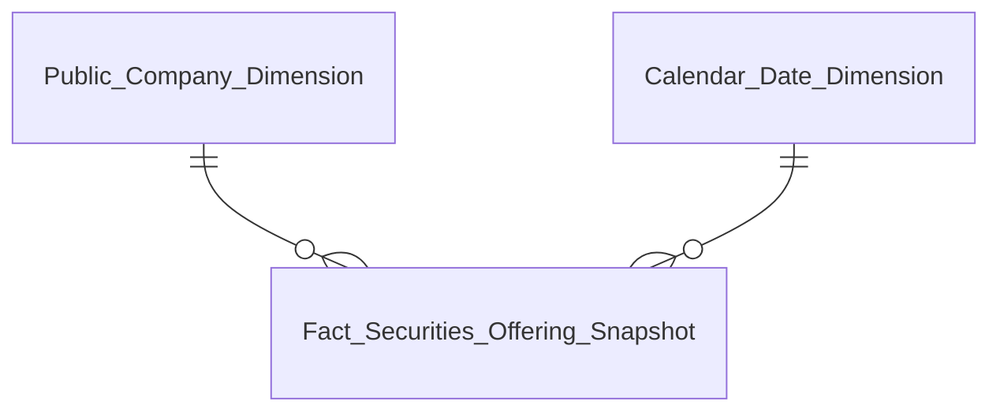
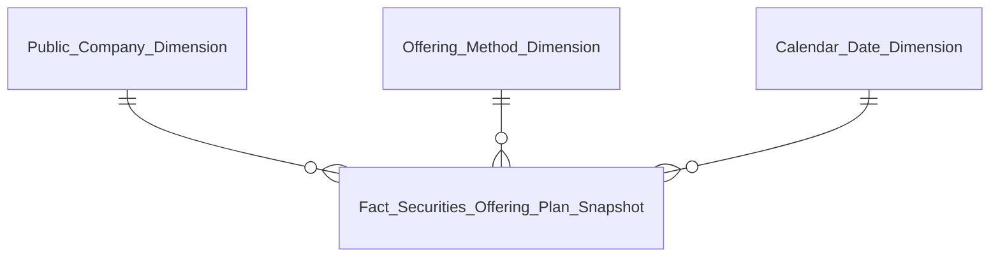
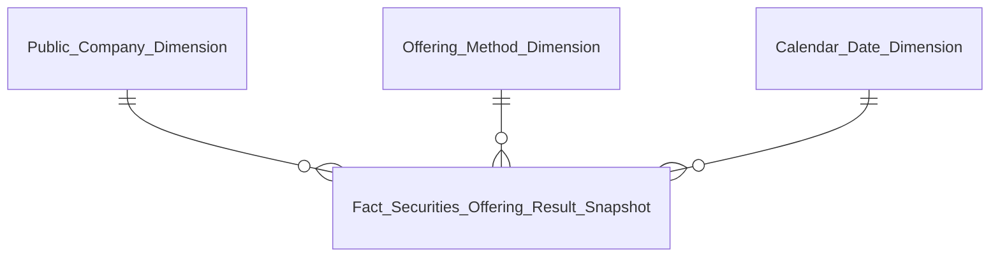
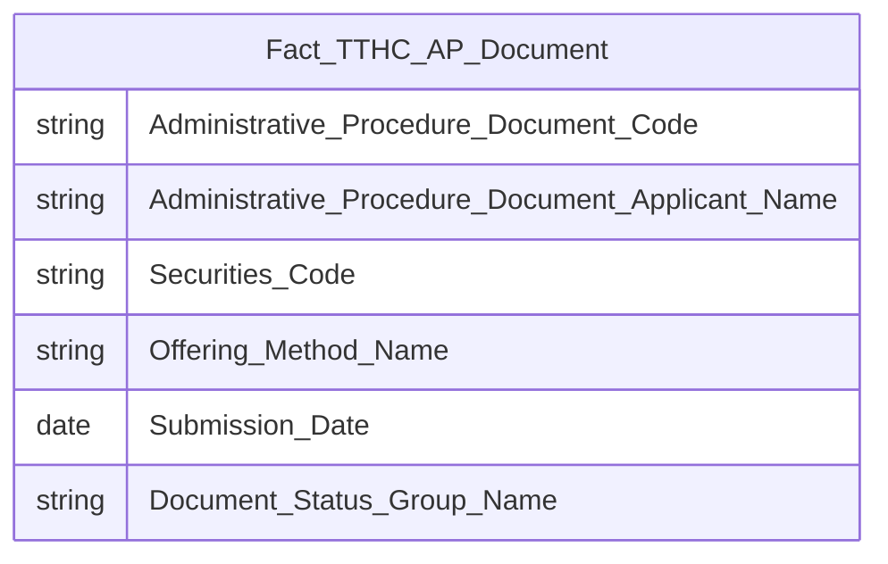

# DTM_QLCB_Entities — v2.5

**Phiên bản:** 2.5
**Ngày:** 15/10/2026
**Phạm vi:** Star schema diagram per nhóm báo cáo — QLCB module (Phase 2, dựa trên Section 3/4 của `DTM_QLCB_HLD.md`)

> **Cập nhật v2.5 (2026-10-15) — Fact phẳng `Fact TTHC AP Document` (SQL dbt `dtm_fct_tthc_ap_document`, Data Modeler):** thay 3 entity (`Fact Securities Offering Application Snapshot`, `Administrative Procedure Application Status Dimension`, `Administrative Procedure Application Type Dimension`) bằng **1 Fact phẳng** `Fact TTHC AP Document` (`fct_tthc_ap_document`, 6 cột, không FK Dimension, không Calendar Date). Nhóm trạng thái là tên tiếng Việt (5 nhóm, bỏ `UNDEFINED`). CSV 10 → 8 dòng. Xem O_QLCB_26.

> **Cập nhật v2.4 (2026-10-08):** Atomic TTHC thiết kế lại (09-30/10-01) — `Fact Securities Offering Application Snapshot` driving `ap_document` mới (+ `securities_symbol_code`); `Administrative Procedure Application Status Dimension`/`Application Type Dimension` đọc `cl_value` (không còn `ap_content_item_index`); Status Dimension thêm nhóm `OVERDUE_SUPPLEMENT`; `Operational Securities Offering 360 Profile` thêm `securities_tp_nm`. KPI mới: K_QLCB_70 (Nhóm 4), K_QLCB_71 (Nhóm 6). Xem HLD v2.3.

> **Cập nhật v2.2 (2026-08-24) — đổi nguồn Nhóm 5/6 từ IDS sang TTHC (task Dũng).** `Fact Securities Offering Application Snapshot` được repoint sang `TTHC.DOCUMENT` + `TTHC.CONTENTITEMINDEX` (`reuse_status`: `new` → `partial`), bổ sung 2 Dimension mới `Administrative Procedure Application Status Dimension` / `Administrative Procedure Application Type Dimension`, và thôi dùng `Offering Method Dimension` ở Nhóm 6. Toàn bộ K_QLCB_32–42 **READY (Atomic draft)**.

> **Cập nhật v2.3 (2026-08-24, cùng ngày):** Atomic đã bổ sung `ap_content_item_index.display_text` → O_QLCB_10 **Closed**. 3 bảng của Nhóm 5/6 (`Fact Securities Offering Application Snapshot` = `partial`, 2 Dimension mới = `new`) đã được đưa **trở lại** `DTM_QLCB_Entities.csv` (7 → 10 dòng); mục "Bảng PENDING" cuối file trở về trạng thái không còn bảng nào.

---

## Tab CHÀO BÁN PHÁT HÀNH

### Nhóm 1 — Tình hình thực hiện chào bán phát hành theo ngành

| Datamart Entity | Loại | Reuse | Mô tả | Grain | KPI |
|---|---|---|---|---|---|
| Fact Securities Offering Snapshot | Fact Event | new | Hồ sơ chào bán/phát hành CK — tổng giá trị cấp phép/huy động theo ngành, kỳ | 1 row / hồ sơ chào bán | K_QLCB_1–5 |
| Public Company Dimension | Dimension | reuse | Mã CK, tên DN, sàn, ngành (reuse `public_company_dim`, module GSDC) | 1 row / công ty đại chúng | Slicer Ngành |
| Calendar Date Dimension | Dimension | reuse | Ngày công văn UBCKNN | 1 row / ngày (Conformed) | Slicer Ngày |

---

### Nhóm 2 — Giá trị cấp phép chào bán phát hành theo ngành

| Datamart Entity | Loại | Reuse | Mô tả | Grain | KPI |
|---|---|---|---|---|---|
| Fact Securities Offering Plan Snapshot | Fact Event | new | Giá trị cấp phép theo loại hình chào bán | 1 row / đợt × 1 loại hình kế hoạch | K_QLCB_6–12 |
| Offering Method Dimension | Dimension | new | Hình thức chào bán (ETL-derived DISTINCT từ `offering_method_code`) | 1 row / mã hình thức | Slicer Loại hình |
| Public Company Dimension | Dimension | reuse | Mã CK, tên DN (reuse `public_company_dim`) | 1 row / công ty đại chúng | Slicer |
| Calendar Date Dimension | Dimension | reuse | Ngày công văn UBCKNN | 1 row / ngày (Conformed) | Slicer |

---

### Nhóm 3 — Giá trị phát hành theo hình thức phát hành và nhóm ngành

| Datamart Entity | Loại | Reuse | Mô tả | Grain | KPI |
|---|---|---|---|---|---|
| Fact Securities Offering Result Snapshot | Fact Event | new | Giá trị huy động theo loại hình chào bán | 1 row / đợt × 1 loại hình kết quả | K_QLCB_13–19 |
| Offering Method Dimension | Dimension | new | Hình thức chào bán (reuse từ Nhóm 2, cùng scheme) | 1 row / mã hình thức | Slicer |
| Public Company Dimension | Dimension | reuse | Mã CK, tên DN (reuse `public_company_dim`) | 1 row / công ty đại chúng | Slicer |
| Calendar Date Dimension | Dimension | reuse | Ngày công văn UBCKNN | 1 row / ngày (Conformed) | Slicer |

---

### Nhóm 4 — Bảng Chi tiết số lượng chứng khoán Chào bán & Phát hành

> Bảng Tác nghiệp — lấy dữ liệu trực tiếp từ Atomic, không join qua Dimension. Không vẽ erDiagram relationship.

| Datamart Entity | Loại | Reuse | Mô tả | Grain | KPI |
|---|---|---|---|---|---|
| Operational Securities Offering 360 Profile | Operational | new | Hồ sơ 360° tra cứu chi tiết từng đợt chào bán — pivot theo loại hình, gồm thông tin tổ chức liên quan (đơn vị tư vấn/kiểm toán/bảo lãnh/XHTN) | 1 row / đợt chào bán × 1 loại hình | K_QLCB_20–31 |

---

## Tab HỒ SƠ ĐĂNG KÝ CHÀO BÁN

### Nhóm 5 — Tỷ lệ xử lý hồ sơ

> **READY (Atomic draft)** — nguồn TTHC (`ap_document` + `ap_document_applicant` + `cl_value`). **[SỬA 2026-10-15]** Fact phẳng, không Dimension.

| Datamart Entity | Loại | Reuse | Mô tả | Grain | KPI |
|---|---|---|---|---|---|
| Fact TTHC AP Document | Fact Event (phẳng) | new | Hồ sơ đăng ký chào bán nộp qua TTHC — đếm theo nhóm trạng thái xử lý (KPI Card + donut). Fact phẳng theo SQL dbt `dtm_fct_tthc_ap_document` (2026-10-15), thay 2 Dimension + Fact snapshot cũ | 1 row / hồ sơ TTHC tại ngày chạy ETL | K_QLCB_32–35 |

---

### Nhóm 6 — Bảng Chi tiết hồ sơ chào bán & phát hành

> **READY (Atomic draft)** — cùng Fact phẳng với Nhóm 5.

| Datamart Entity | Loại | Reuse | Mô tả | Grain | KPI |
|---|---|---|---|---|---|
| Fact TTHC AP Document | Fact Event (phẳng) | new | Cùng Fact với Nhóm 5 — phân tích theo hình thức × tổ chức/cá nhân × mã chứng khoán, 4 cột số lượng theo nhóm trạng thái + tổng. Hình thức chào bán là cột tên (`offering_method_nm`), **KHÔNG** reuse `Offering Method Dimension` (khác nguồn — O_QLCB_13) | 1 row / hồ sơ TTHC (cùng grain Nhóm 5) | K_QLCB_36–42, 66, 67, 71 |

---

## Tab CHÀO BÁN VÀ PHÁT HÀNH (Data Explorer)

> Toàn bộ 4 Nhóm dưới đây reuse `Operational Securities Offering 360 Profile` đã thiết kế ở Nhóm 4 — không thêm Fact/Dim mới, chỉ mở rộng attribute đã có sẵn trong bảng.

### Nhóm 7 — Thông tin cơ sở

| Datamart Entity | Loại | Reuse | Mô tả | Grain | KPI |
|---|---|---|---|---|---|
| Operational Securities Offering 360 Profile | Operational | new (reuse từ Nhóm 4) | Mã CK, tên công ty, sàn, ngành, thời điểm báo cáo, chuyên viên, loại CK | 1 row / đợt chào bán × 1 loại hình (kế thừa Nhóm 4) | K_QLCB_43–48 |

### Nhóm 8 — Thông tin công văn cấp phép

| Datamart Entity | Loại | Reuse | Mô tả | Grain | KPI |
|---|---|---|---|---|---|
| Operational Securities Offering 360 Profile | Operational | new (reuse từ Nhóm 4) | Số/ngày giấy chứng nhận, số/ngày công văn, hình thức phát hành | 1 row / đợt chào bán × 1 loại hình (kế thừa Nhóm 4) | K_QLCB_49–53 |

### Nhóm 9 — Thông tin cấp phép chào bán

| Datamart Entity | Loại | Reuse | Mô tả | Grain | KPI |
|---|---|---|---|---|---|
| Operational Securities Offering 360 Profile | Operational | new (reuse từ Nhóm 4) | Số lượng/giá/giá trị cấp phép, số lượng người lao động, đối tượng, mục đích sử dụng vốn | 1 row / đợt chào bán × 1 loại hình (kế thừa Nhóm 4) | K_QLCB_54–59 |

### Nhóm 10 — Thông tin kết quả chào bán

| Datamart Entity | Loại | Reuse | Mô tả | Grain | KPI |
|---|---|---|---|---|---|
| Operational Securities Offering 360 Profile | Operational | new (reuse từ Nhóm 4) | Số lượng/giá/giá trị thực tế, số lượng người lao động (TT), đối tượng (TT) | 1 row / đợt chào bán × 1 loại hình (kế thừa Nhóm 4) | K_QLCB_60–64 |

---

## Bảng PENDING (không thiết kế trong Phase 2)

**Cập nhật 2026-10-15 (v2.5):** không còn bảng nào PENDING toàn bộ. 3 bảng cũ của Nhóm 5/6 (`Fact Securities Offering Application Snapshot`, `Administrative Procedure Application Status Dimension`, `Administrative Procedure Application Type Dimension`) đã được thay bằng 1 Fact phẳng `Fact TTHC AP Document` — xem O_QLCB_26 trong Section 5 của `DTM_QLCB_HLD.md`.

Toàn bộ 10 Nhóm của module QLCB đều READY (Atomic draft). O_QLCB_9 và O_QLCB_15 là vấn đề quy trình aggregate/manifest bên Atomic, không phải PENDING dữ liệu và không block Phase LLD.

> **Ghi chú lệch tên tồn đọng (không sửa trong lượt này):** `DTM_QLCB_Entities.csv` đang dùng tên Fact **không có** hậu tố `Snapshot` cho 3 Fact của Nhóm 1–3 (`Fact Securities Offering`, `Fact Securities Offering Plan`, `Fact Securities Offering Result`) trong khi HLD Section 3 và `datamart_model.yaml` đều dùng `... Snapshot`. Dòng Fact phẳng Nhóm 5/6 (`Fact TTHC AP Document`) không dùng hậu tố `Snapshot` vì không còn là snapshot theo ngày. Rule Phase 2 yêu cầu `datamart_entity` khớp HLD → 3 dòng Nhóm 1–3 cần đổi tên, tách task riêng cùng với #10 (chiều "Ngành" Nhóm 2/3 + `K_QLCB_65` thừa ở Nhóm 7).
