# Data Mart HLD — Phân hệ Quản lý Chào bán (QLCB)

**Phiên bản:** 2.4
**Ngày:** 15/10/2026 (bản gốc 17/07/2026, cập nhật liên tục 08-11/08-14/08-24/08-25/09-10/10-08/10-15)
**Thay đổi v2.4 (2026-10-15, Data Modeler — Fact phẳng theo SQL dbt `dtm_fct_tthc_ap_document`):** (1) **Nhóm 5/6:** thay 3 bảng (`ap_application_status_dim`, `ap_application_tp_dim`, `fct_securities_offering_application_snpst`) bằng **1 Fact phẳng `fct_tthc_ap_document`** (6 cột: `ap_document_code` DD, `ap_document_applicant_nm`, `securities_code`, `offering_method_nm`, `submission_dt`, `document_status_group_nm`) — tên trạng thái/hình thức/người nộp lưu sẵn, không còn FK Dimension hay Calendar Date; (2) nhóm trạng thái đổi từ code (`REGISTERED`/`IN_PROGRESS`/…) sang **tên tiếng Việt 5 nhóm**, bỏ nhóm `UNDEFINED` (hồ sơ ngoài 5 nhóm bị loại khỏi Fact) — mẫu số Nhóm 5 nay chỉ gồm hồ sơ đã phân loại (O_QLCB_26); (3) phạm vi = cơ quan xử lý 'Ban Quản lý chào bán chứng khoán'; (4) K_QLCB_66 PENDING → READY (dữ liệu `display_nm` có thể NULL, O_QLCB_24); K_QLCB_67 đổi nguồn sang `ap_document.securities_code` (đóng O_QLCB_25); (5) scheme `cl_value` dùng tên logic `TTHC.PROCESSING_STATUS`/`TTHC.DOCUMENT_TYPE`/`TTHC.PROCESSING_AUTHORITY` (đóng điểm (1) của O_QLCB_22); (6) KPI_ID K_QLCB_32–42, 66, 67, 71 giữ nguyên.
**Thay đổi v2.3 (2026-10-08, BA QLCB cập nhật 13:56 + Atomic TTHC thiết kế lại 2026-09-30/10-01):** (1) **Nhóm 5/6 — đổi nguồn Atomic TTHC:** `ap_content_item_index` + `ap_document` (bản 9 attribute) → `ap_document` mới (ODS AP_DOCUMENT: `processing_status_code`, `document_tp_code`, `processing_authority_code`, `submission_tms`, `eform_data`, `ap_document_applicant_*`) + `cl_value` (TTHC.CLASSIFICATION_VALUE) cho tên trạng thái/hình thức/cơ quan; 2 Dimension `ap_application_status_dim`/`ap_application_tp_dim` lấy từ `cl_value`; Fact thêm `securities_symbol_code`. (2) **Nhóm 6:** BA bổ sung 'Mã chứng khoán', 'Tên tổ chức/cá nhân đăng ký' (UAT), 'Ngày gửi hồ sơ'; tách nhóm trạng thái `OVERDUE_SUPPLEMENT` ('Hồ sơ quá hạn bổ sung') → K_QLCB_71 mới; K_QLCB_37 'Năm' thay bằng 'Ngày gửi hồ sơ' (READY), K_QLCB_67 READY, K_QLCB_66 vẫn PENDING; K_QLCB_35 (Nhóm 5) đếm thêm OVERDUE_SUPPLEMENT. (3) **Nhóm 4/7:** K_QLCB_70 'Loại chứng khoán' (mới, tên loại CK — cột mới `securities_tp_nm`, LOOKUP_GROUP = SO_SECURITY_TYPE); K_QLCB_48 đổi sang tên. (4) **Nhóm 4/9:** 'Số lượng cấp phép' (K_QLCB_27/54) đổi nguồn sang `SECURITIES_OFFERING_PLAN.total_registered_qty`. (5) 13 dòng BA Nhóm 1/2/3/4/9/10 chuyển 'Doing' — không đổi thiết kế. (6) O_QLCB_16/17 đóng; mở O_QLCB_22–25. Diff BA: `Datamart/context/ba/QLCB_ba_diff_vs_HEAD_2026-10-08.txt`.

---

## Quy ước trạng thái

| Ký hiệu | Ý nghĩa |
|---|---|
| READY | Atomic đủ — thiết kế đầy đủ |
| PENDING | Atomic chưa có — placeholder + lý do |

---

## Section 1 — Data Lineage: Source → Atomic → Data Mart

##### Cụm 1a: Chào bán phát hành — tổng hồ sơ (Fact Securities Offering Snapshot)

Phục vụ Tab CHÀO BÁN PHÁT HÀNH — Nhóm 1 (KPI tình hình cấp phép/huy động theo ngành).

> Nguồn Atomic: `Public Company Securities Offering` (physical_name `pc_securities_offering`, nguồn `IDS.SECURITIES_OFFERING`, BRD source `BRD/Source/IDS/brd_IDS_SECURITIES_OFFERING.yaml`) + `Public Company Securities Offering Result` (aggregate SUM theo hồ sơ). `Public Company Dimension` **reuse** `public_company_dim` (module GSDC, `datamart_model.yaml`) — cùng nguồn Atomic `Public Company`, đã có đủ cột mã CK/tên/sàn/ngành. Xem Section 4 — Reuse Analysis.

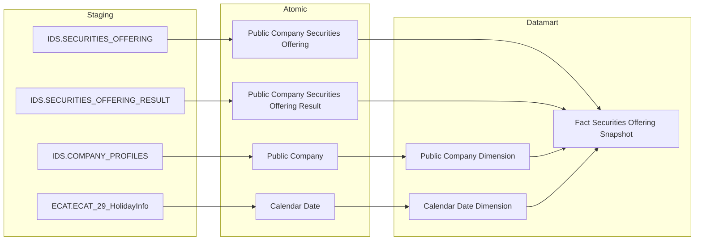

> **Ghi chú:** Ngành (`Business Line Level 1/2 Code`) lấy trực tiếp từ cột có sẵn trên `public_company_dim` (reuse) — không có Dimension ETL-derived riêng. `Public Company Securities Offering Result` feed thẳng vào Fact (không qua Dimension) vì cần aggregate SUM `total_collected_amt` GROUP BY hồ sơ.

---

##### Cụm 1b: Chào bán phát hành — giá trị cấp phép theo loại hình (Fact Securities Offering Plan Snapshot)

Phục vụ Tab CHÀO BÁN PHÁT HÀNH — Nhóm 2 (giá trị cấp phép theo loại hình).

> Nguồn Atomic: `Public Company Securities Offering Plan` (quan hệ 1-N với Offering cha theo `offering_method_code`) + `Public Company Securities Offering` (JOIN lấy `certificate_dt` làm FK date, vì Plan không có ngày riêng). `Offering Method Dimension` ETL-derived (DISTINCT) trực tiếp từ `Public Company Securities Offering Plan.offering_method_code`; `Offering_Method_Name` JOIN sang `Classification Value` (`cl_value`, bảng Fundamental vật lý ở Atomic — theo `cl_value.cl_code = offering_method_code AND cl_value.schema_code = 'SO_OFFERING_METHOD'`) lấy `cl_nm` — không tự CASE WHEN gộp nhóm trên Dimension.

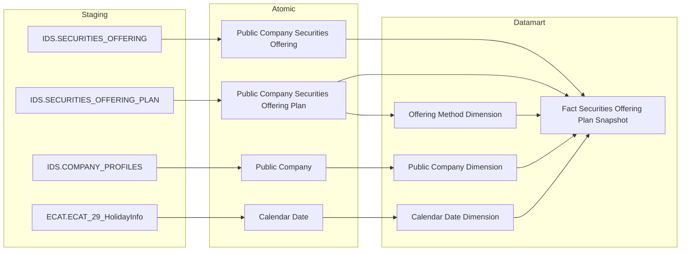

> **Ghi chú:** `Public Company Securities Offering` (Offering cha) feed vào Fact vì `Certificate_Date` (FK date) và `Public Company Code` (FK company) chỉ tồn tại trên bảng cha — Plan phải JOIN ngược lên cha để lấy 2 giá trị này.

---

##### Cụm 1c: Chào bán phát hành — giá trị huy động theo loại hình (Fact Securities Offering Result Snapshot)

Phục vụ Tab CHÀO BÁN PHÁT HÀNH — Nhóm 3 (giá trị huy động theo loại hình × ngành).

> Nguồn Atomic: `Public Company Securities Offering Result` (quan hệ 1-N với Offering cha theo `offering_method_code`) + `Public Company Securities Offering` (JOIN lấy `certificate_dt` làm FK date). Dùng chung `Offering Method Dimension` với Cụm 1b (reuse, cùng scheme `IDS_SO_OFFERING_METHOD`).

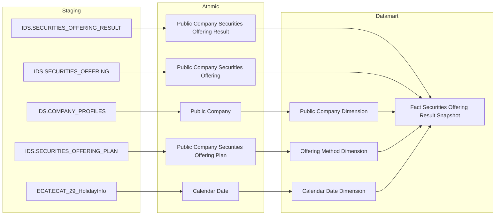

> **Ghi chú:** `Offering Method Code Snapshot` trên Result là denormalized snapshot từ Plan — `Offering Method Dimension` seed (DISTINCT) trực tiếp từ `Public Company Securities Offering Plan.offering_method_code` (dùng chung Cụm 1b, `Offering_Method_Name` join `Classification Value`), ETL populate FK trên Fact Result join qua Plan (`offering_method_code`) rồi snapshot sang Result.

---

##### Cụm 2: Chi tiết đợt chào bán (Bảng Tác nghiệp — Operational Securities Offering 360 Profile)

Phục vụ Tab CHÀO BÁN PHÁT HÀNH — Nhóm 4 (bảng chi tiết số lượng CK chào bán & phát hành) và Tab CHÀO BÁN VÀ PHÁT HÀNH — Nhóm 7–10 (tra cứu chi tiết đợt chào bán theo 4 nhóm chỉ số). Bảng tác nghiệp nhận dữ liệu trực tiếp từ Atomic, không qua Dimension.

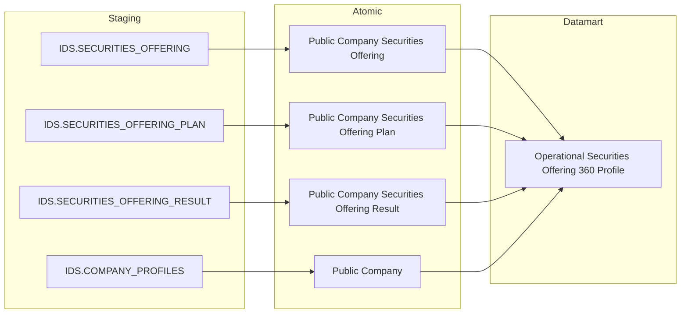

---

##### Cụm 3: Hồ sơ đăng ký chào bán (TTHC)

Phục vụ Tab HỒ SƠ ĐĂNG KÝ CHÀO BÁN — Nhóm 5 (Tỷ lệ xử lý hồ sơ — KPI Card + donut), Nhóm 6 (bảng chi tiết hồ sơ theo hình thức × tổ chức/cá nhân × mã chứng khoán).

> **ĐỔI NGUỒN 2026-08-24 (task Dũng — BA sheet cập nhật 2026-08-24): IDS → TTHC.** Toàn bộ chỉ tiêu Nhóm 5/6 chuyển từ `IDS.SECURITIES_OFFERING.APPROVAL_STATUS_CD` (entity `Public Company Securities Offering`) sang hệ thống TTHC (Orchard Core CMS): `TTHC.DOCUMENT` (nội dung JSON của hồ sơ) + `TTHC.CONTENTITEMINDEX` (index/metadata content item). Hồ sơ = content item `CONTENTTYPE = 'HoSoTTHC'`, lọc `LATEST = 1 AND PUBLISHED = 1`, giới hạn phạm vi nghiệp vụ bằng `CoQuanXuLy → DISPLAYTEXT = 'Ban Quản lý chào bán chứng khoán'`.
>
> 4 trường nghiệp vụ được parse từ `DOCUMENT.CONTENT` (JSON) **tại tầng ODS** — đã có sẵn trên Atomic `Administrative Procedure Document`:
>
> | JSON path (SQL BA STT 5/6) | Atomic attribute | Vai trò |
> |---|---|---|
> | `$.HoSoTTHC.TrangThaiHoSo.ContentItemIds[0]` | `Document Status Code` | ref → trạng thái hồ sơ (Nhóm 5 + 6) |
> | `$.HoSoTTHC.LoaiHoSo.ContentItemIds[0]` | `Offering Method Code` | ref → hình thức chào bán (Nhóm 6) |
> | `$.HoSoTTHC.CoQuanXuLy.ContentItemIds[0]` | `Processing Authority Code` | ref → cơ quan xử lý (filter phạm vi) |
> | `$.HoSoTTHC.NgayGuiHoSo.Value` | `Submission Date` | chiều thời gian |
>
> Cả 3 ref trên đều mang giá trị `CONTENTITEMID` (GUID) — muốn ra tên hiển thị phải self-join `CONTENTITEMINDEX` lấy `DISPLAYTEXT`. Đây là gốc của điểm chặn Atomic ở dưới.
>
> **ĐÃ GIẢI QUYẾT 2026-08-24 — Atomic đã bổ sung `display_text`.** `Administrative Procedure Content Item Index` (`ap_content_item_index`) nay có attribute `Display Text` / `display_text` ← `TTHC.CONTENTITEMINDEX.DISPLAYTEXT` (Text, nullable) — entity approved tăng từ 9 lên 10 attribute. Đây là trường dùng để resolve 3 `CONTENTITEMID` (`TrangThaiHoSo`, `LoaiHoSo`, `CoQuanXuLy`) thành tên hiển thị, nền tảng cho toàn bộ phân loại 4 nhóm trạng thái, nhãn hình thức chào bán và filter cơ quan xử lý. Toàn bộ K_QLCB_32–42 chuyển từ PENDING sang **READY (Atomic draft)**. Xem O_QLCB_10 (Closed).
>
> **Không cần cột `PUBLISHED` ở tầng Datamart** (chốt với người thiết kế 2026-08-24): thiết kế Atomic đã lọc theo cột này ngay khi nạp `ap_content_item_index`, nên mọi dòng Atomic đã là content item **hiện hành + đã xuất bản** — Datamart không lặp lại điều kiện `PUBLISHED = 1` của SQL BA. Tương tự `LATEST = 1` đã được dedup tại Atomic (grain "1 dòng = 1 content item hiện hành", xem `TTHC_HLD_Tier2.md` D-06).
>
> **ĐỔI GRAIN 2026-08-24:** grain mới = **1 row / 1 hồ sơ TTHC** (`CONTENTITEMID` của content item `HoSoTTHC`). Rule cũ *"1 hồ sơ × N loại hình đếm N lần"* (FIX 2026-08-14, dựa trên `IDS.SECURITIES_OFFERING_PLAN`) **mất hiệu lực** — TTHC mỗi hồ sơ chỉ có đúng 1 `LoaiHoSo`, không có bảng Plan tách riêng. SQL BA mới đếm `COUNT(*)` trên grain 1 hồ sơ. Nhóm 5 và Nhóm 6 tiếp tục dùng chung 1 Fact.
>
> **ĐỔI TRỤC THỜI GIAN 2026-08-24:** từ `certificate_date` (ngày cấp giấy chứng nhận, IDS) sang `NgayGuiHoSo` (ngày gửi hồ sơ, TTHC). Fact lưu grain **ngày** (`Submission Date` đã TRUNC về DATE), KPI Nhóm 6 GROUP BY **năm** — chốt với người thiết kế 2026-08-24: khớp cột `Thông tin = Năm` của BA và giữ nguyên hình thức bảng chi tiết hiện tại, trong khi vẫn drill-down được xuống ngày. Lưu ý số liệu theo năm **sẽ khác hẳn** bản IDS cũ vì đổi cả ý nghĩa trục thời gian lẫn grain.
>
> **Công thức `ngay_gui_ho_so` — đã thống nhất (xác nhận người thiết kế 2026-08-24):** BA dùng **một công thức duy nhất** cho cả STT 5 và STT 6 — bản có xử lý múi giờ: `TO_TIMESTAMP(SUBSTR(json,1,19) DEFAULT NULL ON CONVERSION ERROR, 'YYYY-MM-DD"T"HH24:MI:SS')` → `FROM_TZ(..., CASE WHEN json LIKE '%Z' THEN 'UTC' ELSE 'Asia/Ho_Chi_Minh' END)` → `AT TIME ZONE 'Asia/Ho_Chi_Minh'` → `CAST(... AS TIMESTAMP)`. Khớp đúng phương án thiết kế đã chọn trước đó, nên **không phải sửa gì** ở Fact/Dimension/Detail Mapping/flat table. `DEFAULT NULL ON CONVERSION ERROR` cho biết chuỗi ngày sai định dạng sẽ ra NULL — đúng cơ sở cho filter `ap_document.submission_dt IS NOT NULL` của Fact. Datamart tiêu thụ `ap_document.submission_dt` (Atomic khai `data_domain: Date`), tức ODS chịu trách nhiệm `TRUNC` kết quả TIMESTAMP trên về DATE. Xem O_QLCB_11.

> **[CẬP NHẬT 2026-10-08 — Atomic TTHC thiết kế lại 2026-09-30/10-01, thay thế phần mô tả 2026-08-24 phía trên]** `ap_content_item_index` (9→10 attribute, từ `TTHC.CONTENTITEMINDEX`) và `ap_document` bản cũ (`TTHC.DOCUMENT`: `document_status_code`/`offering_method_code`/`submission_dt`) không còn trong thiết kế Atomic làm việc (`DataModel/working/Atomic/lld/TTHC/`) — thay bằng `ap_document` (nguồn `TTHC.AP_DOCUMENT`, ODS đã JOIN `DOCUMENT` + `CONTENTITEMINDEX` lọc `ContentType = 'HoSoTTHC'`, `src_stm_code = 'TTHC_AP_DOCUMENT'`) và `cl_value` (nguồn `TTHC.CLASSIFICATION_VALUE`, `src_stm_code = 'TTHC_CLASSIFICATION_VALUE'`, tên hiển thị = `cl_nm`). Ánh xạ mới:
>
> | JSON path (SQL BA STT 5/6) | Atomic attribute (`ap_document`) | `cl_value.schema_code` | Vai trò |
> |---|---|---|---|
> | `$.HoSoTTHC.TrangThaiHoSo.ContentItemIds[0]` | `processing_status_code` | `TrangThaiHoSo` | trạng thái hồ sơ (Nhóm 5 + 6) |
> | `$.HoSoTTHC.LoaiHoSo.ContentItemIds[0]` | `document_tp_code` | `LoaiHoSo` | hình thức chào bán (Nhóm 6) |
> | `$.HoSoTTHC.CoQuanXuLy.ContentItemIds[0]` | `processing_authority_code` | `CoQuanXuLy` | filter phạm vi 'Ban Quản lý chào bán chứng khoán' |
> | `$.HoSoTTHC.NgayGuiHoSo.Value` | `submission_tms` (Timestamp) | — | chiều thời gian (Atomic mới ghi Timestamp thay Date — O_QLCB_22) |
> | `$.Eform.ContentItems[0].*.Macophieu.Text` | `eform_data` (JSON nguyên Eform) | — | Mã chứng khoán trên hồ sơ (K_QLCB_67) |
> | `$.HoSoTTHC.DoiTuongNopHoSo.ContentItemIds[0]` | `ap_document_applicant_code` → `ap_document_applicant.display_nm` | — | tên tổ chức/cá nhân (K_QLCB_66 — PENDING, O_QLCB_24) |
>
> Hệ quả thiết kế: (a) Fact driving = `ap_document` (không còn self-join content item); `Application Item Code` = `ap_document_code`; (b) 2 Dimension đọc `cl_value` (`schema_code` `TrangThaiHoSo`/`LoaiHoSo`, chỉ nạp giá trị được `ap_document` tham chiếu) — **tên file LLD đổi `_TTHC_CONTENTITEMINDEX` → `_TTHC_CLASSIFICATION_VALUE`**; (c) Fact thêm Degenerate attribute `securities_symbol_code`; (d) Dimension trạng thái thêm nhóm `OVERDUE_SUPPLEMENT`. BA SQL vẫn lọc `LATEST = 1`/`PUBLISHED = 1` trên content item — Atomic mới không còn 2 cột này, giả định ODS đã lọc (O_QLCB_22). `schema_code` ghi theo `lld_TTHC_CLASSIFICATION_VALUE.yaml` (ContentType gốc: `TrangThaiHoSo`, `LoaiHoSo`, `CoQuanXuLy`), trong khi `ap_document` ghi scheme logic `TTHC.PROCESSING_STATUS`/`TTHC.DOCUMENT_TYPE`/`TTHC.PROCESSING_AUTHORITY` — cần Atomic xác nhận giá trị thật (O_QLCB_22).

> **[SỬA 2026-10-15 — Fact phẳng theo SQL dbt `dtm_fct_tthc_ap_document`, Data Modeler duyệt; thay thế các hệ quả (a)–(d) và sơ đồ lineage cũ ở trên]** Nhóm 5/6 chỉ còn **1 Fact phẳng `Fact TTHC AP Document`** (`fct_tthc_ap_document`), không còn Dimension trạng thái/hình thức, không còn FK `Calendar Date Dimension`, không còn cột ngày snapshot. Ánh xạ Atomic → cột Fact:
>
> | Cột Fact | Nguồn Atomic | Quy tắc |
> |---|---|---|
> | `ap_document_code` (DD) | `ap_document.ap_document_code` | Phạm vi: `processing_authority_code` resolve qua `cl_value` (scheme `TTHC.PROCESSING_AUTHORITY`) ra `cl_nm = 'Ban Quản lý chào bán chứng khoán'` |
> | `ap_document_applicant_nm` | `ap_document_applicant.display_nm` | LEFT JOIN theo `ap_document_applicant_id` — NULL không làm mất hồ sơ (O_QLCB_24) |
> | `securities_code` | `ap_document.securities_code` | Direct map, NULL với loại hồ sơ không có mã |
> | `offering_method_nm` | `cl_value.cl_nm` (scheme `TTHC.DOCUMENT_TYPE`) theo `ap_document.document_tp_code` | INNER JOIN 1:1 |
> | `submission_dt` | `ap_document.submission_tms` | `CAST(... AS DATE)` (O_QLCB_22) |
> | `document_status_group_nm` | `cl_value.cl_nm` (scheme `TTHC.PROCESSING_STATUS`) theo `ap_document.processing_status_code` | `CASE WHEN cl_nm IN (...)` → 5 nhóm tên tiếng Việt; ngoài 5 nhóm → NULL → **loại hồ sơ khỏi Fact** |
>
> Nguồn đọc theo SCD4A: bảng chính `ap_document` ở trạng thái ACTIVE của ngày chạy (cột kỹ thuật `ds_*` không đưa vào `etl_logic`). Fact nạp lại theo ngày chạy (trạng thái hiện hành, không giữ lịch sử chuyển trạng thái) — xem O_QLCB_26.

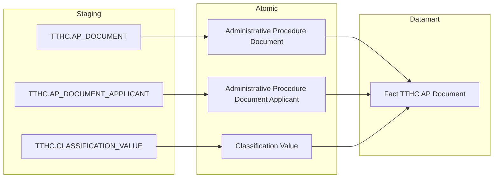

> **Ghi chú lineage [SỬA 2026-10-15]:** `Classification Value` được JOIN 3 lần trong ETL của Fact (trạng thái, loại hồ sơ, cơ quan xử lý — lọc theo `schema_code` + `src_stm_code = 'TTHC_CLASSIFICATION_VALUE'`) thay cho 2 Dimension cũ. **Không reuse `Offering Method Dimension`/`offering_method_dim`** (Nhóm 2/3, nguồn IDS) — dashboard QLCB vẫn có 2 danh mục "hình thức chào bán" song song: Nhóm 2/3 theo `IDS_SO_OFFERING_METHOD`, Nhóm 6 theo tên loại hồ sơ `TTHC.DOCUMENT_TYPE` (`offering_method_nm`) — xem O_QLCB_13.

---

## Section 2 — Tổng quan báo cáo

### Tab: CHÀO BÁN PHÁT HÀNH

**Slicer chung:** Ngày (date picker), Ngành

---

#### Nhóm 1 — Tình hình thực hiện chào bán phát hành theo ngành

> Phân loại: **Phân tích**
> Atomic: `Public Company Securities Offering` ← IDS.SECURITIES_OFFERING — **READY** (Atomic draft — chưa approved chính thức)
> Atomic: `Public Company Securities Offering Plan` ← IDS.SECURITIES_OFFERING_PLAN — **READY** (Atomic draft) — [CẬP NHẬT 2026-09-10] nguồn mới cho "Giá trị Cấp phép" (K_QLCB_3), xem ghi chú dưới
> Atomic: `Public Company Securities Offering Result` ← IDS.SECURITIES_OFFERING_RESULT — **READY** (Atomic draft)
> Atomic: `Public Company` ← IDS.COMPANY_PROFILES — **READY**

**Mockup:**

| Ngành | Giá trị Cấp phép (tỷ đ) | Giá trị Huy động (tỷ đ) | Chưa thành công (tỷ đ) |
|---|---|---|---|
| Tài chính - Ngân hàng | 12,500 | 10,200 | 2,300 |
| Bất động sản | 8,700 | 7,100 | 1,600 |
| Công nghiệp | 5,300 | 4,800 | 500 |

**Source:** `Fact Securities Offering Snapshot` → `Public Company Dimension` (reuse), `Calendar Date Dimension`

**Bảng KPI:**

| KPI ID | Tên KPI | Đơn vị | Tính chất | Công thức | Ghi chú | Trạng thái |
|---|---|---|---|---|---|---|
| K_QLCB_1 | Ngày | — | Chiều | `GROUP BY Certificate Date` — FK date trên Fact, dùng làm slicer/period cho toàn Nhóm — `Public Company Securities Offering.certificate_dt` | BA cập nhật 2026-08-11: đổi field lọc kỳ báo cáo từ Official Letter Date (ngày công văn) sang Certificate Date (ngày cấp GCN). **[CẬP NHẬT 2026-09-10]** phạm vi lọc kỳ báo cáo mở rộng thành `NVL(Certificate Date, Official Letter Date)` — hồ sơ chưa có Certificate Date nhưng đã có Official Letter Date vẫn vào phạm vi; FK ngày trên Fact (`Certificate_Date_Dimension_Id`, giữ nguyên tên cột) nay populate theo `NVL(certificate_dt, official_letter_dt)` thay vì chỉ `certificate_dt` | READY |
| K_QLCB_2 | Ngành | — | Chiều | `GROUP BY Business Line Level 1 Code` — FK Public Company Dimension (reuse `public_company_dim`), dùng làm slicer ngành cho toàn Nhóm | — | READY |
| K_QLCB_3 | Giá trị Cấp phép | Tỷ VNĐ | Cơ sở | `SUM(Total Expected Amount Snapshot) WHERE Approval Status Code = 'APPROVED' AND Offering Method Code NOT IN (6,7,8,10)` per ngành × kỳ — `Public Company Securities Offering Plan.total_expected_amt_snpst` GROUP BY `pc_securities_offering_id` (CTE `plan_agg`) | **[ĐỔI NGUỒN 2026-09-10]** đổi nguồn từ bảng cha `Public Company Securities Offering.total_expected_amt` (giá trị đơn/hồ sơ) sang SUM `Public Company Securities Offering Plan.total_expected_amt_snpst` (aggregate theo `plan_agg`, cùng cơ chế gom nhóm-trước-JOIN-sau đã áp dụng ở Nhóm 2). Danh sách mã loại trừ đổi từ `(6,7,8,9)` → `(6,7,8,10)` (mã 9-ESOP nay được tính, mã 10-Khác bị loại). Thêm điều kiện bắt buộc `Approval Status Code = 'APPROVED'` (trước đây không lọc theo trạng thái duyệt) | READY |
| K_QLCB_4 | Giá trị Huy động thành công | Tỷ VNĐ | Cơ sở | `SUM(Total Collected Amount) WHERE Approval Status Code = 'APPROVED' AND Offering Method Code NOT IN (6,7,8,10)` per ngành × kỳ — aggregate từ `Public Company Securities Offering Result.total_collected_amt` GROUP BY `pc_securities_offering_id` (CTE `result_agg`) trước khi cộng vào Fact | **[ĐỔI 2026-09-10]** cùng điều kiện lọc mới với K_QLCB_3 (mã loại trừ + `APPROVAL_STATUS_CD='APPROVED'`). **Đổi kiểu JOIN — chốt với người thiết kế 2026-09-10:** BA đổi `LEFT JOIN result_agg` → `JOIN result_agg` (INNER) — theo đúng BA, chấp nhận thu hẹp phạm vi: hồ sơ **chưa có bất kỳ dòng Result nào** (chưa công bố kết quả huy động) sẽ **không xuất hiện** trong Nhóm 1 nữa (trước đây LEFT JOIN vẫn hiện với Giá trị Huy động = 0). Ảnh hưởng cả K_QLCB_3 vì cùng 1 SELECT — Giá trị Cấp phép của các hồ sơ này cũng biến mất khỏi tổng theo ngành, không chỉ Giá trị Huy động | READY |
| K_QLCB_5 | Chưa thành công | Tỷ VNĐ | Derived | `K_QLCB_3 − K_QLCB_4` — tính ở presentation layer | — | READY |

> **Lưu ý:** K_QLCB_1/2 là Chiều — cùng dùng chung FK date/ngành đã có sẵn trên `Fact Securities Offering Snapshot` (không tạo cột mới), khai sinh KPI_ID theo rule "mọi dòng BA Phân loại = Chiều phải có KPI_ID". **[CẬP NHẬT 2026-09-10]** K_QLCB_3 nay SUM từ `Public Company Securities Offering Plan` (trước đó lấy trực tiếp `total_expected_amt` trên bảng cha, 1 giá trị/hồ sơ — không còn đúng theo BA mới). K_QLCB_4 cần SUM `total_collected_amt` từ `Public Company Securities Offering Result` GROUP BY `pc_securities_offering_id` — quan hệ 1-N vì 1 hồ sơ có thể có nhiều dòng Result theo từng đợt báo cáo kết quả (`Offering Phase Name`). K_QLCB_5 là Derived — tính ở presentation layer, không lưu mart.
>
> **[CẬP NHẬT 2026-09-10] Nguồn ETL ghi nhận trong `plan_agg`:** `Public Company Securities Offering Plan` được SUM theo `securities_offering_id` (bảng tạm `plan_agg`) rồi INNER JOIN sang `Public Company Securities Offering` (điều kiện `APPROVAL_STATUS_CD='APPROVED'`, `Offering Method Code NOT IN (6,7,8,10)`), và INNER JOIN sang `result_agg` (SUM `Public Company Securities Offering Result` theo `securities_offering_id`). Đã lan sang `DTM_QLCB_Detail_Mapping.csv` — cập nhật logic K_QLCB_3/K_QLCB_4 theo cấu trúc JOIN mới, không còn dùng CTE `valid_offering` cũ (2026-08-25).
>
> **Loại bỏ 2 KPI YOY dư (cross-check phát hiện, đã xóa khỏi bảng trước khi renumber):** BA STT 1 không có dòng nào yêu cầu YoY% — 2 KPI này đã bị thêm không có căn cứ BA, xóa khỏi bảng KPI.

> **Ghi chú — Public Company Dimension (reuse):** Reuse `public_company_dim` đã có trong `datamart_model.yaml` (module GSDC, nguồn Atomic `Public Company`) — đã có sẵn `Business Line Level 1 Code` cho GROUP BY ngành (khớp BA: SQL Nhóm 1 chỉ JOIN `CATEGORIES` qua `category_l1_id`, không cần cấp 2). Xem Section 4 — Reuse Analysis.

**Star Schema:**

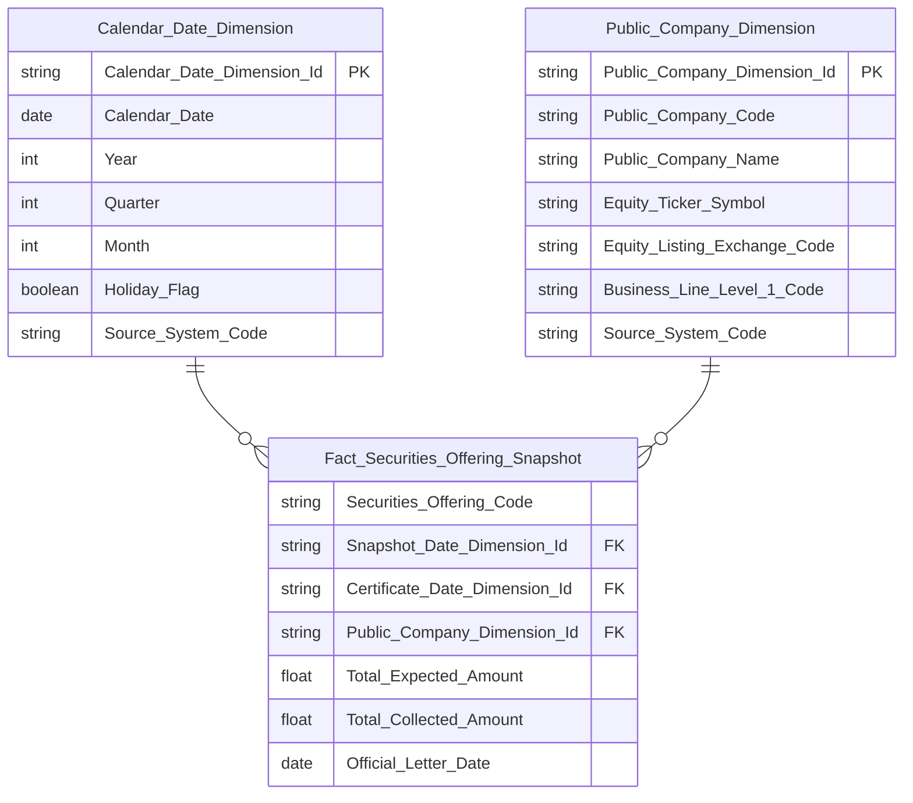

> **Ghi chú Phase 2 — reuse `Public_Company_Dimension` (= `public_company_dim`):** Dùng nguyên schema đã approved trong `datamart_model.yaml` (module GSDC). Key convention theo entity gốc: `Public_Company_Dimension_Id` = PK, `Public_Company_Code` = NK (ETL join từ `Public Company Securities Offering.Public Company Code` để resolve Surrogate Dimension Key).
>
> **[CẬP NHẬT 2026-09-10]** `Certificate_Date_Dimension_Id` — nguồn ETL đổi từ `certificate_dt` sang `NVL(certificate_dt, official_letter_dt)`, giữ nguyên tên cột (không đổi thành role khác vì vẫn cùng 1 vai trò nghiệp vụ "ngày báo cáo/kỳ"). `Total_Expected_Amount`/`Total_Collected_Amount` — không đổi kiểu dữ liệu/tên cột, chỉ đổi nguồn ETL populate (xem K_QLCB_3/4): `Total_Expected_Amount` nay SUM từ `Public Company Securities Offering Plan` thay vì lấy trực tiếp từ Offering cha; cả 2 measure chỉ populate cho hồ sơ có `APPROVAL_STATUS_CD='APPROVED'` + tồn tại ≥1 dòng Result (INNER JOIN).

**Lineage Mart → Báo cáo:**


**Bảng grain:**

| Tên bảng | Grain |
|---|---|
| Fact Securities Offering Snapshot | 1 row = 1 hồ sơ chào bán/phát hành CK đã duyệt (`APPROVAL_STATUS_CD='APPROVED'`) và đã có ≥1 kết quả huy động (INNER JOIN Result), của 1 công ty đại chúng × 1 ngày snapshot (ETL full-scan hàng ngày để Total Collected Amount luôn phản ánh đúng kết quả huy động mới nhất; `NVL(Certificate Date, Official Letter Date)` giữ vai trò Chiều/slicer) — **[CẬP NHẬT 2026-09-10]** thu hẹp phạm vi so với thiết kế trước (LEFT JOIN Result, không lọc APPROVAL_STATUS_CD) |
| Public Company Dimension (reuse `public_company_dim`) | 1 row = 1 công ty đại chúng (SCD4A — theo quy ước module GSDC) |
| Calendar Date Dimension | 1 row = 1 ngày (Certificate Date — ngày cấp giấy chứng nhận) |

---

#### Nhóm 2 — Giá trị cấp phép chào bán phát hành theo ngành

> Phân loại: **Phân tích**
> Atomic: `Public Company Securities Offering Plan` ← IDS.SECURITIES_OFFERING_PLAN — **READY** (Atomic draft — chưa approved chính thức)
> Atomic: `Public Company Securities Offering` ← IDS.SECURITIES_OFFERING — **READY** (Atomic draft, dùng để lấy `certificate_dt` FK date)
> [CẬP NHẬT 2026-09-10] BA đổi filter kỳ báo cáo sang `NVL(certificate_dt, official_letter_dt)` (đồng bộ với Nhóm 1) — không đổi logic measure K_QLCB_6-12, chỉ mở rộng phạm vi hồ sơ theo ngày. Không có thay đổi nguồn/công thức nào khác cho Nhóm này.

**Mockup:**

| Loại hình | Giá trị cấp phép (tỷ đ) | % tổng |
|---|---|---|
| Công chúng | 8,200 | 42% |
| Riêng lẻ | 5,100 | 26% |
| ESOP | 2,300 | 12% |
| Trả cổ tức | 1,800 | 9% |
| Tăng vốn từ VCSH | 1,500 | 8% |
| Khác | 600 | 3% |

**Source:** `Fact Securities Offering Plan Snapshot` → `Offering Method Dimension`, `Public Company Dimension` (reuse), `Calendar Date Dimension`

**Bảng KPI:**

| KPI ID | Tên KPI | Đơn vị | Tính chất | Công thức | Ghi chú | Trạng thái |
|---|---|---|---|---|---|---|
| K_QLCB_2 | Ngành | — | Chiều | `GROUP BY Business Line Level 1 Code` — FK `Public Company Dimension` (reuse `public_company_dim`), cùng cột đã khai sinh ở Nhóm 1 | **[BỔ SUNG 2026-09-10 — Bước 5B phát hiện gap tồn tại từ trước]** Reuse từ Nhóm 1 (K_QLCB_2). Dòng BA STT 2 "Ngành" (Chỉ tiêu cơ sở) đã tồn tại từ bản BA gốc nhưng bị bỏ sót khỏi bảng KPI Nhóm 2 — `Public_Company_Dimension` đã sẵn FK trên `Fact_Securities_Offering_Plan_Snapshot`, không cần bổ sung hạ tầng | READY |
| K_QLCB_6 | Loại hình phát hành | — | Chiều | `GROUP BY Offering Method Code` — hiển thị tên gốc `Offering_Method_Name` (từ Dimension, join Classification Value); filter K_QLCB_7–12 gom mã vào 6 nhóm để tính measure (xem bảng mapping dưới), không đổi tên hiển thị của Chiều này | — | READY |
| K_QLCB_7 | Giá trị cấp phép — Công chúng | Tỷ VNĐ | Cơ sở | `SUM(Total Expected Amount Snapshot) WHERE Offering Method Code IN ('1','2','3','4')` | — | READY |
| K_QLCB_8 | Giá trị cấp phép — Riêng lẻ | Tỷ VNĐ | Cơ sở | `SUM(Total Expected Amount Snapshot) WHERE Offering Method Code = '5'` | — | READY |
| K_QLCB_9 | Giá trị cấp phép — ESOP | Tỷ VNĐ | Cơ sở | `SUM(Total Expected Amount Snapshot) WHERE Offering Method Code IN ('9','10')` | — | READY |
| K_QLCB_10 | Giá trị cấp phép — Trả cổ tức | Tỷ VNĐ | Cơ sở | `SUM(Total Expected Amount Snapshot) WHERE Offering Method Code = '7'` | — | READY |
| K_QLCB_11 | Giá trị cấp phép — Tăng vốn từ VCSH | Tỷ VNĐ | Cơ sở | `SUM(Total Expected Amount Snapshot) WHERE Offering Method Code = '8'` | — | READY |
| K_QLCB_12 | Giá trị cấp phép — Các loại khác | Tỷ VNĐ | Cơ sở | `SUM(Total Expected Amount Snapshot) WHERE Offering Method Code NOT IN ('1','2','3','4','5','7','8','9','10')` | — | READY |

> **Mapping mã `Offering Method Code` → 6 nhóm hiển thị (theo BA SQL tham khảo, xác nhận với `LOOKUP_GROUP = 'SO_OFFERING_METHOD'`):**
>
> | Mã | Nhóm hiển thị |
> |---|---|
> | 1, 2, 3, 4 | Công chúng |
> | 5 | Riêng lẻ |
> | 9, 10 | ESOP |
> | 7 | Trả cổ tức |
> | 8 | Tăng vốn từ VCSH |
> | khác (kể cả NULL) | Khác |

> **Lưu ý:** `Public Company Securities Offering Plan` có **1 dòng riêng cho mỗi loại hình** (`offering_method_code`) của cùng 1 hồ sơ chào bán. K_QLCB_7–12 là **Cơ sở** (SUM trực tiếp có filter theo mã), không phải Derived. `Total Expected Amount Snapshot` là cột denormalized trên Plan (snapshot từ bảng cha).
>
> **Ghi chú kỹ thuật ETL:** BA gom nhóm Plan theo `(securities_offering_id, offering_method_cd)` bằng CTE **trước khi JOIN** sang bảng cha Offering, để đảm bảo mỗi tổ hợp hồ sơ × loại hình chỉ có 1 dòng khi cộng dồn — tránh nhân bản SUM nếu về sau Plan JOIN thêm bảng khác gây fanout. Hiện tại grain Fact Plan đã là 1 row/tổ hợp nên không ảnh hưởng kết quả, nhưng khi thiết kế LLD (etl_logic), giữ nguyên thứ tự "gom nhóm trước, JOIN sau" theo đúng CTE BA.

**Star Schema:**

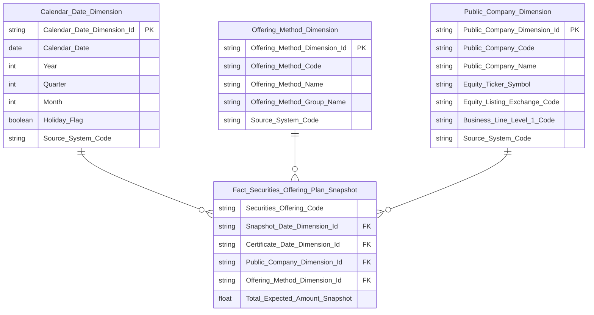

> **Ghi chú Phase 2:**
> - `Securities_Offering_Code` — BK đợt chào bán (degenerate dimension), denormalized sẵn trên Plan (`pc_securities_offering_code`) — bổ sung khi Phase 3 phát hiện 2 FK dim hiện có (Public Company + Offering Method) không đủ phân biệt các đợt chào bán khác nhau của cùng 1 công ty cùng loại hình; dùng làm grain key cho ORDER BY flat table
> - `Offering_Method_Dimension` — `Offering_Method_Dimension_Id` = PK, `Offering_Method_Code` = NK, ETL-derived (DISTINCT) trực tiếp từ `Public Company Securities Offering Plan.offering_method_code`; `Offering_Method_Name` JOIN `Classification Value` (`cl_value.cl_code = offering_method_code AND cl_value.schema_code = 'SO_OFFERING_METHOD'`) lấy `cl_nm` (tên gốc); `Offering_Method_Group_Name` computed CASE WHEN theo `offering_method_code` gom vào 6 nhóm (Công chúng/Riêng lẻ/ESOP/Trả cổ tức/Tăng vốn từ VCSH/Khác) — cả 2 cột tính 1 lần ngay trên Dimension (dùng chung Nhóm 2/3/6), flat table chỉ SELECT thẳng, không tự CASE WHEN lại. Nhóm 2/6 hiển thị tên gốc (`Offering_Method_Name`); Nhóm 3 hiển thị nhóm (`Offering_Method_Group_Name`).
> - `Public_Company_Dimension` = reuse `public_company_dim` (schema đầy đủ xem Nhóm 1) — FK join qua `Public Company Securities Offering.Public Company Code` (JOIN từ Offering cha, vì Plan không có trực tiếp Public Company Code — cần JOIN 2 tầng Plan → Offering → Public Company)
> - `Certificate_Date_Dimension_Id` — cùng FK date với Nhóm 1, join từ `Public Company Securities Offering.certificate_dt` (Plan không có ngày riêng)

**Lineage Mart → Báo cáo:**

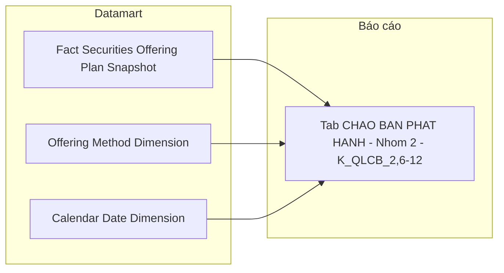

**Bảng grain:**

| Tên bảng | Grain |
|---|---|
| Fact Securities Offering Plan Snapshot | 1 row = 1 đợt chào bán × 1 loại hình kế hoạch × 1 ngày snapshot (ETL full-scan hàng ngày; Certificate Date giữ nguyên vai trò Chiều/slicer) |
| Offering Method Dimension | 1 row = 1 mã hình thức chào bán (scheme `IDS_SO_OFFERING_METHOD`) |
| Public Company Dimension (reuse `public_company_dim`) | 1 row = 1 công ty đại chúng |
| Calendar Date Dimension | 1 row = 1 ngày |

---

#### Nhóm 3 — Giá trị phát hành theo hình thức phát hành và nhóm ngành

> Phân loại: **Phân tích**
> Atomic: `Public Company Securities Offering Result` ← IDS.SECURITIES_OFFERING_RESULT — **READY** (Atomic draft — chưa approved chính thức)
> Atomic: `Public Company Securities Offering` ← IDS.SECURITIES_OFFERING — **READY** (Atomic draft, dùng để lấy `certificate_dt` FK date)
> [CẬP NHẬT 2026-09-10] Cùng thay đổi filter ngày với Nhóm 2 — `NVL(certificate_dt, official_letter_dt)`. Không có thay đổi nguồn/công thức nào khác cho Nhóm này.

**Mockup:**

| Ngành \ Loại hình | Công chúng | Riêng lẻ | ESOP | Trả cổ tức | Tăng vốn VCSH | Khác |
|---|---|---|---|---|---|---|
| Tài chính - Ngân hàng | 4,200 | 3,100 | 800 | 600 | 400 | 200 |
| Bất động sản | 2,100 | 1,800 | 500 | 400 | 700 | 100 |
| Công nghiệp | 1,800 | 950 | 300 | 200 | 150 | 100 |

**Source:** `Fact Securities Offering Result Snapshot` → `Offering Method Dimension`, `Public Company Dimension` (reuse), `Calendar Date Dimension`

**Bảng KPI:**

| KPI ID | Tên KPI | Đơn vị | Tính chất | Công thức | Ghi chú | Trạng thái |
|---|---|---|---|---|---|---|
| K_QLCB_2 | Ngành | — | Chiều | `GROUP BY Business Line Level 1 Code` — FK `Public Company Dimension` (reuse `public_company_dim`), cùng cột đã khai sinh ở Nhóm 1 | **[BỔ SUNG 2026-09-10 — Bước 5B phát hiện gap tồn tại từ trước]** Reuse từ Nhóm 1 (K_QLCB_2). Dòng BA STT 3 "Ngành" (Chỉ tiêu cơ sở) đã tồn tại từ bản BA gốc nhưng bị bỏ sót khỏi bảng KPI Nhóm 3 — `Public_Company_Dimension` đã sẵn FK trên `Fact_Securities_Offering_Result_Snapshot`, không cần bổ sung hạ tầng | READY |
| K_QLCB_13 | Loại hình phát hành (kết quả) | — | Chiều | `GROUP BY Offering Method Code Snapshot` — hiển thị `Offering_Method_Group_Name` (computed CASE WHEN có sẵn trên Dimension, xem bảng mapping ở Nhóm 2) — khác Nhóm 2/6 (hiển thị tên gốc `Offering_Method_Name`); filter K_QLCB_14–19 dùng cùng mapping mã→nhóm | — | READY |
| K_QLCB_14 | Giá trị huy động — Công chúng | Tỷ VNĐ | Cơ sở | `SUM(Total Collected Amount) WHERE Offering Method Code Snapshot IN ('1','2','3','4')` GROUP BY ngành | — | READY |
| K_QLCB_15 | Giá trị huy động — Riêng lẻ | Tỷ VNĐ | Cơ sở | `SUM(Total Collected Amount) WHERE Offering Method Code Snapshot = '5'` GROUP BY ngành | — | READY |
| K_QLCB_16 | Giá trị huy động — ESOP | Tỷ VNĐ | Cơ sở | `SUM(Total Collected Amount) WHERE Offering Method Code Snapshot IN ('9','10')` GROUP BY ngành | — | READY |
| K_QLCB_17 | Giá trị huy động — Trả cổ tức | Tỷ VNĐ | Cơ sở | `SUM(Total Collected Amount) WHERE Offering Method Code Snapshot = '7'` GROUP BY ngành | — | READY |
| K_QLCB_18 | Giá trị huy động — Tăng vốn từ VCSH | Tỷ VNĐ | Cơ sở | `SUM(Total Collected Amount) WHERE Offering Method Code Snapshot = '8'` GROUP BY ngành | — | READY |
| K_QLCB_19 | Giá trị huy động — Các loại khác | Tỷ VNĐ | Cơ sở | `SUM(Total Collected Amount) WHERE Offering Method Code Snapshot NOT IN ('1','2','3','4','5','7','8','9','10')` GROUP BY ngành | — | READY |

> **Mapping mã:** Giống Nhóm 2 — xem bảng mapping mã `Offering Method Code` ở Nhóm 2 (áp dụng cho `Offering Method Code Snapshot` trên Result).

> **Lưu ý:** Nhóm 3 dùng `Public Company Securities Offering Result` (kết quả thực tế), khác Nhóm 2 dùng `Plan` (kế hoạch). `Offering Method Code Snapshot` trên Result là denormalized snapshot từ Plan. K_QLCB_14–19 là **Cơ sở** (SUM trực tiếp có filter theo mã).
>
> **Ghi chú kỹ thuật ETL:** Tương tự Nhóm 2 — BA gom nhóm Result theo `(securities_offering_id, offering_method_cd)` bằng CTE **trước khi JOIN** sang bảng cha Offering, tránh nhân bản SUM nếu Result JOIN thêm bảng khác gây fanout. Giữ nguyên thứ tự "gom nhóm trước, JOIN sau" khi thiết kế LLD (etl_logic).

**Star Schema:**

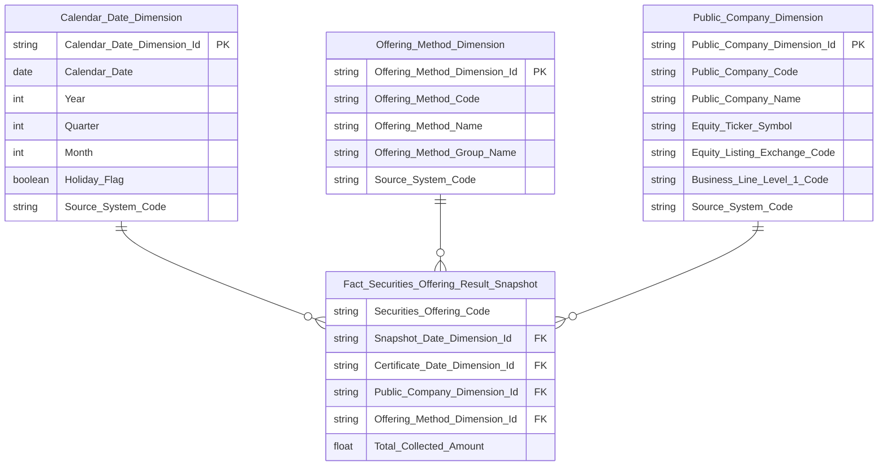

> **Ghi chú Phase 2:** Cùng `Calendar_Date_Dimension`, `Offering_Method_Dimension`, `Public_Company_Dimension` (reuse `public_company_dim`, schema đầy đủ xem Nhóm 1/2) với Nhóm 2 — không thiết kế lại logic, chỉ lặp lại block để Star Schema Nhóm 3 tự đứng độc lập, không có node rỗng.

**Lineage Mart → Báo cáo:**


**Bảng grain:**

| Tên bảng | Grain |
|---|---|
| Fact Securities Offering Result Snapshot | 1 row = 1 đợt chào bán × 1 loại hình kết quả thực tế × 1 ngày snapshot (ETL full-scan hàng ngày để Total Collected Amount luôn phản ánh đúng kết quả huy động mới nhất; Certificate Date giữ nguyên vai trò Chiều/slicer) |
| Offering Method Dimension | 1 row = 1 mã hình thức chào bán (reuse từ Nhóm 2) |
| Public Company Dimension (reuse `public_company_dim`) | 1 row = 1 công ty đại chúng |
| Calendar Date Dimension | 1 row = 1 ngày |

---

#### Nhóm 4 — Bảng Chi tiết số lượng chứng khoán Chào bán & Phát hành

> Phân loại: **Tác nghiệp**
> Atomic: `Public Company Securities Offering` ← IDS.SECURITIES_OFFERING — **READY** (Atomic draft — chưa approved chính thức)
> Atomic: `Public Company Securities Offering Plan` ← IDS.SECURITIES_OFFERING_PLAN — **READY** (Atomic draft)
> Atomic: `Public Company Securities Offering Result` ← IDS.SECURITIES_OFFERING_RESULT — **READY** (Atomic draft)
> Atomic: `Public Company` ← IDS.COMPANY_PROFILES — **READY**
> [CẬP NHẬT 2026-09-10] Cùng thay đổi filter ngày với Nhóm 1/2/3 — `NVL(certificate_dt, official_letter_dt)`. Không có thay đổi nguồn/công thức nào khác cho Nhóm này.

**Mockup:**

| Mã CK | Tên DN | Hình thức | Đvị tư vấn | Tổ chức KT | Đvị bảo lãnh | Đvị XHTN | SL cấp phép | SL thành công | GT cấp phép (tỷ) | GT thành công (tỷ) | Tỷ lệ % |
|---|---|---|---|---|---|---|---|---|---|---|---|
| ABC | Công ty ABC | Công chúng | — | — | — | — | 10,000,000 | 9,500,000 | 500 | 475 | 95% |
| DEF | Công ty DEF | Riêng lẻ | — | — | — | — | 5,000,000 | 5,000,000 | 250 | 250 | 100% |

**Source:** `Operational Securities Offering 360 Profile` — lookup theo đợt chào bán / công ty

**Bảng KPI:**

| KPI ID | Tên KPI | Đơn vị | Tính chất | Công thức | Ghi chú | Trạng thái |
|---|---|---|---|---|---|---|
| K_QLCB_20 | Tên doanh nghiệp | — | Attribute | `SELECT Public Company Name` — `Public Company.public_company_nm` (IDS.COMPANY_PROFILES, cột `COMPANY_NAME_VN`) | — | READY |
| K_QLCB_21 | Mã chứng khoán | Text | Attribute | `SELECT Equity Ticker Symbol` — `Public Company.equity_ticker_symbol` (IDS.COMPANY_PROFILES, cột `equity_ticker`) | — | READY |
| K_QLCB_70 | Loại chứng khoán | Text | Attribute | `securities_tp_nm` ← `Classification Value.cl_nm` (`cl_code = Public Company Securities Offering Result.security_tp_code`, `schema_code = 'SO_SECURITY_TYPE'`) | **[MỚI 2026-10-08]** BA STT 4 thêm dòng 'Loại chứng khoán' (UAT bổ sung; `ck.LOOKUP_VALUE_VN`, `LOOKUP_GROUP = 'SO_SECURITY_TYPE'`). Cột mới `securities_tp_nm` trên `opr_securities_offering_360_profile` (cùng pattern `offering_method_nm`); `securities_tp_code` giữ nguyên | READY (Atomic draft) |
| K_QLCB_22 | Hình thức chào bán | — | Attribute | `SELECT Offering Method Name` — tên gốc, JOIN `Classification Value` (`cl_value.cl_code = Offering Method Code AND cl_value.schema_code = 'SO_OFFERING_METHOD'`) lấy `cl_nm` | — | READY |
| K_QLCB_23 | Đơn vị tư vấn | Text | Attribute | `Public Company Securities Offering.consulting_organization_nm` — IDS.SECURITIES_OFFERING.CONSULTING_ORG — direct map | — | READY |
| K_QLCB_24 | Tổ chức kiểm toán | Text | Attribute | `Public Company Securities Offering.audit_organization_nm` — IDS.SECURITIES_OFFERING.AUDIT_ORG — direct map | — | READY |
| K_QLCB_25 | Đơn vị bảo lãnh | Text | Attribute | `Public Company Securities Offering.underwriting_organization_nm` — IDS.SECURITIES_OFFERING.UNDERWWRITING_ORG (tên cột nguồn có lỗi chính tả, giữ nguyên) — direct map | — | READY |
| K_QLCB_26 | Đơn vị xếp hạng tín nhiệm | Text | Attribute | `Public Company Securities Offering.credit_rating_organization_nm` — IDS.SECURITIES_OFFERING.CREDIT_RATING_ORG — direct map | — | READY |
| K_QLCB_27 | Số lượng CK được cấp phép | CK | Attribute | `SUM(Public Company Securities Offering Plan.total_registered_quantity)` theo đợt × hình thức | **[SỬA 2026-10-08]** BA đổi Bảng nguồn `SECURITIES_OFFERING` → `SECURITIES_OFFERING_PLAN` (BA SQL `p.total_registered_qty` từ `plan_agg`, không còn `t.total_registered_qty` của bảng cha). Mỗi dòng 360 là 1 đợt × 1 hình thức nên lấy theo plan của đúng hình thức — tổng theo đợt vì thế có thể khác bản cũ khi 1 đợt có nhiều hình thức | READY |
| K_QLCB_28 | Số lượng CK chào bán thành công | CK | Attribute | `Public Company Securities Offering Result.total_successful_quantity` — join theo `offering_method_code` khớp với Plan | — | READY |
| K_QLCB_29 | Giá trị cấp phép | Tỷ VNĐ | Attribute | `Public Company Securities Offering Plan.total_expected_amt_snpst` — join theo `(pc_securities_offering_id, offering_method_code)` | **BA cập nhật 2026-08-25 (Dũng):** đổi nguồn từ bảng cha `Public Company Securities Offering` (`total_expected_amt`) sang `Public Company Securities Offering Plan` — khớp grain (Securities Offering Code, Offering Method Code) của Operational này. Atomic ghi cột này là "denormalized snapshot từ Offering cha" — cần Data Modeler xác nhận lại ý nghĩa trước go-live | READY |
| K_QLCB_30 | Giá trị chào bán thành công | Tỷ VNĐ | Attribute | `Public Company Securities Offering Result.total_collected_amt` | — | READY |
| K_QLCB_31 | Tỷ lệ chào bán thành công | % | Attribute | `ROUND(SUM(Total Successful Quantity) / NULLIF(Total Registered Quantity, 0) * 100, 2)` — tính theo 2 trường số lượng (K_QLCB_27/28), không theo giá trị tiền | **BA cập nhật 2026-08-25 (Dũng):** đổi công thức từ `total_collected_amt / total_expected_amt` (giá trị tiền) sang tính theo 2 trường số lượng cấp phép/thành công | READY |

> **Ghi chú K_QLCB_23–26:** 4 cột tổ chức có sẵn trực tiếp trên bảng cha `Public Company Securities Offering`, `etl_logic_type = direct`.

> **Ghi chú grain:** `Operational Securities Offering 360 Profile` join tự nhiên theo `offering_method_code` — `Public Company Securities Offering Plan` (1 row/loại hình kế hoạch) LEFT JOIN `Public Company Securities Offering Result` (1 row/loại hình kết quả) theo `(pc_securities_offering_id, offering_method_code)`. K_QLCB_27 lấy từ bảng cha Offering (`total_registered_quantity`, tổng toàn hồ sơ — không GROUP BY loại hình theo đúng BA SQL). K_QLCB_28 lấy trực tiếp từ Result (không cần SUM vì Result Quantity đã snapshot per-loại-hình sẵn).

**Schema bảng tác nghiệp:**

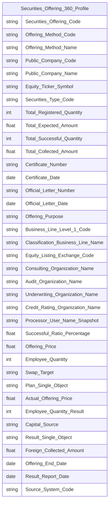

> **Ghi chú Phase 2 — Key labels cho `Operational Securities Offering 360 Profile`:**
> - `Securities_Offering_Code` → `key = BK` — Business key đợt chào bán (`Public Company Securities Offering.pc_securities_offering_code`), ETL debug anchor
> - `Offering_Method_Code` → `key = BK` — Business key component 2 (từ Plan), cùng với `Securities_Offering_Code` tạo thành Composite BK định nghĩa grain (1 row = 1 đợt × 1 loại hình)
> - `Offering_Method_Name` — tên gốc hình thức chào bán, JOIN `Classification Value` (`cl_value.cl_code = Offering_Method_Code AND cl_value.schema_code = 'SO_OFFERING_METHOD'`) lấy `cl_nm`; dùng ở Nhóm 4 (K_QLCB_22) và Nhóm 8 (K_QLCB_53)
> - Mermaid không hỗ trợ label `BK` trong erDiagram — chỉ ghi trong Attributes CSV cột `key`
> - Không có surrogate PK riêng cho 360 Profile — dùng Composite BK thay thế
>
> **Cột dùng ở Nhóm 7/9/10 (mọi cột dùng ở bất kỳ Nhóm nào của `Operational Securities Offering 360 Profile` phải xuất hiện đủ trong erDiagram này):**
> - `Classification_Business_Line_Name` (nguồn `Classification IDS Business Line.cl_ids_business_line_nm`, JOIN qua `Public Company.cl_ids_business_line_level_1_id` — giữ nguyên tên cột như `public_company_dim.classification_business_line_nm`) — dùng ở Nhóm 7 (K_QLCB_65), đệm sẵn tên ngành cho mockup cột "Ngành"
> - `Processor_User_Name_Snapshot` (nguồn bảng cha Offering `processor_user_nm_snpst`) — dùng ở Nhóm 7 (K_QLCB_44)
> - `Result_Report_Date` (nguồn `Public Company Securities Offering Result.result_rpt_dt`) — **[ĐỔI NGUỒN 2026-09-10 lần 2]** dùng ở Nhóm 7 (K_QLCB_43, thay thế `Certificate_Date` làm "Thời điểm báo cáo"). BA đổi 2 lần trong cùng ngày: Certificate Date → Submission Date (Offering cha) → Result Report Date (Result) — cột `Submission_Date` đã thêm trước đó bị thay thế hoàn toàn, không giữ lại vì chưa có KPI nào khác dùng. BA ghi Bảng nguồn = SECURITIES_OFFERING nhưng SQL thực tế lấy `result_agg.RESULT_REPORT_DATE` — xem O_QLCB_21. `Certificate_Date`/`Official_Letter_Date` vẫn giữ trên schema cho Nhóm 8
> - `Total_Registered_Quantity` (nguồn bảng cha Offering `total_registered_quantity`) — dùng ở Nhóm 4 (K_QLCB_27) và Nhóm 9 (K_QLCB_54) — Nhóm 4 sửa lại theo BA (trước đó sai map vào Plan snapshot) khi review cross-check phát hiện gap
> - `Securities_Type_Code` — **[ĐỔI NGUỒN 2026-09-10]** nguồn `Public Company Securities Offering Result.security_tp_code` (trước đây `Public Company.securities_tp_code`) — dùng ở Nhóm 7 (K_QLCB_48), xem O_QLCB_17
> - `Offering_Price` (nguồn Plan `offering_price`), `Employee_Quantity` (nguồn Plan `employee_quantity`), `Swap_Target` (nguồn Plan `swap_target`, giữ lại trên schema dù không còn KPI nào dùng — xem `Plan_Single_Object`), `Plan_Single_Object` (nguồn Plan `single_offering_object` — **[MỚI 2026-09-10]**, thay thế logic CASE WHEN cũ của K_QLCB_58) — dùng ở Nhóm 9 (K_QLCB_55, 57, 58)
> - `Actual_Offering_Price` (nguồn Result `actual_offering_price`), `Employee_Quantity_Result` (nguồn Result `employee_quantity`), `Capital_Source` (nguồn Result `capital_src`, giữ lại trên schema dù không còn KPI nào dùng — xem `Result_Single_Object`), `Result_Single_Object` (nguồn Result `result_single_object` — **[MỚI 2026-09-10]**, thay thế logic CASE WHEN cũ của K_QLCB_64), `Foreign_Collected_Amount` (nguồn Result `foreign_collected_amt` — **[MỚI 2026-09-10]**, KPI mới K_QLCB_68; BA ghi nhầm Bảng nguồn = `SECURITIES_OFFERING` nhưng SQL thực tế dùng `result_agg`/Result, xem O_QLCB_19 — **Closed**), `Offering_End_Date` (nguồn Result `offering_end_dt`, **KHÔNG PHẢI Plan** — **[SỬA NGUỒN 2026-09-10, xác nhận qua issue Dũng 2026-09-09]**: bản nháp trước gán nhầm sang `pc_securities_offering_plan.offering_end_dt` khiến cột "mồ côi" không KPI nào dùng; Dũng xác nhận đây là chỉ tiêu thật "Ngày kết thúc đợt chào bán" cần lên Data Explorer, nguồn đúng là Result — cấp KPI mới K_QLCB_69, xem O_QLCB_18 — **Closed**) — dùng ở Nhóm 10 (K_QLCB_61, 63, 64, 68, 69)
> - `Source_System_Code` — mã hệ thống nguồn, hardcode `IDS.SECURITIES_OFFERING` (driving table `Public Company Securities Offering`, bảng cha Offering — không phải Plan), bắt buộc cho mọi bảng Operational

**Lineage Mart → Báo cáo:**

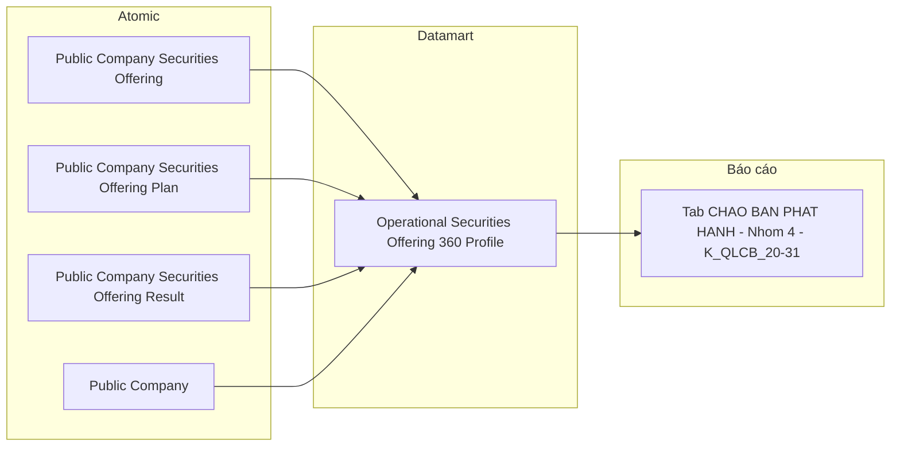

**Bảng grain:**

| Tên bảng | Grain |
|---|---|
| `Operational Securities Offering 360 Profile` | 1 row = 1 đợt chào bán × 1 loại hình (Plan LEFT JOIN Result theo `offering_method_code`). Composite BK: (Securities Offering Code, Offering Method Code) |

---

### Tab: HỒ SƠ ĐĂNG KÝ CHÀO BÁN

**Slicer chung:** Từ ngày — Đến ngày (date range picker)

---

#### Nhóm 5 — Tỷ lệ xử lý hồ sơ (STT 5)

> Phân loại: **Phân tích**
> Atomic: `Administrative Procedure Document` (`ap_document`) ← TTHC.AP_DOCUMENT; `Administrative Procedure Document Applicant` (`ap_document_applicant`) ← TTHC.AP_DOCUMENT_APPLICANT; `Classification Value` (`cl_value`) ← TTHC.CLASSIFICATION_VALUE (scheme `TTHC.PROCESSING_STATUS`, `TTHC.DOCUMENT_TYPE`, `TTHC.PROCESSING_AUTHORITY`) — **READY (Atomic draft/approved)**
> **[SỬA 2026-10-15 — Fact phẳng theo SQL dbt `dtm_fct_tthc_ap_document`, Data Modeler]** Thay 2 Dimension (`Administrative Procedure Application Status Dimension`, `Administrative Procedure Application Type Dimension`) + `Fact Securities Offering Application Snapshot` bằng **1 Fact phẳng `Fact TTHC AP Document`** (`fct_tthc_ap_document`, 6 cột): mã hồ sơ, tên người nộp, mã chứng khoán, hình thức chào bán (tên), ngày gửi và nhóm trạng thái (tên tiếng Việt) lưu sẵn trên Fact — không còn FK Calendar Date/Dimension, không còn cột ngày snapshot. Nguồn đọc theo SCD4A (snapshot ngày chạy, ACTIVE): `ap_document` INNER JOIN `cl_value` (trạng thái, loại hồ sơ, cơ quan xử lý) LEFT JOIN `ap_document_applicant`; phạm vi = cơ quan xử lý 'Ban Quản lý chào bán chứng khoán', trạng thái thuộc 1 trong 5 nhóm. Bảng nạp lại theo ngày chạy (trạng thái hiện hành). KPI_ID và công thức tính giữ nguyên ý nghĩa; chỉ đổi cột nguồn (O_QLCB_26).

**Mockup (a) — 4 KPI Card:**

| Tỷ lệ hồ sơ đăng ký | Tỷ lệ đang xử lý | Tỷ lệ đã cấp phép | Tỷ lệ bị từ chối |
|---|---|---|---|
| 19% | 31% | 42% | 11% |

**Mockup (b) — Donut GROUP BY nhóm trạng thái:**

| Nhóm trạng thái | Số lượng | Tỷ lệ % |
|---|---|---|
| Hồ sơ đăng ký | 24 | 16% |
| Hồ sơ đang xử lý | 38 | 26% |
| Hồ sơ đã được chấp thuận | 72 | 49% |
| Hồ sơ bị từ chối | 14 | 9% |

> **Lưu ý:** Cả 2 mockup cùng dùng 4 KPI Tỷ lệ % bên dưới — (a) hiển thị dạng 4 card riêng biệt (chỉ %), (b) hiển thị dạng GROUP BY pivot trên cùng 1 Fact (cả số lượng lẫn %). Tên dashboard gốc BA là "Tỷ lệ xử lý hồ sơ" — xác nhận toàn bộ 4 KPI của Nhóm này là tỷ lệ %, không phải số lượng thuần.
>
> **Lát 'Chưa xác định' [SỬA 2026-10-15]:** SQL BA STT 5 có nhánh `ELSE 'Chưa xác định - kiểm tra lại danh mục'` và mẫu số gồm cả nhóm này. Theo SQL dbt `dtm_fct_tthc_ap_document` hồ sơ có trạng thái ngoài 5 nhóm bị loại khỏi Fact (`WHERE document_status_group_nm IS NOT NULL`) nên **donut chỉ còn 4 lát đã phân loại** và mẫu số = tổng hồ sơ thuộc 5 nhóm — lệch BA, xem O_QLCB_12 và O_QLCB_26.

**Source:** `Fact TTHC AP Document`

**Bảng KPI:**

| KPI ID | Tên KPI | Đơn vị | Tính chất | Công thức | Ghi chú | Trạng thái |
|---|---|---|---|---|---|---|
| K_QLCB_32 | Tỷ lệ hồ sơ đăng ký | % | Phái sinh | `COUNT(Administrative Procedure Document Code WHERE Document Status Group Name = 'Hồ sơ đăng ký') / COUNT(Administrative Procedure Document Code) * 100` | **[SỬA 2026-10-15]** cột nhóm trạng thái = `document_status_group_nm` (tên tiếng Việt) trên Fact phẳng; mẫu số = tổng hồ sơ thuộc 5 nhóm (không còn nhóm `UNDEFINED` — O_QLCB_26). Giữ Tính chất Phái sinh + phép chia tại Detail Mapping (FIX 2026-08-14 v2) | READY (Atomic draft) |
| K_QLCB_33 | Tỷ lệ hồ sơ đang xử lý | % | Phái sinh | `COUNT(Administrative Procedure Document Code WHERE Document Status Group Name = 'Hồ sơ đang xử lý') / COUNT(Administrative Procedure Document Code) * 100` | Nhóm 'Hồ sơ đang xử lý' gom 30 giá trị `cl_nm` trạng thái. Cùng ghi chú K_QLCB_32 | READY (Atomic draft) |
| K_QLCB_34 | Tỷ lệ hồ sơ đã chấp thuận | % | Phái sinh | `COUNT(Administrative Procedure Document Code WHERE Document Status Group Name = 'Hồ sơ đã được chấp thuận') / COUNT(Administrative Procedure Document Code) * 100` | Nhóm gom 4 giá trị. Cùng ghi chú K_QLCB_32 | READY (Atomic draft) |
| K_QLCB_35 | Tỷ lệ hồ sơ bị từ chối | % | Phái sinh | `COUNT(Administrative Procedure Document Code WHERE Document Status Group Name IN ('Hồ sơ bị từ chối','Hồ sơ quá hạn bổ sung')) / COUNT(Administrative Procedure Document Code) * 100` | BA Nhóm 5 gộp 'Hồ sơ quá hạn bổ sung' vào 'bị từ chối' (9 giá trị) trong khi BA Nhóm 6 tách riêng — đếm 2 nhóm để giữ đúng SQL BA Nhóm 5 (O_QLCB_23). Cùng ghi chú K_QLCB_32 | READY (Atomic draft) |

> **Ghi chú `Administrative Procedure Document Code`:** Degenerate Dimension trên Fact phẳng — BK hồ sơ TTHC (`ap_document.ap_document_code`). Grain = 1 hồ sơ nên `COUNT(Administrative Procedure Document Code)` = `COUNT(*)` của SQL BA, không cần DISTINCT.

> **Ghi chú `Document Status Group Name` — 5 nhóm (tên tiếng Việt, [SỬA 2026-10-15]):** không phải direct map; gom bằng `CASE WHEN cl_nm IN (...)` trên 47 giá trị trạng thái (scheme `TTHC.PROCESSING_STATUS`) ngay trong ETL của Fact (không còn Dimension trạng thái):
>
> | `Document Status Group Name` | Nhãn BA | Số giá trị `cl_nm` |
> |---|---|---|
> | `Hồ sơ đăng ký` | Hồ sơ đăng ký (Nhóm 5) / Hồ sơ đang chờ tiếp nhận (Nhóm 6) | 4 |
> | `Hồ sơ đang xử lý` | Hồ sơ đang xử lý | 30 |
> | `Hồ sơ đã được chấp thuận` | Hồ sơ đã được chấp thuận | 4 |
> | `Hồ sơ bị từ chối` | Hồ sơ bị từ chối | 8 |
> | `Hồ sơ quá hạn bổ sung` | Hồ sơ quá hạn bổ sung (BA Nhóm 6; Nhóm 5 gộp vào bị từ chối) | 1 |
>
> Trạng thái ngoài 5 nhóm (nhánh `ELSE`) → `NULL` → hồ sơ bị loại khỏi Fact. Danh sách 47 giá trị hard-code trong SQL BA/dbt, chưa có danh mục chuẩn hoá ở nguồn — O_QLCB_12.

**Star Schema:**

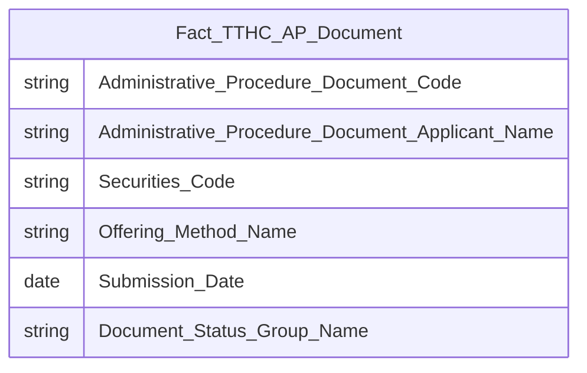

> **Ghi chú Phase 2 — Key labels (Fact phẳng 2026-10-15):** `Administrative_Procedure_Document_Code` → `key = DD` (Degenerate Dimension). Fact **không có Surrogate PK, không có FK** (denormalized): mọi chiều (hình thức chào bán, nhóm trạng thái, tên người nộp, mã chứng khoán, ngày gửi) là cột thường; `Submission_Date` là cột ngày thường, không còn `Calendar Date Dimension`. Đã bỏ: `Snapshot_Date_Dimension_Id`, `Submission_Date_Dimension_Id`, 2 FK Dimension, `Securities_Symbol_Code` (thay bằng `Securities_Code`).

**Lineage Mart → Báo cáo:**

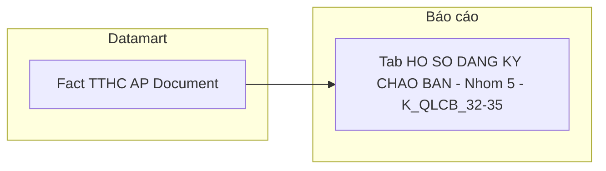

**Bảng grain:**

| Tên bảng | Grain |
|---|---|
| `Fact TTHC AP Document` | 1 row = 1 hồ sơ TTHC (`Administrative Procedure Document Code`) tại ngày chạy ETL — snapshot Atomic ACTIVE của ngày chạy, cơ quan xử lý 'Ban Quản lý chào bán chứng khoán', trạng thái thuộc 5 nhóm; bảng nạp lại theo ngày chạy (trạng thái hiện hành) |

---

#### Nhóm 6 — Bảng Chi tiết hồ sơ chào bán & phát hành

> Phân loại: **Phân tích**
> Atomic: `Administrative Procedure Document` (`ap_document`) ← TTHC.AP_DOCUMENT; `Administrative Procedure Document Applicant` (`ap_document_applicant`) ← TTHC.AP_DOCUMENT_APPLICANT; `Classification Value` (`cl_value`) ← TTHC.CLASSIFICATION_VALUE (scheme `TTHC.PROCESSING_STATUS`, `TTHC.DOCUMENT_TYPE`, `TTHC.PROCESSING_AUTHORITY`) — **READY (Atomic draft/approved)**
> **[SỬA 2026-10-15 — Fact phẳng theo SQL dbt `dtm_fct_tthc_ap_document`, Data Modeler]** Thay 2 Dimension (`Administrative Procedure Application Status Dimension`, `Administrative Procedure Application Type Dimension`) + `Fact Securities Offering Application Snapshot` bằng **1 Fact phẳng `Fact TTHC AP Document`** (`fct_tthc_ap_document`, 6 cột): mã hồ sơ, tên người nộp, mã chứng khoán, hình thức chào bán (tên), ngày gửi và nhóm trạng thái (tên tiếng Việt) lưu sẵn trên Fact — không còn FK Calendar Date/Dimension, không còn cột ngày snapshot. Nguồn đọc theo SCD4A (snapshot ngày chạy, ACTIVE): `ap_document` INNER JOIN `cl_value` (trạng thái, loại hồ sơ, cơ quan xử lý) LEFT JOIN `ap_document_applicant`; phạm vi = cơ quan xử lý 'Ban Quản lý chào bán chứng khoán', trạng thái thuộc 1 trong 5 nhóm. Bảng nạp lại theo ngày chạy (trạng thái hiện hành). KPI_ID và công thức tính giữ nguyên ý nghĩa; chỉ đổi cột nguồn (O_QLCB_26).
> Ghi chú: cùng Fact với Nhóm 5. BA STT 6 (SQL 2026-09-10) nhóm theo hình thức × tên tổ chức/cá nhân × mã chứng khoán; `ky_bao_cao` là chuỗi hiển thị khoảng ngày (không phải cột GROUP BY).

**Mockup:**

| Tên tổ chức/cá nhân | Mã cổ phiếu | Hình thức chào bán | Hồ sơ đăng ký | Đang xử lý | Đã cấp phép | Bị từ chối | Tổng |
|---|---|---|---|---|---|---|---|
| Công ty CP ABC | ABC | Chào bán cổ phiếu lần đầu ra công chúng (IPO) | 2 | 5 | 18 | 3 | 28 |
| Công ty CP DEF | DEF | Chào bán trái phiếu ra công chúng | 1 | 3 | 12 | 1 | 17 |
| Ông Nguyễn Văn X | — | Phát hành cổ phiếu theo chương trình ESOP | 0 | 2 | 24 | 4 | 30 |

> **Ghi chú mockup [CẬP NHẬT 2026-09-10]:** Mockup cũ (GROUP BY hình thức × năm) đã lỗi thời — SQL BA mới nhóm theo hình thức × tổ chức/cá nhân nộp hồ sơ × mã cổ phiếu, không còn hiển thị trục Năm; thay vào đó có `ky_bao_cao` (chuỗi hiển thị khoảng ngày đã lọc, không phải cột GROUP BY). Nhãn hình thức chào bán vẫn lấy nguyên `display_text` của content item `LoaiHoSo` trên TTHC — không đổi so với 2026-08-24, xem O_QLCB_13.


**Source:** `Fact TTHC AP Document`

**Bảng KPI:**

| KPI ID | Tên KPI | Đơn vị | Tính chất | Công thức | Ghi chú | Trạng thái |
|---|---|---|---|---|---|---|
| K_QLCB_36 | Hình thức chào bán | — | Chiều | `Fact TTHC AP Document.Offering Method Name` | **[SỬA 2026-10-15]** tên loại hồ sơ (`cl_nm`, scheme `TTHC.DOCUMENT_TYPE`) lưu sẵn trên Fact phẳng — không còn Dimension hình thức. Danh mục khác Nhóm 2/3 (scheme `IDS_SO_OFFERING_METHOD`), xem O_QLCB_13 | READY (Atomic draft) |
| K_QLCB_37 | Ngày gửi hồ sơ | — | Chiều | `Fact TTHC AP Document.Submission Date` | **[SỬA 2026-10-15]** `CAST(submission_tms AS DATE)` — cột ngày thường trên Fact (không còn FK `Calendar Date Dimension`); BI rollup năm nếu cần. Atomic Timestamp chưa nêu múi giờ — O_QLCB_22 | READY (Atomic draft) |
| K_QLCB_66 | Tên tổ chức/cá nhân đăng ký | Text | Chiều | `Fact TTHC AP Document.Administrative Procedure Document Applicant Name` ← `ap_document_applicant.display_nm` | **[SỬA 2026-10-15]** nâng PENDING → READY: SQL dbt LEFT JOIN `ap_document_applicant` lấy `display_nm` → cột `ap_document_applicant_nm` trên Fact. Atomic ghi `display_nm` chỉ có giá trị với schema cũ (trước 05/2025), schema mới NULL cho tới khi Atomic tra cứu bổ sung — dữ liệu có thể NULL (O_QLCB_24) | READY (Atomic draft) — dữ liệu schema mới có thể NULL |
| K_QLCB_67 | Mã chứng khoán | Text | Chiều | `Fact TTHC AP Document.Securities Code` ← `ap_document.securities_code` | **[SỬA 2026-10-15]** đổi từ parse JSON `eform_data` (`securities_symbol_code`) sang `ap_document.securities_code` (`HoSoTTHC.MaChungKhoan`) theo SQL dbt; NULL với loại hồ sơ không có mã. O_QLCB_25 hết hiệu lực | READY (Atomic draft) |
| K_QLCB_38 | Số lượng hồ sơ đang chờ tiếp nhận | Hồ sơ | Cơ sở | `COUNT(Administrative Procedure Document Code) WHERE Document Status Group Name = 'Hồ sơ đăng ký'` | Nhóm BA 'Hồ sơ đang chờ tiếp nhận' = nhóm 'Hồ sơ đăng ký'. BA SQL cột `so_luong_ho_so_dang_ky` so nhãn cũ nên luôn = 0 — thiết kế theo mô tả BA (O_QLCB_23). Số lượng thuần, không phải % | READY (Atomic draft) |
| K_QLCB_39 | Số lượng hồ sơ đang xử lý | Hồ sơ | Cơ sở | `COUNT(Administrative Procedure Document Code) WHERE Document Status Group Name = 'Hồ sơ đang xử lý'` | Cùng ghi chú K_QLCB_38 | READY (Atomic draft) |
| K_QLCB_40 | Số lượng hồ sơ đã cấp phép | Hồ sơ | Cơ sở | `COUNT(Administrative Procedure Document Code) WHERE Document Status Group Name = 'Hồ sơ đã được chấp thuận'` | Cùng ghi chú K_QLCB_38 | READY (Atomic draft) |
| K_QLCB_71 | Số lượng hồ sơ quá hạn bổ sung | Hồ sơ | Cơ sở | `COUNT(Administrative Procedure Document Code) WHERE Document Status Group Name = 'Hồ sơ quá hạn bổ sung'` | BA STT 6 dòng 49; nhóm riêng, tách khỏi 'bị từ chối' (O_QLCB_23) | READY (Atomic draft) |
| K_QLCB_41 | Số lượng hồ sơ bị từ chối | Hồ sơ | Cơ sở | `COUNT(Administrative Procedure Document Code) WHERE Document Status Group Name = 'Hồ sơ bị từ chối'` | 'Hồ sơ quá hạn bổ sung' không thuộc nhóm này ở BA Nhóm 6 — xem K_QLCB_71 | READY (Atomic draft) |
| K_QLCB_42 | Tổng hồ sơ | Hồ sơ | Derived | `COUNT(Administrative Procedure Document Code)` — tổng hồ sơ trong ô (hình thức × tổ chức × mã CK), **không** phải tổng 4 KPI con | SQL BA dùng `COUNT(*) AS tong_ho_so`. **[SỬA 2026-10-15]** Fact chỉ chứa hồ sơ thuộc 5 nhóm trạng thái nên không còn hồ sơ 'chưa phân loại' trong tổng | READY (Atomic draft) |

**Star Schema:** Dùng chung Fact phẳng với Nhóm 5 (không có Dimension):


> **Ghi chú grain:** Nhóm 5 và Nhóm 6 dùng chung 1 Fact, **1 row = 1 hồ sơ TTHC**. Hình thức chào bán là cột tên (`offering_method_nm`) lấy bằng INNER JOIN 1:1 `cl_value` theo loại hồ sơ nên không làm phồng số dòng; tên người nộp lấy bằng LEFT JOIN 1:1 theo `ap_document_applicant_id` (NULL không làm mất hồ sơ).

**Lineage Mart → Báo cáo:**

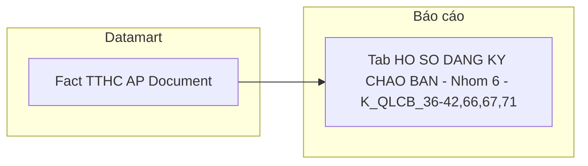

**Bảng grain:**

| Tên bảng | Grain |
|---|---|
| `Fact TTHC AP Document` | 1 row = 1 hồ sơ TTHC tại ngày chạy ETL (cùng grain với Nhóm 5; bỏ các Dimension trạng thái/hình thức và cột ngày snapshot — Fact phẳng 2026-10-15) |

**Bảng mapping nguồn (Atomic):**

| Bảng nguồn BA | Atomic entity | Atomic table | KPI liên quan |
|---|---|---|---|
| `TTHC.AP_DOCUMENT_APPLICANT` (JSON `$.HoSoTTHC.DoiTuongNopHoSo.ContentItemIds[0]`) | `Administrative Procedure Document Applicant` (`display_nm`, NULL với schema mới) | `ap_document_applicant` | K_QLCB_66 (READY — dữ liệu có thể NULL, O_QLCB_24) |
| `TTHC.AP_DOCUMENT` (`securities_code` = `HoSoTTHC.MaChungKhoan`) | `Administrative Procedure Document` | `ap_document` | K_QLCB_67 (READY) |

---

### Tab: CHÀO BÁN VÀ PHÁT HÀNH (Data Explorer)

**Slicer chung:** Sàn (dropdown), Ngành nghề (dropdown), Khoảng thời gian (Từ ngày — Đến ngày), Loại chứng khoán (dropdown) — **[MỚI 2026-09-10, theo issue Dũng 2026-09-09]** filter theo `Public Company Securities Offering Result.security_tp_code` (cùng nguồn hiển thị với K_QLCB_48)

> **Ghi chú thiết kế:** Data Explorer là màn hình tra cứu chi tiết từng đợt chào bán, cho phép người dùng chọn tổ hợp chỉ số (checkbox) từ 4 nhóm rồi hiển thị bảng kết quả. Đây là use case Tác nghiệp — lookup n đợt chào bán theo điều kiện lọc. Tab này **reuse** `Operational Securities Offering 360 Profile` đã thiết kế ở Nhóm 4 Tab CHÀO BÁN PHÁT HÀNH, mở rộng thêm các attribute chi tiết theo từng hình thức phát hành. Không cần thêm Fact hay Dim mới.

---

#### Nhóm 7 — Thông tin cơ sở (STT 40–45)

> Phân loại: **Tác nghiệp**
> Atomic: `Public Company Securities Offering` ← IDS.SECURITIES_OFFERING — **READY** (Atomic draft — chưa approved chính thức)
> Atomic: `Public Company` ← IDS.COMPANY_PROFILES — **READY**
> Atomic: `Public Company Securities Offering Result` ← IDS.SECURITIES_OFFERING_RESULT — **READY** (Atomic draft) — [MỚI 2026-09-10] cần cho K_QLCB_48 (đổi nguồn "Loại chứng khoán") và filter "Loại chứng khoán" trên Slicer chung (cùng cột `security_tp_code`)

**Mockup:**

| Mã CK | Tên công ty | Sàn | Ngành | Thời điểm báo cáo | Chuyên viên | Loại CK |
|---|---|---|---|---|---|---|
| VIC | VinGroup | HOSE | Bất động sản | 24/03/2026 | Nguyễn Văn A | Cổ phiếu |
| VCB | Vietcombank | UPCOM | Ngân hàng | 24/03/2026 | Trần Thị B | Cổ phiếu |

**Source:** `Operational Securities Offering 360 Profile`

**Bảng KPI:**

| KPI ID | Tên KPI | Đơn vị | Tính chất | Công thức | Ghi chú | Trạng thái |
|---|---|---|---|---|---|---|
| K_QLCB_43 | Thời điểm báo cáo | Ngày | Attribute | `Public Company Securities Offering Result.result_rpt_dt` — IDS.SECURITIES_OFFERING_RESULT.RESULT_REPORT_DATE (qua CTE result_agg) | BA cập nhật 2026-08-11: đổi từ Official Letter Date sang Certificate Date. **[ĐỔI NGUỒN 2026-09-10]** BA đổi 2 lần trong cùng ngày: → `SUBMISSION_DATE` (Offering cha) → `result_report_date` (Result). Atomic `pc_securities_offering_result` đã có sẵn attribute `result_rpt_dt` — READY. BA ghi Bảng nguồn = SECURITIES_OFFERING nhưng SQL thực tế dùng Result — xem O_QLCB_21 | READY |
| K_QLCB_44 | Chuyên viên | Text | Attribute | `Public Company Securities Offering.processor_user_nm_snpst` — IDS.SECURITIES_OFFERING.PROCESSOR_USER_NAME | Tên người xử lý hồ sơ dạng snapshot | READY |
| K_QLCB_45 | Tên công ty | Text | Attribute | `Public Company.public_company_nm` | — | READY |
| K_QLCB_46 | Mã chứng khoán | Text | Attribute | `Public Company.equity_ticker_symbol` — IDS.COMPANY_PROFILES | — | READY |
| K_QLCB_47 | Sàn | Text | Attribute | `Public Company.exchange_code` | Scheme: IDS_EQUITY_LISTING_EXCH | READY |
| K_QLCB_48 | Loại chứng khoán | Text | Attribute | `securities_tp_nm` ← `Classification Value.cl_nm` (`cl_code = Public Company Securities Offering Result.security_tp_code`, `schema_code = 'SO_SECURITY_TYPE'`) | **[ĐỔI NGUỒN 2026-09-10]** BA đổi nguồn từ `COMPANY_PROFILES.SECURITIES_TYPE_CD` sang `SECURITIES_OFFERING_RESULT.security_type_cd` JOIN `LOOKUP_VALUES` (loại CK của chính đợt chào bán/kết quả). **[SỬA 2026-10-08]** BA SQL STT 7 bổ sung điều kiện `ck.LOOKUP_GROUP = 'SO_SECURITY_TYPE'` → đóng O_QLCB_17; hiển thị TÊN (`LOOKUP_VALUE_VN`) nên đổi sang cột mới `securities_tp_nm` (cột `securities_tp_code` giữ nguyên) | READY (Atomic draft) |
| K_QLCB_65 | Ngành | Text | Attribute | `Classification IDS Business Line.cl_ids_business_line_nm` — JOIN qua `Public Company.cl_ids_business_line_level_1_id` | Tên ngành (đệm sẵn trên `opr_securities_offering_360_profile`, cột `classification_business_line_nm` — giữ nguyên tên như `public_company_dim`) — khớp cột "Ngành" ở mockup | READY |

**Schema bảng tác nghiệp:** Kế thừa `Operational Securities Offering 360 Profile` — bổ sung cột `Processor_User_Name_Snapshot`, `Securities_Type_Code`, `Classification_Business_Line_Name` (xem erDiagram Nhóm 4).

**Lineage Mart → Báo cáo:**


**Bảng grain:**

| Tên bảng | Grain |
|---|---|
| `Operational Securities Offering 360 Profile` | 1 row = 1 đợt chào bán × 1 loại hình (kế thừa Nhóm 4) |

---

#### Nhóm 8 — Thông tin công văn cấp phép (STT 46–50)

> Phân loại: **Tác nghiệp**
> Atomic: `Public Company Securities Offering` ← IDS.SECURITIES_OFFERING — **READY** (Atomic draft — chưa approved chính thức)

**Mockup:**

| Số GCN | Ngày cấp GCN | Số công văn gửi CT | Ngày công văn | Hình thức phát hành |
|---|---|---|---|---|
| 12/GCN-UBCK | 15/01/2026 | 14/CV-UBCK | 14/01/2026 | Công chúng |
| 08/GCN-UBCK | 10/02/2026 | 07/CV-UBCK | 09/02/2026 | Riêng lẻ |

**Source:** `Operational Securities Offering 360 Profile`

**Bảng KPI:**

| KPI ID | Tên KPI | Đơn vị | Tính chất | Công thức | Ghi chú | Trạng thái |
|---|---|---|---|---|---|---|
| K_QLCB_49 | Số giấy chứng nhận | Text | Attribute | `Public Company Securities Offering.certificate_nbr` — IDS.SECURITIES_OFFERING.CERTIFICATE_NO | — | READY |
| K_QLCB_50 | Ngày cấp giấy chứng nhận | Ngày | Attribute | `Public Company Securities Offering.certificate_dt` — IDS.SECURITIES_OFFERING.CERTIFICATE_DATE | — | READY |
| K_QLCB_51 | Số công văn gửi công ty | Text | Attribute | `Public Company Securities Offering.official_letter_nbr` — IDS.SECURITIES_OFFERING.OFFICIAL_LETTER_NO | — | READY |
| K_QLCB_52 | Ngày công văn | Ngày | Attribute | `Public Company Securities Offering.official_letter_dt` — IDS.SECURITIES_OFFERING.OFFICIAL_LETTER_DATE | — | READY |
| K_QLCB_53 | Hình thức phát hành | Text | Attribute | `Operational Securities Offering 360 Profile.Offering_Method_Name` — tên gốc, JOIN `Classification Value` theo `Offering_Method_Code` (composite BK component 2, từ `Public Company Securities Offering Plan.offering_method_code`) | — | READY |

**Schema bảng tác nghiệp:** Kế thừa `Operational Securities Offering 360 Profile`.

**Lineage Mart → Báo cáo:**

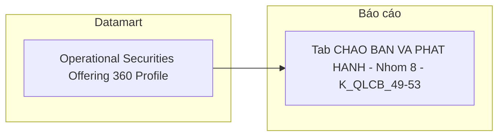

**Bảng grain:**

| Tên bảng | Grain |
|---|---|
| `Operational Securities Offering 360 Profile` | 1 row = 1 đợt chào bán × 1 loại hình (kế thừa Nhóm 4) |

---

#### Nhóm 9 — Thông tin cấp phép chào bán (STT 51–56)

> Phân loại: **Tác nghiệp**
> Atomic: `Public Company Securities Offering Plan` ← IDS.SECURITIES_OFFERING_PLAN — **READY** (Atomic draft — chưa approved chính thức)
> Atomic: `Public Company Securities Offering` ← IDS.SECURITIES_OFFERING — **READY** (Atomic draft, dùng cho `total_registered_quantity`, `offering_purpose`)
> Ghi chú (FIX 2026-08-14 — sửa lại mô tả sai): `offering_price` (giá trung bình các phương án) và `employee_quantity` (tổng số lượng NLĐ) là measure **gộp theo hồ sơ** — `AVG(offering_price)`/`SUM(employee_quantity)` qua `GROUP BY securities_offering_id` trên toàn bộ `Public Company Securities Offering Plan` của đợt chào bán, KHÔNG phân biệt loại hình — khớp đúng CTE `plan_agg` trong SQL BA. Xác nhận với user 2026-08-14: đây là thiết kế có chủ ý của BA (1 đợt chào bán có giá trung bình + tổng NLĐ + 1 hình thức đại diện), không phải lỗi độ chi tiết. Ghi chú cũ ("mỗi row là 1 loại hình cụ thể, lấy trực tiếp từ Plan tương ứng") đã sai — thay thế bằng ghi chú này.

**Mockup:**

| Số lượng cấp phép | Giá (cấp phép) | Giá trị cấp phép | SL người LĐ | Đối tượng cấp phép | Mục đích sử dụng vốn |
|---|---|---|---|---|---|
| 10,000,000 | 15,000 đ | 150 tỷ | 500 | CBNV công ty | Bổ sung vốn lưu động |

**Source:** `Operational Securities Offering 360 Profile`

**Bảng KPI:**

| KPI ID | Tên KPI | Đơn vị | Tính chất | Công thức | Ghi chú | Trạng thái |
|---|---|---|---|---|---|---|
| K_QLCB_54 | Số lượng cấp phép | CK | Attribute | `SUM(Public Company Securities Offering Plan.total_registered_quantity)` theo đợt × hình thức | **[SỬA 2026-10-08]** BA STT 9 đổi Bảng nguồn `SECURITIES_OFFERING` → `SECURITIES_OFFERING_PLAN` — cùng thay đổi K_QLCB_27 (BA SQL STT 7 `p.total_registered_qty`) | READY |
| K_QLCB_55 | Giá (cấp phép) | VNĐ | Attribute | `Public Company Securities Offering Plan.offering_price` — IDS.SECURITIES_OFFERING_PLAN.OFFERING_PRICE (giá trực tiếp trên Plan, không cần Derived) | — | READY |
| K_QLCB_56 | Giá trị cấp phép | Tỷ VNĐ | Attribute | `Public Company Securities Offering.total_expected_amt` — bảng cha, IDS.SECURITIES_OFFERING.TOTAL_EXPECTED_AM (BA ghi rõ nguồn bảng cha, không phải Plan snapshot) | — | READY |
| K_QLCB_57 | Số lượng người lao động | Người | Attribute | `Public Company Securities Offering Plan.employee_quantity` — IDS.SECURITIES_OFFERING_PLAN.EMPLOYEE_QTY; chỉ có giá trị với 1 số thủ tục (ESOP/Bonus Share), NULL với loại hình khác | — | READY |
| K_QLCB_58 | Đối tượng cấp phép | Text | Attribute | `Public Company Securities Offering Plan.single_offering_object` (SUM/gộp theo hồ sơ, cùng CTE `plan_agg` với Giá cấp phép/Số lượng NLĐ) | **[ĐƠN GIẢN HÓA 2026-09-10]** BA thay hẳn logic `CASE WHEN Offering_Method_Code = 5 THEN tên công ty ELSE NULL` (FIX 2026-08-14) bằng field trực tiếp `plan_single_obj` trên Plan — Atomic đã có sẵn attribute tương ứng `single_offering_object` trên `pc_securities_offering_plan` — READY, không còn cần cột `Offering_Method_Code_Representative` (giữ lại trên schema, không dùng nữa) | READY |
| K_QLCB_59 | Mục đích sử dụng vốn | Text | Attribute | `Public Company Securities Offering.offering_purpose` — bảng cha, IDS.SECURITIES_OFFERING.OFFERING_PURPOSE | — | READY |

**Schema bảng tác nghiệp:** Kế thừa `Operational Securities Offering 360 Profile` — bổ sung cột `Offering_Price`, `Employee_Quantity`, `Plan_Single_Object` (**mới**, thay `Swap_Target`/`Offering_Method_Code_Representative` cho K_QLCB_58 — 2 cột cũ giữ lại trên schema, không dùng nữa) (xem erDiagram Nhóm 4).

**Lineage Mart → Báo cáo:**


**Bảng grain:**

| Tên bảng | Grain |
|---|---|
| `Operational Securities Offering 360 Profile` | 1 row = 1 đợt chào bán × 1 loại hình (kế thừa Nhóm 4) |

---

#### Nhóm 10 — Thông tin kết quả chào bán (STT 57–61)

> Phân loại: **Tác nghiệp**
> Atomic: `Public Company Securities Offering Result` ← IDS.SECURITIES_OFFERING_RESULT — **READY** (Atomic draft — chưa approved chính thức)

**Mockup:** [CẬP NHẬT 2026-09-10 — thêm cột "Giá trị chào bán cho NĐTNN", đổi nhãn "Đối tượng (TT)" → "Đối tượng kết quả"; CẬP NHẬT 2026-09-10 lần 2 — thêm cột "Ngày kết thúc chào bán"]

| Số lượng thực tế | Giá thực tế | Giá trị thực tế | SL người LĐ (TT) | Đối tượng kết quả | Giá trị chào bán cho NĐTNN | Ngày kết thúc chào bán |
|---|---|---|---|---|---|---|
| 9,800,000 | 15,000 đ | 147 tỷ | 490 | CBNV công ty | 25 tỷ | 30/09/2026 |

**Source:** `Operational Securities Offering 360 Profile`

**Bảng KPI:**

| KPI ID | Tên KPI | Đơn vị | Tính chất | Công thức | Ghi chú | Trạng thái |
|---|---|---|---|---|---|---|
| K_QLCB_60 | Số lượng thực tế | CK | Attribute | `Public Company Securities Offering Result.total_successful_quantity` — IDS.SECURITIES_OFFERING_RESULT.TOTAL_SUCCESSFUL_QTY | — | READY |
| K_QLCB_61 | Giá thực tế | VNĐ | Attribute | `Public Company Securities Offering Result.actual_offering_price` — IDS.SECURITIES_OFFERING_RESULT.ACTUAL_OFFERING_PRICE (giá trực tiếp trên Result, không cần Derived) | — | READY |
| K_QLCB_62 | Giá trị thực tế | Tỷ VNĐ | Attribute | `Public Company Securities Offering Result.total_collected_amt` — IDS.SECURITIES_OFFERING_RESULT.TOTAL_COLLECTED_AM | — | READY |
| K_QLCB_63 | Số lượng người lao động (TT) | Người | Attribute | `Public Company Securities Offering Result.employee_quantity` — IDS.SECURITIES_OFFERING_RESULT.EMPLOYEE_QTY | — | READY |
| K_QLCB_64 | Đối tượng kết quả | Text | Attribute | `Public Company Securities Offering Result.result_single_object` (JOIN `Public Company Securities Offering Plan` theo BA — cùng khái niệm với K_QLCB_58 nhưng phía kết quả thực tế) | **[ĐƠN GIẢN HÓA 2026-09-10]** BA thay logic `CASE WHEN offering_method_code_snpst = 5 THEN tên công ty ELSE NULL` bằng field trực tiếp `RESULT_SINGLE_OBJ` — Atomic đã có sẵn attribute tương ứng `result_single_object` trên `pc_securities_offering_result` — READY, không còn cần điều kiện CASE WHEN | READY |
| K_QLCB_68 | Giá trị chào bán cho NĐTNN | Tỷ VNĐ | Attribute | `Public Company Securities Offering Result.foreign_collected_amt` (SUM/gộp theo hồ sơ, cùng CTE `result_agg`) | **[MỚI 2026-09-10]** KPI mới — số tiền thu được từ NĐT nước ngoài. BA ghi cột "Bảng nguồn" = `SECURITIES_OFFERING` nhưng SQL tham khảo thực tế lấy từ alias `r` (`result_agg`, nguồn `SECURITIES_OFFERING_RESULT`) — Atomic đã có sẵn attribute `foreign_collected_amt` trên `pc_securities_offering_result`, dùng nguồn này theo đúng SQL thực thi, không theo cột "Bảng nguồn" ghi nhầm — xem O_QLCB_19 (**Closed** — Dũng xác nhận nguồn Result qua issue 2026-09-09) | READY |
| K_QLCB_69 | Ngày kết thúc đợt chào bán | Ngày | Attribute | `Public Company Securities Offering Result.offering_end_dt` — IDS.SECURITIES_OFFERING_RESULT.OFFERING_END_DATE (SUM/gộp theo hồ sơ, cùng CTE `result_agg` như K_QLCB_68) | **[MỚI 2026-09-10, xác nhận qua issue Dũng 2026-09-09]** — trước đây nghi là dòng BA STT 10 trùng lặp/lỗi nhập liệu (O_QLCB_18); Dũng xác nhận đây là chỉ tiêu thật cần bổ sung lên Data Explorer. Nguồn đúng là **Result** (bản nháp trước gán nhầm sang Plan `offering_end_dt` — 2 bảng có cùng tên cột nhưng khác ý nghĩa: Plan = ngày kết thúc kế hoạch, Result = ngày kết thúc thực tế báo cáo kết quả). Atomic `offering_end_dt` đã có sẵn trên `pc_securities_offering_result` (approved) — xem O_QLCB_18 (**Closed**) | READY |

**Schema bảng tác nghiệp:** Kế thừa `Operational Securities Offering 360 Profile` — bổ sung cột `Actual_Offering_Price`, `Employee_Quantity_Result`, `Result_Single_Object` (**mới**, thay `Capital_Source` — giữ `Capital_Source` trên schema, không xóa), `Foreign_Collected_Amount` (**mới**), `Offering_End_Date` (**mới**, nguồn Result — xem Section 4 Reuse Analysis).

**Lineage Mart → Báo cáo:**

```mermaid
flowchart LR
    subgraph Datamart["Datamart"]
        G1["Operational Securities Offering 360 Profile"]
    end
    subgraph RPT["Báo cáo"]
        R10["Tab CHAO BAN VA PHAT HANH - Nhom 10 - K_QLCB_60-64,68,69"]
    end
    G1 --> R10
```

**Bảng grain:**

| Tên bảng | Grain |
|---|---|
| `Operational Securities Offering 360 Profile` | 1 row = 1 đợt chào bán × 1 loại hình (kế thừa Nhóm 4) |

---

## Section 3 — Mô hình tổng thể

> **Cập nhật 2026-08-24:** bổ sung cột `Trạng thái` vào 3 bảng dưới đây theo chuẩn `section_structure.md` (chốt 2026-08-21) — trước đây Section này chỉ liệt kê bảng READY nên không có chỗ thể hiện bảng PENDING. Giữ lại cột này sau khi O_QLCB_10 đã Closed (Atomic bổ sung `display_text` cùng ngày, toàn bộ bảng của Nhóm 5/6 chuyển sang READY) — cột `Trạng thái` là phần bắt buộc của chuẩn, không phải giải pháp tạm cho 1 đợt PENDING.

```mermaid
graph TB
    classDef dim fill:#E6F1FB,stroke:#185FA5,color:#0C447C
    classDef fact fill:#FAECE7,stroke:#993C1D,color:#4A1B0C
    classDef oper fill:#E8F5E9,stroke:#2E7D32,color:#1B5E20

    DIM_DATE["Calendar Date Dimension"]:::dim
    DIM_COMPANY["Public Company Dimension"]:::dim
    DIM_OFFRMETHOD["Offering Method Dimension"]:::dim

    FACT_OFF["Fact Securities Offering Snapshot"]:::fact
    FACT_PLAN["Fact Securities Offering Plan Snapshot"]:::fact
    FACT_RESULT["Fact Securities Offering Result Snapshot"]:::fact
    FACT_APP["Fact TTHC AP Document"]:::fact

    OPR_OFF["Operational Securities Offering 360 Profile"]:::oper

    DIM_DATE --> FACT_OFF
    DIM_COMPANY --> FACT_OFF

    DIM_DATE --> FACT_PLAN
    DIM_COMPANY --> FACT_PLAN
    DIM_OFFRMETHOD --> FACT_PLAN

    DIM_DATE --> FACT_RESULT
    DIM_COMPANY --> FACT_RESULT
    DIM_OFFRMETHOD --> FACT_RESULT

```

### Bảng Phân tích (Star Schema)

| Tên bảng Datamart | Mô tả | Fact Pattern | Grain | Nguồn Atomic chính | Trạng thái |
|---|---|---|---|---|---|
| Fact Securities Offering Snapshot | Hồ sơ chào bán/phát hành CK — tổng giá trị cấp phép/huy động theo ngành, kỳ (Nhóm 1) | Fact Event | 1 hồ sơ chào bán | Public Company Securities Offering / Public Company Securities Offering Plan / Public Company Securities Offering Result | READY (Atomic draft) |
| Fact Securities Offering Plan Snapshot | Giá trị cấp phép theo loại hình chào bán (Nhóm 2) | Fact Event | 1 đợt × 1 loại hình kế hoạch | Public Company Securities Offering Plan | READY (Atomic draft) |
| Fact Securities Offering Result Snapshot | Giá trị huy động theo loại hình chào bán (Nhóm 3) | Fact Event | 1 đợt × 1 loại hình kết quả | Public Company Securities Offering Result | READY (Atomic draft) |
| Fact TTHC AP Document | Hồ sơ đăng ký chào bán nộp lên TTHC — **Fact phẳng** (denormalized: nhóm trạng thái, hình thức chào bán, tên người nộp, mã chứng khoán, ngày gửi lưu sẵn trên Fact), đếm và phân tích theo nhóm trạng thái xử lý (Nhóm 5-6). **Thay 2 Dimension + Fact snapshot cũ 2026-10-15** | Fact Event | 1 hồ sơ TTHC tại ngày chạy ETL | Administrative Procedure Document / Administrative Procedure Document Applicant / Classification Value | READY (Atomic draft) |

### Bảng Tác nghiệp (Denormalized)

| Tên bảng Datamart | Mô tả | Grain | Nguồn Atomic chính | Trạng thái |
|---|---|---|---|---|
| Operational Securities Offering 360 Profile | Hồ sơ 360° tra cứu chi tiết từng đợt chào bán — pivot theo loại hình, gồm thông tin tổ chức liên quan (Nhóm 4, 7-10) | 1 đợt chào bán × 1 loại hình | Public Company Securities Offering / Public Company Securities Offering Plan / Public Company Securities Offering Result / Public Company | READY (Atomic draft) |

### Bảng Dimension

*Tất cả Dimension áp dụng SCD Type 4A (trừ `Public Company Dimension` — reuse `public_company_dim`, giữ quy ước SCD gốc của module GSDC).*

| Tên bảng Datamart | Mô tả | Grain | Nguồn Atomic chính | Conformed | Trạng thái |
|---|---|---|---|---|---|
| Calendar Date Dimension | Lịch ngày — ETL tự sinh | 1 ngày | Generated | Có | READY |
| Public Company Dimension | Công ty đại chúng — mã CK, tên, ngành, sàn (reuse `public_company_dim`, module GSDC) | 1 công ty đại chúng | Public Company | Có | READY (Atomic draft) |
| Offering Method Dimension | Hình thức chào bán/phát hành — ETL-derived (DISTINCT) từ cột `offering_method_code`, scheme mô tả `IDS_SO_OFFERING_METHOD`. Phục vụ Nhóm 2/3 (K_QLCB_6–19); **không** còn dùng ở Nhóm 6 sau khi đổi nguồn 2026-08-24 | 1 mã hình thức | Public Company Securities Offering Plan | Không | READY (Atomic draft) |

---

## Section 4 — Reuse Analysis

| Datamart Entity | datamart_table | reuse_status | Ghi chú |
|---|---|---|---|
| Calendar Date Dimension | cdr_dt_dim | reuse | Conformed Dim toàn hệ thống (Lớp 1 — Whitelist) |
| Public Company Dimension | public_company_dim | reuse | Module GSDC đã có, cùng nguồn Atomic `Public Company`, đủ cột mã CK/tên/sàn/`Business Line Level 1 Code` cho GROUP BY ngành (Lớp 3 — Source Match). Bổ sung `QLCB` vào `modules_using` |
| Offering Method Dimension | offering_method_dim | new | Chưa có entity nào trong registry cùng nguồn `Public Company Securities Offering Plan`/`Result` — `offering_form_dim` (module QLKD) tuy cùng `table_type: dim` nhưng khác nguồn Atomic hoàn toàn (SCMS `sc_disclosure_securities_offering` khác IDS `pc_securities_offering_plan`) nên không reuse được. **2026-08-24:** giữ nguyên phạm vi phục vụ Nhóm 2/3 (K_QLCB_6–19), KHÔNG repoint sang TTHC cho Nhóm 6 |
| Fact Securities Offering Snapshot | fct_securities_offering_snpst (đề xuất) | new | Chưa có Fact nào cùng nguồn `pc_securities_offering` trong registry |
| Fact Securities Offering Plan Snapshot | fct_securities_offering_plan_snpst (đề xuất) | new | Chưa có Fact nào cùng grain/nguồn `pc_securities_offering_plan` |
| Fact Securities Offering Result Snapshot | fct_securities_offering_result_snpst (đề xuất) | new | Chưa có Fact nào cùng grain/nguồn `pc_securities_offering_result` |
| Fact TTHC AP Document | fct_tthc_ap_document | new | **[SỬA 2026-10-15] Fact phẳng theo SQL dbt `dtm_fct_tthc_ap_document` (Data Modeler)** — thay `fct_securities_offering_application_snpst` + `ap_application_status_dim` + `ap_application_tp_dim`. Registry chưa có entity nào cùng nguồn `ap_document` nên `new` (không còn `partial` vì bỏ tên bảng cũ). Chỉ phục vụ K_QLCB_32–42, 66, 67, 71 nên không ảnh hưởng Nhóm nào khác. Không dùng Calendar Date Dimension (`submission_dt` là cột ngày thường) và không reuse `offering_method_dim` (khác nguồn Atomic — O_QLCB_13); `cl_dim` (GSDC) cũng không dùng vì tên trạng thái/hình thức lưu thẳng trên Fact |
| Operational Securities Offering 360 Profile | opr_securities_offering_360_profile (đề xuất) | new | Bảng tác nghiệp, chưa có tương đương trong registry |

---

## Section 5 — Vấn đề mở

| ID | Vấn đề | Giả định hiện tại | KPI liên quan | Trạng thái |
|---|---|---|---|---|
| O_QLCB_9 | **[Phạm vi Atomic — không phải Datamart] 2 track Atomic trùng logical_name "Public Company Securities Offering":** Track cũ `DataModel/working/Atomic_LinhLV/Business_Activity/dm_atm_pblc_co_scr_ofrg-IDS.company_securities_issuance.yaml` (physical_name `pblc_co_scr_ofrg`, nguồn ghi `IDS.company_securities_issuance`) **không có BRD source thật** trong `BRD/Source/IDS/` — có khả năng là track nháp/lỗi thời. Track mới `DataModel/working/Atomic/lld/IDS/lld_IDS_SECURITIES_OFFERING.yaml` (physical_name `pc_securities_offering`, nguồn `IDS.SECURITIES_OFFERING`) có BRD source đầy đủ nhưng attribute-level `status: draft`, chưa aggregate vào `DataModel/Atomic/` + `dm_manifest.yaml`. Đây là vấn đề quy trình thiết kế/quản lý Atomic (track nào là chuẩn, đã aggregate hay chưa) — không phải lỗi trace nguồn hay thiết kế của Datamart HLD; Datamart đã xác định đúng entity có BRD source thật để dùng. | Datamart HLD dùng track mới theo xác nhận người thiết kế (coi LLD draft là READY) — quyết định này thuộc phạm vi Datamart và đã chốt. Phần còn lại (reconcile track cũ, chạy `aggregate_atomic.py`, đưa vào `dm_manifest.yaml`) là việc của quy trình `atomic-lld-design`/`atomic-review`, không block hay thuộc trách nhiệm giải quyết của Datamart. | Toàn bộ KPI Nhóm 1–10 | **[Đã giải quyết 2026-09-10]** `dm_manifest.yaml` nay có entry `pc_securities_offering` (`DataModel/Atomic/Business_Activity/dm_atm_pc_securities_offering-IDS.SECURITIES_OFFERING.yaml`), cùng `pc_securities_offering_plan`/`pc_securities_offering_result` — đã aggregate vào Nguồn 1. **Closed** |
| O_QLCB_10 | **[Đã giải quyết] Atomic thiếu `display_text` trên `Administrative Procedure Content Item Index`.** SQL BA STT 5/6 (sheet 2026-08-24) dùng `CONTENTITEMINDEX.DISPLAYTEXT` để resolve 3 ContentItemId (`TrangThaiHoSo`, `LoaiHoSo`, `CoQuanXuLy`) thành tên hiển thị — toàn bộ `CASE WHEN ts.DISPLAYTEXT IN (…)` phân loại 4 nhóm trạng thái, nhãn hình thức chào bán của Nhóm 6, và filter cơ quan xử lý đều dựa trên trường này. Khi thiết kế lần đầu (2026-08-24 sáng) cột nằm trong `DataModel/working/Atomic/lld/pending_design.yaml` nên toàn bộ K_QLCB_32–42 phải đánh PENDING. `PUBLISHED` không nằm trong yêu cầu bổ sung — thiết kế Atomic đã lọc theo cột này khi nạp `ap_content_item_index`. | **Closed 2026-08-24** — Atomic đã bổ sung attribute `Display Text` / `display_text` ← `TTHC.CONTENTITEMINDEX.DISPLAYTEXT` (Text, nullable) trên cả `DataModel/Atomic/Documentation/dm_atm_ap_content_item_index-TTHC.CONTENTITEMINDEX.yaml` (9 → 10 attribute) và `DataModel/working/Atomic/lld/TTHC/lld_TTHC_CONTENTITEMINDEX.yaml`. Toàn bộ K_QLCB_32–42 chuyển sang **READY (Atomic draft)**; 3 bảng của Nhóm 5/6 đã được đưa trở lại `DTM_QLCB_Entities.csv`. **Còn tồn đọng bên Atomic (không block Datamart):** entry `DISPLAYTEXT` vẫn nằm trong `pending_design.yaml` với `action: "Pending — thiết kế ở lượt sau nếu cần"` — cần gỡ để danh sách pending không báo sai. | K_QLCB_32–42 | **Closed** |
| O_QLCB_11 | **Kết quả `TIMESTAMP` so với filter `BETWEEN TO_DATE(...)` → ngày đến bị loại; định dạng `:tu_ngay` ghi 2 kiểu; và `DEFAULT NULL ON CONVERSION ERROR` chỉ có ở STT 5.** (a) Công thức trả `CAST(... AS TIMESTAMP)` (có giờ, không `TRUNC`), nhưng filter là `BETWEEN TO_DATE(:tu_ngay,'YYYYMMDD') AND TO_DATE(:den_ngay,'YYYYMMDD')` — `TO_DATE(:den_ngay)` là 00:00:00 của ngày đến, nên hồ sơ gửi 09:15 ngày đến bị **loại khỏi kết quả**; chọn 01/08→31/08 sẽ mất gần như toàn bộ ngày 31/8, không báo lỗi, chỉ ra số thấp hơn. Nay áp dụng đều cho cả 2 Nhóm (không còn lệch nhau) nhưng vẫn cần chốt biên. (b) **CHỐT 2026-08-24: định dạng tham số `:tu_ngay`/`:den_ngay` là `'YYYYMMDD'`** (VD `20260824`) — khớp thân SQL đang chạy được, không phụ thuộc locale, và không có ca nào parse nhầm im lặng (không có dấu phân cách để hoán vị ngày/tháng), đồng thời trùng convention `data_dt` của flat table. Cột `Điều kiện` (cột R) của **cả STT 5 và STT 6** hiện còn ghi `'DD/MM/YYYY'` (`24/08/2026`) — BA cần sửa lại cho khớp. Lưu ý nếu để `'DD/MM/YYYY'`: date-picker locale US gửi `MM/DD/YYYY` thì ngày ≤ 12 sẽ parse được nhưng **sai im lặng** (VD `03/08/2026` hiểu thành 3 tháng 8 thay vì 8 tháng 3), ngày > 12 mới báo `ORA-01843`. (c) `DEFAULT NULL ON CONVERSION ERROR` có trong `TO_TIMESTAMP` của STT 5 nhưng **thiếu ở STT 6** → gặp chuỗi ngày sai định dạng, STT 5 trả NULL còn STT 6 **lỗi cả câu truy vấn**. **Đã đóng phần (d):** trước 2026-08-24 hai STT dùng 2 công thức derive khác nhau (`SUBSTR(...,1,10)` + `TO_DATE` vs `SUBSTR(...,1,19)` + `FROM_TZ`) làm cùng 1 hồ sơ ra 2 ngày khác nhau — sheet bản 16:04 ngày 2026-08-24 đã thống nhất về **một** công thức có xử lý múi giờ; đã diff xác nhận. | Fact lưu grain **ngày** (`ap_document.submission_dt` — ODS `TRUNC` kết quả TIMESTAMP của BA về DATE) nên trong Datamart cả 2 Nhóm dùng chung một ngày. (a) và (b) thuộc tầng truy vấn/hợp đồng API, (c) thuộc chất lượng SQL BA — cả 3 không chặn thiết kế Datamart. Đề nghị BA: thêm `DEFAULT NULL ON CONVERSION ERROR` vào STT 6, chốt 1 định dạng tham số, và chốt ngày đến có được tính vào khoảng lọc hay không (nếu có → dùng `< :den_ngay + 1` thay cho `BETWEEN`). | K_QLCB_32–42 | **[CẬP NHẬT 2026-09-10]** Sheet BA mới đã: (b) áp dụng `'YYYYMMDD'` cho cả STT 5 và STT 6 — **Closed**; (c) bổ sung `DEFAULT NULL ON CONVERSION ERROR` + `REGEXP_LIKE` guard cho STT 6 — **Closed**; STT 6 còn đổi `BETWEEN` filter sang `trunc(cte.ngay_gui_ho_so) BETWEEN ...` — khắc phục 1 phần (a) cho riêng STT 6. (a) cho STT 5 (biên ngày đến khi chưa TRUNC) **vẫn Open** — SQL STT 5 chưa thấy áp dụng TRUNC tương tự | **Open — chỉ còn (a)/STT 5 chờ BA** |
| O_QLCB_12 | **47 giá trị trạng thái hồ sơ hard-code trong SQL BA, chưa có danh mục chuẩn hoá.** Việc phân loại 4 nhóm trạng thái dựa trên so khớp chuỗi tiếng Việt của `DISPLAYTEXT` (VD `'LĐCM Đã Ký Kết Quả Chấp Thuận'`, `'CBNV Chờ Trả Yêu Cầu Bổ Sung Hồ Sơ Về BPMC'`) — rất dễ vỡ khi TTHC đổi nhãn hoặc thêm trạng thái mới; nhánh `ELSE` sẽ âm thầm hút mọi trạng thái chưa khai báo. Nhãn nhánh `ELSE` còn khác nhau giữa 2 SQL (`'Chưa xác định - kiểm tra lại danh mục'` ở STT 5 vs `'Chưa xác định'` ở STT 6). TTHC thực tế có sẵn cụm bảng workflow (`TVRP_WORKFLOW_STATUS`, `TVRP_WORKFLOW_STATUS_CATEGORY`, `TVRP_CONTENT_WORKFLOW_STATE_INDEX`) nhưng **chưa có entity Atomic nào** cho các bảng này. | **[SỬA 2026-10-15]** Logic gom nhóm đặt trong ETL của `Fact TTHC AP Document` (`CASE WHEN cl_nm IN (...)` → `document_status_group_nm`, 5 nhóm tên tiếng Việt, không còn Dimension trạng thái và không còn nhóm `UNDEFINED`): trạng thái ngoài 5 nhóm → NULL → hồ sơ bị loại khỏi Fact (theo SQL dbt) — mất tín hiệu 'Chưa xác định' trên donut Nhóm 5, hồ sơ mang trạng thái mới biến mất âm thầm thay vì hiện ở lát riêng (xem O_QLCB_26). Trước đó (2026-08-24): gom nhóm tại Dimension + hiển thị lát `UNDEFINED`. Đề xuất giai đoạn sau: thiết kế Atomic cho `TVRP_WORKFLOW_STATUS`/`TVRP_WORKFLOW_STATUS_CATEGORY` để lấy nhóm trạng thái từ danh mục nguồn thay vì so khớp chuỗi. | K_QLCB_32–42 | **Open — chờ BA/đội Atomic** |
| O_QLCB_13 | **Dashboard QLCB sẽ có 2 danh mục "hình thức chào bán" song song.** Nhóm 2/3 (K_QLCB_6–19) lấy hình thức từ `IDS.SECURITIES_OFFERING_PLAN.offering_method_cd` + `LOOKUP_VALUES` (scheme `IDS_SO_OFFERING_METHOD`, các giá trị Công chúng/Riêng lẻ/ESOP/Trả cổ tức/…); Nhóm 6 sau khi đổi nguồn lấy từ `TTHC.LoaiHoSo.DISPLAYTEXT` (theo bộ Eform: IPO, chào bán thêm cổ phiếu, trái phiếu ra công chúng, chào bán riêng lẻ, ESOP, chứng quyền có bảo đảm, chứng chỉ quỹ, …). Hai danh mục không trùng nhau về độ mịn lẫn cách gọi → người dùng thấy cùng một khái niệm nhưng 2 bộ giá trị khác nhau trên cùng dashboard. | Giữ 2 Dimension độc lập (không repoint `offering_method_dim` vì sẽ phá 14 KPI Nhóm 2/3). Cần BA/nghiệp vụ quyết định: (a) chấp nhận 2 danh mục vì 2 Nhóm phản ánh 2 nghiệp vụ khác nhau (hồ sơ nộp vs đợt chào bán đã cấp phép), hay (b) xây bảng mapping TTHC `LoaiHoSo` → scheme `IDS_SO_OFFERING_METHOD` để hợp nhất nhãn hiển thị. | K_QLCB_36, K_QLCB_6–19 | **Open — chờ BA quyết định** |
| O_QLCB_14 | **Cột `Nguồn` của BA vẫn ghi `IDS` cho toàn bộ 11 dòng STT 5/6** dù `Bảng nguồn` đã đổi thành `DOCUMENT`/`CONTENTITEMINDEX` và `Câu lệnh tham khảo` truy vấn `TTHC_UAT`. Nếu để nguyên, RTM sẽ trace BR/FR về `Nguồn = IDS` trong khi thiết kế và ETL đều trỏ TTHC. | Thiết kế lấy `Bảng nguồn` + `Câu lệnh tham khảo` làm chuẩn (nguồn = TTHC). Cần BA sửa cột `Nguồn` của 11 dòng STT 5/6 thành `TTHC`. | K_QLCB_32–42 | **[Đã giải quyết 2026-09-10]** BA sheet mới đã sửa cột `Nguồn` thành `TTHC` cho toàn bộ dòng STT 5/6. **Closed** |
| O_QLCB_15 | **`DataModel/Atomic/dm_manifest.yaml` không có entry nào cho TTHC** dù 2 file entity đã tồn tại trong `DataModel/Atomic/Documentation/` (`dm_atm_ap_document-TTHC.DOCUMENT.yaml`, `dm_atm_ap_content_item_index-TTHC.CONTENTITEMINDEX.yaml`). Theo Bước 1 mục 3 của `datamart-hld-design`, tra Nguồn 1 sẽ không thấy → buộc fallback sang Nguồn 2 (`working/Atomic/lld/manifest.yaml`, cả 2 entry `design_status: approved`). Manifest lệch so với thư mục thực tế. | Datamart HLD dùng 2 entity này (đã grep xác nhận file tồn tại + có entry ở manifest Nguồn 2). Việc đăng ký bổ sung vào `dm_manifest.yaml` thuộc quy trình `atomic-lld-design`/`atomic-review`, không block thiết kế Datamart. | K_QLCB_32–42 | **[Đã giải quyết 2026-09-10]** `dm_manifest.yaml` nay có entry cho cả `ap_content_item_index` và `ap_document` (nguồn TTHC) — đã tra thấy ở Nguồn 1. **Closed** |
| O_QLCB_16 | **[ĐÓNG 2026-10-08 — BA thay dòng 'Năm' bằng 'Ngày gửi hồ sơ' (K_QLCB_37 READY)] [MỞ 2026-09-10] Nhóm 6 — SQL BA mới bỏ hẳn trục GROUP BY "Năm" khỏi bảng chi tiết hồ sơ.** Trước đây (2026-08-24) BA GROUP BY theo hình thức × năm (`ngay_gui_ho_so`); sheet 2026-09-10 đổi hẳn sang GROUP BY hình thức × Tên tổ chức/cá nhân × Mã cổ phiếu, thay trục thời gian bằng `ky_bao_cao` (chuỗi tĩnh, không phải GROUP BY thật). K_QLCB_37 "Năm" chuyển PENDING (xem Nhóm 6). | Người thiết kế đã quyết định áp dụng theo SQL mới (không giữ thiết kế cũ). Cần BA xác nhận đây là thay đổi có chủ đích (bỏ hẳn phân tích theo năm cho báo cáo chi tiết hồ sơ) hay là sai sót khi viết lại SQL — nếu BA xác nhận vẫn cần trục Năm, bổ sung lại `Submission_Date_Dimension_Id` vào GROUP BY cùng 2 Chiều mới. | K_QLCB_37, K_QLCB_66, K_QLCB_67 | **Open — chờ BA xác nhận** |
| O_QLCB_17 | **[ĐÓNG 2026-10-08 — BA bổ sung `LOOKUP_GROUP = 'SO_SECURITY_TYPE'`] [MỞ 2026-09-10] Nhóm 7 — K_QLCB_48 "Loại chứng khoán" đổi nguồn sang `SECURITIES_OFFERING_RESULT.security_type_cd` JOIN `LOOKUP_VALUES`, nhưng BA không ghi rõ `LOOKUP_GROUP`** (khác Offering Method đã biết rõ `LOOKUP_GROUP = 'SO_OFFERING_METHOD'`). Không tra được scheme chuẩn trong `classification_schemes.yaml` cho cột `security_type_cd` trên `pc_securities_offering_result`. | Tạm coi là Classification Value cần xác nhận scheme trước khi build ETL — không tự đặt tên scheme (VD `IDS_ISSUANCE_SECURITY_TYPE` cũ dùng cho `Public Company.securities_tp_code`, có thể không phải cùng 1 danh mục với `security_type_cd` trên Result). | K_QLCB_48 | **Open — chờ BA/đội Atomic xác nhận LOOKUP_GROUP** |
| O_QLCB_18 | **[MỞ 2026-09-10, Closed 2026-09-11] Nhóm 10 (STT 10) — 1 dòng BA nghi trùng lặp/lỗi nhập liệu.** BA sheet có 2 dòng liên tiếp cùng "Thông tin" = "Số lượng thực tế": dòng 1 ghi Trường nguồn = `offering_end_date` (cột Note/Hoàn thành DEV/Loại dữ liệu/Kết quả Test đều để trống — khác pattern mọi dòng khác), dòng 2 ghi đúng Trường nguồn = `total_successful_qty` (đầy đủ metadata, khớp K_QLCB_60 hiện có). | Coi dòng 1 là lỗi nhập liệu/trùng lặp khi BA copy-paste — không cấp KPI_ID riêng, không đếm vào $BA\_Valid$ đối soát số lượng Nhóm 10. `offering_end_dt` (ngày kết thúc chào bán) đã có sẵn trên Atomic Result/Plan nhưng chưa có dòng BA hợp lệ nào yêu cầu — chưa cấp KPI_ID, chờ BA làm rõ nếu thực sự cần. | K_QLCB_69 (mới) | **Closed** — Dũng xác nhận qua issue log 2026-09-09 (bảng `securities_offering_result`, cột `offering_end_date`, mô tả "bổ sung chỉ tiêu Ngày kết thúc đợt chào bán lên Data Explorer"): KHÔNG phải lỗi nhập liệu — là chỉ tiêu thật, nguồn đúng = **Result** (không phải Plan như bản nháp trước gán nhầm). Đã cấp `K_QLCB_69`, sửa nguồn LLD Plan→Result |
| O_QLCB_20 | **[MỞ 2026-09-10 — Bước 5B đối soát toàn file phát hiện, tồn tại từ trước, không liên quan mapping mới]** K_QLCB_65 "Ngành" ở Nhóm 7 không có dòng BA tương ứng — cả BA sheet cũ (HEAD) lẫn sheet mới nhất đều chỉ liệt kê đúng 6 dòng cho STT 7 (Thời điểm báo cáo/Chuyên viên/Tên công ty/Mã chứng khoán/Sàn/Loại chứng khoán), không có dòng "Ngành". K_QLCB_65 được thêm để khớp cột "Ngành" trên mockup screenshot (ghi chú cũ: "đệm sẵn tên ngành cho mockup"), vi phạm rule "cấm thêm KPI không có dòng BA tương ứng" nếu chỉ căn cứ vào Thông tin/Bảng KPI. | Không tự xóa KPI đã tồn tại (thuộc quyết định thiết kế trước, có thể đã được duyệt dựa trên screenshot mà phiên làm việc hiện tại không có). Cần BA bổ sung dòng "Ngành" chính thức cho STT 7 (Phân loại = Chỉ tiêu cơ sở) để hợp thức hóa K_QLCB_65, hoặc xác nhận loại bỏ khỏi mockup/bảng KPI nếu không còn cần. | K_QLCB_65 | **Open — chờ BA xác nhận** |
| O_QLCB_19 | **[MỞ 2026-09-10, Closed 2026-09-11] K_QLCB_68 "Giá trị chào bán cho NĐTNN" — cột "Bảng nguồn" của BA ghi `SECURITIES_OFFERING` nhưng SQL tham khảo thực tế lấy từ `result_agg` (nguồn `SECURITIES_OFFERING_RESULT.foreign_collected_am`).** Atomic chỉ có attribute `foreign_collected_amt` trên `pc_securities_offering_result`, không có trên `pc_securities_offering`. | Thiết kế ưu tiên SQL tham khảo (nguồn thực thi) hơn cột "Bảng nguồn" (có thể BA gõ nhầm) — dùng `Public Company Securities Offering Result.foreign_collected_amt`. Cần BA xác nhận lại cột "Bảng nguồn" cho đúng khi cập nhật sheet lần sau. | K_QLCB_68 | **Closed** — Dũng xác nhận qua issue log 2026-09-09 (bảng `securities_offering_result`, cột `foreign_collected_am`): nguồn đúng là Result, khớp thiết kế hiện tại. Đề nghị BA vẫn sửa lại cột "Bảng nguồn" trên sheet gốc cho khớp |
| O_QLCB_21 | **[MỞ 2026-09-10, lần cập nhật thứ 2 trong ngày; Closed 2026-09-11] K_QLCB_43 "Thời điểm báo cáo" — BA đổi nguồn 2 lần liên tiếp trong cùng ngày** (Certificate Date → Submission Date trên `Public Company Securities Offering` → Result Report Date trên `Public Company Securities Offering Result`, qua CTE `result_agg`). Cột "Bảng nguồn" của BA vẫn ghi `SECURITIES_OFFERING` ở cả 2 lần đổi, không cập nhật theo SQL thực tế (giống pattern O_QLCB_19). Cột `Submission_Date` vừa thêm vào schema Operational trong lần đổi đầu đã bị thay thế hoàn toàn bằng `Result_Report_Date` — không có KPI nào khác kịp dùng `Submission_Date` nên không để lại cột thừa. | Dùng nguồn thực thi theo SQL tham khảo (Result), không theo cột "Bảng nguồn". Cần BA xác nhận đây là thay đổi chủ đích cuối cùng (không còn đổi tiếp) và sửa lại cột "Bảng nguồn" thành `SECURITIES_OFFERING_RESULT`. | K_QLCB_43 | **Closed** — Dũng xác nhận qua issue log 2026-09-10 ("chỉ tiêu Ngày BCKQ: lấy trường result_report_date của bảng SECURITIES_OFFERING_RESULT"): xác nhận đây là thay đổi nguồn cuối cùng, khớp thiết kế hiện tại. Đề nghị BA vẫn sửa lại cột "Bảng nguồn" trên sheet gốc cho khớp |
| O_QLCB_16 | **[HẾT HIỆU LỰC 2026-10-15 — 2 Dimension bị bỏ trong Fact phẳng; phạm vi lọc nay nằm trong `etl_logic` của `ap_document_code`/`document_status_group_nm`/`offering_method_nm` theo `schema_code` + `src_stm_code`] Phạm vi 2 Dimension mới lọc bằng tham chiếu ngược, không lọc theo `CONTENTTYPE`.** `TTHC.CONTENTITEMINDEX` gộp mọi content item của CMS (hồ sơ, trạng thái, loại hồ sơ, cơ quan xử lý, tin tức, trang…) trong 1 bảng. Để lấy ra 47 dòng trạng thái cho `ap_application_status_dim` (và tương tự cho `ap_application_tp_dim`), cách gọn nhất là `WHERE content_tp_code = 'TrangThaiHoSo'` — nhưng giá trị thật của `CONTENTTYPE` **chưa được profile**: SQL BA join trạng thái thuần theo `CONTENTITEMID` không hề dùng `CONTENTTYPE`, và `DataModel/working/Atomic/hld/TTHC_HLD_Tier2.md` mục 7e câu #4 ghi rõ *"cần profile toàn bộ distinct values thực tế"*. Đoán sai tên → Dimension ra rỗng. | **Chốt 2026-08-24 (Cách B):** ETL lọc bằng `EXISTS` ngược về `ap_document` — chỉ nạp content item đang được hồ sơ tham chiếu ở vai trò trạng thái (`document_status_code`) hoặc hình thức chào bán (`offering_method_code`). Khớp đúng SQL BA, không phụ thuộc giá trị `CONTENTTYPE` chưa xác nhận, cùng khuôn "ETL-derived (DISTINCT)" mà `offering_method_dim` (Nhóm 2/3) đang dùng. Đánh đổi: ETL nặng hơn, và trạng thái chưa hồ sơ nào dùng thì chưa xuất hiện trong Dimension (không ảnh hưởng số liệu vì cũng không có hồ sơ nào rơi vào trạng thái đó). **Khi TTHC profile xong `CONTENTTYPE`** → đổi sang filter trực tiếp cho gọn và nhẹ ETL, không cần sửa thiết kế Datamart ngoài `etl_logic` của cột `src_stm_code` trên 2 Dimension. | K_QLCB_32–42 | **Closed 2026-10-15 (hết hiệu lực)** |
| O_QLCB_22 | **[MỚI 2026-10-08] Atomic TTHC thiết kế lại — 4 điểm cần Atomic/dev xác nhận.** (1) `cl_value.schema_code` của TTHC: `lld_TTHC_CLASSIFICATION_VALUE.yaml` ghi ContentType gốc (`TrangThaiHoSo`, `LoaiHoSo`, `CoQuanXuLy`), còn `ap_document` + `classification_schemes.yaml` ghi scheme logic `TTHC.PROCESSING_STATUS`/`TTHC.DOCUMENT_TYPE`/`TTHC.PROCESSING_AUTHORITY` — **[ĐÃ GIẢI QUYẾT 2026-10-15]** SQL dbt `dtm_fct_tthc_ap_document` dùng scheme logic `TTHC.PROCESSING_STATUS`/`TTHC.DOCUMENT_TYPE`/`TTHC.PROCESSING_AUTHORITY` nên thiết kế Fact phẳng dùng đúng 3 tên này (không còn dùng ContentType gốc); (2) `ap_document` không còn `latest_ind`/`published_ind`: giả định ODS đã lọc hiện hành + đã xuất bản (BA SQL vẫn lọc `LATEST = 1 AND PUBLISHED = 1`); (3) `submission_tms` là Timestamp — BA quy đổi `Asia/Ho_Chi_Minh` rồi TRUNC, Atomic chưa nêu múi giờ; Fact lấy `CAST(submission_tms AS DATE)`; (4) `DataModel/Atomic/dm_manifest.yaml` còn đồng thời 2 entry `ap_document` (`TTHC.DOCUMENT` cũ và `TTHC.AP_DOCUMENT` mới) và `ap_content_item_index` cũ — Gate 0 vẫn PASS nhờ bản cũ nên không bắt được drift; cần Atomic dọn. | K_QLCB_32–42, K_QLCB_71 | **Open — chờ Atomic/dev** |
| O_QLCB_23 | **[MỚI 2026-10-08] BA Nhóm 5 và Nhóm 6 phân nhóm trạng thái KHÁC nhau.** Nhóm 6 (SQL mới) tách 'Hồ sơ quá hạn bổ sung' thành nhóm riêng, đổi nhãn 'Hồ sơ đăng ký' → 'Hồ sơ đang chờ tiếp nhận' nhưng cột đếm `so_luong_ho_so_dang_ky` vẫn so nhãn cũ 'Hồ sơ đăng ký' (luôn = 0 — lỗi BA SQL); Nhóm 5 vẫn gộp 'quá hạn bổ sung' vào 'bị từ chối' và dùng nhãn 'Hồ sơ đăng ký'. Thiết kế **[SỬA 2026-10-15]**: Fact có 5 nhóm tên tiếng Việt (`document_status_group_nm` = 'Hồ sơ đăng ký'/'Hồ sơ đang xử lý'/'Hồ sơ đã được chấp thuận'/'Hồ sơ bị từ chối'/'Hồ sơ quá hạn bổ sung'), không còn Dimension và nhóm `UNDEFINED`; Nhóm 5 K_QLCB_35 = REJECTED + OVERDUE_SUPPLEMENT, Nhóm 6 tách riêng; K_QLCB_38 đếm REGISTERED theo mô tả BA. Cần BA thống nhất 2 màn hình. | K_QLCB_35, K_QLCB_38, K_QLCB_41, K_QLCB_71 | **Open — chờ BA** |
| O_QLCB_24 | **[MỚI 2026-10-08; SỬA 2026-10-15 — K_QLCB_66 đã READY trên Fact phẳng (cột `ap_document_applicant_nm`), dữ liệu có thể NULL] K_QLCB_66 'Tên tổ chức/cá nhân đăng ký'.** `ap_document_applicant.display_nm` chỉ có với schema cũ (trước 05/2025); schema mới NULL cho tới khi Atomic tra cứu bổ sung từ content item đối tượng (`ContentType = 'DoiTuongNopHoSo'`, không nằm trong 10 scheme của `cl_value`). BA báo test Round 2 'P' trên lakehouse — hỏi dev nguồn thực tế đang dùng. | K_QLCB_66 | **Open — chờ Atomic/dev** (KPI READY nhưng cột NULL với hồ sơ schema mới tới khi Atomic bổ sung) |
| O_QLCB_25 | **[ĐÓNG 2026-10-15 — hết hiệu lực: SQL dbt lấy trực tiếp `ap_document.securities_code`, không parse `eform_data`] [MỚI 2026-10-08] K_QLCB_67 'Mã chứng khoán' — parse Eform JSON.** `ap_document.eform_data` lưu nguyên Eform.ContentItems[0] (≥ 6 ContentType Eform khác nhau); BA đọc `$.*.Macophieu.Text` (dự phòng `MaCoPhieu`) bằng wildcard `$.*`. Cần dev xác nhận hàm Spark/Iceberg parse được wildcard theo khóa động (nếu không: `get_json_object` theo từng Eform cụ thể) và rằng `ap_document.securities_code` (`MaChungKhoan`) KHÔNG thay thế được. | K_QLCB_67 | **Closed 2026-10-15** |
| O_QLCB_26 | **[MỚI 2026-10-15] Fact phẳng `fct_tthc_ap_document` lệch BA/thiết kế cũ ở 3 điểm.** (1) **Mất lát 'Chưa xác định'**: SQL dbt chỉ giữ hồ sơ có `document_status_group_nm IS NOT NULL` nên hồ sơ có trạng thái ngoài 5 nhóm bị loại khỏi Fact; BA Nhóm 5 (SQL `ELSE 'Chưa xác định…'` + mẫu số `SUM(COUNT(*)) OVER ()`) tính cả nhóm này → % Nhóm 5 và 'Tổng hồ sơ' Nhóm 6 có thể lệch BA khi xuất hiện trạng thái mới chưa phân loại. (2) **Không có lịch sử/ngày snapshot**: SQL dbt đọc snapshot Atomic ACTIVE của ngày chạy (`_hstr`) và Fact không có cột ngày snapshot → Fact phẳng chỉ phản ánh trạng thái hiện hành; flat table nạp lại theo ngày chạy (TRUNCATE + INSERT — giả định, cần dev/BI xác nhận cách lọc kỳ `:tu_ngay`/`:den_ngay` theo `submission_dt`). (3) **Nguồn `securities_code`**: lấy `ap_document.securities_code` thay cho parse `eform_data` (K_QLCB_67); BA vẫn mô tả Eform `Macophieu`. Ngoài ra `ap_document_applicant_nm` có thể NULL (O_QLCB_24) và `offering_method_nm` dùng INNER JOIN `cl_value` nên hồ sơ có `document_tp_code` không resolve ra tên cũng bị loại. | Thiết kế theo SQL dbt do Data Modeler cung cấp 2026-10-15; chưa đối chiếu lại số liệu với SQL BA. Đề xuất: so khớp tổng hồ sơ Fact vs SQL BA (có/không nhóm 'Chưa xác định') trên dữ liệu thật trước khi chốt dashboard; nếu cần giữ lát 'Chưa xác định' thì đổi `ELSE NULL` thành 'Chưa xác định' và bỏ filter `IS NOT NULL`. | K_QLCB_32–35, K_QLCB_42, K_QLCB_66, K_QLCB_67 | **Open — chờ BA/dev xác nhận** |
