# DATAMART QLQ — Phase 2b: Entity Relationships

> **[VIẾT LẠI TOÀN BỘ 2026-09-26]** Bản trước (Phase 2b cũ) tự ghi nhận đã lệch hoàn toàn với HLD sau nhiều lần renumber (K_FMS→K_QLQ 1-981). File này viết lại từ Section 3 + Section 4 của `DTM_QLQ_HLD.md` sau khi rà soát Nhóm 1-28 (gỡ gating "Dữ liệu động" sai, sửa nguồn Securities/Fund Distribution Agent, xem `project_qlq_reconciliation_0926.md`). Nguồn sự thật: `DTM_QLQ_Entities.csv` (cùng thư mục).

## Nhóm 1, 6 — Thống kê chung CTQLQ (Fact Fund Management Company Snapshot)

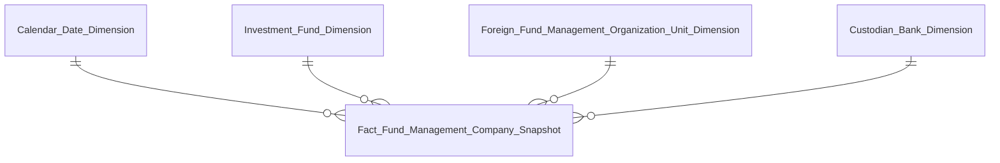

| Datamart Entity | Loại | Reuse | Mô tả | Grain | KPI |
|---|---|---|---|---|---|
| Fact Fund Management Company Snapshot | Fact Snapshot | new | Thống kê thị trường CTQLQ | 1 snapshot toàn TT × 1 tháng | K_QLQ_1,2,5,6,8,9,10,11 (Nhóm 1); K_QLQ_39,40 (Nhóm 6, reuse) |
| Investment Fund Dimension | Dimension | new | Quỹ đầu tư (SCD4A) | 1 quỹ (current state) | — |
| Foreign Fund Management Organization Unit Dimension | Dimension | new | CN CTQLQ nước ngoài (SCD4A) | 1 CN (current state) | — |
| Custodian Bank Dimension | Dimension | new | Ngân hàng giám sát (SCD4A) | 1 NH (current state) | — |
| Calendar Date Dimension | Dimension | reuse | Lịch ngày | 1 ngày | — |

---

## Nhóm 1, 2, 6–9, 12, 17–21, 24, 25 — Dashboard RPT: giá trị ô báo cáo định kỳ (Fact Fund Management Report Cell Value)

> **[MỚI 2026-10-14 — bổ sung đăng ký]** Fact và Dimension này đã có LLD/master/model/Detail Mapping và Cụm 17 của HLD từ 2026-10-13 nhưng bị bỏ sót ở Section 3/4, Entities và flat SQL (`check_orphan` báo Nhánh A). Nhãn dòng/cột của Dimension ô là giả định chờ mẫu dữ liệu (O_QLQ_31); nạp tăng dần theo ngày nộp `submitted_dt = :etl_date` (O_QLQ_34).

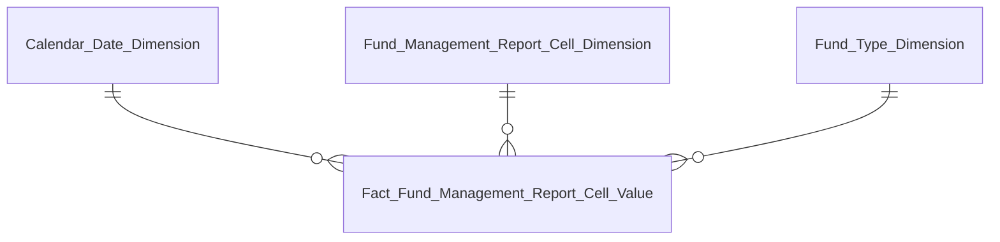

| Datamart Entity | Loại | Reuse | Mô tả | Grain | KPI |
|---|---|---|---|---|---|
| Fact Fund Management Report Cell Value | Fact (EAV mức ô) | new | Giá trị ô báo cáo định kỳ `RPT_*`; mỗi KPI là bộ lọc (sheet, nhãn dòng, nhãn cột, `record_tp`) trên Dimension ô | 1 ô báo cáo × 1 bản nộp | 51 KPI READY: K_QLQ_3,4,7 (Nhóm 1); K_QLQ_12–18 (Nhóm 2); K_QLQ_42,43 (Nhóm 6); K_QLQ_46,49 (Nhóm 7); K_QLQ_44,50–55 (Nhóm 8); K_QLQ_44,56 (Nhóm 9); K_QLQ_81 (Nhóm 12); K_QLQ_118–121 (Nhóm 17); K_QLQ_122–125 (Nhóm 18); K_QLQ_126–129 (Nhóm 19); K_QLQ_130–133 (Nhóm 20); K_QLQ_134–136 (Nhóm 21); K_QLQ_162,163 (Nhóm 24); K_QLQ_164–170 (Nhóm 25) |
| Fund Management Report Cell Dimension | Dimension | new | Ô báo cáo định kỳ — sheet, biểu mẫu, chỉ số dòng/cột, nhãn dòng/cột (SCD4A) | 1 ô × 1 sheet (current state) | — |
| Fund Type Dimension | Dimension | new | Loại hình quỹ (SCD4A) | 1 loại hình quỹ (current state) | — |
| Calendar Date Dimension | Dimension | reuse | Lịch ngày — FK vai trò ngày cuối kỳ báo cáo | 1 ngày | — |

---

## Nhóm 3 — Danh sách các Công ty quản lý quỹ (Operational)

Bảng tác nghiệp — lấy trực tiếp từ Atomic (Fund Management Company, Investment Fund, Member Rating), không qua Dimension riêng.

| Datamart Entity | Loại | Reuse | Mô tả | Grain | KPI |
|---|---|---|---|---|---|
| Fund Management Company Profile | Operational | new | Hồ sơ CTQLQ | 1 CTQLQ × 1 tháng slicer | K_QLQ_19,20,23,24,25,26 |

---

## Nhóm 4 — Chi tiết Quỹ của một CTQLQ (Operational)

| Datamart Entity | Loại | Reuse | Mô tả | Grain | KPI |
|---|---|---|---|---|---|
| Fund Management Company Fund List | Operational | new | Bảng con drill-down danh sách quỹ theo CTQLQ | 1 quỹ × 1 CTQLQ × 1 tháng slicer | K_QLQ_33,34 |

---

## Nhóm 5 — Chi tiết các hợp đồng UTDM của CTQLQ (Operational)

| Datamart Entity | Loại | Reuse | Mô tả | Grain | KPI |
|---|---|---|---|---|---|
| Fund Management Company Contract List | Operational | new | Bảng con drill-down danh sách hợp đồng UTDM của CTQLQ — đọc engine báo cáo định kỳ `RPT_*` (sheet `@QLDMDT`), PII lưu nguyên văn là ngoại lệ đã duyệt (O_QLQ_33) | 1 hợp đồng UTDM (dòng động `dynamic_row_nbr`) × 1 bản nộp báo cáo của 1 quỹ × 1 kỳ báo cáo | K_QLQ_36,37,38 |

---

## Nhóm 7 (+8, 9 partial) — Biểu đồ Tổng NAV Quỹ / Phân bổ tài sản / Biến động NAV (Fact Investment Fund NAV Snapshot)

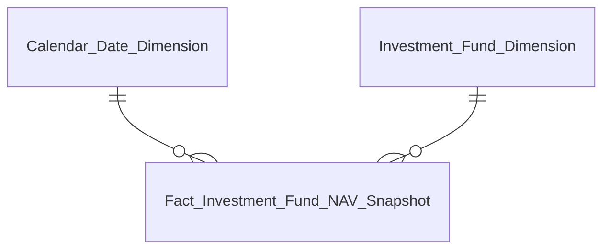

| Datamart Entity | Loại | Reuse | Mô tả | Grain | KPI |
|---|---|---|---|---|---|
| Fact Investment Fund NAV Snapshot | Fact Snapshot | partial | Tổng NAV quỹ so với GDP | 1 quỹ × 1 tháng | K_QLQ_44,45,47 (Nhóm 7) |
| Investment Fund Dimension | Dimension | new | Quỹ đầu tư (SCD4A) | 1 quỹ (current state) | — |
| Calendar Date Dimension | Dimension | reuse | Lịch ngày | 1 ngày | — |
| Fact Macro Indicator Snapshot (module PTTT) | Fact Snapshot | reuse | GDP_VN — reuse xuyên module, không sinh file LLD cho QLQ | 1 chỉ số × 1 kỳ | K_QLQ_47 |

> Nhóm 8, 9 tái sử dụng Chiều Thời gian (K_QLQ_44) nhưng không có measure riêng READY — toàn bộ 6 chỉ tiêu phân bổ tài sản (Nhóm 8) và 3 chỉ tiêu biến động NAV (Nhóm 9) PENDING, xem O_QLQ_15.

---

## Nhóm 10 (+6 reuse) — Số lượng quỹ đầu tư chứng khoán (Fact Investment Fund Count Snapshot)

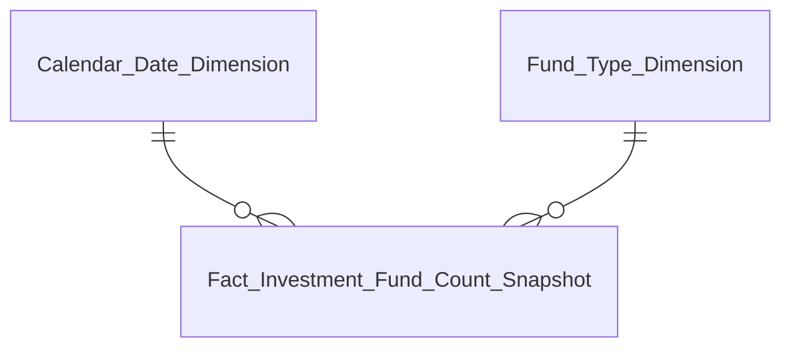

| Datamart Entity | Loại | Reuse | Mô tả | Grain | KPI |
|---|---|---|---|---|---|
| Fact Investment Fund Count Snapshot | Fact Snapshot | new | Đếm số quỹ theo loại hình quỹ | 1 loại hình quỹ × 1 tháng | K_QLQ_59–67 (Nhóm 10); K_QLQ_41 (Nhóm 6, reuse) |
| Fund Type Dimension | Dimension | new | Loại hình quỹ (SCD4A) | 1 loại hình quỹ (current state) | — |
| Calendar Date Dimension | Dimension | reuse | Lịch ngày | 1 ngày | — |

---

## Nhóm 11 — Tăng trưởng số lượng CCQ lưu hành (Fact Investment Fund CCQ Snapshot)

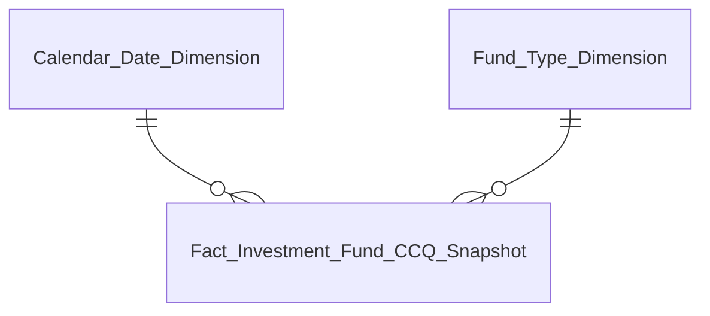

| Datamart Entity | Loại | Reuse | Mô tả | Grain | KPI |
|---|---|---|---|---|---|
| Fact Investment Fund CCQ Snapshot | Fact Snapshot | new | Tổng KL CCQ lưu hành theo loại hình quỹ | 1 loại hình quỹ × 1 tháng | K_QLQ_68–76 |
| Fund Type Dimension | Dimension | new | Loại hình quỹ (SCD4A) | 1 loại hình quỹ (current state) | — |
| Calendar Date Dimension | Dimension | reuse | Lịch ngày | 1 ngày | — |

---

## Nhóm 12 — Tỉ lệ tăng trưởng NAV/CCQ so với VN-Index và Lãi suất liên NH (không còn Fact riêng)

> **[SỬA 2026-10-05 — All-Tier Cleanup]** BA lấy NAV/CCQ (K_QLQ_81–91) từ engine báo cáo định kỳ `RPT_*` (chưa có Atomic entity) → hạ PENDING, `Fact Investment Fund NAV per CCQ Snapshot` còn 0 KPI READY mang measure nên đã xóa. K_QLQ_77 (Thời gian) gắn `Fact Fund Management Company Snapshot`; K_QLQ_80 (Loại hình quỹ chi tiết) là Chiều DERIVED chưa gắn cột (giống K_QLQ_45); VN-Index/Lãi suất reuse module khác. Xem O_QLQ_25.

| Datamart Entity | Loại | Reuse | Mô tả | Grain | KPI |
|---|---|---|---|---|---|
| Fund Type Dimension | Dimension | new | Loại hình quỹ chi tiết (nguồn Atomic Classification FMS Fund Type; [SỬA 2026-10-12] thay Classification Dimension scheme FMS_FUND_TYPE) | 1 loại hình quỹ | K_QLQ_80 (DERIVED) |
| Fact Market Index Snapshot (module GSTT) | Fact Snapshot | reuse | VN-Index — reuse xuyên module, không sinh file LLD cho QLQ | 1 chỉ số × 1 ngày | K_QLQ_78 |
| Fact Macro Indicator Snapshot (module PTTT) | Fact Snapshot | reuse | Lãi suất liên NH qua đêm (INTERBANK_IR) — reuse xuyên module | 1 chỉ số × 1 kỳ | K_QLQ_79 |

---

## Nhóm 13 — Danh sách các quỹ đầu tư (Operational)

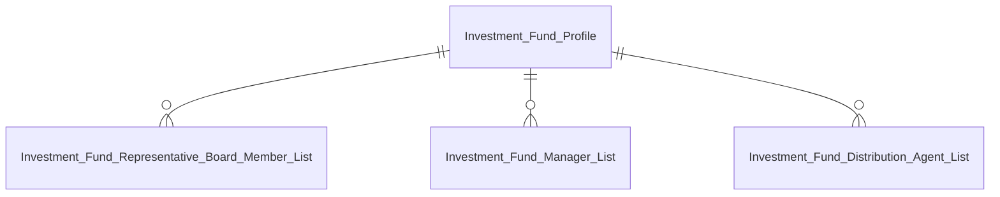

| Datamart Entity | Loại | Reuse | Mô tả | Grain | KPI |
|---|---|---|---|---|---|
| Investment Fund Profile | Operational | partial | Hồ sơ quỹ đầu tư | 1 quỹ × 1 tháng slicer | K_QLQ_92-99,101 |

---

## Nhóm 14 — Danh sách đại lý phân phối (Operational, drill-down từ Nhóm 13)

| Datamart Entity | Loại | Reuse | Mô tả | Grain | KPI |
|---|---|---|---|---|---|
| Investment Fund Distribution Agent List | Operational | new | Bảng con drill-down đại lý phân phối của quỹ (junction FUD_AG_AGT draft — dùng tạm, O_QLQ_9) | 1 đại lý × 1 quỹ | K_QLQ_103 |

---

## Nhóm 15 — Danh sách thành viên ban đại diện (Operational, drill-down từ Nhóm 13)

| Datamart Entity | Loại | Reuse | Mô tả | Grain | KPI |
|---|---|---|---|---|---|
| Investment Fund Representative Board Member List | Operational | new | Bảng con drill-down thành viên BĐD quỹ | 1 thành viên × 1 quỹ | K_QLQ_104 |

---

## Nhóm 16 — Danh sách người điều hành quỹ (Operational, drill-down từ Nhóm 13)

| Datamart Entity | Loại | Reuse | Mô tả | Grain | KPI |
|---|---|---|---|---|---|
| Investment Fund Manager List | Operational | new | Bảng con drill-down người điều hành quỹ | 1 người × 1 quỹ | K_QLQ_105 |

---

## Nhóm 17 — Thống kê chung Đại lý phân phối (Fact Fund Distribution Agent Snapshot)

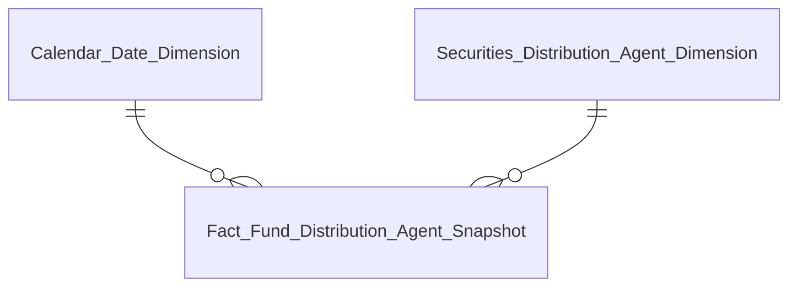

| Datamart Entity | Loại | Reuse | Mô tả | Grain | KPI |
|---|---|---|---|---|---|
| Fact Fund Distribution Agent Snapshot | Fact Snapshot | new | Thống kê chung ĐLPP toàn thị trường (nguồn FMS.DISTRIBUTOR_AGENT) | 1 snapshot toàn TT × 1 quý/năm | K_QLQ_116,117 |
| Securities Distribution Agent Dimension | Dimension | new | ĐLPP (SCD4A, + shared IP Alt Identification/Postal Address) | 1 ĐLPP (current state) | — |
| Calendar Date Dimension | Dimension | reuse | Lịch ngày | 1 ngày | — |

---

## Nhóm 22 — Danh sách Đại lý phân phối (Operational)

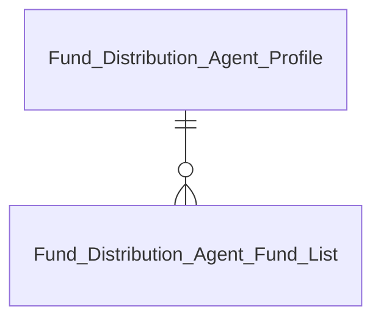

| Datamart Entity | Loại | Reuse | Mô tả | Grain | KPI |
|---|---|---|---|---|---|
| Fund Distribution Agent Profile | Operational | new | Hồ sơ ĐLPP (nguồn FMS.DISTRIBUTOR_AGENT) | 1 ĐLPP × 1 tháng slicer | K_QLQ_137-143 |

---

## Nhóm 23 — Danh sách các Quỹ đang phân phối (Operational, drill-down từ Nhóm 22)

| Datamart Entity | Loại | Reuse | Mô tả | Grain | KPI |
|---|---|---|---|---|---|
| Fund Distribution Agent Fund List | Operational | new | Bảng con drill-down danh sách quỹ đang phân phối (nguồn FMS.AGENCIES) | 1 quỹ × 1 ĐLPP | K_QLQ_159 |
| Fund Distribution Agent Dimension | Dimension | new | ĐLPP nguồn FMS.AGENCIES (SCD4A) — xem O_QLQ_10 | 1 ĐLPP (current state) | — |

---

## Nhóm 24 — Thống kê chung CN CTQLQ nước ngoài tại VN (Fact Foreign Fund Management Organization Unit Snapshot)

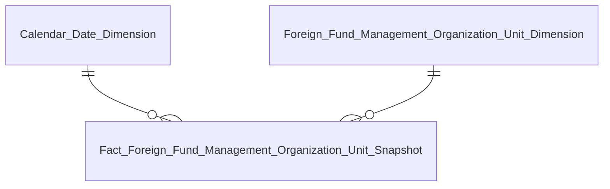

| Datamart Entity | Loại | Reuse | Mô tả | Grain | KPI |
|---|---|---|---|---|---|
| Fact Foreign Fund Management Organization Unit Snapshot | Fact Snapshot | new | Thống kê chung CN CTQLQ nước ngoài toàn thị trường | 1 snapshot toàn TT × 1 tháng | K_QLQ_160,161 |
| Foreign Fund Management Organization Unit Dimension | Dimension | new | CN CTQLQ nước ngoài (SCD4A) | 1 CN (current state) | — |
| Calendar Date Dimension | Dimension | reuse | Lịch ngày | 1 ngày | — |

---

## Nhóm 26 — Danh sách các Chi nhánh CTQLQ nước ngoài tại Việt Nam (Operational)

| Datamart Entity | Loại | Reuse | Mô tả | Grain | KPI |
|---|---|---|---|---|---|
| Foreign Fund Management Organization Unit Profile | Operational | partial | Hồ sơ CN CTQLQ nước ngoài | 1 CN × 1 tháng slicer | K_QLQ_171,172,173 |
| Foreign Fund Management Organization Unit Staff Dimension | Dimension | new | Nhân viên CN CTQLQ nước ngoài (Giám đốc CN) | 1 nhân viên (current state) | — |

---

## Nhóm 27 — Chi tiết hợp đồng UTQLDM của CN CTQLQ nước ngoài (Operational)

> **[THIẾT KẾ 2026-10-14]** Nhóm 27 (K_QLQ_179–181) trước đó PENDING; nay READY qua bảng Operational đọc engine báo cáo định kỳ `RPT_*` theo cách của `Fund Management Company Contract List` (Nhóm 5): 1 hợp đồng UTQLDM = 1 dòng động (`dynamic_row_nbr`), `record_tp = 4`. BA để trống tên sheet nên không lọc sheet; dòng hợp đồng nhận diện bằng nhãn cột "Loại" (O_QLQ_37).

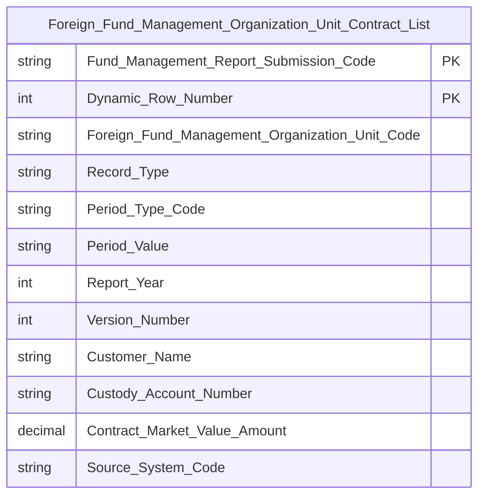

| Datamart Entity | Loại | Reuse | Mô tả | Grain | KPI |
|---|---|---|---|---|---|
| Foreign Fund Management Organization Unit Contract List | Operational | new | Danh sách hợp đồng UTQLDM của CN CTQLQ nước ngoài (popup Nhóm 26) | 1 hợp đồng (dòng động) × 1 bản nộp × 1 kỳ báo cáo | K_QLQ_179–181 (Nhóm 27) |

---

## Nhóm 28 — Thống kê giao dịch của nhân viên công ty QLQ (Fact báo cáo — append)

> **[THIẾT KẾ 2026-10-14]** Nhóm 28 (K_QLQ_106–115) trước đó PENDING (thiếu cầu nối VSDC investor registry); nay READY qua bảng Fact dạng report (`_rpt`, append) đọc `securities_trade` (HOSE/HNX), nối nhân viên theo `fmc_employee.securities_trading_account_nbr`. Phạm vi tài khoản có thể hẹp hơn BA (O_QLQ_35/36). **[SỬA 2026-10-15 — làm theo BA]** nay nối qua CCCD → `open_investor_account` → `securities_trade` và khử trùng như UNION của BA (O_QLQ_35/36/39). Nạp append theo ngày `trade_dt = :etl_date`. **[SỬA 2026-10-14 — O_QLQ_38]** Đổi từ Operational (SCD4A) sang Fact report: `securities_trade` là bảng event nên bộ lọc `trade_dt = :etl_date` làm mọi giao dịch ngày trước thành INACTIVE và `_hstr` phình dần.

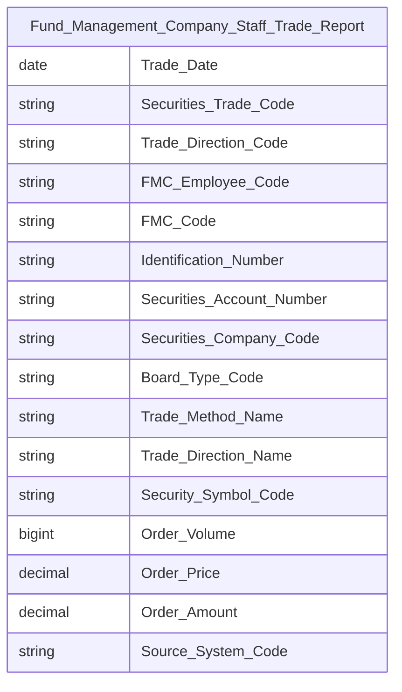

| Datamart Entity | Loại | Reuse | Mô tả | Grain | KPI |
|---|---|---|---|---|---|
| Fund Management Company Staff Trade Report | Fact (report) | new | Giao dịch của nhân viên CTQLQ trên sổ lệnh HOSE/HNX | 1 dòng khử trùng (như UNION của BA) × nhân viên × ngày × tài khoản × bên mua/bán × mã CK × phương thức × CTCK × số lượng lệnh × giá lệnh | K_QLQ_106–115 (Nhóm 28) |

---

## Nhóm 29–33 — Data Explorer: danh sách sheet biểu mẫu báo cáo định kỳ (Operational)

> **[MỚI 2026-10-06]** Atomic (commit e9378756) đã có `fund_management_report` (FMS.RPT_TEMP), `fmr_sheet` (FMS.SHEET), `fmr_period`, `fmr_submission`, `fmr_value`. Thiết kế phần **header** của Data Explorer: Loại/Mã/Tên báo cáo + Mã/Tên sheet (5/9 dòng BA mỗi sheet, 26 sheet có BA Done). Kỳ báo cáo, Mã chỉ tiêu, Tên chỉ tiêu, Giá trị vẫn PENDING — xem O_QLQ_27.

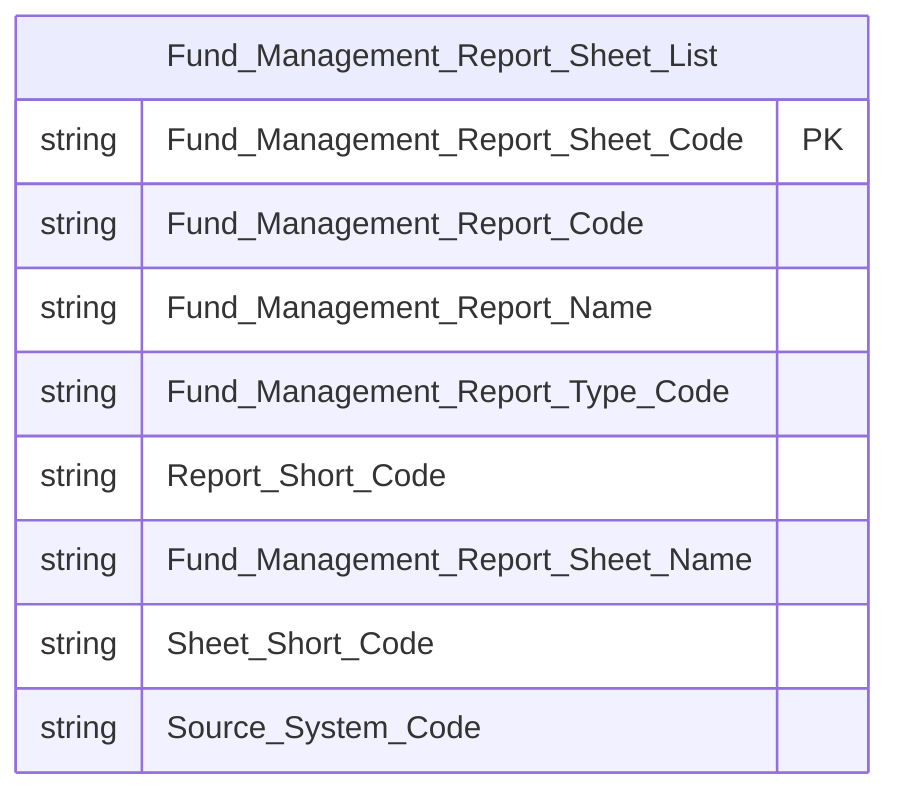

| Datamart Entity | Loại | Reuse | Mô tả | Grain | KPI |
|---|---|---|---|---|---|
| Fund Management Report Sheet List | Operational | new | Danh sách sheet biểu mẫu báo cáo định kỳ FMS — Loại/Mã/Tên báo cáo + Mã/Tên sheet | 1 sheet của 1 biểu mẫu (current state) | 130 KPI header Nhóm 29–33 (xem Detail Mapping) |

---

## Bảng PENDING (không thiết kế trong Phase 2)

| Datamart Entity | Lý do PENDING | Issue |
|---|---|---|
| Fact Discretionary Investment Contract Snapshot (Nhóm 2) | 0/7 KPI READY — BA đổi hẳn nguồn sang engine báo cáo định kỳ, chưa có Atomic entity | O_QLQ_15 |
| Fund Management Report Data (giá trị ô báo cáo + Kỳ báo cáo — Tab DATA EXPLORER, STT 29–91; thay `Report Pass-through View`) | PENDING — `fmr_value` thiếu TGT_ID/CODE, `fmr_sheet` thiếu DATA_LABEL/CELLS_META, thiếu RECORD_STATUS (O_QLQ_27); STT 33 (từ dòng 10)–91 BA Pending (O_QLQ_26) | O_QLQ_1, O_QLQ_27 |
