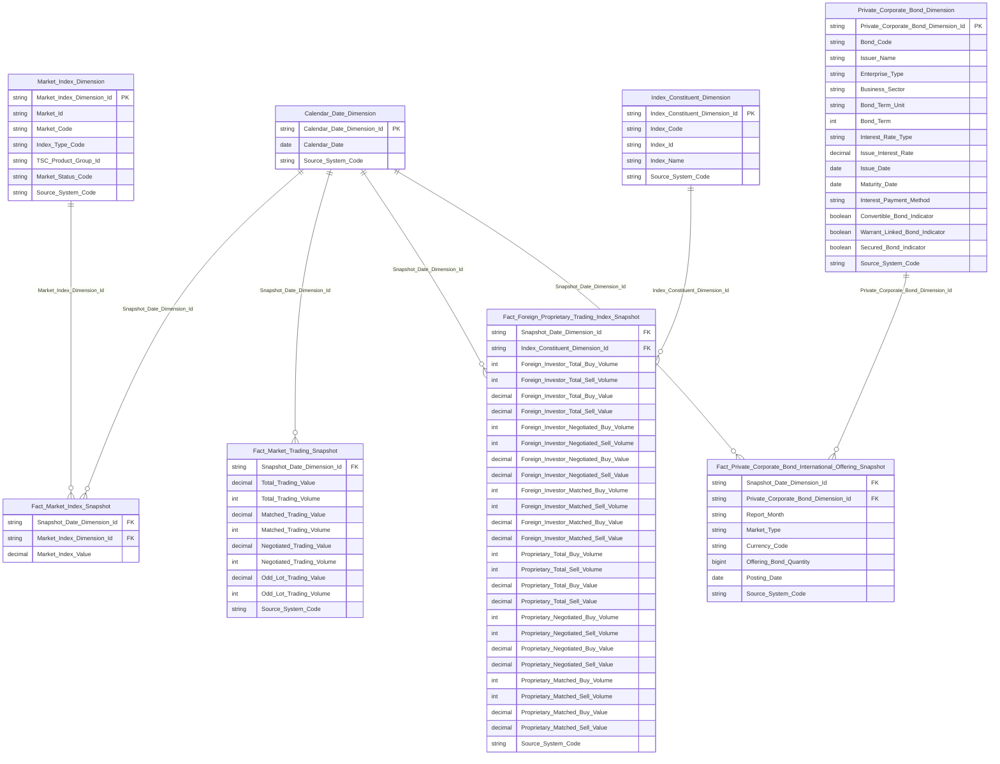

# Entities — Datamart TKNB (Thống kê nội bộ)

## Ghi chú thiết kế

19/20 bảng còn lại là `operational` (bảng phẳng theo từng báo cáo — EAV `item_code` hoặc danh sách) theo quyết định thiết kế module TKNB "mỗi báo cáo 1 bảng phẳng riêng, không tách Dimension dùng chung". **[SỬA 2026-09-22, datamart-review — Kịch bản D]** Ngoại lệ duy nhất: qua review phát hiện `Market Trading Report (BM030a)` gộp sai 2 grain khác nhau vào cùng 1 bảng EAV (Nhóm 18), và `Foreign Proprietary Trading Report (BM031a)` (Nhóm 23) không tận dụng được Dimension dùng chung đã có sẵn cross-module — cả 2 bảng đã DEPRECATED và **xóa khỏi bảng dưới đây** (theo All-Tier Cleanup Protocol — orphan checker yêu cầu xóa hẳn khỏi Entities.csv/.md, không giữ dòng ghost; lịch sử bãi bỏ vẫn lưu đầy đủ ở Section 4 `DTM_TKNB_HLD.md`), thay bằng 3 Fact + 2 Dimension chuẩn Star Schema (2 Fact mới sở hữu TKNB, 1 Fact + 2 Dimension reuse từ QLKD/GSTT). 19 bảng operational còn lại không có FK/relationship với nhau — mỗi bảng độc lập theo layout báo cáo gốc.

**[MỚI 2026-10-25 — đồng bộ pipeline dev `item_rule` → `item_value` → ClickHouse]** 14 bảng Operational EAV của 14 báo cáo dev (HNX01, HNX02, HNX03, HNX06, HNX07, HSX01, HSX04, BM030b/c/d/e/f, BM031b/c) được thay bằng **1 bảng dùng chung `item_value`** (Report Item Value): cột `report_code`, `report_name`, `item_code`, `item_name`, `item_type`, `calc_date`, `value` DECIMAL(23,2), `ds_etl_pcs_tms`; ETL engine đọc cấu hình `item_rule` (Atomic, nạp từ `full_items.csv`) và ghi kết quả; ClickHouse đẩy theo `report_code` sang bảng flat riêng từng báo cáo. 7 bảng EAV còn lại (HNX04, HSX02, TTLK10, 0513, TK-04.BTC, TK_NienGiam, BM031d) chưa có trong pipeline dev nên giữ nguyên.

## erDiagram (chỉ 5 entity Star Schema mới — 19 bảng Operational khác không vẽ, không có quan hệ)

## Bảng entity tóm tắt (18 bảng: 10 Dimension/Fact (Star Schema, gồm 3 Dimension reuse) + 8 Operational — **[SỬA 2026-10-25]** 14 bảng Operational EAV của 14 báo cáo dev đã gộp vào 1 bảng `item_value`; 2 bảng Operational cũ (BM030a/BM031a) đã DEPRECATED, xem lịch sử tại Section 4 `DTM_TKNB_HLD.md`, sắp theo thứ tự Nhóm trong HLD)

| STT | Datamart Entity | Loại | Reuse | Mô tả | Grain | KPI |
|---|---|---|---|---|---|---|
| — | Calendar Date Dimension | Dimension | reuse | Lịch ngày dùng chung | 1 dòng/1 ngày | — |
| — | Index Constituent Dimension | Dimension | reuse (GSTT) | Danh mục rổ chỉ số | 1 dòng/Index Code | K_TKNB_1013 (Nhóm 18), K_TKNB_1069 (Nhóm 23) |
| — | Fact Market Trading Snapshot | Fact | new | GTGD/KLGD toàn thị trường cổ phiếu + giá trị chỉ số theo ngày [SỬA 2026-09-23] | 1 dòng/Trade Date × Index Code | K_TKNB_1013–1022 (Nhóm 18) |
| — | Fact Foreign Proprietary Trading Index Snapshot | Fact | new | GD NĐTNN/tự doanh theo chỉ số | 1 dòng/Trade Date × Index Code | K_TKNB_1070–1093 (Nhóm 23) |
| — | Private Corporate Bond Dimension | Dimension | new | [MỚI 2026-09-24] Danh mục TPDN riêng lẻ phát hành ra thị trường quốc tế | 1 dòng/1 mã TP (SCD4A) | K_TKNB_554–557, 561–570 (Nhóm 9); K_TKNB_538–541, 543–552 (Nhóm 8) |
| — | Fact Private Corporate Bond International Offering Snapshot | Fact | new | [MỚI 2026-09-24] Tình hình chào bán TPDN riêng lẻ ra thị trường quốc tế (HNX12) | 1 dòng/1 mã TP × 1 thị trường × 1 tháng báo cáo | K_TKNB_553, 558–560 (Nhóm 9) |
| — | Fact Private Corporate Bond Issuance Snapshot | Fact | new | [MỚI 2026-10-05, TKNB Nhóm 8 HNX11] Khối lượng/giá trị phát hành TPDN riêng lẻ trong nước (HNX11) | 1 dòng/1 mã TP × 1 tháng báo cáo | K_TKNB_537, 542 (Nhóm 8) |
| — | Security Trading Snapshot Dimension | Dimension | reuse (GSTT) | Hồ sơ chứng khoán — Symbol/ISIN/Sàn/Ngày đáo hạn/Hệ số hợp đồng | 1 dòng/mã CK (SCD4A) | K_TKNB_1188 (Nhóm 28), K_TKNB_1240, 1242 (Nhóm 29) |
| — | Fact Security Trading Detail Snapshot | Fact | new | [THIẾT KẾ LẠI 2026-10-06, TKNB Nhóm 28] Thống kê giao dịch từng mã CK (giá, cung cầu, quy mô GD, NĐTNN, tự doanh) | 1 dòng/mã CK × 1 ngày | K_TKNB_1187–1239 (Nhóm 28) |
| — | Fact Derivatives Security Detail Snapshot | Fact | new | [THIẾT KẾ LẠI 2026-10-06, TKNB Nhóm 29] Thống kê giao dịch CKPS từng mã hợp đồng (open interest, KL/GT, NĐTNN, tự doanh) | 1 dòng/mã hợp đồng × 1 ngày | K_TKNB_1240–1257 (Nhóm 29) |

| STT | Datamart Entity | Loại | Reuse | Mô tả | Grain | KPI |
|---|---|---|---|---|---|---|
| 1 | Report Item Value | Operational | new | Giá trị chỉ tiêu 14 báo cáo TKNB theo cấu hình `item_rule` (HNX01, HNX02, HNX03, HNX06, HNX07, HSX01, HSX04, BM030b/c/d/e/f, BM031b/c) — thay 14 bảng EAV riêng từng báo cáo | 1 dòng/1 chỉ tiêu (`item_code`)/1 báo cáo (`report_code`)/1 ngày tính (`calc_date`) | K_TKNB_1–108, 109–273, 274–286, 472–496, 497–519, 571–695, 793–820, 1025–1067, 1094–1122, 1174–1186, 1258–1299 (14 báo cáo) |
| 4 | Market Scale Report (HNX04) | Operational | new | Báo cáo tổng hợp quy mô TTCK HNX | 1 dòng/1 chỉ tiêu/1 kỳ báo cáo/1 period_type | K_TKNB_290–471 |
| 11 | Listing Trading Report (HSX02) | Operational | new | Báo cáo niêm yết và giao dịch chứng khoán HOSE kỳ tháng | 1 dòng/1 chỉ tiêu/1 kỳ báo cáo/1 period_type | K_TKNB_696–792 |
| 14 | CW Outstanding Report (TTLK10) | Operational | new | Danh sách chứng quyền đang lưu hành | 1 dòng/1 mã chứng quyền/1 kỳ báo cáo | K_TKNB_843–845 |
| 15 | Offering Result Report (0513.H.UBCK.QG) | Operational | new | Báo cáo kết quả thực hiện phát hành chứng khoán | 1 dòng/1 chỉ tiêu/1 kỳ báo cáo | K_TKNB_846–874 |
| 16 | Market Summary Report (TK-04.BTC) | Operational | new | Báo cáo tổng hợp TTCK theo quý/lũy kế | 1 dòng/1 chỉ tiêu/1 kỳ gốc (period_marker) | K_TKNB_875–917 |
| 17 | Market Annual Report (TK_NienGiam) | Operational | new | Niên giám thống kê thị trường chứng khoán theo năm | 1 dòng/1 chỉ tiêu/1 năm báo cáo | K_TKNB_918–1011 |
| 26 | Fund Cert ETF CW Foreign Proprietary Trading Report (BM031d) | Operational | new | Giao dịch NĐTNN/tự doanh thị trường CCQ/ETF/CW theo ngày | 1 dòng/1 chỉ tiêu/1 kỳ báo cáo | K_TKNB_1123–1173 |

## Nguồn Atomic theo bảng

| Datamart Entity | source_table (Atomic physical_name) |
|---|---|
| Calendar Date Dimension | cdr_dt_dim (conformed, không có Atomic source riêng) |
| Index Constituent Dimension | index_constituent_snapshot |
| Fact Market Trading Snapshot | securities_trade / market_index_snapshot |
| Fact Foreign Proprietary Trading Index Snapshot | securities_trade / index_constituent_snapshot |
| Private Corporate Bond Dimension | private_corp_bond_offering |
| Fact Private Corporate Bond International Offering Snapshot | private_corp_bond_offering |
| Fact Private Corporate Bond Issuance Snapshot | private_corp_bond_registration / private_corp_bond_offering |
| Fact Security Trading Detail Snapshot | securities_trade / security_trading_snapshot / securities_order / foreign_ownership_information |
| Fact Derivatives Security Detail Snapshot | securities_trade / security_trading_snapshot / end_of_day_open_interest |
| Security Trading Snapshot Dimension (reuse GSTT) | security_trading_snapshot |
| Report Item Value | securities_trade / market_index_snapshot / security_trading_snapshot / bond_order_book / gov_bond_bidding_result / internal_statistical_report / end_of_day_open_interest |
| Market Scale Report (HNX04) | securities_trade / security_trading_snapshot |
| Listing Trading Report (HSX02) | market_index_snapshot / securities_trade / security_trading_snapshot |
| CW Outstanding Report (TTLK10) | sc_disclosure_securities_offering |
| Offering Result Report (0513.H.UBCK.QG) | pc_securities_offering_result |
| Market Summary Report (TK-04.BTC) | securities_trade |
| Market Annual Report (TK_NienGiam) | market_index_snapshot / securities_trade / security_trading_snapshot / public_company / securities_company / fund_management_company |
| Fund Cert ETF CW Foreign Proprietary Trading Report (BM031d) | securities_trade / security_trading_snapshot |
