# DTM_VP_Entities — Danh mục thực thể Datamart Phân hệ VP (Thống kê thị trường chứng khoán)

**Phiên bản:** 2.8 (Fact Government Bond Listing Snapshot cho Nhóm 30, 49, 55 sau khi Atomic có rpt_year; trước đó 2.7: bổ sung Nhóm 38, 39, 41, 44, 54 — BA 2026-11-05: 2 Fact mới Derivatives Account Snapshot và Foreign Capital Flow Summary Snapshot; trước đó: Nhóm 30, 31 — chỉ tiêu phát hành/đấu thầu TPCP theo tháng-quý-năm, thêm cột calling_val vào Fact kết quả đấu thầu; Nhóm 45 — Fact kết quả đấu giá cổ phần; trước đó: Nhóm 19 — vốn hóa cổ phiếu; Nhóm 47–48 — Fact kết quả đấu thầu TPCP; Nhóm 49 — quy mô niêm yết/giao dịch TPCP; Nhóm 55c/55d — GTGD bình quân TPCP, số tài khoản NĐT)  
**Ngày cập nhật:** 2026-11-05 (lần 2)  
**Phạm vi:** Nhóm 1–16 (Lô 1 + Lô 2), Nhóm 32–37, 51 (Lô 3), Nhóm 19, 30, 31, 45, 47–49, 55 (Lô 4), Nhóm 38, 39, 41, 44, 54 (Lô 5). Đồng bộ với `DTM_VP_HLD.md` (khối Nhóm). Lưu ý: HLD Section 3 + Section 4 chưa liệt kê các Fact của Lô 3–4 (Listing Status Change, Investor Account Movement, Listed Equity, Bidding Result, Share Auction Result) và của Lô 5 (Derivatives Account, Foreign Capital Flow Summary) — nợ có từ trước, chưa sửa trong lượt này.

---

## Nhóm 1 - Cổ phiếu >> Biều đồ Giá trị mua/bán ròng NĐTNN và chỉ số Index

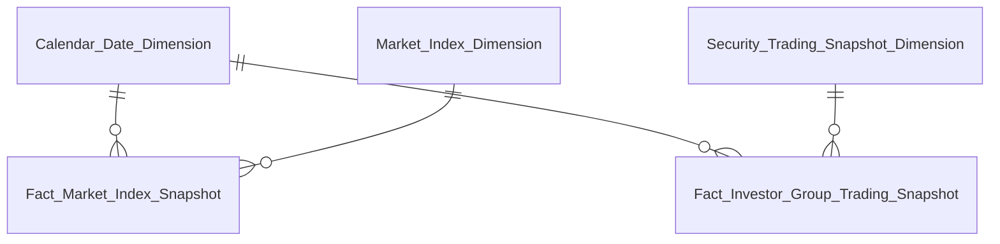

| Datamart Entity | Loại | Reuse | Mô tả | Grain | KPI |
|---|---|---|---|---|---|
| Calendar Date Dimension | Dimension | reuse | Lịch ngày | 1 ngày dương lịch | — |
| Market Index Dimension | Dimension | reuse | Danh mục chỉ số thị trường (VN-Index, HNX-Index, UPCoM-Index) | 1 tổ hợp Market Id + Market Code | — |
| Security Trading Snapshot Dimension | Dimension | partial | Hồ sơ chứng khoán / hợp đồng phái sinh (SCD4A current-state) | 1 mã chứng khoán / hợp đồng phái sinh | — |
| Fact Market Index Snapshot | Fact Snapshot | reuse | Điểm đóng cửa chỉ số thị trường cuối ngày (Nhóm 1, 2) | 1 chỉ số × 1 ngày giao dịch (bản ghi cuối ngày) | K_VP_4,6-8 |
| Fact Investor Group Trading Snapshot | Fact Snapshot | new | Khối lượng và giá trị mua/bán theo nhóm nhà đầu tư NĐTNN / Tự doanh / Toàn bộ (Nhóm 1, 2, 3, 5, 6) | 1 mã × 1 ngày × 1 sàn × 1 nhóm NĐT (PK investor_group_trading_snpst_id = hash cột grain) | K_VP_5,9-12 |

---

## Nhóm 2 - Cổ phiếu >> Biều đồ Giá trị mua/bán ròng Tự doanh và chỉ số Index


| Datamart Entity | Loại | Reuse | Mô tả | Grain | KPI |
|---|---|---|---|---|---|
| Calendar Date Dimension | Dimension | reuse | Lịch ngày | 1 ngày dương lịch | — |
| Market Index Dimension | Dimension | reuse | Danh mục chỉ số thị trường (VN-Index, HNX-Index, UPCoM-Index) | 1 tổ hợp Market Id + Market Code | — |
| Security Trading Snapshot Dimension | Dimension | partial | Hồ sơ chứng khoán / hợp đồng phái sinh (SCD4A current-state) | 1 mã chứng khoán / hợp đồng phái sinh | — |
| Fact Market Index Snapshot | Fact Snapshot | reuse | Điểm đóng cửa chỉ số thị trường cuối ngày (Nhóm 1, 2) | 1 chỉ số × 1 ngày giao dịch (bản ghi cuối ngày) | K_VP_4,6-8 |
| Fact Investor Group Trading Snapshot | Fact Snapshot | new | Khối lượng và giá trị mua/bán theo nhóm nhà đầu tư NĐTNN / Tự doanh / Toàn bộ (Nhóm 1, 2, 3, 5, 6) | 1 mã × 1 ngày × 1 sàn × 1 nhóm NĐT (PK investor_group_trading_snpst_id = hash cột grain) | K_VP_13-17 |

---

## Nhóm 3 - Phái sinh >> Chỉ tiêu tổng hợp

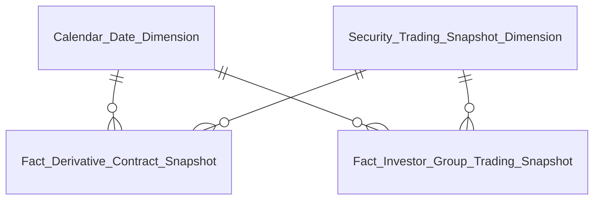

| Datamart Entity | Loại | Reuse | Mô tả | Grain | KPI |
|---|---|---|---|---|---|
| Calendar Date Dimension | Dimension | reuse | Lịch ngày | 1 ngày dương lịch | — |
| Security Trading Snapshot Dimension | Dimension | partial | Hồ sơ chứng khoán / hợp đồng phái sinh (SCD4A current-state) | 1 mã chứng khoán / hợp đồng phái sinh | — |
| Fact Derivative Contract Snapshot | Fact Snapshot | new | Khối lượng mở (OI) và giá đóng cửa hợp đồng phái sinh (Nhóm 3, 4, 5) | 1 mã hợp đồng phái sinh × 1 ngày giao dịch (PK derivative_contract_snpst_id = hash(ngày, mã hợp đồng)) | K_VP_19-20,29-30,39-40,49-50,59-60 |
| Fact Investor Group Trading Snapshot | Fact Snapshot | new | Khối lượng và giá trị mua/bán theo nhóm nhà đầu tư NĐTNN / Tự doanh / Toàn bộ (Nhóm 1, 2, 3, 5, 6) | 1 mã × 1 ngày × 1 sàn × 1 nhóm NĐT (PK investor_group_trading_snpst_id = hash cột grain) | K_VP_21-28,31-38,41-48,51-58,61-68 |

---

## Nhóm 4 - Phái sinh >> Giá HĐTL

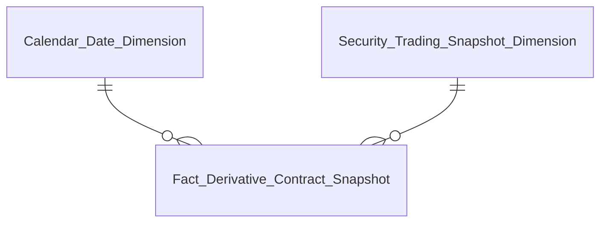

| Datamart Entity | Loại | Reuse | Mô tả | Grain | KPI |
|---|---|---|---|---|---|
| Calendar Date Dimension | Dimension | reuse | Lịch ngày | 1 ngày dương lịch | — |
| Security Trading Snapshot Dimension | Dimension | partial | Hồ sơ chứng khoán / hợp đồng phái sinh (SCD4A current-state) | 1 mã chứng khoán / hợp đồng phái sinh | — |
| Fact Derivative Contract Snapshot | Fact Snapshot | new | Khối lượng mở (OI) và giá đóng cửa hợp đồng phái sinh (Nhóm 3, 4, 5) | 1 mã hợp đồng phái sinh × 1 ngày giao dịch (PK derivative_contract_snpst_id = hash(ngày, mã hợp đồng)) | K_VP_70 |

---

## Nhóm 5 - Phái sinh >> Biểu đồ Diễn biến giao dịch thị trường phái sinh


| Datamart Entity | Loại | Reuse | Mô tả | Grain | KPI |
|---|---|---|---|---|---|
| Calendar Date Dimension | Dimension | reuse | Lịch ngày | 1 ngày dương lịch | — |
| Security Trading Snapshot Dimension | Dimension | partial | Hồ sơ chứng khoán / hợp đồng phái sinh (SCD4A current-state) | 1 mã chứng khoán / hợp đồng phái sinh | — |
| Fact Derivative Contract Snapshot | Fact Snapshot | new | Khối lượng mở (OI) và giá đóng cửa hợp đồng phái sinh (Nhóm 3, 4, 5) | 1 mã hợp đồng phái sinh × 1 ngày giao dịch (PK derivative_contract_snpst_id = hash(ngày, mã hợp đồng)) | K_VP_19,29,39,49,59 |
| Fact Investor Group Trading Snapshot | Fact Snapshot | new | Khối lượng và giá trị mua/bán theo nhóm nhà đầu tư NĐTNN / Tự doanh / Toàn bộ (Nhóm 1, 2, 3, 5, 6) | 1 mã × 1 ngày × 1 sàn × 1 nhóm NĐT (PK investor_group_trading_snpst_id = hash cột grain) | K_VP_21,31,41,51,61 |

---

## Nhóm 6 - Phái sinh >> Biểu đồ Khối lượng mua/bán ròng của NĐTNN

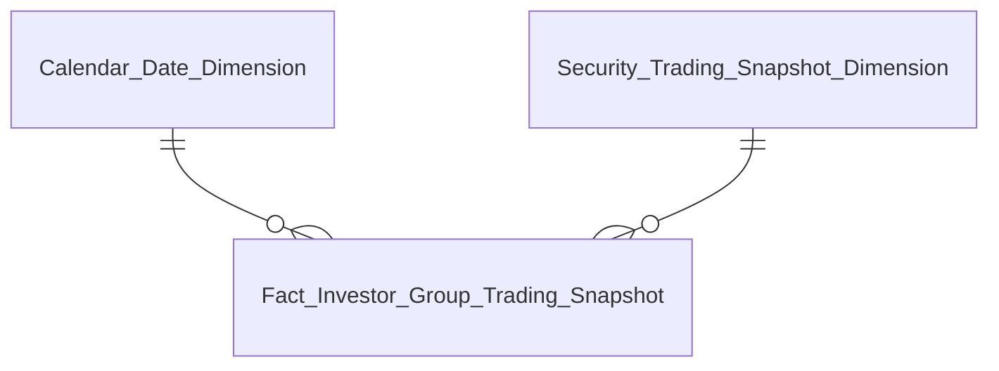

| Datamart Entity | Loại | Reuse | Mô tả | Grain | KPI |
|---|---|---|---|---|---|
| Calendar Date Dimension | Dimension | reuse | Lịch ngày | 1 ngày dương lịch | — |
| Security Trading Snapshot Dimension | Dimension | partial | Hồ sơ chứng khoán / hợp đồng phái sinh (SCD4A current-state) | 1 mã chứng khoán / hợp đồng phái sinh | — |
| Fact Investor Group Trading Snapshot | Fact Snapshot | new | Khối lượng và giá trị mua/bán theo nhóm nhà đầu tư NĐTNN / Tự doanh / Toàn bộ (Nhóm 1, 2, 3, 5, 6) | 1 mã × 1 ngày × 1 sàn × 1 nhóm NĐT (PK investor_group_trading_snpst_id = hash cột grain) | K_VP_23,25,27,33,35,37,43,45,47,53,55,57,63,65,67 |

---

## Nhóm 7 - TPDN niêm yết >> Chỉ tiêu tổng hợp

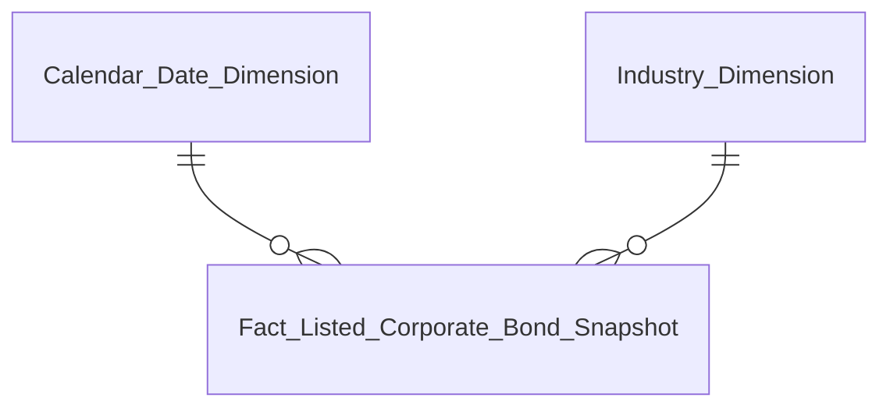

| Datamart Entity | Loại | Reuse | Mô tả | Grain | KPI |
|---|---|---|---|---|---|
| Calendar Date Dimension | Dimension | reuse | Lịch ngày | 1 ngày dương lịch | — |
| Industry Dimension | Dimension | reuse | Danh mục ngành nghề kinh doanh cấp 1 (Classification IDS Business Line) | 1 ngành nghề cấp 1 hiện hành | — |
| Fact Listed Corporate Bond Snapshot | Fact Snapshot | new | Giao dịch, kỳ hạn, ngành và khối lượng lưu hành của TPDN niêm yết theo mã trái phiếu (Nhóm 7, 8, 9, 10) | 1 mã trái phiếu (ISIN) × 1 ngày giao dịch (PK listed_corporate_bond_snpst_id = hash(snpst_dt_dim_id, security_symbol_code)) | K_VP_71-83,112-114 |

---

## Nhóm 8 - TPDN niêm yết >> Thống kê giao dịch TPDN niêm yết theo ngành


| Datamart Entity | Loại | Reuse | Mô tả | Grain | KPI |
|---|---|---|---|---|---|
| Calendar Date Dimension | Dimension | reuse | Lịch ngày | 1 ngày dương lịch | — |
| Industry Dimension | Dimension | reuse | Danh mục ngành nghề kinh doanh cấp 1 (Classification IDS Business Line) | 1 ngành nghề cấp 1 hiện hành | — |
| Fact Listed Corporate Bond Snapshot | Fact Snapshot | new | Giao dịch, kỳ hạn, ngành và khối lượng lưu hành của TPDN niêm yết theo mã trái phiếu (Nhóm 7, 8, 9, 10) | 1 mã trái phiếu (ISIN) × 1 ngày giao dịch (PK listed_corporate_bond_snpst_id = hash(snpst_dt_dim_id, security_symbol_code)) | K_VP_83-88 |

---

## Nhóm 9 - TPDN niêm yết >> Biểu đồ Thống kê GTGD TPDN niêm yết và TPDN riêng lẻ

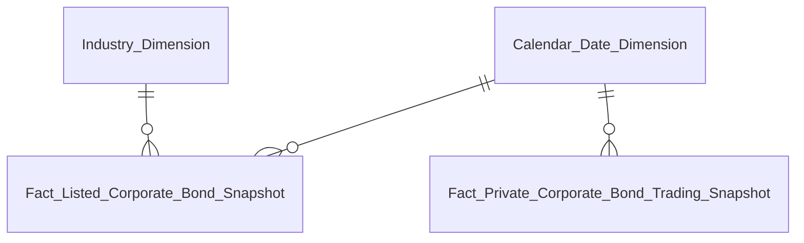

| Datamart Entity | Loại | Reuse | Mô tả | Grain | KPI |
|---|---|---|---|---|---|
| Calendar Date Dimension | Dimension | reuse | Lịch ngày | 1 ngày dương lịch | — |
| Industry Dimension | Dimension | reuse | Danh mục ngành nghề kinh doanh cấp 1 (Classification IDS Business Line) | 1 ngành nghề cấp 1 hiện hành | — |
| Fact Listed Corporate Bond Snapshot | Fact Snapshot | new | Giao dịch, kỳ hạn, ngành và khối lượng lưu hành của TPDN niêm yết theo mã trái phiếu (Nhóm 7, 8, 9, 10) | 1 mã trái phiếu (ISIN) × 1 ngày giao dịch (PK listed_corporate_bond_snpst_id = hash(snpst_dt_dim_id, security_symbol_code)) | K_VP_73 |
| Fact Private Corporate Bond Trading Snapshot | Fact Snapshot | new | Giá trị giao dịch và giá trị mua/bán NĐTNN TPDN riêng lẻ theo ngày báo cáo HNX09 (Nhóm 9, 11, 12, 13) | 1 ngày báo cáo HNX09 (PK private_corporate_bond_trading_snpst_id = hash(snpst_dt_dim_id, src_stm_code)) | K_VP_89 |

---

## Nhóm 10 - TPDN niêm yết >> Biểu đồ Giá trị giao dịch TPDN theo ngành


| Datamart Entity | Loại | Reuse | Mô tả | Grain | KPI |
|---|---|---|---|---|---|
| Calendar Date Dimension | Dimension | reuse | Lịch ngày | 1 ngày dương lịch | — |
| Industry Dimension | Dimension | reuse | Danh mục ngành nghề kinh doanh cấp 1 (Classification IDS Business Line) | 1 ngành nghề cấp 1 hiện hành | — |
| Fact Listed Corporate Bond Snapshot | Fact Snapshot | new | Giao dịch, kỳ hạn, ngành và khối lượng lưu hành của TPDN niêm yết theo mã trái phiếu (Nhóm 7, 8, 9, 10) | 1 mã trái phiếu (ISIN) × 1 ngày giao dịch (PK listed_corporate_bond_snpst_id = hash(snpst_dt_dim_id, security_symbol_code)) | K_VP_84,86,90 |

---

## Nhóm 11 - TPDN riêng lẻ >> Chỉ tiêu tổng hợp

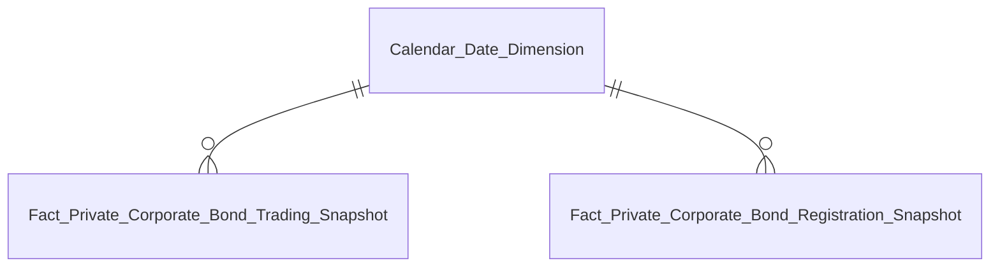

| Datamart Entity | Loại | Reuse | Mô tả | Grain | KPI |
|---|---|---|---|---|---|
| Calendar Date Dimension | Dimension | reuse | Lịch ngày | 1 ngày dương lịch | — |
| Fact Private Corporate Bond Trading Snapshot | Fact Snapshot | new | Giá trị giao dịch và giá trị mua/bán NĐTNN TPDN riêng lẻ theo ngày báo cáo HNX09 (Nhóm 9, 11, 12, 13) | 1 ngày báo cáo HNX09 (PK private_corporate_bond_trading_snpst_id = hash(snpst_dt_dim_id, src_stm_code)) | K_VP_89,91-99 |
| Fact Private Corporate Bond Registration Snapshot | Fact Snapshot | new | Số mã TPDN riêng lẻ đăng ký giao dịch theo báo cáo tháng HNX (Nhóm 11); từ 2026-11-08 có thêm KL, mệnh giá, giá trị đăng ký giao dịch (Nhóm 17, 18, 20; O_VP_68) | 1 mã trái phiếu (Bond Code) × 1 tháng báo cáo (PK private_corporate_bond_registration_snpst_id = hash(bond_code, rpt_year, rpt_month, src_stm_code)) | K_VP_100-101 |

---

## Nhóm 12 - TPDN riêng lẻ >> Biểu đồ Diễn biến giao dịch thị trường TPDN riêng lẻ

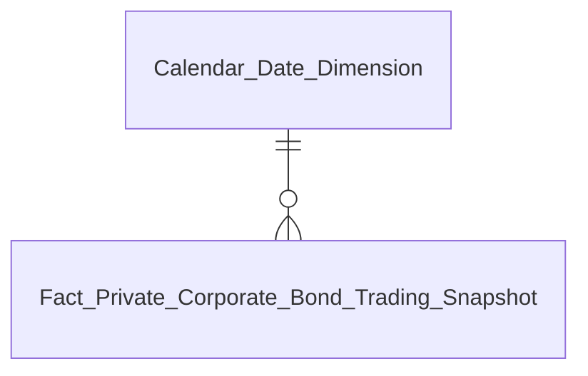

| Datamart Entity | Loại | Reuse | Mô tả | Grain | KPI |
|---|---|---|---|---|---|
| Calendar Date Dimension | Dimension | reuse | Lịch ngày | 1 ngày dương lịch | — |
| Fact Private Corporate Bond Trading Snapshot | Fact Snapshot | new | Giá trị giao dịch và giá trị mua/bán NĐTNN TPDN riêng lẻ theo ngày báo cáo HNX09 (Nhóm 9, 11, 12, 13) | 1 ngày báo cáo HNX09 (PK private_corporate_bond_trading_snpst_id = hash(snpst_dt_dim_id, src_stm_code)) | K_VP_89 |

---

## Nhóm 13 - TPDN riêng lẻ >> Giá trị mua/bán ròng NĐTNN trên thị trường TPDN riêng lẻ


| Datamart Entity | Loại | Reuse | Mô tả | Grain | KPI |
|---|---|---|---|---|---|
| Calendar Date Dimension | Dimension | reuse | Lịch ngày | 1 ngày dương lịch | — |
| Fact Private Corporate Bond Trading Snapshot | Fact Snapshot | new | Giá trị giao dịch và giá trị mua/bán NĐTNN TPDN riêng lẻ theo ngày báo cáo HNX09 (Nhóm 9, 11, 12, 13) | 1 ngày báo cáo HNX09 (PK private_corporate_bond_trading_snpst_id = hash(snpst_dt_dim_id, src_stm_code)) | K_VP_94,96,98 |

---

## Nhóm 14 - TPCP >> Chỉ tiêu tổng hợp

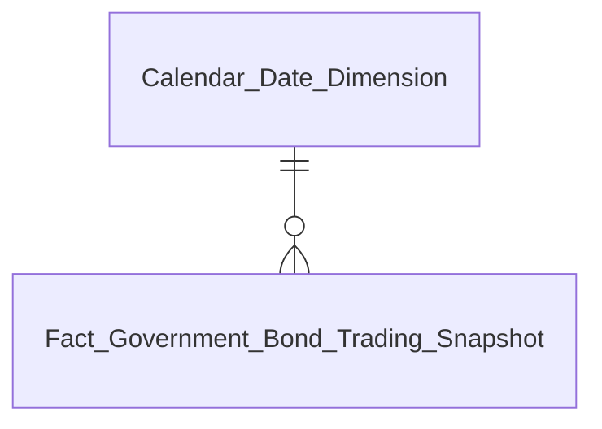

| Datamart Entity | Loại | Reuse | Mô tả | Grain | KPI |
|---|---|---|---|---|---|
| Calendar Date Dimension | Dimension | reuse | Lịch ngày | 1 ngày dương lịch | — |
| Fact Government Bond Trading Snapshot | Fact Snapshot | new | Khối lượng, giá trị giao dịch và giá trị mua/bán NĐTNN TPCP theo ngày và loại sổ lệnh (Nhóm 14, 15, 16) | 1 ngày giao dịch × 1 loại sổ lệnh OUTRIGHT / REPO (PK government_bond_trading_snpst_id = hash(snpst_dt_dim_id, order_book_tp, src_stm_code)) | K_VP_102-111 |

---

## Nhóm 15 - TPCP >> Biểu đồ Diễn biến giao dịch thị trường


| Datamart Entity | Loại | Reuse | Mô tả | Grain | KPI |
|---|---|---|---|---|---|
| Calendar Date Dimension | Dimension | reuse | Lịch ngày | 1 ngày dương lịch | — |
| Fact Government Bond Trading Snapshot | Fact Snapshot | new | Khối lượng, giá trị giao dịch và giá trị mua/bán NĐTNN TPCP theo ngày và loại sổ lệnh (Nhóm 14, 15, 16) | 1 ngày giao dịch × 1 loại sổ lệnh OUTRIGHT / REPO (PK government_bond_trading_snpst_id = hash(snpst_dt_dim_id, order_book_tp, src_stm_code)) | K_VP_102,104 |

---

## Nhóm 16 - TPCP >> Biểu đồ Giá trị mua/bán ròng NĐTNN


| Datamart Entity | Loại | Reuse | Mô tả | Grain | KPI |
|---|---|---|---|---|---|
| Calendar Date Dimension | Dimension | reuse | Lịch ngày | 1 ngày dương lịch | — |
| Fact Government Bond Trading Snapshot | Fact Snapshot | new | Khối lượng, giá trị giao dịch và giá trị mua/bán NĐTNN TPCP theo ngày và loại sổ lệnh (Nhóm 14, 15, 16) | 1 ngày giao dịch × 1 loại sổ lệnh OUTRIGHT / REPO (PK government_bond_trading_snpst_id = hash(snpst_dt_dim_id, order_book_tp, src_stm_code)) | K_VP_106,108,110 |

## Nhóm 17 - Niêm yết >> Chỉ tiêu tổng hợp

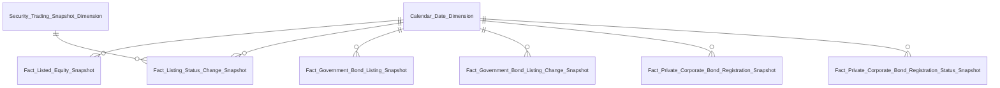

| Datamart Entity | Loại | Reuse | Mô tả | Grain | KPI |
|---|---|---|---|---|---|
| Calendar Date Dimension | Dimension | reuse | Lịch ngày (kỳ tra cứu, kỳ trước) | 1 ngày dương lịch | K_VP_1 |
| Security Trading Snapshot Dimension | Dimension | reuse | Loại chứng khoán hiện hành của mã có sự kiện niêm yết (cổ phiếu, CCQ, ETF, chứng quyền, TPDN niêm yết); GSTT sở hữu | 1 mã chứng khoán / hợp đồng phái sinh (SCD4A current-state) | K_VP_375, K_VP_382–389 |
| Fact Listed Equity Snapshot | Fact Snapshot | reuse | Quy mô niêm yết MDDS của cổ phiếu, CCQ, ETF, chứng quyền, TPDN niêm yết — mở rộng loại 1/4 và cột `fund_tp_code` [2026-11-08, O_VP_68] | 1 mã chứng khoán × 1 ngày giao dịch (PK hash cột grain) | K_VP_375–381 |
| Fact Government Bond Listing Snapshot | Fact Snapshot | reuse | Quy mô niêm yết TPCP theo tháng báo cáo | 1 mã TPCP × 1 tháng báo cáo | K_VP_376–381 |
| Fact Private Corporate Bond Registration Snapshot | Fact Snapshot | reuse | Quy mô ĐKGD TPDN riêng lẻ — thêm KL, mệnh giá, giá trị đăng ký giao dịch [2026-11-08, O_VP_68] | 1 mã TPDN riêng lẻ × 1 tháng báo cáo | K_VP_376–381 |
| Fact Listing Status Change Snapshot | Fact Snapshot | reuse | Sự kiện niêm yết mới/bổ sung/hủy của cổ phiếu, CCQ, ETF, chứng quyền, TPDN niêm yết (HNX + HOSE) | 1 quyết định thay đổi niêm yết × 1 mã × 1 Sở | K_VP_382–389 |
| Fact Government Bond Listing Change Snapshot | Fact Snapshot | new | [MỚI 2026-11-08, O_VP_71] Sự kiện niêm yết mới / bổ sung / đáo hạn của TPCP (Atomic additional_gov_bond_listing) | 1 sự kiện (PK = id dòng Atomic, Dạng A) | K_VP_382–389 |
| Fact Private Corporate Bond Registration Status Snapshot | Fact Snapshot | new | [MỚI 2026-11-08, O_VP_71] Đăng ký / hủy đăng ký giao dịch TPDN riêng lẻ LŨY KẾ từ đầu năm (Atomic bond_trading_registration_status) | 1 mã × 1 trạng thái × 1 tháng báo cáo (PK = hash có ngày cuối tháng báo cáo, Dạng B — khóa Atomic không chứa tháng) | K_VP_382–389 |

## Nhóm 18 - Biểu đồ Khối lượng chứng khoán niêm yết

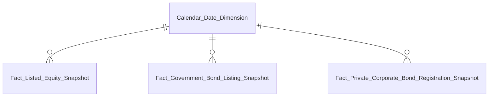

| Datamart Entity | Loại | Reuse | Mô tả | Grain | KPI |
|---|---|---|---|---|---|
| Calendar Date Dimension | Dimension | reuse | Lịch ngày (chuỗi kỳ Từ kỳ — Đến kỳ) | 1 ngày dương lịch | K_VP_1 |
| Fact Listed Equity Snapshot | Fact Snapshot | reuse | KL niêm yết của cổ phiếu (theo sàn), CCQ, ETF, chứng quyền, TPDN niêm yết tại ngày giao dịch cuối mỗi kỳ [mở rộng Fact, O_VP_68] | 1 mã chứng khoán × 1 ngày giao dịch (PK hash cột grain) | K_VP_348–354, 357–359 |
| Fact Government Bond Listing Snapshot | Fact Snapshot | reuse | KL niêm yết TPCP tại tháng báo cáo mới nhất trong kỳ | 1 mã TPCP × 1 tháng báo cáo | K_VP_350, 356 |
| Fact Private Corporate Bond Registration Snapshot | Fact Snapshot | reuse | KL đăng ký giao dịch TPDN riêng lẻ tại tháng báo cáo mới nhất trong kỳ [cột mới, O_VP_68] | 1 mã TPDN riêng lẻ × 1 tháng báo cáo | K_VP_350, 355 |

## Nhóm 19 - Chỉ tiêu tổng hợp - Vốn hóa cổ phiếu

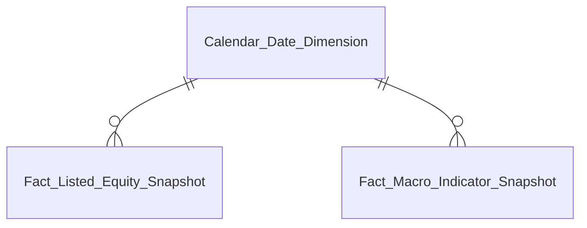

| Datamart Entity | Loại | Reuse | Mô tả | Grain | KPI |
|---|---|---|---|---|---|
| Calendar Date Dimension | Dimension | reuse | Lịch ngày (mốc ngày giao dịch cuối kỳ, kỳ trước, cuối năm trước) | 1 ngày dương lịch | K_VP_1 |
| Fact Listed Equity Snapshot | Fact Snapshot | reuse | Vốn hóa cổ phiếu cuối ngày trên HOSE, HNX, UPCoM (UPCoM theo VWAP T+1) — dùng chung với Nhóm 55 | 1 mã × 1 ngày giao dịch | K_VP_239–254 |
| Fact Macro Indicator Snapshot | Fact Snapshot | reuse | GDP_VN (PTTT sở hữu; bổ sung PK macro_indicator_val_id và cột unit_tp_code, O_VP_41 phương án A) — mẫu số tỷ lệ Vốn hóa/GDP | 1 chỉ tiêu × 1 kỳ công bố (PK id dòng Atomic) | K_VP_243–245 |

## Nhóm 20 - Chỉ tiêu tổng hợp - Giá trị niêm yết trái phiếu

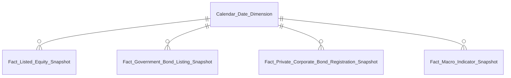

| Datamart Entity | Loại | Reuse | Mô tả | Grain | KPI |
|---|---|---|---|---|---|
| Calendar Date Dimension | Dimension | reuse | Lịch ngày (mốc kỳ này, kỳ trước, cuối năm trước) | 1 ngày dương lịch | K_VP_1 |
| Fact Listed Equity Snapshot | Fact Snapshot | reuse | GT niêm yết TPDN niêm yết (KL × mệnh giá suy ngược từ giá tham chiếu; loại 1 mở rộng, O_VP_68) | 1 mã chứng khoán × 1 ngày giao dịch (PK hash cột grain) | K_VP_360–363, 365–368 |
| Fact Government Bond Listing Snapshot | Fact Snapshot | reuse | GT niêm yết TPCP (KL × 100.000) | 1 mã TPCP × 1 tháng báo cáo | K_VP_361–365, 372–374 |
| Fact Private Corporate Bond Registration Snapshot | Fact Snapshot | reuse | GT đăng ký giao dịch TPDN riêng lẻ (KL × mệnh giá) [cột mới, O_VP_68] | 1 mã TPDN riêng lẻ × 1 tháng báo cáo | K_VP_361–365, 369–371 |
| Fact Macro Indicator Snapshot | Fact Snapshot | reuse | GDP_VN (PTTT sở hữu; K_VP_174, O_VP_41) — mẫu số Quy mô TP/GDP | 1 chỉ tiêu × 1 kỳ công bố (PK id dòng Atomic) | K_VP_364–365 |

## Nhóm 21 - Biểu đồ Giá trị vốn hóa thị trường cổ phiếu

```mermaid
erDiagram
    Calendar_Date_Dimension ||--o{ Fact_Listed_Equity_Snapshot : " "
    Calendar_Date_Dimension ||--o{ Fact_Macro_Indicator_Snapshot : " "
```

| Datamart Entity | Loại | Reuse | Mô tả | Grain | KPI |
|---|---|---|---|---|---|
| Calendar Date Dimension | Dimension | reuse | Lịch ngày (chuỗi kỳ Từ kỳ — Đến kỳ) | 1 ngày dương lịch | K_VP_1 |
| Fact Listed Equity Snapshot | Fact Snapshot | reuse | Vốn hóa cổ phiếu cuối ngày theo sàn tại ngày giao dịch cuối mỗi kỳ (UPCoM theo VWAP T+1) | 1 mã chứng khoán × 1 ngày giao dịch (PK hash cột grain) | K_VP_342–347 |
| Fact Macro Indicator Snapshot | Fact Snapshot | reuse | GDP_VN (PTTT sở hữu; K_VP_174, O_VP_41) — mẫu số Tỷ lệ Vốn hóa/GDP | 1 chỉ tiêu × 1 kỳ công bố (PK id dòng Atomic) | K_VP_347 |

## Nhóm 22 - Biểu đồ Cơ cấu vốn hóa cổ phiếu theo ngành

```mermaid
erDiagram
    Calendar_Date_Dimension ||--o{ Fact_Listed_Equity_Snapshot : " "
    Industry_Dimension ||--o{ Fact_Listed_Equity_Snapshot : " "
```

| Datamart Entity | Loại | Reuse | Mô tả | Grain | KPI |
|---|---|---|---|---|---|
| Calendar Date Dimension | Dimension | reuse | Lịch ngày (mốc ngày giao dịch cuối kỳ) | 1 ngày dương lịch | K_VP_1 |
| Industry Dimension | Dimension | reuse | Ngành nghề kinh doanh cấp 1 (GSDC sở hữu) — chiều ngành của cổ phiếu qua FK `industry_dim_id` trên Fact vốn hóa [2026-11-08, O_VP_66] | 1 ngành cấp 1 hiện hành | K_VP_339 |
| Fact Listed Equity Snapshot | Fact Snapshot | reuse | Vốn hóa cổ phiếu cuối ngày trên HOSE, HNX, UPCoM (UPCoM theo VWAP T+1) — dùng chung với Nhóm 19, 55; thêm cột FK ngành `industry_dim_id` (nullable, chỉ cổ phiếu; CTCK/CTQLQ đại chúng = 07000), không đổi grain/PK [2026-11-08, O_VP_66] | 1 mã × 1 ngày giao dịch (PK hash cột grain) | K_VP_340–341 |

## Nhóm 30 - Huy động vốn >> TPCP >> Chỉ tiêu tổng hợp

```mermaid
erDiagram
    Calendar_Date_Dimension ||--o{ Fact_Government_Bond_Bidding_Result_Snapshot : " "
    Government_Bond_Term_Dimension ||--o{ Fact_Government_Bond_Bidding_Result_Snapshot : " "
    Calendar_Date_Dimension ||--o{ Fact_Government_Bond_Listing_Snapshot : " "
```

| Datamart Entity | Loại | Reuse | Mô tả | Grain | KPI |
|---|---|---|---|---|---|
| Calendar Date Dimension | Dimension | reuse | Lịch ngày (kỳ tháng/quý/năm của ngày phát hành) | 1 ngày dương lịch | K_VP_1 |
| Fact Government Bond Bidding Result Snapshot | Fact Snapshot | new | Kết quả đấu thầu phát hành trái phiếu Chính phủ (HNX) — GT phát hành = giá trị trúng thầu, kỳ hạn và lãi suất bình quân gia quyền theo kỳ; dùng chung với Nhóm 31, 47, 48 [2026-11-06: TKNB Nhóm 5 HNX06 thêm 3 cột `rpt_year`, `rpt_month`, `government_bond_term_dim_id` (FK Government Bond Term Dimension, sở hữu TKNB); grain/PK không đổi] | 1 dòng kết quả đấu thầu (PK = id dòng Atomic `gov_bond_bidding_result`) | K_VP_273–278 |
| Fact Government Bond Listing Snapshot | Fact Snapshot | new | [MỚI 2026-11-05] Danh sách trái phiếu Chính phủ niêm yết tại HNX theo tháng báo cáo (Atomic gov_bond_listing ← HNX.GOV_BOND_LISTED_LIST): khối lượng niêm yết và giá trị niêm yết (KL × mệnh giá 100.000 đồng) — phục vụ Tổng dư nợ TPCP (Nhóm 30), Giá trị niêm yết TPCP (Nhóm 49), Số mã / Giá trị niêm yết TPCP (Nhóm 55); grain 1 mã TPCP × 1 tháng báo cáo; PK government_bond_listing_snpst_id (Dạng B: hash bond_code, rpt_year, rpt_month, src_stm_code) | 1 mã TPCP × 1 tháng báo cáo; PK = hash(bond_code, rpt_year, rpt_month, src_stm_code) | K_VP_271–272 |

## Nhóm 31 - Huy động vốn >> TPCP >> Biểu đồ Giá trị trúng thầu TPCP

```mermaid
erDiagram
    Calendar_Date_Dimension ||--o{ Fact_Government_Bond_Bidding_Result_Snapshot : " "
    Government_Bond_Term_Dimension ||--o{ Fact_Government_Bond_Bidding_Result_Snapshot : " "
```

| Datamart Entity | Loại | Reuse | Mô tả | Grain | KPI |
|---|---|---|---|---|---|
| Calendar Date Dimension | Dimension | reuse | Lịch ngày (kỳ tháng/quý/năm của ngày phát hành) | 1 ngày dương lịch | K_VP_1 |
| Fact Government Bond Bidding Result Snapshot | Fact Snapshot | new | Kết quả đấu thầu phát hành trái phiếu Chính phủ (HNX) — thêm cột Calling Value (giá trị gọi thầu) cho Nhóm 31; dùng chung với Nhóm 30, 47, 48 [2026-11-06: TKNB Nhóm 5 HNX06 thêm 3 cột `rpt_year`, `rpt_month`, `government_bond_term_dim_id` (FK Government Bond Term Dimension, sở hữu TKNB); grain/PK không đổi] | 1 dòng kết quả đấu thầu (PK = id dòng Atomic `gov_bond_bidding_result`) | K_VP_279–280 (K_VP_273 dùng lại) |

## Nhóm 32 - Mua/Bán ròng NĐTNN >> Chỉ tiêu tổng hợp

```mermaid
erDiagram
    Calendar_Date_Dimension ||--o{ Fact_Investor_Group_Trading_Snapshot : " "
    Security_Trading_Snapshot_Dimension ||--o{ Fact_Investor_Group_Trading_Snapshot : " "
    Calendar_Date_Dimension ||--o{ Fact_Listed_Corporate_Bond_Snapshot : " "
    Calendar_Date_Dimension ||--o{ Fact_Private_Corporate_Bond_Trading_Snapshot : " "
    Calendar_Date_Dimension ||--o{ Fact_Government_Bond_Trading_Snapshot : " "
```

| Datamart Entity | Loại | Reuse | Mô tả | Grain | KPI |
|---|---|---|---|---|---|
| Calendar Date Dimension | Dimension | reuse | Lịch ngày | 1 ngày dương lịch | — |
| Fact Investor Group Trading Snapshot | Fact Snapshot | reuse | Giá trị/khối lượng mua/bán theo nhóm NĐT (NĐTNN / Tự doanh / Toàn bộ) — đã thiết kế Nhóm 1–6; Nhóm 32 đọc `Buy Value`/`Sell Value` với Investor Group Code = 'FOREIGN' | 1 mã × 1 ngày × 1 sàn × 1 nhóm NĐT × 1 nguồn Sổ lệnh | K_VP_115–134 |
| Security Trading Snapshot Dimension | Dimension | reuse (partial) | Hồ sơ chứng khoán (GSTT sở hữu) — Nhóm 32 lọc/cắt theo `Stock Type Name` (Cổ phiếu / Chứng quyền / Chứng chỉ quỹ·ETF / Phái sinh) | 1 mã chứng khoán (bản ghi mới nhất) | K_VP_115–134 |
| Fact Listed Corporate Bond Snapshot | Fact Snapshot | reuse | Giao dịch TPDN niêm yết (đã thiết kế Nhóm 7–10); Nhóm 32 đọc `Foreign Buy Value`/`Foreign Sell Value` | 1 mã trái phiếu (ISIN) × 1 ngày giao dịch | K_VP_115–134 |
| Fact Private Corporate Bond Trading Snapshot | Fact Snapshot | reuse | Giao dịch TPDN riêng lẻ (đã thiết kế Nhóm 11–13); Nhóm 32 đọc `Foreign Buy Value`/`Foreign Sell Value` | 1 ngày × 1 nguồn báo cáo HNX09 | K_VP_115–134 |
| Fact Government Bond Trading Snapshot | Fact Snapshot | reuse | Giao dịch TPCP (đã thiết kế Nhóm 14–16); Nhóm 32 đọc `Foreign Buy Value`/`Foreign Sell Value` | 1 ngày giao dịch × 1 loại sổ lệnh OUTRIGHT / REPO | K_VP_115–134 |

## Nhóm 33 - Mua/Bán ròng NĐTNN >> Chi tiết giao dịch

```mermaid
erDiagram
    Calendar_Date_Dimension ||--o{ Fact_Investor_Group_Trading_Snapshot : " "
    Security_Trading_Snapshot_Dimension ||--o{ Fact_Investor_Group_Trading_Snapshot : " "
    Calendar_Date_Dimension ||--o{ Fact_Listed_Corporate_Bond_Snapshot : " "
    Calendar_Date_Dimension ||--o{ Fact_Private_Corporate_Bond_Trading_Snapshot : " "
    Calendar_Date_Dimension ||--o{ Fact_Government_Bond_Trading_Snapshot : " "
```

| Datamart Entity | Loại | Reuse | Mô tả | Grain | KPI |
|---|---|---|---|---|---|
| Calendar Date Dimension | Dimension | reuse | Lịch ngày | 1 ngày dương lịch | — |
| Fact Investor Group Trading Snapshot | Fact Snapshot | reuse | Giá trị/khối lượng mua/bán theo nhóm NĐT (NĐTNN / Tự doanh / Toàn bộ) — đã thiết kế Nhóm 1–6; Nhóm 33 đọc `Buy Value`/`Sell Value` với Investor Group Code = 'FOREIGN' | 1 mã × 1 ngày × 1 sàn × 1 nhóm NĐT × 1 nguồn Sổ lệnh | K_VP_135–140 |
| Security Trading Snapshot Dimension | Dimension | reuse (partial) | Hồ sơ chứng khoán (GSTT sở hữu) — Nhóm 33 lọc/cắt theo `Stock Type Name` (Cổ phiếu / Chứng quyền / Chứng chỉ quỹ·ETF / Phái sinh) | 1 mã chứng khoán (bản ghi mới nhất) | K_VP_135–140 |
| Fact Listed Corporate Bond Snapshot | Fact Snapshot | reuse | Giao dịch TPDN niêm yết (đã thiết kế Nhóm 7–10); Nhóm 33 đọc `Foreign Buy Value`/`Foreign Sell Value` | 1 mã trái phiếu (ISIN) × 1 ngày giao dịch | K_VP_135–140 |
| Fact Private Corporate Bond Trading Snapshot | Fact Snapshot | reuse | Giao dịch TPDN riêng lẻ (đã thiết kế Nhóm 11–13); Nhóm 33 đọc `Foreign Buy Value`/`Foreign Sell Value` | 1 ngày × 1 nguồn báo cáo HNX09 | K_VP_135–140 |
| Fact Government Bond Trading Snapshot | Fact Snapshot | reuse | Giao dịch TPCP (đã thiết kế Nhóm 14–16); Nhóm 33 đọc `Foreign Buy Value`/`Foreign Sell Value` | 1 ngày giao dịch × 1 loại sổ lệnh OUTRIGHT / REPO | K_VP_135–140 |

## Nhóm 34 - Mua/Bán ròng NĐTNN >> Chỉ tiêu tổng hợp (GT bán theo loại tài sản)

```mermaid
erDiagram
    Calendar_Date_Dimension ||--o{ Fact_Investor_Group_Trading_Snapshot : " "
    Security_Trading_Snapshot_Dimension ||--o{ Fact_Investor_Group_Trading_Snapshot : " "
    Calendar_Date_Dimension ||--o{ Fact_Listed_Corporate_Bond_Snapshot : " "
    Calendar_Date_Dimension ||--o{ Fact_Private_Corporate_Bond_Trading_Snapshot : " "
    Calendar_Date_Dimension ||--o{ Fact_Government_Bond_Trading_Snapshot : " "
```

| Datamart Entity | Loại | Reuse | Mô tả | Grain | KPI |
|---|---|---|---|---|---|
| Calendar Date Dimension | Dimension | reuse | Lịch ngày | 1 ngày dương lịch | — |
| Fact Investor Group Trading Snapshot | Fact Snapshot | reuse | Giá trị/khối lượng mua/bán theo nhóm NĐT (NĐTNN / Tự doanh / Toàn bộ) — đã thiết kế Nhóm 1–6; Nhóm 34 đọc `Buy Value`/`Sell Value` với Investor Group Code = 'FOREIGN' | 1 mã × 1 ngày × 1 sàn × 1 nhóm NĐT × 1 nguồn Sổ lệnh | K_VP_141 |
| Security Trading Snapshot Dimension | Dimension | reuse (partial) | Hồ sơ chứng khoán (GSTT sở hữu) — Nhóm 34 lọc/cắt theo `Stock Type Name` (Cổ phiếu / Chứng quyền / Chứng chỉ quỹ·ETF / Phái sinh) | 1 mã chứng khoán (bản ghi mới nhất) | K_VP_141 |
| Fact Listed Corporate Bond Snapshot | Fact Snapshot | reuse | Giao dịch TPDN niêm yết (đã thiết kế Nhóm 7–10); Nhóm 34 đọc `Foreign Buy Value`/`Foreign Sell Value` | 1 mã trái phiếu (ISIN) × 1 ngày giao dịch | K_VP_141 |
| Fact Private Corporate Bond Trading Snapshot | Fact Snapshot | reuse | Giao dịch TPDN riêng lẻ (đã thiết kế Nhóm 11–13); Nhóm 34 đọc `Foreign Buy Value`/`Foreign Sell Value` | 1 ngày × 1 nguồn báo cáo HNX09 | K_VP_141 |
| Fact Government Bond Trading Snapshot | Fact Snapshot | reuse | Giao dịch TPCP (đã thiết kế Nhóm 14–16); Nhóm 34 đọc `Foreign Buy Value`/`Foreign Sell Value` | 1 ngày giao dịch × 1 loại sổ lệnh OUTRIGHT / REPO | K_VP_141 |

## Nhóm 35 - Mua/Bán ròng NĐTNN >> Biểu đồ Giá trị mua/bán ròng cổ phiếu NĐTNN theo nhóm ngành

```mermaid
erDiagram
    Calendar_Date_Dimension ||--o{ Fact_Investor_Group_Trading_Snapshot : " "
    Security_Trading_Snapshot_Dimension ||--o{ Fact_Investor_Group_Trading_Snapshot : " "
    Industry_Dimension ||--o{ Fact_Investor_Group_Trading_Snapshot : " "
```

| Datamart Entity | Loại | Reuse | Mô tả | Grain | KPI |
|---|---|---|---|---|---|
| Calendar Date Dimension | Dimension | reuse | Lịch ngày | 1 ngày dương lịch | — |
| Fact Investor Group Trading Snapshot | Fact Snapshot | reuse | Giá trị/khối lượng mua/bán theo nhóm NĐT (NĐTNN / Tự doanh / Toàn bộ) — đã thiết kế Nhóm 1–6; Nhóm 35 đọc `Buy Value`/`Sell Value` với Investor Group Code = 'FOREIGN' | 1 mã × 1 ngày × 1 sàn × 1 nhóm NĐT × 1 nguồn Sổ lệnh | K_VP_142–143 |
| Security Trading Snapshot Dimension | Dimension | reuse (partial) | Hồ sơ chứng khoán (GSTT sở hữu) — Nhóm 35 lọc/cắt theo `Stock Type Name` (Cổ phiếu / Chứng quyền / Chứng chỉ quỹ·ETF / Phái sinh) | 1 mã chứng khoán (bản ghi mới nhất) | K_VP_142–143 |
| Industry Dimension | Dimension | reuse | Danh mục ngành nghề kinh doanh cấp 1 (GSDC sở hữu) — Nhóm 35 dùng làm chiều Ngành của cổ phiếu (qua FK Industry Dimension Id của Fact nhóm NĐT, O_VP_37) | 1 ngành nghề cấp 1 hiện hành | K_VP_142–143 |

## Nhóm 36 - Mua/Bán ròng NĐTNN >> Biểu đồ Giá trị giao dịch Cổ phiếu của NĐTNN

```mermaid
erDiagram
    Calendar_Date_Dimension ||--o{ Fact_Investor_Group_Trading_Snapshot : " "
    Security_Trading_Snapshot_Dimension ||--o{ Fact_Investor_Group_Trading_Snapshot : " "
```

| Datamart Entity | Loại | Reuse | Mô tả | Grain | KPI |
|---|---|---|---|---|---|
| Calendar Date Dimension | Dimension | reuse | Lịch ngày | 1 ngày dương lịch | — |
| Fact Investor Group Trading Snapshot | Fact Snapshot | reuse | Giá trị/khối lượng mua/bán theo nhóm NĐT (NĐTNN / Tự doanh / Toàn bộ) — đã thiết kế Nhóm 1–6; Nhóm 36 đọc `Buy Value`/`Sell Value` với Investor Group Code = 'FOREIGN' | 1 mã × 1 ngày × 1 sàn × 1 nhóm NĐT × 1 nguồn Sổ lệnh | K_VP_144–146 |
| Security Trading Snapshot Dimension | Dimension | reuse (partial) | Hồ sơ chứng khoán (GSTT sở hữu) — Nhóm 36 chỉ lọc theo `Stock Type Code` = '2' (Cổ phiếu) | 1 mã chứng khoán (bản ghi mới nhất) | K_VP_144–146 |

## Nhóm 37 - Mua/Bán ròng NĐTNN >> Biểu đồ Giá trị giao dịch Trái phiếu của NĐTNN

```mermaid
erDiagram
    Calendar_Date_Dimension ||--o{ Fact_Listed_Corporate_Bond_Snapshot : " "
    Calendar_Date_Dimension ||--o{ Fact_Private_Corporate_Bond_Trading_Snapshot : " "
    Calendar_Date_Dimension ||--o{ Fact_Government_Bond_Trading_Snapshot : " "
```

| Datamart Entity | Loại | Reuse | Mô tả | Grain | KPI |
|---|---|---|---|---|---|
| Calendar Date Dimension | Dimension | reuse | Lịch ngày | 1 ngày dương lịch | — |
| Fact Listed Corporate Bond Snapshot | Fact Snapshot | reuse | Giao dịch TPDN niêm yết (đã thiết kế Nhóm 7–10); Nhóm 37 đọc `Foreign Buy Value`/`Foreign Sell Value` | 1 mã trái phiếu (ISIN) × 1 ngày giao dịch | K_VP_147–159 |
| Fact Private Corporate Bond Trading Snapshot | Fact Snapshot | reuse | Giao dịch TPDN riêng lẻ (đã thiết kế Nhóm 11–13); Nhóm 37 đọc `Foreign Buy Value`/`Foreign Sell Value` | 1 ngày × 1 nguồn báo cáo HNX09 | K_VP_147–159 |
| Fact Government Bond Trading Snapshot | Fact Snapshot | reuse | Giao dịch TPCP (đã thiết kế Nhóm 14–16); Nhóm 37 đọc `Foreign Buy Value`/`Foreign Sell Value` | 1 ngày giao dịch × 1 loại sổ lệnh OUTRIGHT / REPO | K_VP_147–159 |

## Nhóm 38 - Dòng tiền NĐTNN >> Chỉ tiêu tổng hợp

```mermaid
erDiagram
    Calendar_Date_Dimension ||--o{ Fact_Foreign_Capital_Flow_Summary_Snapshot : " "
```

| Datamart Entity | Loại | Reuse | Mô tả | Grain | KPI |
|---|---|---|---|---|---|
| Calendar Date Dimension | Dimension | reuse | Lịch ngày | 1 ngày dương lịch | — |
| Fact Foreign Capital Flow Summary Snapshot | Fact Snapshot | new | [MỚI 2026-11-05] Dòng tiền NĐTNN theo báo cáo FIMS IBOU9 (PLIV-TT51), dòng 'Tổng= (1) + (2)' — vào ròng, dòng tiền vào, dòng tiền ra (USD) (Nhóm 38, 39); grain 1 TVLK nộp báo cáo × 1 kỳ báo cáo nửa tháng (period_val, rpt_year), bản nộp mới nhất của kỳ; PK foreign_capital_flow_summary_snpst_id (Dạng B: hash reporting_entity_code, period_val, rpt_year, src_stm_code) | 1 TVLK nộp báo cáo × 1 kỳ báo cáo nửa tháng; PK = hash(reporting_entity_code, period_val, rpt_year, src_stm_code) | K_VP_288–295 |

## Nhóm 39 - Dòng tiền NĐTNN >> Biểu đồ thống kê dòng tiền vào/ra của NĐTNN theo thời gian

```mermaid
erDiagram
    Calendar_Date_Dimension ||--o{ Fact_Foreign_Capital_Flow_Summary_Snapshot : " "
```

| Datamart Entity | Loại | Reuse | Mô tả | Grain | KPI |
|---|---|---|---|---|---|
| Calendar Date Dimension | Dimension | reuse | Lịch ngày | 1 ngày dương lịch | — |
| Fact Foreign Capital Flow Summary Snapshot | Fact Snapshot | new | [MỚI 2026-11-05] Dòng tiền NĐTNN theo báo cáo FIMS IBOU9 (PLIV-TT51), dòng 'Tổng= (1) + (2)' — vào ròng, dòng tiền vào, dòng tiền ra (USD) (Nhóm 38, 39); grain 1 TVLK nộp báo cáo × 1 kỳ báo cáo nửa tháng (period_val, rpt_year), bản nộp mới nhất của kỳ; PK foreign_capital_flow_summary_snpst_id (Dạng B: hash reporting_entity_code, period_val, rpt_year, src_stm_code) | 1 TVLK nộp báo cáo × 1 kỳ báo cáo nửa tháng; PK = hash(reporting_entity_code, period_val, rpt_year, src_stm_code) | K_VP_296–299 |

## Nhóm 40 - Tài khoản giao dịch >> Chỉ tiêu tổng hợp - Thị trường cơ sở

```mermaid
erDiagram
    Calendar_Date_Dimension ||--o{ Fact_Investor_Account_Movement_Snapshot : " "
```

| Datamart Entity | Loại | Reuse | Mô tả | Grain | KPI |
|---|---|---|---|---|---|
| Calendar Date Dimension | Dimension | reuse | Lịch ngày | 1 ngày dương lịch | — |
| Fact Investor Account Movement Snapshot | Fact Snapshot | new | Số tài khoản giao dịch mở và đóng theo ngày × loại nhà đầu tư VSDC (Nhóm 40, 42, 43) — kết hợp VSDC.OPEN_INVESTORS và VSDC.CLOSED_INVESTORS; grain 1 ngày phát sinh × 1 loại NĐT (3 Cá nhân trong nước, 4 Cá nhân nước ngoài, 5 Pháp nhân trong nước, 6 Pháp nhân nước ngoài, 7 Nhà nước, NA); số tài khoản lũy kế = Σ mở − Σ đóng đến ngày; dựng lại toàn bộ mỗi lần chạy | 1 ngày phát sinh × 1 loại NĐT VSDC; PK = hash(snpst_dt_dim_id, investor_tp_code) | K_VP_212–234 |

## Nhóm 41 - Tài khoản giao dịch >> Chỉ tiêu tổng hợp - Thị trường phái sinh

```mermaid
erDiagram
    Calendar_Date_Dimension ||--o{ Fact_Derivatives_Account_Snapshot : " "
```

| Datamart Entity | Loại | Reuse | Mô tả | Grain | KPI |
|---|---|---|---|---|---|
| Calendar Date Dimension | Dimension | reuse | Lịch ngày | 1 ngày dương lịch | — |
| Fact Derivatives Account Snapshot | Fact Snapshot | new | [MỚI 2026-11-05] Số tài khoản phái sinh cuối kỳ (tổng, trong nước, nước ngoài) theo báo cáo thống kê ISS TTLK01_1 (Nhóm 41, 44, 54) — grain 1 dòng báo cáo (row_index) × 1 tháng báo cáo (ngày cuối tháng); PK derivatives_account_snpst_id (Dạng B: hash snpst_dt_dim_id, row_nbr, src_stm_code) | 1 dòng báo cáo TTLK01_1 × 1 tháng báo cáo; PK = hash(snpst_dt_dim_id, row_nbr, src_stm_code) | K_VP_300–329 (READY: 300, 301, 303–305, 312–314, 321–323; PENDING 19 dòng không có nguồn) |

## Nhóm 42 - Tài khoản giao dịch >> Biểu đồ Tổng số tài khoản theo thời gian

```mermaid
erDiagram
    Calendar_Date_Dimension ||--o{ Fact_Investor_Account_Movement_Snapshot : " "
```

| Datamart Entity | Loại | Reuse | Mô tả | Grain | KPI |
|---|---|---|---|---|---|
| Calendar Date Dimension | Dimension | reuse | Lịch ngày | 1 ngày dương lịch | — |
| Fact Investor Account Movement Snapshot | Fact Snapshot | new | Số tài khoản giao dịch mở và đóng theo ngày × loại nhà đầu tư VSDC (Nhóm 40, 42, 43) — kết hợp VSDC.OPEN_INVESTORS và VSDC.CLOSED_INVESTORS; grain 1 ngày phát sinh × 1 loại NĐT (3 Cá nhân trong nước, 4 Cá nhân nước ngoài, 5 Pháp nhân trong nước, 6 Pháp nhân nước ngoài, 7 Nhà nước, NA); số tài khoản lũy kế = Σ mở − Σ đóng đến ngày; dựng lại toàn bộ mỗi lần chạy | 1 ngày phát sinh × 1 loại NĐT VSDC; PK = hash(snpst_dt_dim_id, investor_tp_code) | K_VP_235–236 |

## Nhóm 43 - Tài khoản giao dịch >> Biểu đồ Số lượng tài khoản mới theo thời gian

```mermaid
erDiagram
    Calendar_Date_Dimension ||--o{ Fact_Investor_Account_Movement_Snapshot : " "
```

| Datamart Entity | Loại | Reuse | Mô tả | Grain | KPI |
|---|---|---|---|---|---|
| Calendar Date Dimension | Dimension | reuse | Lịch ngày | 1 ngày dương lịch | — |
| Fact Investor Account Movement Snapshot | Fact Snapshot | new | Số tài khoản giao dịch mở và đóng theo ngày × loại nhà đầu tư VSDC (Nhóm 40, 42, 43) — kết hợp VSDC.OPEN_INVESTORS và VSDC.CLOSED_INVESTORS; grain 1 ngày phát sinh × 1 loại NĐT (3 Cá nhân trong nước, 4 Cá nhân nước ngoài, 5 Pháp nhân trong nước, 6 Pháp nhân nước ngoài, 7 Nhà nước, NA); số tài khoản lũy kế = Σ mở − Σ đóng đến ngày; dựng lại toàn bộ mỗi lần chạy | 1 ngày phát sinh × 1 loại NĐT VSDC; PK = hash(snpst_dt_dim_id, investor_tp_code) | K_VP_237–238 |

## Nhóm 44 - Tài khoản giao dịch >> Biểu đồ Tổng số tài khoản phái sinh theo thời gian

```mermaid
erDiagram
    Calendar_Date_Dimension ||--o{ Fact_Derivatives_Account_Snapshot : " "
```

| Datamart Entity | Loại | Reuse | Mô tả | Grain | KPI |
|---|---|---|---|---|---|
| Calendar Date Dimension | Dimension | reuse | Lịch ngày | 1 ngày dương lịch | — |
| Fact Derivatives Account Snapshot | Fact Snapshot | new | [MỚI 2026-11-05] Số tài khoản phái sinh cuối kỳ (tổng, trong nước, nước ngoài) theo báo cáo thống kê ISS TTLK01_1 (Nhóm 41, 44, 54) — grain 1 dòng báo cáo (row_index) × 1 tháng báo cáo (ngày cuối tháng); PK derivatives_account_snpst_id (Dạng B: hash snpst_dt_dim_id, row_nbr, src_stm_code) | 1 dòng báo cáo TTLK01_1 × 1 tháng báo cáo; PK = hash(snpst_dt_dim_id, row_nbr, src_stm_code) | K_VP_330–331 |

## Nhóm 45 - Tổng quan thị trường >> Biểu đồ Tổng giá trị cổ phần bán được qua đấu giá

```mermaid
erDiagram
    Calendar_Date_Dimension ||--o{ Fact_Share_Auction_Result_Snapshot : " "
```

| Datamart Entity | Loại | Reuse | Mô tả | Grain | KPI |
|---|---|---|---|---|---|
| Calendar Date Dimension | Dimension | reuse | Lịch ngày (năm của ngày cuối tháng báo cáo) | 1 ngày dương lịch | K_VP_160 |
| Fact Share Auction Result Snapshot | Fact Snapshot | new | Kết quả đấu giá cổ phần theo biểu mẫu eForm HNX05 (HNX) và HSX03 (HOSE) do ISS thu nhận — nhóm loại hình đấu giá tính tại ETL, giá trị trúng giá nhà đầu tư trong nước và nước ngoài | 1 dòng biểu mẫu = 1 đợt đấu giá của 1 tổ chức (PK share_auction_result_snpst_id = hash(snpst_dt_dim_id, rpt_code, row_nbr, src_stm_code)) | K_VP_281–287 |

## Nhóm 47 - Tổng quan thị trường >> Biểu đồ Kỳ hạn phát hành bình quân TPCP

```mermaid
erDiagram
    Calendar_Date_Dimension ||--o{ Fact_Government_Bond_Bidding_Result_Snapshot : " "
    Government_Bond_Term_Dimension ||--o{ Fact_Government_Bond_Bidding_Result_Snapshot : " "
```

| Datamart Entity | Loại | Reuse | Mô tả | Grain | KPI |
|---|---|---|---|---|---|
| Calendar Date Dimension | Dimension | reuse | Lịch ngày (năm của ngày phát hành) | 1 ngày dương lịch | K_VP_160 |
| Fact Government Bond Bidding Result Snapshot | Fact Snapshot | new | Kết quả đấu thầu phát hành trái phiếu Chính phủ (HNX) — kỳ hạn quy đổi năm, giá trị và lãi suất trúng thầu; dùng cho Nhóm 47, 48 [2026-11-06: TKNB Nhóm 5 HNX06 thêm 3 cột `rpt_year`, `rpt_month`, `government_bond_term_dim_id` (FK Government Bond Term Dimension, sở hữu TKNB); grain/PK không đổi] | 1 dòng kết quả đấu thầu (PK = id dòng Atomic `gov_bond_bidding_result`) | K_VP_255 |

## Nhóm 48 - Tổng quan thị trường >> Biểu đồ Lãi suất phát hành bình quân TPCP

```mermaid
erDiagram
    Calendar_Date_Dimension ||--o{ Fact_Government_Bond_Bidding_Result_Snapshot : " "
    Government_Bond_Term_Dimension ||--o{ Fact_Government_Bond_Bidding_Result_Snapshot : " "
```

| Datamart Entity | Loại | Reuse | Mô tả | Grain | KPI |
|---|---|---|---|---|---|
| Calendar Date Dimension | Dimension | reuse | Lịch ngày (năm của ngày phát hành) | 1 ngày dương lịch | K_VP_160 |
| Fact Government Bond Bidding Result Snapshot | Fact Snapshot | new | Kết quả đấu thầu phát hành trái phiếu Chính phủ (HNX) — dùng chung với Nhóm 47 [2026-11-06: TKNB Nhóm 5 HNX06 thêm 3 cột `rpt_year`, `rpt_month`, `government_bond_term_dim_id` (FK Government Bond Term Dimension, sở hữu TKNB); grain/PK không đổi] | 1 dòng kết quả đấu thầu (PK = id dòng Atomic `gov_bond_bidding_result`) | K_VP_256 |

## Nhóm 49 - Tổng quan thị trường >> Biểu đồ Quy mô niêm yết và giao dịch TPCP

```mermaid
erDiagram
    Calendar_Date_Dimension ||--o{ Fact_Government_Bond_Trading_Snapshot : " "
    Calendar_Date_Dimension ||--o{ Fact_Government_Bond_Listing_Snapshot : " "
```

| Datamart Entity | Loại | Reuse | Mô tả | Grain | KPI |
|---|---|---|---|---|---|
| Calendar Date Dimension | Dimension | reuse | Lịch ngày (năm của ngày giao dịch) | 1 ngày dương lịch | K_VP_160 |
| Fact Government Bond Trading Snapshot | Fact Snapshot | reuse | GTGD Outright / Repos TPCP theo loại sổ lệnh (dùng chung với Nhóm 14–16) | 1 ngày × 1 loại sổ lệnh | K_VP_258–259 |
| Fact Government Bond Listing Snapshot | Fact Snapshot | new | [MỚI 2026-11-05] Danh sách trái phiếu Chính phủ niêm yết tại HNX theo tháng báo cáo (Atomic gov_bond_listing ← HNX.GOV_BOND_LISTED_LIST): khối lượng niêm yết và giá trị niêm yết (KL × mệnh giá 100.000 đồng) — phục vụ Tổng dư nợ TPCP (Nhóm 30), Giá trị niêm yết TPCP (Nhóm 49), Số mã / Giá trị niêm yết TPCP (Nhóm 55); grain 1 mã TPCP × 1 tháng báo cáo; PK government_bond_listing_snpst_id (Dạng B: hash bond_code, rpt_year, rpt_month, src_stm_code) | 1 mã TPCP × 1 tháng báo cáo; PK = hash(bond_code, rpt_year, rpt_month, src_stm_code) | K_VP_257 |

Giá trị niêm yết TPCP (K_VP_257) đọc Fact Government Bond Listing Snapshot (Atomic `gov_bond_listing` đã có năm báo cáo từ 2026-11-04; khóa Atomic xem O_VP_62).

## Nhóm 50 - Tổng quan thị trường >> Biểu đồ Thống kê cổ phiếu niêm yết mới

```mermaid
erDiagram
    Calendar_Date_Dimension ||--o{ Fact_Listing_Status_Change_Snapshot : " "
    Security_Trading_Snapshot_Dimension ||--o{ Fact_Listing_Status_Change_Snapshot : " "
```

| Datamart Entity | Loại | Reuse | Mô tả | Grain | KPI |
|---|---|---|---|---|---|
| Calendar Date Dimension | Dimension | reuse | Lịch ngày | 1 ngày dương lịch | — |
| Security Trading Snapshot Dimension | Dimension | reuse (partial) | Hồ sơ chứng khoán (GSTT sở hữu) — loại chứng khoán, mã sàn | 1 mã chứng khoán (bản ghi mới nhất) | K_VP_208–211 |
| Fact Listing Status Change Snapshot | Fact Snapshot | new | Quyết định thay đổi niêm yết/đăng ký giao dịch của cổ phiếu trên HNX (gồm UPCoM) và HOSE — dùng cho Nhóm 17 (sự kiện niêm yết mới/bổ sung/hủy của cổ phiếu, CCQ, ETF, chứng quyền, TPDN niêm yết), Nhóm 50 (cổ phiếu niêm yết mới/bổ sung) và Nhóm 51 (cổ phiếu hủy niêm yết); grain 1 quyết định × 1 mã × 1 Sở (PK listing_status_change_snpst_id = id dòng Atomic listing_status_change); kỳ theo ngày hiệu lực (effective_dt); Listing Floor Code = sàn tại ngày sự kiện (MDDS) cho các chỉ tiêu theo sàn (O_VP_53); Listing Stock Type Code / Listing Fund Type Code = loại chứng khoán / loại quỹ của mã (bản tin MDDS mới nhất, loại phái sinh) để phân loại sự kiện Nhóm 17 (O_VP_74); Detail Mapping lọc new/additional_listed_share_quantity > 0 (Nhóm 50) hoặc delisted_share_quantity > 0 (Nhóm 51) | 1 quyết định × 1 mã × 1 Sở (PK id dòng Atomic) | K_VP_160, K_VP_208–211 |

## Nhóm 51 - Tổng quan thị trường >> Biểu đồ Thống kê cổ phiếu hủy niêm yết

```mermaid
erDiagram
    Calendar_Date_Dimension ||--o{ Fact_Listing_Status_Change_Snapshot : " "
    Security_Trading_Snapshot_Dimension ||--o{ Fact_Listing_Status_Change_Snapshot : " "
```

| Datamart Entity | Loại | Reuse | Mô tả | Grain | KPI |
|---|---|---|---|---|---|
| Calendar Date Dimension | Dimension | reuse | Lịch ngày | 1 ngày dương lịch | — |
| Security Trading Snapshot Dimension | Dimension | reuse (partial) | Hồ sơ chứng khoán (GSTT sở hữu) — loại chứng khoán, mã sàn | 1 mã chứng khoán (bản ghi mới nhất) | K_VP_161–164 |
| Fact Listing Status Change Snapshot | Fact Snapshot | new | Quyết định thay đổi niêm yết/đăng ký giao dịch của cổ phiếu trên HNX (gồm UPCoM) và HOSE — dùng cho Nhóm 17 (sự kiện niêm yết mới/bổ sung/hủy của cổ phiếu, CCQ, ETF, chứng quyền, TPDN niêm yết), Nhóm 50 (cổ phiếu niêm yết mới/bổ sung) và Nhóm 51 (cổ phiếu hủy niêm yết); grain 1 quyết định × 1 mã × 1 Sở (PK listing_status_change_snpst_id = id dòng Atomic listing_status_change); kỳ theo ngày hiệu lực (effective_dt); Listing Floor Code = sàn tại ngày sự kiện (MDDS) cho các chỉ tiêu theo sàn (O_VP_53); Listing Stock Type Code / Listing Fund Type Code = loại chứng khoán / loại quỹ của mã (bản tin MDDS mới nhất, loại phái sinh) để phân loại sự kiện Nhóm 17 (O_VP_74); Detail Mapping lọc new/additional_listed_share_quantity > 0 (Nhóm 50) hoặc delisted_share_quantity > 0 (Nhóm 51) | 1 quyết định × 1 mã × 1 Sở (PK id dòng Atomic) | K_VP_160–164 |

## Nhóm 54 - Data Explorer Tài khoản giao dịch

```mermaid
erDiagram
    Calendar_Date_Dimension ||--o{ Fact_Investor_Account_Movement_Snapshot : " "
    Calendar_Date_Dimension ||--o{ Fact_Derivatives_Account_Snapshot : " "
```

| Datamart Entity | Loại | Reuse | Mô tả | Grain | KPI |
|---|---|---|---|---|---|
| Calendar Date Dimension | Dimension | reuse | Lịch ngày | 1 ngày dương lịch | — |
| Fact Investor Account Movement Snapshot | Fact Snapshot | reuse | [MỚI 2026-11-05] Số tài khoản giao dịch mở và đóng theo ngày × loại nhà đầu tư VSDC (Nhóm 40, 42, 43) — kết hợp VSDC.OPEN_INVESTORS và VSDC.CLOSED_INVESTORS; grain 1 ngày phát sinh × 1 loại NĐT (3 Cá nhân trong nước, 4 Cá nhân nước ngoài, 5 Pháp nhân trong nước, 6 Pháp nhân nước ngoài, 7 Nhà nước, NA); số tài khoản lũy kế = Σ mở − Σ đóng đến ngày; dựng lại toàn bộ mỗi lần chạy | 1 ngày phát sinh × 1 loại NĐT VSDC; PK = hash(snpst_dt_dim_id, investor_tp_code) | K_VP_332–338 |
| Fact Derivatives Account Snapshot | Fact Snapshot | new | [MỚI 2026-11-05] Số tài khoản phái sinh cuối kỳ (tổng, trong nước, nước ngoài) theo báo cáo thống kê ISS TTLK01_1 (Nhóm 41, 44, 54) — grain 1 dòng báo cáo (row_index) × 1 tháng báo cáo (ngày cuối tháng); PK derivatives_account_snpst_id (Dạng B: hash snpst_dt_dim_id, row_nbr, src_stm_code) | 1 dòng báo cáo TTLK01_1 × 1 tháng báo cáo; PK = hash(snpst_dt_dim_id, row_nbr, src_stm_code) | K_VP_332–338 |

## Nhóm 55 - Báo cáo VP_TK02 – TTCK bất thường (lô 55a–55d: chỉ số, vốn hóa, GDP, GTGD bình quân, niêm yết, HĐTL VN30, chứng quyền, GT NĐTNN ròng, GTGD bình quân TPCP, số tài khoản NĐT; niêm yết TPCP)

```mermaid
erDiagram
    Calendar_Date_Dimension ||--o{ Fact_Market_Index_Snapshot : " "
    Calendar_Date_Dimension ||--o{ Fact_Listed_Equity_Snapshot : " "
    Calendar_Date_Dimension ||--o{ Fact_Macro_Indicator_Snapshot : " "
    Calendar_Date_Dimension ||--o{ Fact_Investor_Group_Trading_Snapshot : " "
    Calendar_Date_Dimension ||--o{ Fact_Derivative_Contract_Snapshot : " "
    Calendar_Date_Dimension ||--o{ Fact_Government_Bond_Trading_Snapshot : " "
    Calendar_Date_Dimension ||--o{ Fact_Investor_Account_Movement_Snapshot : " "
    Calendar_Date_Dimension ||--o{ Fact_Government_Bond_Listing_Snapshot : " "
    Market_Index_Dimension ||--o{ Fact_Market_Index_Snapshot : " "
    Security_Trading_Snapshot_Dimension ||--o{ Fact_Investor_Group_Trading_Snapshot : " "
    Security_Trading_Snapshot_Dimension ||--o{ Fact_Derivative_Contract_Snapshot : " "
```

| Datamart Entity | Loại | Reuse | Mô tả | Grain | KPI |
|---|---|---|---|---|---|
| Calendar Date Dimension | Dimension | reuse | Lịch ngày (mốc ngày báo cáo, tháng/năm trước, số phiên giao dịch) | 1 ngày dương lịch | K_VP_165 |
| Market Index Dimension | Dimension | reuse | Danh mục chỉ số (QLKD sở hữu) | 1 chỉ số thị trường | K_VP_166–171 |
| Security Trading Snapshot Dimension | Dimension | reuse (partial) | Hồ sơ chứng khoán (GSTT sở hữu) — lọc chứng quyền, HĐTL VN30, cổ phiếu/CCQ | 1 mã | K_VP_176–180, 186–207 |
| Fact Market Index Snapshot | Fact Snapshot | reuse | Điểm chỉ số cuối ngày (QLKD sở hữu) — VN-Index (HOSE), HNX-Index (HNX) | 1 chỉ số × 1 ngày giao dịch | K_VP_166–171 |
| Fact Listed Equity Snapshot | Fact Snapshot | new | Vốn hóa, khối lượng lưu hành và quy mô niêm yết của cổ phiếu/chứng chỉ quỹ cuối ngày trên HOSE, HNX, UPCoM — dùng cho Nhóm 55 (báo cáo TTCK bất thường: vốn hóa, số mã/giá trị niêm yết); grain 1 mã × 1 ngày giao dịch (PK listed_equity_snpst_id = hash cột grain); UPCoM tính vốn hóa theo VWAP ngày T lấy ở bản tin T+1 | 1 mã × 1 ngày giao dịch (PK hash cột grain) | K_VP_172–173, 181–185 |
| Fact Macro Indicator Snapshot | Fact Snapshot | reuse | GDP_VN (PTTT sở hữu; bổ sung PK macro_indicator_val_id và cột Unit Type Code, O_VP_41 phương án A) | 1 chỉ tiêu × 1 kỳ công bố (PK id dòng Atomic) | K_VP_174–175, 185 |
| Fact Investor Group Trading Snapshot | Fact Snapshot | reuse | GTGD/KLGD nhóm ALL cổ phiếu-CCQ, chứng quyền, HĐTL VN30; GT NĐTNN (FOREIGN) | 1 mã × 1 ngày × 1 sàn × 1 nhóm NĐT | K_VP_176–180, 186–190, 194–205 |
| Fact Derivative Contract Snapshot | Fact Snapshot | reuse | OI HĐTL VN30 (VSDC) | 1 mã hợp đồng × 1 ngày | K_VP_191–193 |
| Fact Government Bond Trading Snapshot | Fact Snapshot | reuse | GT NĐTNN mua/bán TPCP; GTGD bình quân TPCP (Outright + Repo) | 1 ngày × 1 loại sổ lệnh | K_VP_206–207, 260–264 |
| Fact Investor Account Movement Snapshot | Fact Snapshot | reuse | Số tài khoản NĐT lũy kế (Σ mở − Σ đóng) đến ngày báo cáo / cuối năm trước (VSDC; dùng chung với Nhóm 40, 42, 43) | 1 ngày phát sinh × 1 loại NĐT | K_VP_269–270 |
| Fact Government Bond Listing Snapshot | Fact Snapshot | new | [MỚI 2026-11-05] Danh sách trái phiếu Chính phủ niêm yết tại HNX theo tháng báo cáo (Atomic gov_bond_listing ← HNX.GOV_BOND_LISTED_LIST): khối lượng niêm yết và giá trị niêm yết (KL × mệnh giá 100.000 đồng) — phục vụ Tổng dư nợ TPCP (Nhóm 30), Giá trị niêm yết TPCP (Nhóm 49), Số mã / Giá trị niêm yết TPCP (Nhóm 55); grain 1 mã TPCP × 1 tháng báo cáo; PK government_bond_listing_snpst_id (Dạng B: hash bond_code, rpt_year, rpt_month, src_stm_code) | 1 mã TPCP × 1 tháng báo cáo; PK = hash(bond_code, rpt_year, rpt_month, src_stm_code) | K_VP_265–268 |

---

## Bảng PENDING (không thiết kế trong Phase 2)

Không còn Fact/Dimension PENDING toàn bộ (Fact Government Bond Listing Snapshot đã thiết kế 2026-11-05 sau khi Atomic `gov_bond_listing` có `rpt_year`; còn lại chỉ KPI PENDING lẻ trong Nhóm 41 — O_VP_59).

## Bảng DEPRECATED / Bãi bỏ

| Datamart Entity | Căn cứ bãi bỏ | Trạng thái |
|---|---|---|
| Fact Securities Market Index Snapshot (`fct_scr_mkt_indx_snpst`) | Thiết kế VP cũ bị thay hoàn toàn theo yêu cầu thiết kế lại phân hệ VP ngày 2026-10-25 — HLD Section 4 | DEPRECATED — dọn 5 tầng ở bước LLD |
| Fact Derivatives Trading Snapshot (`fct_derv_tdg_snpst`) | Thiết kế VP cũ bị thay hoàn toàn theo yêu cầu thiết kế lại phân hệ VP ngày 2026-10-25 — HLD Section 4 | DEPRECATED — dọn 5 tầng ở bước LLD |
| Fact Derivatives Price Snapshot (`fct_derv_prc_snpst`) | Thiết kế VP cũ bị thay hoàn toàn theo yêu cầu thiết kế lại phân hệ VP ngày 2026-10-25 — HLD Section 4 | DEPRECATED — dọn 5 tầng ở bước LLD |
| Fact Listed Corporate Bond Industry Term Snapshot (`fct_lst_crp_bnd_indy_trm_snpst`) | Thiết kế VP cũ bị thay hoàn toàn theo yêu cầu thiết kế lại phân hệ VP ngày 2026-10-25 — HLD Section 4 | DEPRECATED — dọn 5 tầng ở bước LLD |
| Fact OTC Bond Snapshot (`fct_otc_bnd_snpst`) | Thiết kế VP cũ bị thay hoàn toàn theo yêu cầu thiết kế lại phân hệ VP ngày 2026-10-25 — HLD Section 4 | DEPRECATED — dọn 5 tầng ở bước LLD |
| Fact Share Auction Snapshot (`fct_share_auction_snpst`) | Thiết kế VP cũ bị thay hoàn toàn theo yêu cầu thiết kế lại phân hệ VP ngày 2026-10-25 — HLD Section 4 | DEPRECATED — dọn 5 tầng ở bước LLD |

Ghi chú: Fact Listed Corporate Bond Snapshot cũ (`fct_lst_crp_bnd_snpst`) không còn ở bảng này — đã được thay bằng bảng mới cùng tên logic `fct_listed_corporate_bond_snpst` (Nhóm 7–10, reuse_status = new; HLD Section 4).
