# DTM_VP_Entities — Danh mục thực thể Datamart Phân hệ VP (Thống kê thị trường chứng khoán)

**Phiên bản:** 2.4 (bổ sung Nhóm 32–37 — NĐTNN mua/bán ròng; Nhóm 51 — Fact hủy niêm yết; Nhóm 55a — Fact vốn hóa cổ phiếu)  
**Ngày cập nhật:** 2026-10-28  
**Phạm vi:** Nhóm 1–16 (Lô 1 + Lô 2) và Nhóm 32–37, 51 (Lô 3). Đồng bộ với `DTM_VP_HLD.md` Section 3 + Section 4.

---

## Nhóm 1 - Cổ phiếu >> Biều đồ Giá trị mua/bán ròng NĐTNN và chỉ số Index

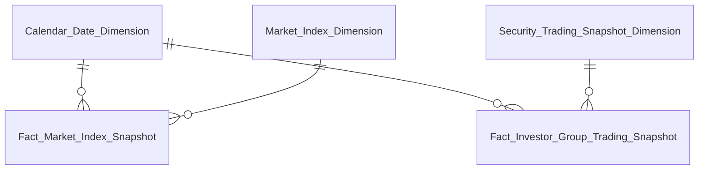

| Datamart Entity | Loại | Reuse | Mô tả | Grain | KPI |
|---|---|---|---|---|---|
| Calendar Date Dimension | Dimension | reuse | Lịch ngày | 1 ngày dương lịch | — |
| Market Index Dimension | Dimension | reuse | Danh mục chỉ số thị trường (VN-Index, HNX-Index, UPCoM-Index) | 1 tổ hợp Market Id + Market Code | — |
| Security Trading Snapshot Dimension | Dimension | partial | Hồ sơ chứng khoán / hợp đồng phái sinh (SCD4A current-state) | 1 mã chứng khoán / hợp đồng phái sinh | — |
| Fact Market Index Snapshot | Fact Snapshot | reuse | Điểm đóng cửa chỉ số thị trường cuối ngày (Nhóm 1, 2) | 1 chỉ số × 1 ngày giao dịch (bản ghi cuối ngày) | K_VP_4,6-8 |
| Fact Investor Group Trading Snapshot | Fact Snapshot | new | Khối lượng và giá trị mua/bán theo nhóm nhà đầu tư NĐTNN / Tự doanh / Toàn bộ (Nhóm 1, 2, 3, 5, 6) | 1 mã × 1 ngày × 1 sàn × 1 nhóm NĐT (PK investor_group_trading_snpst_id = hash cột grain) | K_VP_5,9-12 |

---

## Nhóm 2 - Cổ phiếu >> Biều đồ Giá trị mua/bán ròng Tự doanh và chỉ số Index


| Datamart Entity | Loại | Reuse | Mô tả | Grain | KPI |
|---|---|---|---|---|---|
| Calendar Date Dimension | Dimension | reuse | Lịch ngày | 1 ngày dương lịch | — |
| Market Index Dimension | Dimension | reuse | Danh mục chỉ số thị trường (VN-Index, HNX-Index, UPCoM-Index) | 1 tổ hợp Market Id + Market Code | — |
| Security Trading Snapshot Dimension | Dimension | partial | Hồ sơ chứng khoán / hợp đồng phái sinh (SCD4A current-state) | 1 mã chứng khoán / hợp đồng phái sinh | — |
| Fact Market Index Snapshot | Fact Snapshot | reuse | Điểm đóng cửa chỉ số thị trường cuối ngày (Nhóm 1, 2) | 1 chỉ số × 1 ngày giao dịch (bản ghi cuối ngày) | K_VP_4,6-8 |
| Fact Investor Group Trading Snapshot | Fact Snapshot | new | Khối lượng và giá trị mua/bán theo nhóm nhà đầu tư NĐTNN / Tự doanh / Toàn bộ (Nhóm 1, 2, 3, 5, 6) | 1 mã × 1 ngày × 1 sàn × 1 nhóm NĐT (PK investor_group_trading_snpst_id = hash cột grain) | K_VP_13-17 |

---

## Nhóm 3 - Phái sinh >> Chỉ tiêu tổng hợp

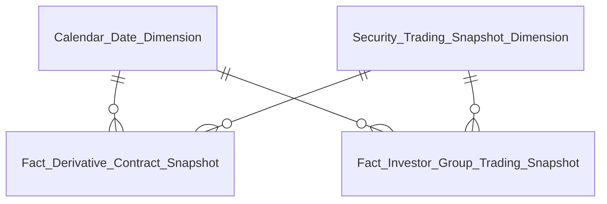

| Datamart Entity | Loại | Reuse | Mô tả | Grain | KPI |
|---|---|---|---|---|---|
| Calendar Date Dimension | Dimension | reuse | Lịch ngày | 1 ngày dương lịch | — |
| Security Trading Snapshot Dimension | Dimension | partial | Hồ sơ chứng khoán / hợp đồng phái sinh (SCD4A current-state) | 1 mã chứng khoán / hợp đồng phái sinh | — |
| Fact Derivative Contract Snapshot | Fact Snapshot | new | Khối lượng mở (OI) và giá đóng cửa hợp đồng phái sinh (Nhóm 3, 4, 5) | 1 mã hợp đồng phái sinh × 1 ngày giao dịch (PK derivative_contract_snpst_id = hash(ngày, mã hợp đồng)) | K_VP_19-20,29-30,39-40,49-50,59-60 |
| Fact Investor Group Trading Snapshot | Fact Snapshot | new | Khối lượng và giá trị mua/bán theo nhóm nhà đầu tư NĐTNN / Tự doanh / Toàn bộ (Nhóm 1, 2, 3, 5, 6) | 1 mã × 1 ngày × 1 sàn × 1 nhóm NĐT (PK investor_group_trading_snpst_id = hash cột grain) | K_VP_21-28,31-38,41-48,51-58,61-68 |

---

## Nhóm 4 - Phái sinh >> Giá HĐTL

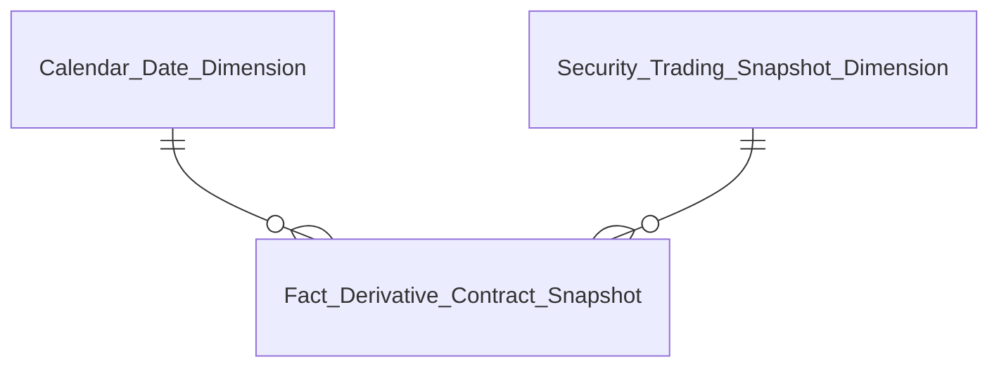

| Datamart Entity | Loại | Reuse | Mô tả | Grain | KPI |
|---|---|---|---|---|---|
| Calendar Date Dimension | Dimension | reuse | Lịch ngày | 1 ngày dương lịch | — |
| Security Trading Snapshot Dimension | Dimension | partial | Hồ sơ chứng khoán / hợp đồng phái sinh (SCD4A current-state) | 1 mã chứng khoán / hợp đồng phái sinh | — |
| Fact Derivative Contract Snapshot | Fact Snapshot | new | Khối lượng mở (OI) và giá đóng cửa hợp đồng phái sinh (Nhóm 3, 4, 5) | 1 mã hợp đồng phái sinh × 1 ngày giao dịch (PK derivative_contract_snpst_id = hash(ngày, mã hợp đồng)) | K_VP_70 |

---

## Nhóm 5 - Phái sinh >> Biểu đồ Diễn biến giao dịch thị trường phái sinh


| Datamart Entity | Loại | Reuse | Mô tả | Grain | KPI |
|---|---|---|---|---|---|
| Calendar Date Dimension | Dimension | reuse | Lịch ngày | 1 ngày dương lịch | — |
| Security Trading Snapshot Dimension | Dimension | partial | Hồ sơ chứng khoán / hợp đồng phái sinh (SCD4A current-state) | 1 mã chứng khoán / hợp đồng phái sinh | — |
| Fact Derivative Contract Snapshot | Fact Snapshot | new | Khối lượng mở (OI) và giá đóng cửa hợp đồng phái sinh (Nhóm 3, 4, 5) | 1 mã hợp đồng phái sinh × 1 ngày giao dịch (PK derivative_contract_snpst_id = hash(ngày, mã hợp đồng)) | K_VP_19,29,39,49,59 |
| Fact Investor Group Trading Snapshot | Fact Snapshot | new | Khối lượng và giá trị mua/bán theo nhóm nhà đầu tư NĐTNN / Tự doanh / Toàn bộ (Nhóm 1, 2, 3, 5, 6) | 1 mã × 1 ngày × 1 sàn × 1 nhóm NĐT (PK investor_group_trading_snpst_id = hash cột grain) | K_VP_21,31,41,51,61 |

---

## Nhóm 6 - Phái sinh >> Biểu đồ Khối lượng mua/bán ròng của NĐTNN

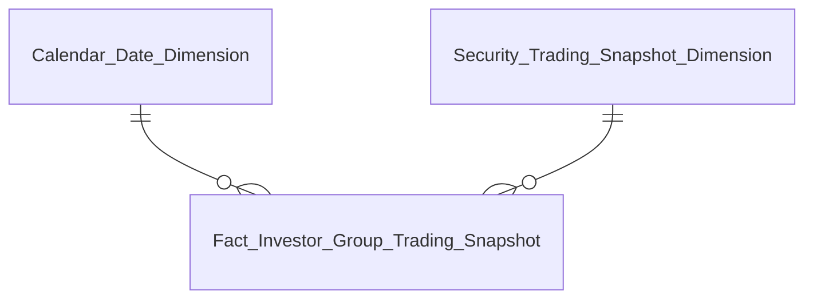

| Datamart Entity | Loại | Reuse | Mô tả | Grain | KPI |
|---|---|---|---|---|---|
| Calendar Date Dimension | Dimension | reuse | Lịch ngày | 1 ngày dương lịch | — |
| Security Trading Snapshot Dimension | Dimension | partial | Hồ sơ chứng khoán / hợp đồng phái sinh (SCD4A current-state) | 1 mã chứng khoán / hợp đồng phái sinh | — |
| Fact Investor Group Trading Snapshot | Fact Snapshot | new | Khối lượng và giá trị mua/bán theo nhóm nhà đầu tư NĐTNN / Tự doanh / Toàn bộ (Nhóm 1, 2, 3, 5, 6) | 1 mã × 1 ngày × 1 sàn × 1 nhóm NĐT (PK investor_group_trading_snpst_id = hash cột grain) | K_VP_23,25,27,33,35,37,43,45,47,53,55,57,63,65,67 |

---

## Nhóm 7 - TPDN niêm yết >> Chỉ tiêu tổng hợp

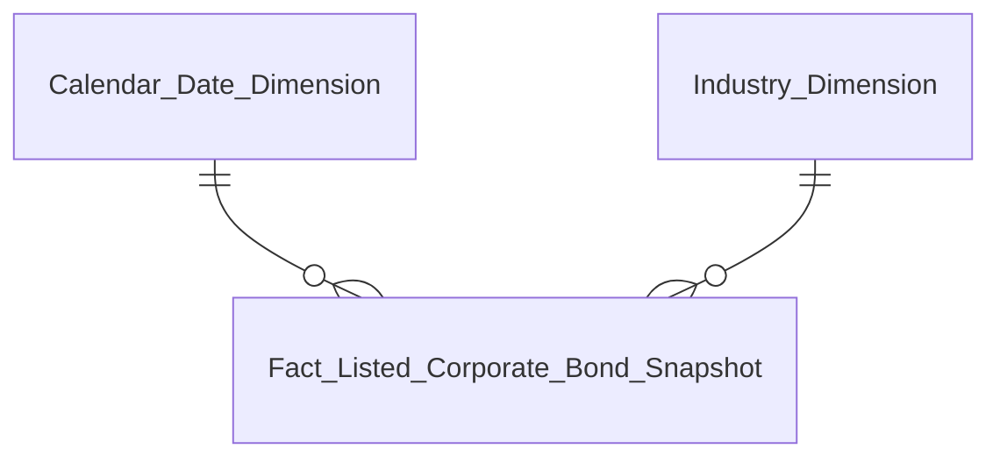

| Datamart Entity | Loại | Reuse | Mô tả | Grain | KPI |
|---|---|---|---|---|---|
| Calendar Date Dimension | Dimension | reuse | Lịch ngày | 1 ngày dương lịch | — |
| Industry Dimension | Dimension | reuse | Danh mục ngành nghề kinh doanh cấp 1 (Classification IDS Business Line) | 1 ngành nghề cấp 1 hiện hành | — |
| Fact Listed Corporate Bond Snapshot | Fact Snapshot | new | Giao dịch, kỳ hạn, ngành và khối lượng lưu hành của TPDN niêm yết theo mã trái phiếu (Nhóm 7, 8, 9, 10) | 1 mã trái phiếu (ISIN) × 1 ngày giao dịch (PK listed_corporate_bond_snpst_id = hash(snpst_dt_dim_id, security_symbol_code)) | K_VP_71-83,112-114 |

---

## Nhóm 8 - TPDN niêm yết >> Thống kê giao dịch TPDN niêm yết theo ngành


| Datamart Entity | Loại | Reuse | Mô tả | Grain | KPI |
|---|---|---|---|---|---|
| Calendar Date Dimension | Dimension | reuse | Lịch ngày | 1 ngày dương lịch | — |
| Industry Dimension | Dimension | reuse | Danh mục ngành nghề kinh doanh cấp 1 (Classification IDS Business Line) | 1 ngành nghề cấp 1 hiện hành | — |
| Fact Listed Corporate Bond Snapshot | Fact Snapshot | new | Giao dịch, kỳ hạn, ngành và khối lượng lưu hành của TPDN niêm yết theo mã trái phiếu (Nhóm 7, 8, 9, 10) | 1 mã trái phiếu (ISIN) × 1 ngày giao dịch (PK listed_corporate_bond_snpst_id = hash(snpst_dt_dim_id, security_symbol_code)) | K_VP_83-88 |

---

## Nhóm 9 - TPDN niêm yết >> Biểu đồ Thống kê GTGD TPDN niêm yết và TPDN riêng lẻ

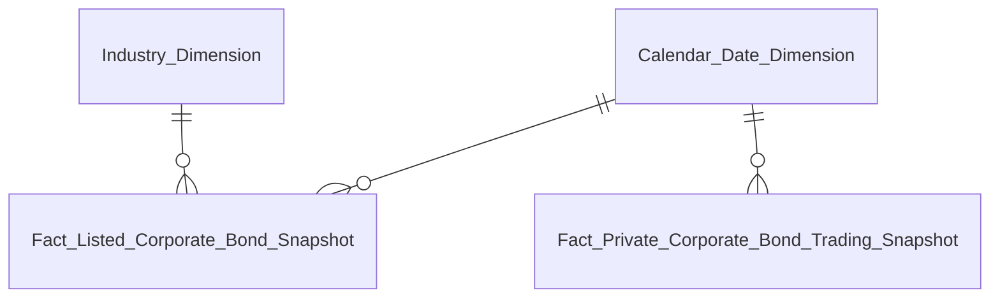

| Datamart Entity | Loại | Reuse | Mô tả | Grain | KPI |
|---|---|---|---|---|---|
| Calendar Date Dimension | Dimension | reuse | Lịch ngày | 1 ngày dương lịch | — |
| Industry Dimension | Dimension | reuse | Danh mục ngành nghề kinh doanh cấp 1 (Classification IDS Business Line) | 1 ngành nghề cấp 1 hiện hành | — |
| Fact Listed Corporate Bond Snapshot | Fact Snapshot | new | Giao dịch, kỳ hạn, ngành và khối lượng lưu hành của TPDN niêm yết theo mã trái phiếu (Nhóm 7, 8, 9, 10) | 1 mã trái phiếu (ISIN) × 1 ngày giao dịch (PK listed_corporate_bond_snpst_id = hash(snpst_dt_dim_id, security_symbol_code)) | K_VP_73 |
| Fact Private Corporate Bond Trading Snapshot | Fact Snapshot | new | Giá trị giao dịch và giá trị mua/bán NĐTNN TPDN riêng lẻ theo ngày báo cáo HNX09 (Nhóm 9, 11, 12, 13) | 1 ngày báo cáo HNX09 (PK private_corporate_bond_trading_snpst_id = hash(snpst_dt_dim_id, src_stm_code)) | K_VP_89 |

---

## Nhóm 10 - TPDN niêm yết >> Biểu đồ Giá trị giao dịch TPDN theo ngành


| Datamart Entity | Loại | Reuse | Mô tả | Grain | KPI |
|---|---|---|---|---|---|
| Calendar Date Dimension | Dimension | reuse | Lịch ngày | 1 ngày dương lịch | — |
| Industry Dimension | Dimension | reuse | Danh mục ngành nghề kinh doanh cấp 1 (Classification IDS Business Line) | 1 ngành nghề cấp 1 hiện hành | — |
| Fact Listed Corporate Bond Snapshot | Fact Snapshot | new | Giao dịch, kỳ hạn, ngành và khối lượng lưu hành của TPDN niêm yết theo mã trái phiếu (Nhóm 7, 8, 9, 10) | 1 mã trái phiếu (ISIN) × 1 ngày giao dịch (PK listed_corporate_bond_snpst_id = hash(snpst_dt_dim_id, security_symbol_code)) | K_VP_84,86,90 |

---

## Nhóm 11 - TPDN riêng lẻ >> Chỉ tiêu tổng hợp

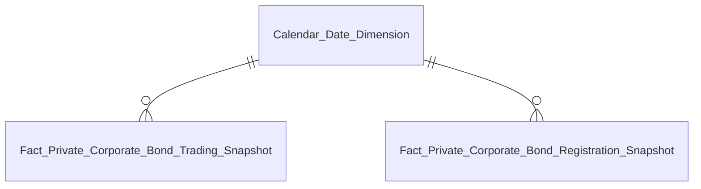

| Datamart Entity | Loại | Reuse | Mô tả | Grain | KPI |
|---|---|---|---|---|---|
| Calendar Date Dimension | Dimension | reuse | Lịch ngày | 1 ngày dương lịch | — |
| Fact Private Corporate Bond Trading Snapshot | Fact Snapshot | new | Giá trị giao dịch và giá trị mua/bán NĐTNN TPDN riêng lẻ theo ngày báo cáo HNX09 (Nhóm 9, 11, 12, 13) | 1 ngày báo cáo HNX09 (PK private_corporate_bond_trading_snpst_id = hash(snpst_dt_dim_id, src_stm_code)) | K_VP_89,91-99 |
| Fact Private Corporate Bond Registration Snapshot | Fact Snapshot | new | Số mã TPDN riêng lẻ đăng ký giao dịch theo báo cáo tháng HNX, factless (Nhóm 11) | 1 mã trái phiếu (Bond Code) × 1 tháng báo cáo (PK private_corporate_bond_registration_snpst_id = hash(bond_code, rpt_year, rpt_month, src_stm_code)) | K_VP_100-101 |

---

## Nhóm 12 - TPDN riêng lẻ >> Biểu đồ Diễn biến giao dịch thị trường TPDN riêng lẻ

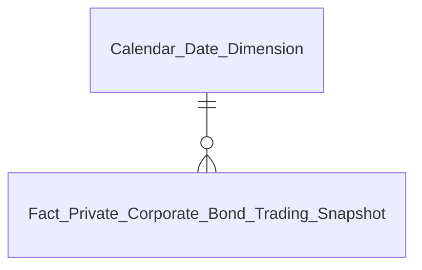

| Datamart Entity | Loại | Reuse | Mô tả | Grain | KPI |
|---|---|---|---|---|---|
| Calendar Date Dimension | Dimension | reuse | Lịch ngày | 1 ngày dương lịch | — |
| Fact Private Corporate Bond Trading Snapshot | Fact Snapshot | new | Giá trị giao dịch và giá trị mua/bán NĐTNN TPDN riêng lẻ theo ngày báo cáo HNX09 (Nhóm 9, 11, 12, 13) | 1 ngày báo cáo HNX09 (PK private_corporate_bond_trading_snpst_id = hash(snpst_dt_dim_id, src_stm_code)) | K_VP_89 |

---

## Nhóm 13 - TPDN riêng lẻ >> Giá trị mua/bán ròng NĐTNN trên thị trường TPDN riêng lẻ


| Datamart Entity | Loại | Reuse | Mô tả | Grain | KPI |
|---|---|---|---|---|---|
| Calendar Date Dimension | Dimension | reuse | Lịch ngày | 1 ngày dương lịch | — |
| Fact Private Corporate Bond Trading Snapshot | Fact Snapshot | new | Giá trị giao dịch và giá trị mua/bán NĐTNN TPDN riêng lẻ theo ngày báo cáo HNX09 (Nhóm 9, 11, 12, 13) | 1 ngày báo cáo HNX09 (PK private_corporate_bond_trading_snpst_id = hash(snpst_dt_dim_id, src_stm_code)) | K_VP_94,96,98 |

---

## Nhóm 14 - TPCP >> Chỉ tiêu tổng hợp

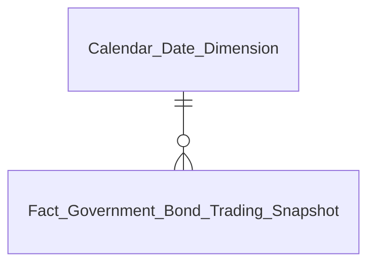

| Datamart Entity | Loại | Reuse | Mô tả | Grain | KPI |
|---|---|---|---|---|---|
| Calendar Date Dimension | Dimension | reuse | Lịch ngày | 1 ngày dương lịch | — |
| Fact Government Bond Trading Snapshot | Fact Snapshot | new | Khối lượng, giá trị giao dịch và giá trị mua/bán NĐTNN TPCP theo ngày và loại sổ lệnh (Nhóm 14, 15, 16) | 1 ngày giao dịch × 1 loại sổ lệnh OUTRIGHT / REPO (PK government_bond_trading_snpst_id = hash(snpst_dt_dim_id, order_book_tp, src_stm_code)) | K_VP_102-111 |

---

## Nhóm 15 - TPCP >> Biểu đồ Diễn biến giao dịch thị trường


| Datamart Entity | Loại | Reuse | Mô tả | Grain | KPI |
|---|---|---|---|---|---|
| Calendar Date Dimension | Dimension | reuse | Lịch ngày | 1 ngày dương lịch | — |
| Fact Government Bond Trading Snapshot | Fact Snapshot | new | Khối lượng, giá trị giao dịch và giá trị mua/bán NĐTNN TPCP theo ngày và loại sổ lệnh (Nhóm 14, 15, 16) | 1 ngày giao dịch × 1 loại sổ lệnh OUTRIGHT / REPO (PK government_bond_trading_snpst_id = hash(snpst_dt_dim_id, order_book_tp, src_stm_code)) | K_VP_102,104 |

---

## Nhóm 16 - TPCP >> Biểu đồ Giá trị mua/bán ròng NĐTNN


| Datamart Entity | Loại | Reuse | Mô tả | Grain | KPI |
|---|---|---|---|---|---|
| Calendar Date Dimension | Dimension | reuse | Lịch ngày | 1 ngày dương lịch | — |
| Fact Government Bond Trading Snapshot | Fact Snapshot | new | Khối lượng, giá trị giao dịch và giá trị mua/bán NĐTNN TPCP theo ngày và loại sổ lệnh (Nhóm 14, 15, 16) | 1 ngày giao dịch × 1 loại sổ lệnh OUTRIGHT / REPO (PK government_bond_trading_snpst_id = hash(snpst_dt_dim_id, order_book_tp, src_stm_code)) | K_VP_106,108,110 |

## Nhóm 32 - Mua/Bán ròng NĐTNN >> Chỉ tiêu tổng hợp

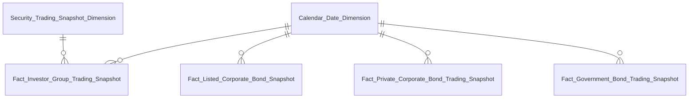

| Datamart Entity | Loại | Reuse | Mô tả | Grain | KPI |
|---|---|---|---|---|---|
| Calendar Date Dimension | Dimension | reuse | Lịch ngày | 1 ngày dương lịch | — |
| Fact Investor Group Trading Snapshot | Fact Snapshot | reuse | Giá trị/khối lượng mua/bán theo nhóm NĐT (NĐTNN / Tự doanh / Toàn bộ) — đã thiết kế Nhóm 1–6; Nhóm 32 đọc `Buy Value`/`Sell Value` với Investor Group Code = 'FOREIGN' | 1 mã × 1 ngày × 1 sàn × 1 nhóm NĐT × 1 nguồn Sổ lệnh | K_VP_115–134 |
| Security Trading Snapshot Dimension | Dimension | reuse (partial) | Hồ sơ chứng khoán (GSTT sở hữu) — Nhóm 32 lọc/cắt theo `Stock Type Name` (Cổ phiếu / Chứng quyền / Chứng chỉ quỹ·ETF / Phái sinh) | 1 mã chứng khoán (bản ghi mới nhất) | K_VP_115–134 |
| Fact Listed Corporate Bond Snapshot | Fact Snapshot | reuse | Giao dịch TPDN niêm yết (đã thiết kế Nhóm 7–10); Nhóm 32 đọc `Foreign Buy Value`/`Foreign Sell Value` | 1 mã trái phiếu (ISIN) × 1 ngày giao dịch | K_VP_115–134 |
| Fact Private Corporate Bond Trading Snapshot | Fact Snapshot | reuse | Giao dịch TPDN riêng lẻ (đã thiết kế Nhóm 11–13); Nhóm 32 đọc `Foreign Buy Value`/`Foreign Sell Value` | 1 ngày × 1 nguồn báo cáo HNX09 | K_VP_115–134 |
| Fact Government Bond Trading Snapshot | Fact Snapshot | reuse | Giao dịch TPCP (đã thiết kế Nhóm 14–16); Nhóm 32 đọc `Foreign Buy Value`/`Foreign Sell Value` | 1 ngày giao dịch × 1 loại sổ lệnh OUTRIGHT / REPO | K_VP_115–134 |

## Nhóm 33 - Mua/Bán ròng NĐTNN >> Chi tiết giao dịch


| Datamart Entity | Loại | Reuse | Mô tả | Grain | KPI |
|---|---|---|---|---|---|
| Calendar Date Dimension | Dimension | reuse | Lịch ngày | 1 ngày dương lịch | — |
| Fact Investor Group Trading Snapshot | Fact Snapshot | reuse | Giá trị/khối lượng mua/bán theo nhóm NĐT (NĐTNN / Tự doanh / Toàn bộ) — đã thiết kế Nhóm 1–6; Nhóm 33 đọc `Buy Value`/`Sell Value` với Investor Group Code = 'FOREIGN' | 1 mã × 1 ngày × 1 sàn × 1 nhóm NĐT × 1 nguồn Sổ lệnh | K_VP_135–140 |
| Security Trading Snapshot Dimension | Dimension | reuse (partial) | Hồ sơ chứng khoán (GSTT sở hữu) — Nhóm 33 lọc/cắt theo `Stock Type Name` (Cổ phiếu / Chứng quyền / Chứng chỉ quỹ·ETF / Phái sinh) | 1 mã chứng khoán (bản ghi mới nhất) | K_VP_135–140 |
| Fact Listed Corporate Bond Snapshot | Fact Snapshot | reuse | Giao dịch TPDN niêm yết (đã thiết kế Nhóm 7–10); Nhóm 33 đọc `Foreign Buy Value`/`Foreign Sell Value` | 1 mã trái phiếu (ISIN) × 1 ngày giao dịch | K_VP_135–140 |
| Fact Private Corporate Bond Trading Snapshot | Fact Snapshot | reuse | Giao dịch TPDN riêng lẻ (đã thiết kế Nhóm 11–13); Nhóm 33 đọc `Foreign Buy Value`/`Foreign Sell Value` | 1 ngày × 1 nguồn báo cáo HNX09 | K_VP_135–140 |
| Fact Government Bond Trading Snapshot | Fact Snapshot | reuse | Giao dịch TPCP (đã thiết kế Nhóm 14–16); Nhóm 33 đọc `Foreign Buy Value`/`Foreign Sell Value` | 1 ngày giao dịch × 1 loại sổ lệnh OUTRIGHT / REPO | K_VP_135–140 |

## Nhóm 34 - Mua/Bán ròng NĐTNN >> Chỉ tiêu tổng hợp (GT bán theo loại tài sản)


| Datamart Entity | Loại | Reuse | Mô tả | Grain | KPI |
|---|---|---|---|---|---|
| Calendar Date Dimension | Dimension | reuse | Lịch ngày | 1 ngày dương lịch | — |
| Fact Investor Group Trading Snapshot | Fact Snapshot | reuse | Giá trị/khối lượng mua/bán theo nhóm NĐT (NĐTNN / Tự doanh / Toàn bộ) — đã thiết kế Nhóm 1–6; Nhóm 34 đọc `Buy Value`/`Sell Value` với Investor Group Code = 'FOREIGN' | 1 mã × 1 ngày × 1 sàn × 1 nhóm NĐT × 1 nguồn Sổ lệnh | K_VP_141 |
| Security Trading Snapshot Dimension | Dimension | reuse (partial) | Hồ sơ chứng khoán (GSTT sở hữu) — Nhóm 34 lọc/cắt theo `Stock Type Name` (Cổ phiếu / Chứng quyền / Chứng chỉ quỹ·ETF / Phái sinh) | 1 mã chứng khoán (bản ghi mới nhất) | K_VP_141 |
| Fact Listed Corporate Bond Snapshot | Fact Snapshot | reuse | Giao dịch TPDN niêm yết (đã thiết kế Nhóm 7–10); Nhóm 34 đọc `Foreign Buy Value`/`Foreign Sell Value` | 1 mã trái phiếu (ISIN) × 1 ngày giao dịch | K_VP_141 |
| Fact Private Corporate Bond Trading Snapshot | Fact Snapshot | reuse | Giao dịch TPDN riêng lẻ (đã thiết kế Nhóm 11–13); Nhóm 34 đọc `Foreign Buy Value`/`Foreign Sell Value` | 1 ngày × 1 nguồn báo cáo HNX09 | K_VP_141 |
| Fact Government Bond Trading Snapshot | Fact Snapshot | reuse | Giao dịch TPCP (đã thiết kế Nhóm 14–16); Nhóm 34 đọc `Foreign Buy Value`/`Foreign Sell Value` | 1 ngày giao dịch × 1 loại sổ lệnh OUTRIGHT / REPO | K_VP_141 |

## Nhóm 35 - Mua/Bán ròng NĐTNN >> Biểu đồ Giá trị mua/bán ròng cổ phiếu NĐTNN theo nhóm ngành

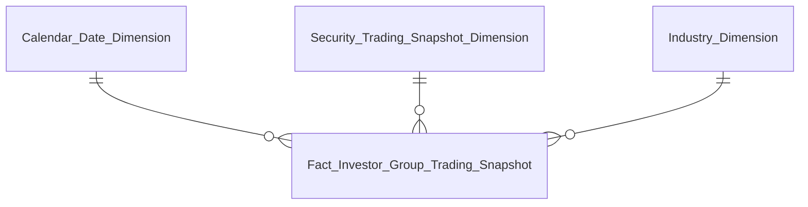

| Datamart Entity | Loại | Reuse | Mô tả | Grain | KPI |
|---|---|---|---|---|---|
| Calendar Date Dimension | Dimension | reuse | Lịch ngày | 1 ngày dương lịch | — |
| Fact Investor Group Trading Snapshot | Fact Snapshot | reuse | Giá trị/khối lượng mua/bán theo nhóm NĐT (NĐTNN / Tự doanh / Toàn bộ) — đã thiết kế Nhóm 1–6; Nhóm 35 đọc `Buy Value`/`Sell Value` với Investor Group Code = 'FOREIGN' | 1 mã × 1 ngày × 1 sàn × 1 nhóm NĐT × 1 nguồn Sổ lệnh | K_VP_142–143 |
| Security Trading Snapshot Dimension | Dimension | reuse (partial) | Hồ sơ chứng khoán (GSTT sở hữu) — Nhóm 35 lọc/cắt theo `Stock Type Name` (Cổ phiếu / Chứng quyền / Chứng chỉ quỹ·ETF / Phái sinh) | 1 mã chứng khoán (bản ghi mới nhất) | K_VP_142–143 |
| Industry Dimension | Dimension | reuse | Danh mục ngành nghề kinh doanh cấp 1 (GSDC sở hữu) — Nhóm 35 dùng làm chiều Ngành của cổ phiếu (qua FK Industry Dimension Id của Fact nhóm NĐT, O_VP_37) | 1 ngành nghề cấp 1 hiện hành | K_VP_142–143 |

## Nhóm 36 - Mua/Bán ròng NĐTNN >> Biểu đồ Giá trị giao dịch Cổ phiếu của NĐTNN

```mermaid
erDiagram
    Calendar_Date_Dimension ||--o{ Fact_Investor_Group_Trading_Snapshot : " "
    Security_Trading_Snapshot_Dimension ||--o{ Fact_Investor_Group_Trading_Snapshot : " "
```

| Datamart Entity | Loại | Reuse | Mô tả | Grain | KPI |
|---|---|---|---|---|---|
| Calendar Date Dimension | Dimension | reuse | Lịch ngày | 1 ngày dương lịch | — |
| Fact Investor Group Trading Snapshot | Fact Snapshot | reuse | Giá trị/khối lượng mua/bán theo nhóm NĐT (NĐTNN / Tự doanh / Toàn bộ) — đã thiết kế Nhóm 1–6; Nhóm 36 đọc `Buy Value`/`Sell Value` với Investor Group Code = 'FOREIGN' | 1 mã × 1 ngày × 1 sàn × 1 nhóm NĐT × 1 nguồn Sổ lệnh | K_VP_144–146 |
| Security Trading Snapshot Dimension | Dimension | reuse (partial) | Hồ sơ chứng khoán (GSTT sở hữu) — Nhóm 36 lọc/cắt theo `Stock Type Name` (Cổ phiếu / Chứng quyền / Chứng chỉ quỹ·ETF / Phái sinh) | 1 mã chứng khoán (bản ghi mới nhất) | K_VP_144–146 |

## Nhóm 37 - Mua/Bán ròng NĐTNN >> Biểu đồ Giá trị giao dịch Trái phiếu của NĐTNN

```mermaid
erDiagram
    Calendar_Date_Dimension ||--o{ Fact_Listed_Corporate_Bond_Snapshot : " "
    Calendar_Date_Dimension ||--o{ Fact_Private_Corporate_Bond_Trading_Snapshot : " "
    Calendar_Date_Dimension ||--o{ Fact_Government_Bond_Trading_Snapshot : " "
```

| Datamart Entity | Loại | Reuse | Mô tả | Grain | KPI |
|---|---|---|---|---|---|
| Calendar Date Dimension | Dimension | reuse | Lịch ngày | 1 ngày dương lịch | — |
| Fact Listed Corporate Bond Snapshot | Fact Snapshot | reuse | Giao dịch TPDN niêm yết (đã thiết kế Nhóm 7–10); Nhóm 37 đọc `Foreign Buy Value`/`Foreign Sell Value` | 1 mã trái phiếu (ISIN) × 1 ngày giao dịch | K_VP_147–159 |
| Fact Private Corporate Bond Trading Snapshot | Fact Snapshot | reuse | Giao dịch TPDN riêng lẻ (đã thiết kế Nhóm 11–13); Nhóm 37 đọc `Foreign Buy Value`/`Foreign Sell Value` | 1 ngày × 1 nguồn báo cáo HNX09 | K_VP_147–159 |
| Fact Government Bond Trading Snapshot | Fact Snapshot | reuse | Giao dịch TPCP (đã thiết kế Nhóm 14–16); Nhóm 37 đọc `Foreign Buy Value`/`Foreign Sell Value` | 1 ngày giao dịch × 1 loại sổ lệnh OUTRIGHT / REPO | K_VP_147–159 |

## Nhóm 51 - Tổng quan thị trường >> Biểu đồ Thống kê cổ phiếu hủy niêm yết

```mermaid
erDiagram
    Calendar_Date_Dimension ||--o{ Fact_Listing_Status_Change_Snapshot : " "
    Security_Trading_Snapshot_Dimension ||--o{ Fact_Listing_Status_Change_Snapshot : " "
```

| Datamart Entity | Loại | Reuse | Mô tả | Grain | KPI |
|---|---|---|---|---|---|
| Calendar Date Dimension | Dimension | reuse | Lịch ngày | 1 ngày dương lịch | — |
| Security Trading Snapshot Dimension | Dimension | reuse (partial) | Hồ sơ chứng khoán (GSTT sở hữu) — loại chứng khoán, mã sàn | 1 mã chứng khoán (bản ghi mới nhất) | K_VP_161–164 |
| Fact Listing Status Change Snapshot | Fact Snapshot | new | Quyết định thay đổi niêm yết/đăng ký giao dịch của cổ phiếu trên HNX (gồm UPCoM) và HOSE — dùng cho Nhóm 51 (thống kê cổ phiếu hủy niêm yết); grain 1 quyết định × 1 mã × 1 Sở (PK listing_status_change_snpst_id = id dòng Atomic listing_status_change); Detail Mapping lọc delisted_share_quantity > 0 và không chuyển sàn | 1 quyết định × 1 mã × 1 Sở (PK id dòng Atomic) | K_VP_160–164 |

## Nhóm 55 - Báo cáo VP_TK02 – TTCK bất thường (lô 55a–55b: chỉ số, vốn hóa, GDP, GTGD bình quân, niêm yết, HĐTL VN30, chứng quyền, GT NĐTNN ròng)

```mermaid
erDiagram
    Calendar_Date_Dimension ||--o{ Fact_Market_Index_Snapshot : " "
    Calendar_Date_Dimension ||--o{ Fact_Listed_Equity_Snapshot : " "
    Calendar_Date_Dimension ||--o{ Fact_Macro_Indicator_Snapshot : " "
    Calendar_Date_Dimension ||--o{ Fact_Investor_Group_Trading_Snapshot : " "
    Calendar_Date_Dimension ||--o{ Fact_Derivative_Contract_Snapshot : " "
    Calendar_Date_Dimension ||--o{ Fact_Government_Bond_Trading_Snapshot : " "
    Market_Index_Dimension ||--o{ Fact_Market_Index_Snapshot : " "
    Security_Trading_Snapshot_Dimension ||--o{ Fact_Investor_Group_Trading_Snapshot : " "
    Security_Trading_Snapshot_Dimension ||--o{ Fact_Derivative_Contract_Snapshot : " "
```

| Datamart Entity | Loại | Reuse | Mô tả | Grain | KPI |
|---|---|---|---|---|---|
| Calendar Date Dimension | Dimension | reuse | Lịch ngày (mốc ngày báo cáo, tháng/năm trước, số phiên giao dịch) | 1 ngày dương lịch | K_VP_165 |
| Market Index Dimension | Dimension | reuse | Danh mục chỉ số (QLKD sở hữu) | 1 chỉ số thị trường | K_VP_166–171 |
| Security Trading Snapshot Dimension | Dimension | reuse (partial) | Hồ sơ chứng khoán (GSTT sở hữu) — lọc chứng quyền, HĐTL VN30, cổ phiếu/CCQ | 1 mã | K_VP_176–180, 186–207 |
| Fact Market Index Snapshot | Fact Snapshot | reuse | Điểm chỉ số cuối ngày (QLKD sở hữu) — VN-Index (HOSE), HNX-Index (HNX) | 1 chỉ số × 1 ngày giao dịch | K_VP_166–171 |
| Fact Listed Equity Snapshot | Fact Snapshot | new | Vốn hóa, khối lượng lưu hành và quy mô niêm yết của cổ phiếu/chứng chỉ quỹ cuối ngày trên HOSE, HNX, UPCoM — dùng cho Nhóm 55 (báo cáo TTCK bất thường: vốn hóa, số mã/giá trị niêm yết); grain 1 mã × 1 ngày giao dịch (PK listed_equity_snpst_id = hash cột grain); UPCoM tính vốn hóa theo VWAP ngày T lấy ở bản tin T+1 | 1 mã × 1 ngày giao dịch (PK hash cột grain) | K_VP_172–173, 181–185 |
| Fact Macro Indicator Snapshot | Fact Snapshot | reuse | GDP_VN (PTTT sở hữu; thêm cột Unit Type Code 2026-10-28, O_VP_41) | 1 chỉ tiêu × 1 kỳ công bố | K_VP_174–175, 185 |
| Fact Investor Group Trading Snapshot | Fact Snapshot | reuse | GTGD/KLGD nhóm ALL cổ phiếu-CCQ, chứng quyền, HĐTL VN30; GT NĐTNN (FOREIGN) | 1 mã × 1 ngày × 1 sàn × 1 nhóm NĐT | K_VP_176–180, 186–190, 194–205 |
| Fact Derivative Contract Snapshot | Fact Snapshot | reuse | OI HĐTL VN30 (VSDC) | 1 mã hợp đồng × 1 ngày | K_VP_191–193 |
| Fact Government Bond Trading Snapshot | Fact Snapshot | reuse | GT NĐTNN mua/bán TPCP | 1 ngày × 1 loại sổ lệnh | K_VP_206–207 |

---

## Bảng PENDING (không thiết kế trong Phase 2)

Không có — mọi Fact/Dimension của Nhóm 1–16 đều có KPI READY.

| Datamart Entity | Lý do PENDING | Issue |
|---|---|---|
| — | — | — |

## Bảng DEPRECATED / Bãi bỏ

| Datamart Entity | Căn cứ bãi bỏ | Trạng thái |
|---|---|---|
| Fact Securities Market Index Snapshot (`fct_scr_mkt_indx_snpst`) | Thiết kế VP cũ bị thay hoàn toàn theo yêu cầu thiết kế lại phân hệ VP ngày 2026-10-25 — HLD Section 4 | DEPRECATED — dọn 5 tầng ở bước LLD |
| Fact Derivatives Trading Snapshot (`fct_derv_tdg_snpst`) | Thiết kế VP cũ bị thay hoàn toàn theo yêu cầu thiết kế lại phân hệ VP ngày 2026-10-25 — HLD Section 4 | DEPRECATED — dọn 5 tầng ở bước LLD |
| Fact Derivatives Price Snapshot (`fct_derv_prc_snpst`) | Thiết kế VP cũ bị thay hoàn toàn theo yêu cầu thiết kế lại phân hệ VP ngày 2026-10-25 — HLD Section 4 | DEPRECATED — dọn 5 tầng ở bước LLD |
| Fact Listed Corporate Bond Industry Term Snapshot (`fct_lst_crp_bnd_indy_trm_snpst`) | Thiết kế VP cũ bị thay hoàn toàn theo yêu cầu thiết kế lại phân hệ VP ngày 2026-10-25 — HLD Section 4 | DEPRECATED — dọn 5 tầng ở bước LLD |
| Fact OTC Bond Snapshot (`fct_otc_bnd_snpst`) | Thiết kế VP cũ bị thay hoàn toàn theo yêu cầu thiết kế lại phân hệ VP ngày 2026-10-25 — HLD Section 4 | DEPRECATED — dọn 5 tầng ở bước LLD |
| Fact Share Auction Snapshot (`fct_share_auction_snpst`) | Thiết kế VP cũ bị thay hoàn toàn theo yêu cầu thiết kế lại phân hệ VP ngày 2026-10-25 — HLD Section 4 | DEPRECATED — dọn 5 tầng ở bước LLD |

Ghi chú: Fact Listed Corporate Bond Snapshot cũ (`fct_lst_crp_bnd_snpst`) không còn ở bảng này — đã được thay bằng bảng mới cùng tên logic `fct_listed_corporate_bond_snpst` (Nhóm 7–10, reuse_status = new; HLD Section 4).
