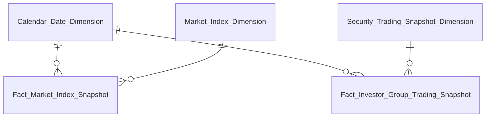
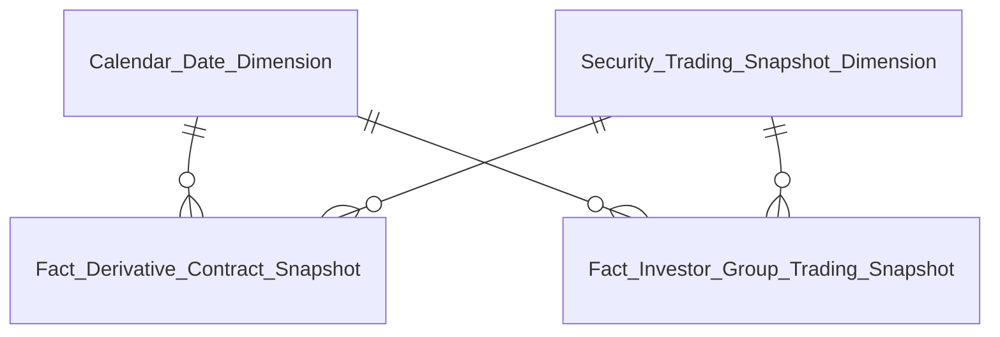
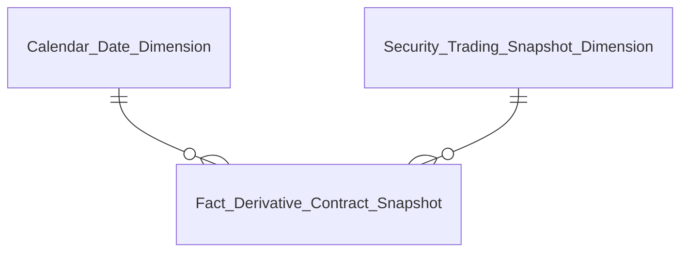
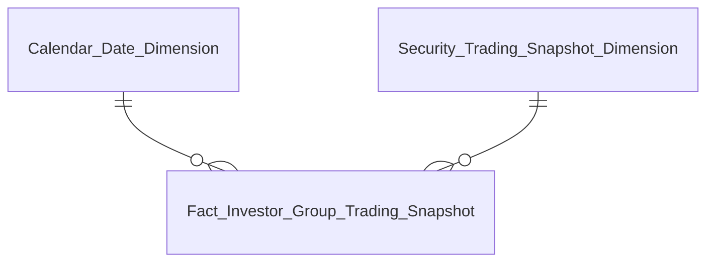
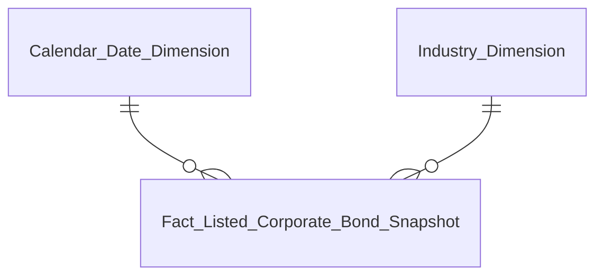
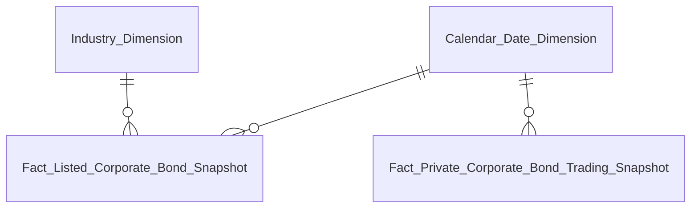
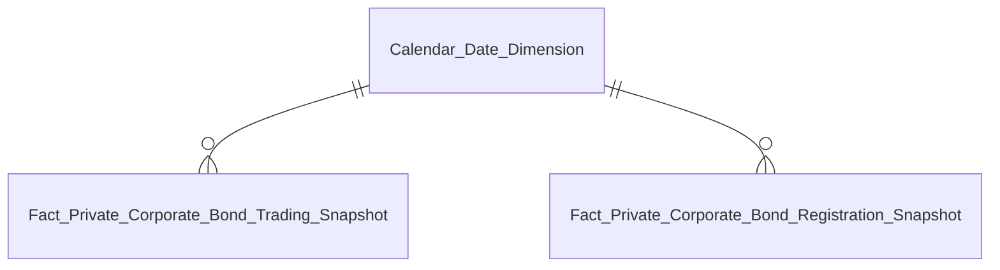
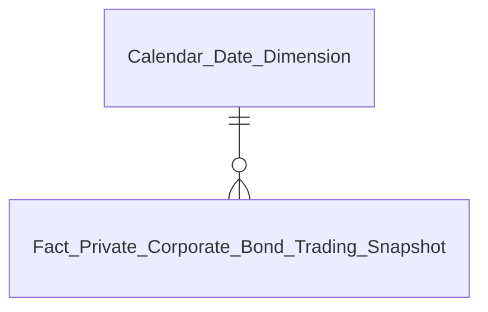
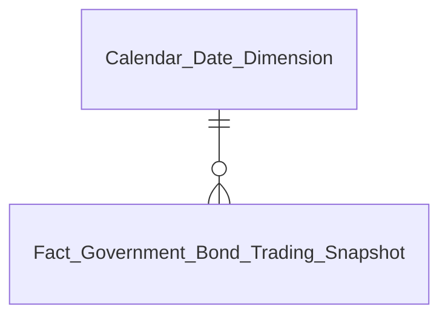

# DTM_VP_Entities — Danh mục thực thể Datamart Phân hệ VP (Thống kê thị trường chứng khoán)

**Phiên bản:** 2.2 (thiết kế lại từ đầu; bổ sung Nhóm 7–10 và Nhóm 11–16)  
**Ngày cập nhật:** 2026-10-25  
**Phạm vi:** Nhóm 1–16 (Lô 1 + Lô 2). Đồng bộ với `DTM_VP_HLD.md` Section 3 + Section 4.

---

## Nhóm 1 - Cổ phiếu >> Biều đồ Giá trị mua/bán ròng NĐTNN và chỉ số Index

| Datamart Entity | Loại | Reuse | Mô tả | Grain | KPI |
|---|---|---|---|---|---|
| Calendar Date Dimension | Dimension | reuse | Lịch ngày | 1 ngày dương lịch | — |
| Market Index Dimension | Dimension | reuse | Danh mục chỉ số thị trường (VN-Index, HNX-Index, UPCoM-Index) | 1 tổ hợp Market Id + Market Code | — |
| Security Trading Snapshot Dimension | Dimension | partial | Hồ sơ chứng khoán / hợp đồng phái sinh (SCD4A current-state) | 1 mã chứng khoán / hợp đồng phái sinh | — |
| Fact Market Index Snapshot | Fact Snapshot | reuse | Điểm đóng cửa chỉ số thị trường cuối ngày (Nhóm 1, 2) | 1 chỉ số × 1 ngày giao dịch (bản ghi cuối ngày) | K_VP_4,6-8 |
| Fact Investor Group Trading Snapshot | Fact Snapshot | new | Khối lượng và giá trị mua/bán theo nhóm nhà đầu tư NĐTNN / Tự doanh / Toàn bộ (Nhóm 1, 2, 3, 5, 6) | 1 mã × 1 ngày × 1 sàn × 1 nhóm NĐT (PK investor_group_trading_snpst_id = hash cột grain) | K_VP_5,9-12 |

---

## Nhóm 2 - Cổ phiếu >> Biều đồ Giá trị mua/bán ròng Tự doanh và chỉ số Index

| Datamart Entity | Loại | Reuse | Mô tả | Grain | KPI |
|---|---|---|---|---|---|
| Calendar Date Dimension | Dimension | reuse | Lịch ngày | 1 ngày dương lịch | — |
| Market Index Dimension | Dimension | reuse | Danh mục chỉ số thị trường (VN-Index, HNX-Index, UPCoM-Index) | 1 tổ hợp Market Id + Market Code | — |
| Security Trading Snapshot Dimension | Dimension | partial | Hồ sơ chứng khoán / hợp đồng phái sinh (SCD4A current-state) | 1 mã chứng khoán / hợp đồng phái sinh | — |
| Fact Market Index Snapshot | Fact Snapshot | reuse | Điểm đóng cửa chỉ số thị trường cuối ngày (Nhóm 1, 2) | 1 chỉ số × 1 ngày giao dịch (bản ghi cuối ngày) | K_VP_4,6-8 |
| Fact Investor Group Trading Snapshot | Fact Snapshot | new | Khối lượng và giá trị mua/bán theo nhóm nhà đầu tư NĐTNN / Tự doanh / Toàn bộ (Nhóm 1, 2, 3, 5, 6) | 1 mã × 1 ngày × 1 sàn × 1 nhóm NĐT (PK investor_group_trading_snpst_id = hash cột grain) | K_VP_13-17 |

---

## Nhóm 3 - Phái sinh >> Chỉ tiêu tổng hợp

| Datamart Entity | Loại | Reuse | Mô tả | Grain | KPI |
|---|---|---|---|---|---|
| Calendar Date Dimension | Dimension | reuse | Lịch ngày | 1 ngày dương lịch | — |
| Security Trading Snapshot Dimension | Dimension | partial | Hồ sơ chứng khoán / hợp đồng phái sinh (SCD4A current-state) | 1 mã chứng khoán / hợp đồng phái sinh | — |
| Fact Derivative Contract Snapshot | Fact Snapshot | new | Khối lượng mở (OI) và giá đóng cửa hợp đồng phái sinh (Nhóm 3, 4, 5) | 1 mã hợp đồng phái sinh × 1 ngày giao dịch (PK derivative_contract_snpst_id = hash(ngày, mã hợp đồng)) | K_VP_19-20,29-30,39-40,49-50,59-60 |
| Fact Investor Group Trading Snapshot | Fact Snapshot | new | Khối lượng và giá trị mua/bán theo nhóm nhà đầu tư NĐTNN / Tự doanh / Toàn bộ (Nhóm 1, 2, 3, 5, 6) | 1 mã × 1 ngày × 1 sàn × 1 nhóm NĐT (PK investor_group_trading_snpst_id = hash cột grain) | K_VP_21-28,31-38,41-48,51-58,61-68 |

---

## Nhóm 4 - Phái sinh >> Giá HĐTL

| Datamart Entity | Loại | Reuse | Mô tả | Grain | KPI |
|---|---|---|---|---|---|
| Calendar Date Dimension | Dimension | reuse | Lịch ngày | 1 ngày dương lịch | — |
| Security Trading Snapshot Dimension | Dimension | partial | Hồ sơ chứng khoán / hợp đồng phái sinh (SCD4A current-state) | 1 mã chứng khoán / hợp đồng phái sinh | — |
| Fact Derivative Contract Snapshot | Fact Snapshot | new | Khối lượng mở (OI) và giá đóng cửa hợp đồng phái sinh (Nhóm 3, 4, 5) | 1 mã hợp đồng phái sinh × 1 ngày giao dịch (PK derivative_contract_snpst_id = hash(ngày, mã hợp đồng)) | K_VP_70 |

---

## Nhóm 5 - Phái sinh >> Biểu đồ Diễn biến giao dịch thị trường phái sinh

| Datamart Entity | Loại | Reuse | Mô tả | Grain | KPI |
|---|---|---|---|---|---|
| Calendar Date Dimension | Dimension | reuse | Lịch ngày | 1 ngày dương lịch | — |
| Security Trading Snapshot Dimension | Dimension | partial | Hồ sơ chứng khoán / hợp đồng phái sinh (SCD4A current-state) | 1 mã chứng khoán / hợp đồng phái sinh | — |
| Fact Derivative Contract Snapshot | Fact Snapshot | new | Khối lượng mở (OI) và giá đóng cửa hợp đồng phái sinh (Nhóm 3, 4, 5) | 1 mã hợp đồng phái sinh × 1 ngày giao dịch (PK derivative_contract_snpst_id = hash(ngày, mã hợp đồng)) | K_VP_19,29,39,49,59 |
| Fact Investor Group Trading Snapshot | Fact Snapshot | new | Khối lượng và giá trị mua/bán theo nhóm nhà đầu tư NĐTNN / Tự doanh / Toàn bộ (Nhóm 1, 2, 3, 5, 6) | 1 mã × 1 ngày × 1 sàn × 1 nhóm NĐT (PK investor_group_trading_snpst_id = hash cột grain) | K_VP_21,31,41,51,61 |

---

## Nhóm 6 - Phái sinh >> Biểu đồ Khối lượng mua/bán ròng của NĐTNN

| Datamart Entity | Loại | Reuse | Mô tả | Grain | KPI |
|---|---|---|---|---|---|
| Calendar Date Dimension | Dimension | reuse | Lịch ngày | 1 ngày dương lịch | — |
| Security Trading Snapshot Dimension | Dimension | partial | Hồ sơ chứng khoán / hợp đồng phái sinh (SCD4A current-state) | 1 mã chứng khoán / hợp đồng phái sinh | — |
| Fact Investor Group Trading Snapshot | Fact Snapshot | new | Khối lượng và giá trị mua/bán theo nhóm nhà đầu tư NĐTNN / Tự doanh / Toàn bộ (Nhóm 1, 2, 3, 5, 6) | 1 mã × 1 ngày × 1 sàn × 1 nhóm NĐT (PK investor_group_trading_snpst_id = hash cột grain) | K_VP_23,25,27,33,35,37,43,45,47,53,55,57,63,65,67 |

---

## Nhóm 7 - TPDN niêm yết >> Chỉ tiêu tổng hợp

| Datamart Entity | Loại | Reuse | Mô tả | Grain | KPI |
|---|---|---|---|---|---|
| Calendar Date Dimension | Dimension | reuse | Lịch ngày | 1 ngày dương lịch | — |
| Industry Dimension | Dimension | reuse | Danh mục ngành nghề kinh doanh cấp 1 (Classification IDS Business Line) | 1 ngành nghề cấp 1 hiện hành | — |
| Fact Listed Corporate Bond Snapshot | Fact Snapshot | new | Giao dịch, kỳ hạn, ngành và khối lượng lưu hành của TPDN niêm yết theo mã trái phiếu (Nhóm 7, 8, 9, 10) | 1 mã trái phiếu (ISIN) × 1 ngày giao dịch (PK listed_corporate_bond_snpst_id = hash(snpst_dt_dim_id, security_symbol_code)) | K_VP_71-83,112-114 |

---

## Nhóm 8 - TPDN niêm yết >> Thống kê giao dịch TPDN niêm yết theo ngành

| Datamart Entity | Loại | Reuse | Mô tả | Grain | KPI |
|---|---|---|---|---|---|
| Calendar Date Dimension | Dimension | reuse | Lịch ngày | 1 ngày dương lịch | — |
| Industry Dimension | Dimension | reuse | Danh mục ngành nghề kinh doanh cấp 1 (Classification IDS Business Line) | 1 ngành nghề cấp 1 hiện hành | — |
| Fact Listed Corporate Bond Snapshot | Fact Snapshot | new | Giao dịch, kỳ hạn, ngành và khối lượng lưu hành của TPDN niêm yết theo mã trái phiếu (Nhóm 7, 8, 9, 10) | 1 mã trái phiếu (ISIN) × 1 ngày giao dịch (PK listed_corporate_bond_snpst_id = hash(snpst_dt_dim_id, security_symbol_code)) | K_VP_83-88 |

---

## Nhóm 9 - TPDN niêm yết >> Biểu đồ Thống kê GTGD TPDN niêm yết và TPDN riêng lẻ

| Datamart Entity | Loại | Reuse | Mô tả | Grain | KPI |
|---|---|---|---|---|---|
| Calendar Date Dimension | Dimension | reuse | Lịch ngày | 1 ngày dương lịch | — |
| Industry Dimension | Dimension | reuse | Danh mục ngành nghề kinh doanh cấp 1 (Classification IDS Business Line) | 1 ngành nghề cấp 1 hiện hành | — |
| Fact Listed Corporate Bond Snapshot | Fact Snapshot | new | Giao dịch, kỳ hạn, ngành và khối lượng lưu hành của TPDN niêm yết theo mã trái phiếu (Nhóm 7, 8, 9, 10) | 1 mã trái phiếu (ISIN) × 1 ngày giao dịch (PK listed_corporate_bond_snpst_id = hash(snpst_dt_dim_id, security_symbol_code)) | K_VP_73 |
| Fact Private Corporate Bond Trading Snapshot | Fact Snapshot | new | Giá trị giao dịch và giá trị mua/bán NĐTNN TPDN riêng lẻ theo ngày báo cáo HNX09 (Nhóm 9, 11, 12, 13) | 1 ngày báo cáo HNX09 (PK private_corporate_bond_trading_snpst_id = hash(snpst_dt_dim_id, src_stm_code)) | K_VP_89 |

---

## Nhóm 10 - TPDN niêm yết >> Biểu đồ Giá trị giao dịch TPDN theo ngành

| Datamart Entity | Loại | Reuse | Mô tả | Grain | KPI |
|---|---|---|---|---|---|
| Calendar Date Dimension | Dimension | reuse | Lịch ngày | 1 ngày dương lịch | — |
| Industry Dimension | Dimension | reuse | Danh mục ngành nghề kinh doanh cấp 1 (Classification IDS Business Line) | 1 ngành nghề cấp 1 hiện hành | — |
| Fact Listed Corporate Bond Snapshot | Fact Snapshot | new | Giao dịch, kỳ hạn, ngành và khối lượng lưu hành của TPDN niêm yết theo mã trái phiếu (Nhóm 7, 8, 9, 10) | 1 mã trái phiếu (ISIN) × 1 ngày giao dịch (PK listed_corporate_bond_snpst_id = hash(snpst_dt_dim_id, security_symbol_code)) | K_VP_84,86,90 |

---

## Nhóm 11 - TPDN riêng lẻ >> Chỉ tiêu tổng hợp

| Datamart Entity | Loại | Reuse | Mô tả | Grain | KPI |
|---|---|---|---|---|---|
| Calendar Date Dimension | Dimension | reuse | Lịch ngày | 1 ngày dương lịch | — |
| Fact Private Corporate Bond Trading Snapshot | Fact Snapshot | new | Giá trị giao dịch và giá trị mua/bán NĐTNN TPDN riêng lẻ theo ngày báo cáo HNX09 (Nhóm 9, 11, 12, 13) | 1 ngày báo cáo HNX09 (PK private_corporate_bond_trading_snpst_id = hash(snpst_dt_dim_id, src_stm_code)) | K_VP_89,91-99 |
| Fact Private Corporate Bond Registration Snapshot | Fact Snapshot | new | Số mã TPDN riêng lẻ đăng ký giao dịch theo báo cáo tháng HNX, factless (Nhóm 11) | 1 mã trái phiếu (Bond Code) × 1 tháng báo cáo (PK private_corporate_bond_registration_snpst_id = hash(bond_code, rpt_year, rpt_month, src_stm_code)) | K_VP_100-101 |

---

## Nhóm 12 - TPDN riêng lẻ >> Biểu đồ Diễn biến giao dịch thị trường TPDN riêng lẻ

| Datamart Entity | Loại | Reuse | Mô tả | Grain | KPI |
|---|---|---|---|---|---|
| Calendar Date Dimension | Dimension | reuse | Lịch ngày | 1 ngày dương lịch | — |
| Fact Private Corporate Bond Trading Snapshot | Fact Snapshot | new | Giá trị giao dịch và giá trị mua/bán NĐTNN TPDN riêng lẻ theo ngày báo cáo HNX09 (Nhóm 9, 11, 12, 13) | 1 ngày báo cáo HNX09 (PK private_corporate_bond_trading_snpst_id = hash(snpst_dt_dim_id, src_stm_code)) | K_VP_89 |

---

## Nhóm 13 - TPDN riêng lẻ >> Giá trị mua/bán ròng NĐTNN trên thị trường TPDN riêng lẻ

| Datamart Entity | Loại | Reuse | Mô tả | Grain | KPI |
|---|---|---|---|---|---|
| Calendar Date Dimension | Dimension | reuse | Lịch ngày | 1 ngày dương lịch | — |
| Fact Private Corporate Bond Trading Snapshot | Fact Snapshot | new | Giá trị giao dịch và giá trị mua/bán NĐTNN TPDN riêng lẻ theo ngày báo cáo HNX09 (Nhóm 9, 11, 12, 13) | 1 ngày báo cáo HNX09 (PK private_corporate_bond_trading_snpst_id = hash(snpst_dt_dim_id, src_stm_code)) | K_VP_94,96,98 |

---

## Nhóm 14 - TPCP >> Chỉ tiêu tổng hợp

| Datamart Entity | Loại | Reuse | Mô tả | Grain | KPI |
|---|---|---|---|---|---|
| Calendar Date Dimension | Dimension | reuse | Lịch ngày | 1 ngày dương lịch | — |
| Fact Government Bond Trading Snapshot | Fact Snapshot | new | Khối lượng, giá trị giao dịch và giá trị mua/bán NĐTNN TPCP theo ngày và loại sổ lệnh (Nhóm 14, 15, 16) | 1 ngày giao dịch × 1 loại sổ lệnh OUTRIGHT / REPO (PK government_bond_trading_snpst_id = hash(snpst_dt_dim_id, order_book_tp, src_stm_code)) | K_VP_102-111 |

---

## Nhóm 15 - TPCP >> Biểu đồ Diễn biến giao dịch thị trường

| Datamart Entity | Loại | Reuse | Mô tả | Grain | KPI |
|---|---|---|---|---|---|
| Calendar Date Dimension | Dimension | reuse | Lịch ngày | 1 ngày dương lịch | — |
| Fact Government Bond Trading Snapshot | Fact Snapshot | new | Khối lượng, giá trị giao dịch và giá trị mua/bán NĐTNN TPCP theo ngày và loại sổ lệnh (Nhóm 14, 15, 16) | 1 ngày giao dịch × 1 loại sổ lệnh OUTRIGHT / REPO (PK government_bond_trading_snpst_id = hash(snpst_dt_dim_id, order_book_tp, src_stm_code)) | K_VP_102,104 |

---

## Nhóm 16 - TPCP >> Biểu đồ Giá trị mua/bán ròng NĐTNN

| Datamart Entity | Loại | Reuse | Mô tả | Grain | KPI |
|---|---|---|---|---|---|
| Calendar Date Dimension | Dimension | reuse | Lịch ngày | 1 ngày dương lịch | — |
| Fact Government Bond Trading Snapshot | Fact Snapshot | new | Khối lượng, giá trị giao dịch và giá trị mua/bán NĐTNN TPCP theo ngày và loại sổ lệnh (Nhóm 14, 15, 16) | 1 ngày giao dịch × 1 loại sổ lệnh OUTRIGHT / REPO (PK government_bond_trading_snpst_id = hash(snpst_dt_dim_id, order_book_tp, src_stm_code)) | K_VP_106,108,110 |

---

## Bảng PENDING (không thiết kế trong Phase 2)

Không có — mọi Fact/Dimension của Nhóm 1–16 đều có KPI READY.

| Datamart Entity | Lý do PENDING | Issue |
|---|---|---|
| — | — | — |

## Bảng DEPRECATED / Bãi bỏ

| Datamart Entity | Căn cứ bãi bỏ | Trạng thái |
|---|---|---|
| Fact Securities Market Index Snapshot (`fct_scr_mkt_indx_snpst`) | Thiết kế VP cũ bị thay hoàn toàn theo yêu cầu thiết kế lại phân hệ VP ngày 2026-10-25 — HLD Section 4 | DEPRECATED — dọn 5 tầng ở bước LLD |
| Fact Derivatives Trading Snapshot (`fct_derv_tdg_snpst`) | Thiết kế VP cũ bị thay hoàn toàn theo yêu cầu thiết kế lại phân hệ VP ngày 2026-10-25 — HLD Section 4 | DEPRECATED — dọn 5 tầng ở bước LLD |
| Fact Derivatives Price Snapshot (`fct_derv_prc_snpst`) | Thiết kế VP cũ bị thay hoàn toàn theo yêu cầu thiết kế lại phân hệ VP ngày 2026-10-25 — HLD Section 4 | DEPRECATED — dọn 5 tầng ở bước LLD |
| Fact Listed Corporate Bond Industry Term Snapshot (`fct_lst_crp_bnd_indy_trm_snpst`) | Thiết kế VP cũ bị thay hoàn toàn theo yêu cầu thiết kế lại phân hệ VP ngày 2026-10-25 — HLD Section 4 | DEPRECATED — dọn 5 tầng ở bước LLD |
| Fact OTC Bond Snapshot (`fct_otc_bnd_snpst`) | Thiết kế VP cũ bị thay hoàn toàn theo yêu cầu thiết kế lại phân hệ VP ngày 2026-10-25 — HLD Section 4 | DEPRECATED — dọn 5 tầng ở bước LLD |
| Fact Share Auction Snapshot (`fct_share_auction_snpst`) | Thiết kế VP cũ bị thay hoàn toàn theo yêu cầu thiết kế lại phân hệ VP ngày 2026-10-25 — HLD Section 4 | DEPRECATED — dọn 5 tầng ở bước LLD |

Ghi chú: Fact Listed Corporate Bond Snapshot cũ (`fct_lst_crp_bnd_snpst`) không còn ở bảng này — đã được thay bằng bảng mới cùng tên logic `fct_listed_corporate_bond_snpst` (Nhóm 7–10, reuse_status = new; HLD Section 4).
