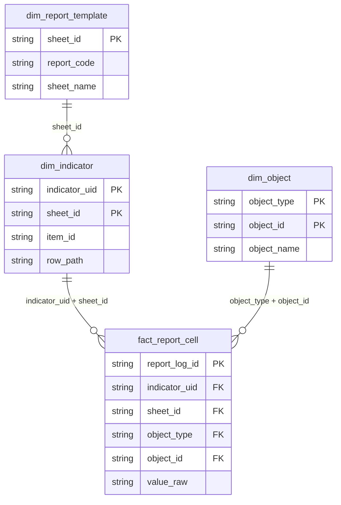
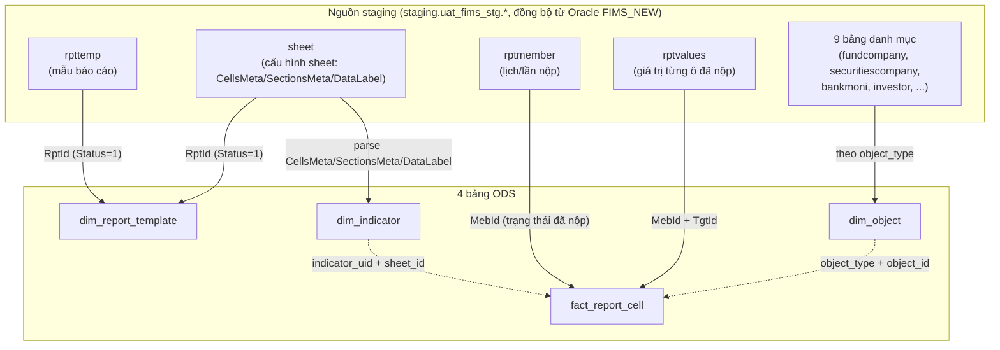

# 4 bảng ODS trải phẳng FIMS — Ý nghĩa & cách dùng (hướng dẫn BA)

**Áp dụng cho:** luồng FIMS chạy PySpark (`spark/spark_job/fims_staging_to_ods.py` +
`spark/spark_job/fims_ods_to_clickhouse.py`). Namespace: `ods.uat_fims_ods.*` (UAT).

> **Lưu ý phân biệt:** repo còn có file `ODS_FLAT_TABLES.md` mô tả mô hình **3 bảng EAV cũ**
> (`item_list`/`report_history`/`item_value`, dùng chung cho FMS/SCMS/TMS/ISS và bản FIMS cũ).
> Tài liệu NÀY nói về mô hình **4 bảng riêng của FIMS** (mới hơn, thay `item_list` bằng 3 bảng
> tách rõ `dim_object`/`dim_report_template`/`dim_indicator`). Đừng nhầm hai tài liệu.

---

## 1. Bốn bảng, quan hệ với nhau như thế nào

**Ghi nhớ 1 câu cho mỗi bảng:**

| Bảng | 1 dòng nghĩa là gì | Có phụ thuộc lần nộp không? |
|---|---|---|
| `dim_object` | Một tổ chức/cá nhân từng xuất hiện là bên nộp báo cáo | Không |
| `dim_report_template` | Một sheet của một mẫu báo cáo (Phụ lục) | Không |
| `dim_indicator` | Một Ô CHỈ TIÊU trong template — vị trí, tên, cấu trúc cây | Không |
| `fact_report_cell` | Một Ô GIÁ TRỊ đã điền, của một lần nộp cụ thể | **Có** — mỗi ngày nộp là dữ liệu mới |

### Sơ đồ khoá nối (join)



*(Nếu chỗ xem file này không hiện được sơ đồ trên — GitHub và VSCode xem được, một số công cụ
khác thì không — dùng bảng khoá nối bằng chữ ngay dưới đây, nội dung y hệt.)*

### Bảng khoá nối bằng chữ — dùng để tự viết SQL JOIN

| Nối từ bảng | Sang bảng | Nối theo cột nào | Vì sao phải đủ CẢ HAI cột (nếu có 2) |
|---|---|---|---|
| `dim_indicator` | `dim_report_template` | `sheet_id` = `sheet_id` | — |
| `fact_report_cell` | `dim_indicator` | `indicator_uid` = `indicator_uid` **VÀ** `sheet_id` = `sheet_id` | `indicator_uid` sinh theo TỪNG sheet, KHÔNG duy nhất toàn hệ thống — 2 sheet khác nhau có thể trùng `indicator_uid`. Thiếu `sheet_id` sẽ nối lẫn sang sheet khác |
| `fact_report_cell` | `dim_object` | `object_type` = `object_type` **VÀ** `object_id` = `object_id` | `object_id` KHÔNG duy nhất toàn hệ thống — vd 2 loại đối tượng khác nhau dùng chung 1 bảng danh mục nguồn nên có thể trùng `object_id` khác `object_type`. Thiếu `object_type` sẽ nối lẫn sang tổ chức khác |
| `fact_report_cell` | `dim_report_template` | `sheet_id` = `sheet_id` (thường KHÔNG CẦN — xem ghi chú) | — |

**Ghi chú quan trọng — thường KHÔNG cần JOIN gì cả:** `fact_report_cell` đã **denormalize sẵn**
hầu hết thông tin hay cần tra (`report_code`, `report_name`, `sheet_name`, `row_path`,
`column_path`, `object_name`, `period_type`, `period_value`...) ngay trong chính nó. BA chỉ thật
sự cần JOIN sang 3 bảng kia khi cần các cột KHÔNG có sẵn ở `fact_report_cell`, ví dụ:
- JOIN `dim_indicator` để xem `override_source`/`is_group_last_band` (không denormalize xuống fact)
- JOIN `dim_report_template` để xem `legal_basis`/`template_status`
- JOIN `dim_object` để xem `object_short_name`/`object_code`

Ví dụ JOIN đầy đủ cả 3 bảng (khi cần mọi thông tin):

```sql
SELECT f.report_log_id, f.row_path, f.column_path, f.value_raw,
       d.override_source, d.is_group_last_band,
       t.legal_basis, t.template_status,
       o.object_short_name, o.object_code
FROM ods.uat_fims_ods.fact_report_cell f
JOIN ods.uat_fims_ods.dim_indicator d
  ON d.indicator_uid = f.indicator_uid AND d.sheet_id = f.sheet_id
JOIN ods.uat_fims_ods.dim_report_template t
  ON t.sheet_id = f.sheet_id
JOIN ods.uat_fims_ods.dim_object o
  ON o.object_type = f.object_type AND o.object_id = f.object_id
WHERE f.report_log_id = '<report_log_id>';
```

`dim_object`, `dim_report_template`, `dim_indicator` **ghi lại toàn bộ mỗi lần chạy ETL** (không
tích luỹ theo ngày) — nên số liệu ở 3 bảng này luôn phản ánh đúng cấu trúc HIỆN TẠI, không có
"lịch sử". `fact_report_cell` mới là bảng có lịch sử theo ngày nộp (`ngay_nop`).

---

## 2. `dim_report_template` — Danh mục mẫu báo cáo

Trả lời câu hỏi: **"Hệ thống đang có những mẫu báo cáo nào, sheet nào?"**

| Cột | Ý nghĩa |
|---|---|
| `report_code` | Mã mẫu báo cáo — **mã KỸ THUẬT do hệ thống tự sinh** (vd `BZ5X4`, `H0I8J`), KHÔNG phải tên gọi tắt hay dùng khi trao đổi (`"PLIII_CTCK"`) — hai cái không đảm bảo khớp nhau |
| `report_name` | Tên đầy đủ của mẫu báo cáo (vd "Phụ lục III...") |
| `legal_basis` | Căn cứ pháp lý (thông tư/quyết định) |
| `sheet_name` | Tên sheet/tab trong mẫu (vd "I", "II", "III") |
| `sheet_index` | Thứ tự sheet |
| `template_status` | Trạng thái mẫu — chỉ mẫu `status=1` (đang dùng) mới có mặt |

**BA dùng để làm gì:** tra `report_code` THẬT ứng với tên gọi quen thuộc, trước khi hỏi bất kỳ
câu nào ở `dim_indicator`/`fact_report_cell` (2 bảng kia bắt buộc lọc theo `report_code`, gõ sai
là tra không ra gì, không báo lỗi).

```sql
SELECT report_code, report_name, legal_basis, sheet_name
FROM ods.uat_fims_ods.dim_report_template
ORDER BY report_name, sheet_index;
```

---

## 3. `dim_indicator` — Cây chỉ tiêu (bảng quan trọng nhất để MAPPING)

Trả lời câu hỏi: **"Ô này trên Excel tương ứng với chỉ tiêu nào, nằm ở đâu trong cây?"** — đây
là bảng BA cần dùng nhiều nhất khi đối chiếu cấu trúc báo cáo hoặc khai báo override.

| Cột | Ý nghĩa |
|---|---|
| `indicator_uid` | Mã định danh của Ô TEMPLATE, duy nhất **trong cùng 1 sheet** (không phải duy nhất toàn hệ thống — 2 sheet khác nhau có thể trùng `indicator_uid`, phải luôn đi kèm `sheet_id`) |
| `item_id` | Mã dùng để LÊN BÁO CÁO/DATA EXPLORER (xem mục 4 — khác `indicator_uid`) |
| `sheet_row` / `sheet_col` | Vị trí 0-based trong template. **Excel_row (số dòng mắt nhìn thấy) = `sheet_row` + 1** |
| `row_path` | Đường dẫn CHA→CON của dòng, nối bằng `" > "` (vd `"G. Tiền... > 1. Tiền"`) — chính là "tên nhóm chỉ tiêu" hiển thị trên Data Explorer |
| `column_path` | Đường dẫn header của cột (vd `"Kỳ báo cáo"`, `"Chênh lệch..."`) |
| `section_id` / `section_type` | `DYNAMIC` (vùng dữ liệu có thể nhiều dòng, vd danh sách công ty) hay `FIXED` (dòng cố định, vd dòng Tổng) |
| `is_total_row` | `1` = đây là dòng TỔNG (không phải dòng nhập liệu chi tiết) |
| `is_ordinal_col` | `1` = cột số thứ tự (STT), không phải chỉ tiêu nghiệp vụ |
| `is_group_last_band` | `1` = đây là band ĐỘNG cuối cùng trong nhóm — dùng nội bộ để nhận diện dữ liệu thật vs bản sao lỗi nguồn, BA không cần quan tâm trừ khi soi lỗi |
| `is_excluded_by_config` | `1` = dòng này bị loại khỏi cây chỉ tiêu do có khai `drop: true` trong file cấu hình đè (`fims_row_overrides/`) |
| `override_source` | Nếu dòng này từng bị sửa tay qua file cấu hình đè, cột này ghi rõ `"<tên file>.yaml#<excel_row>"` — soi ra ngay ai/khi nào đã sửa gì |
| `format_data_type` | Kiểu dữ liệu nguồn khai: `numberic`, `percentage`, `string`... |
| `sort_order` | Thứ tự hiển thị trên UI |

**BA dùng để làm gì:**

1. **Xem toàn bộ cây chỉ tiêu của 1 báo cáo** (đối chiếu với Excel gốc):
   ```sql
   SELECT sheet_name, sheet_row + 1 AS excel_row, row_path, column_path, is_total_row
   FROM ods.uat_fims_ods.dim_indicator
   WHERE report_code = '<mã thật lấy từ dim_report_template>'
   ORDER BY sheet_name, sheet_row, sheet_col;
   ```

2. **Kiểm tra 1 dòng cụ thể có đang bị cấu hình sửa tay hay không:**
   ```sql
   SELECT sheet_name, sheet_row + 1 AS excel_row, row_path, override_source
   FROM ods.uat_fims_ods.dim_indicator
   WHERE report_code = '<report_code>' AND override_source <> '';
   ```

3. **Cách nhanh hơn, không cần tự viết SQL** — có sẵn 2 lệnh dòng lệnh (chạy trên máy có kết nối
   UAT), chỉ đọc, không ghi gì:

   ```bash
   # Xem danh sách report_code thật + số chỉ tiêu mỗi sheet
   python spark/spark_job/main_fims_staging_to_ods.py --list-reports

   # In sẵn cây chỉ tiêu của 1 báo cáo, kèm excel_row đã quy đổi sẵn
   python spark/spark_job/main_fims_staging_to_ods.py --dump-structure --report-code <report_code>
   ```

---

## 4. Vì sao có cả `indicator_uid` lẫn `item_id` — cái nào dùng để mapping?

- `indicator_uid`: khoá THÔ, sinh trực tiếp từ toạ độ ô trong file template gốc (`cellsMeta`).
  Chỉ duy nhất trong 1 sheet.
- `item_id`: khoá dùng để LÊN Data Explorer (`bc_fims_v2.id_chitieu`, `metadata_etl.id_chitieu`).
  Tính bằng cách băm (MD5) từ `report_code + legal_basis + sheet_name + row_path + column_path`
  — tức là băm theo Ý NGHĨA/VỊ TRÍ trong cây chỉ tiêu, không băm theo toạ độ Excel thô.

**Vì sao quan trọng:** nếu `row_path` của một dòng bị sửa (qua file cấu hình đè, hoặc do template
đổi), `item_id` của dòng đó ĐỔI THEO — nghĩa là dòng đó biến thành "chỉ tiêu mới" trên Data
Explorer, còn dữ liệu cũ theo `item_id` cũ không tự động chuyển sang. Khi BA thấy một chỉ tiêu
"biến mất" hoặc "trùng tên nhưng ra 2 dòng khác nhau" trên Data Explorer sau khi có sửa đổi cấu
trúc — đây thường là nguyên nhân, cần báo dev backfill lại.

---

## 5. `fact_report_cell` — Giá trị thật đã nộp

Trả lời câu hỏi: **"Lần nộp này, ô này có giá trị bao nhiêu?"**

| Cột | Ý nghĩa |
|---|---|
| `report_log_id` | Mã của LẦN NỘP cụ thể — dùng để lọc "toàn bộ số liệu của 1 lần nộp" |
| `object_id` / `object_name` | Tổ chức đã nộp (FK → `dim_object`) |
| `period_type` / `period_value` | Loại kỳ (`THANG`, `QUY`, `NAM`...) và giá trị kỳ (vd `T09/2026`) |
| `ngay_nop` | Ngày THỰC TẾ nộp — **khác** `period_value` (báo cáo kỳ tháng 1 có thể nộp trễ vào tháng 3) |
| `indicator_uid` / `item_id` | Nối với `dim_indicator` để biết ô này thuộc chỉ tiêu nào |
| `row_order` | Thứ tự dòng trong band động (vd công ty thứ mấy trong danh sách) — `0` nghĩa là ô TĨNH của band |
| `entity_code` | Mã định danh thực thể nếu là dòng động (vd mã công ty) |
| `value_raw` / `value_num` / `value_text` | Giá trị gốc / giá trị đã ép kiểu số / giá trị dạng chữ |
| `is_mirror`, `is_section_echo`, `is_band_overflow`, `is_static_copy`, `is_template_marker` | Các cờ chẩn đoán "ô này có phải dữ liệu THẬT không" — xem bảng dưới. Ô bị cờ = 1 ở BẤT KỲ cột nào trong số này sẽ KHÔNG lên Data Explorer (bị loại ở tầng 2), nhưng vẫn còn nguyên trong bảng này để tra cứu/audit |

**Ý nghĩa 5 cờ loại bỏ** (BA cần khi thắc mắc "sao ô này không thấy trên Data Explorer mà vẫn có
trong ODS"):

| Cờ | Khi nào = 1 |
|---|---|
| `is_mirror` | Ô nằm trên chính DÒNG NHÃN của band động — nguồn ghi trùng dữ liệu vào đó |
| `is_section_echo` | Dòng nhãn của một mục (vd "A. Tín phiếu") bị nguồn lỡ ghi lẫn vào như một dòng dữ liệu |
| `is_band_overflow` | Band động này bị "tràn" — nguồn cắt sai ranh giới, kéo theo dữ liệu của mục sau vào mục trước |
| `is_static_copy` | Ô tĩnh của band không phải cuối nhóm, giá trị là bản sao chép nhầm từ band cuối |
| `is_template_marker` | Ô mang giá trị `"..."` — chỗ đánh dấu của template, không phải dữ liệu thật |

**Ví dụ tra toàn bộ số liệu của 1 lần nộp** (kèm tên chỉ tiêu, đọc được luôn không cần đoán):

```sql
SELECT f.row_path, f.column_path, f.row_order, f.entity_code, f.value_raw,
       f.is_mirror, f.is_section_echo, f.is_band_overflow, f.is_static_copy, f.is_template_marker
FROM ods.uat_fims_ods.fact_report_cell f
WHERE f.report_log_id = '<report_log_id>'
ORDER BY f.sheet_name, f.sheet_row, f.column_path;
```

---

## 6. `dim_object` — Danh mục tổ chức/cá nhân nộp báo cáo

Trả lời câu hỏi: **"Object_id này là ai?"**

| Cột | Ý nghĩa |
|---|---|
| `object_type` / `object_type_name` | Loại đối tượng: quỹ, công ty chứng khoán, ngân hàng lưu ký... |
| `object_id` | Mã định danh trong hệ thống nguồn |
| `object_code` | Mã tra cứu (regno/taxcode/certno/transactioncode tuỳ loại; riêng "Đại diện giao dịch" dùng `idno` — nguồn ĐÃ mã hóa CMND/CCCD trước khi tới staging nên đây không phải số gốc, xác nhận với BA 24/09/2026) |
| `object_name` / `object_short_name` | Tên đầy đủ / tên viết tắt |

```sql
SELECT object_type_name, object_id, object_name
FROM ods.uat_fims_ods.dim_object
WHERE object_name LIKE '%VSDC%';
```

---

## 7. Quy trình mapping điển hình cho BA

**Tình huống: "Tôi cần biết số liệu ô X trên báo cáo Y, kỳ Z, của tổ chức W nằm ở đâu và giá trị
bao nhiêu."**

1. Tra `report_code` thật ở `dim_report_template` (theo `report_name`).
2. Tra cây chỉ tiêu ở `dim_indicator` (theo `report_code` + `sheet_name`) để xác định đúng
   `row_path`/`column_path`/`excel_row` khớp với ô X trên Excel.
3. Tra `object_id` ở `dim_object` (theo tên tổ chức W).
4. Lọc `fact_report_cell` theo `object_id` + `period_value` (kỳ Z) + `row_path`/`column_path`
   (từ bước 2) để lấy đúng `value_raw`.

**Tình huống: "Sao chỉ tiêu này thấy sai/thiếu trên Data Explorer?"**

1. Tra `fact_report_cell` xem giá trị ở tầng ODS đã đúng chưa (nếu SAI ở đây → lỗi từ nguồn, xem
   mục 8).
2. Nếu ĐÚNG ở đây nhưng SAI trên Data Explorer → xem 5 cờ loại bỏ ở mục 5, cột nào = 1 thì đó là
   lý do bị loại ở tầng 2.
3. Nếu nghi ngờ do cấu trúc cây (dòng bị gán sai cha) → xem `dim_indicator.override_source` có
   giá trị không; nếu không, có thể cần khai cấu hình đè (báo dev).

---

## 8. Một lưu ý quan trọng: ODS "bê nguyên" dữ liệu nguồn, không tự sửa

Nếu số liệu ở `fact_report_cell` ĐÃ sai ngay từ giá trị gốc (khác với lỗi cấu trúc/bị lọc nhầm ở
mục 5), đó là **lỗi từ hệ thống nguồn FIMS**, không phải lỗi của tầng ODS này — ODS chỉ chuyển
nguyên trạng, không tự "sửa" giá trị nhập sai. Trường hợp này cần làm việc trực tiếp với đơn vị
nộp báo cáo hoặc đội vận hành nguồn, không phải yêu cầu sửa ETL.

---

## 9. Nguồn (staging) → 4 bảng ODS — quy tắc join/dựng dữ liệu

Mục 1-8 nói về 4 bảng ODS ĐÃ CÓ. Mục này nói **4 bảng đó được TẠO RA từ đâu** — để BA biết khi
số liệu sai, nên nghi ngờ NGUỒN hay nghi ngờ TẦNG chuyển đổi.

> Đây là tầng **staging (Hive) → ODS**, do `spark/spark_job/fims_staging_to_ods.py` chạy. KHÁC với tài
> liệu `co-che-parse-excel-va-join-4-bang.md` (mô tả cách hệ thống NGUỒN — ứng dụng FIMS_NEW —
> tự ghi Excel người dùng nộp xuống `RPTTEMP`/`SHEET`/`RPTMEMBER`/`RPTVALUES` ngay từ đầu, TRƯỚC
> khi tới staging). Sai ở tầng ĐÓ thì phải báo đội vận hành nguồn; sai ở tầng NÀY thì báo dev ETL.

### 9.1 Sơ đồ tổng thể



### 9.2 Bảng ánh xạ nguồn → đích

| Bảng ODS | Đọc từ (staging) | Nối theo khoá nào | Điều kiện lọc |
|---|---|---|---|
| `dim_object` | 9 bảng danh mục (`fundcompany`, `securitiescompany`, `bankmoni`, `depositorycenter`, `stockexchange`, `infodiscrepres`, `branchs`, `investor`, `tradingrepresentative`) | Không JOIN — mỗi bảng đọc riêng, gắn `object_type` tương ứng | — |
| `dim_report_template` | `rpttemp` JOIN `sheet` | `sheet.RptId = rpttemp.Id` | Chỉ mẫu **`Status = 1`** (đang dùng) |
| `dim_indicator` | `sheet` (đúng sheet vừa lọc ở `dim_report_template`) | Không JOIN bảng khác — **PARSE JSON** 3 cột `CellsMeta`/`SectionsMeta`/`DataLabel` của chính `sheet` | Chỉ ô có `uid` trong `CellsMeta` |
| `fact_report_cell` | `rptmember` JOIN `rptvalues` | `rptvalues.MebId = rptmember.Id` | Chỉ `rptmember` có trạng thái **đã nộp** (2/3/5), trong khoảng `[from_date, to_date)` theo `DateSubmitted` |

**`dim_indicator` không phải JOIN SQL bình thường** — đây là điểm khác biệt lớn nhất so với 3
bảng còn lại. `CellsMeta` là một cột JSON (mảng toạ độ ô + `uid` + định dạng), `SectionsMeta` là
JSON đánh dấu vùng động/cố định, `DataLabel` là ma trận nhãn 2 chiều. Cây chỉ tiêu (`row_path`,
`column_path`, band nào là động/tĩnh...) được **suy ra bằng thuật toán đọc 3 JSON này**, không
phải một câu `SELECT ... JOIN`. Đây cũng là lý do vì sao có cả một lớp cấu hình đè
(`fims_row_overrides/`) — suy luận từ JSON không phải lúc nào cũng đúng 100%.

### 9.3 Vì sao `fact_report_cell` cần join thêm với `dim_indicator` và `dim_object`

`rptvalues` tự nó chỉ có `TgtId` (mã ô THÔ, xem mục 9.4) và các cột FK đối tượng
(`FundId`/`SecId`/`BankId`/...), **không có sẵn** tên chỉ tiêu hay tên tổ chức dễ đọc. ETL phải
tra thêm:

- `TgtId` → khớp với `indicator_uid` trong `dim_indicator` (cùng `sheet_id`) để biết ô này là
  chỉ tiêu nào (`row_path`/`column_path`).
- FK đối tượng trên `rptmember` → khớp với `dim_object` để biết ai đã nộp. Vì mỗi loại đối
  tượng dùng MỘT cột FK riêng (`fundid` cho quỹ, `secid` cho CTCK, `bankid` cho ngân hàng lưu
  ký...), ETL **duyệt lần lượt theo thứ tự cố định** các cột này, lấy cột ĐẦU TIÊN có giá trị
  làm định danh + suy luôn `object_type` từ cột đó — không có một cột `object_id` sẵn có trên
  `rptmember`.

  | Thứ tự duyệt | Cột FK trên `rptmember` | object_type tương ứng |
  |---|---|---|
  | 1 | `secid` | CTCK |
  | 2 | `fundid` | QLQ (công ty quản lý quỹ) |
  | 3 | `bankid` | Ngân hàng lưu ký |
  | 4 | `depid` | VSDC |
  | 5 | `stockid` | Sở GDCK |
  | 6 | `inid` | Đại diện CBTT |
  | 7 | `branid` | CN QLQ nước ngoài |
  | 8 | `investorid` | NĐT nước ngoài / NĐT |
  | 9 | `tradingrepresentativeid` | Đại diện giao dịch |

Kết quả 2 phép tra này (`indicator_uid`+`sheet_id` và `object_type`+`object_id`) được ETL
**denormalize sẵn** luôn vào từng dòng `fact_report_cell` (đúng như đã nói ở mục 1) — nên BA đọc
`fact_report_cell` không cần tự làm lại 2 phép tra này nữa.

### 9.4 Một điểm kỹ thuật cần biết nếu BA tự soi trực tiếp bảng staging

`rptvalues.tgtid` (staging) lưu dạng **nhị phân RAW(16)**, KHÔNG phải chuỗi UUID có dấu gạch
ngang như `dim_indicator.indicator_uid` hiển thị. Nếu BA tự viết SQL so sánh trực tiếp
`WHERE tgtid = '536c8155-6561-...'` sẽ **luôn ra rỗng** dù dữ liệu có tồn tại. Cách đúng: dùng
hàm `hex(tgtid)` rồi so với `indicator_uid` đã bỏ dấu gạch ngang, viết hoa:

```sql
SELECT hex(tgtid) AS tgt_id_hex, rowdynamic, code, value
FROM staging.uat_fims_stg.rptvalues
WHERE mebid = <report_log_id>
  AND hex(tgtid) = '536C815565614D9EA441078B06394565';  -- = 536c8155-6561-4d9e-a441-078b06394565 bỏ dấu gạch, viết hoa
```

Việc này chỉ cần khi BA muốn soi TẬN GỐC (trước cả `fact_report_cell`) — ví dụ để xác định một
giá trị sai là do NGUỒN nhập sai hay do lỗi tầng chuyển đổi. Bình thường dùng `fact_report_cell`
là đủ, không cần đụng tới bảng staging thô này.

---

## 10. Trải 1 dòng báo cáo (dạng EAV) thành 1 dòng ngang — pivot theo cột

`fact_report_cell` lưu **1 ô = 1 dòng** (đúng thiết kế EAV). Muốn xem lại đúng như 1 dòng trên
báo cáo gốc (nhiều cột trên cùng 1 hàng), phải TRẢI (pivot) theo `column_path`.

**Vì sao câu `PIVOT`/`CASE WHEN` luôn cần một hàm tổng hợp (`MAX`, ...):** cú pháp bắt buộc phải
có, để xử lý trường hợp có NHIỀU dòng khớp vào cùng 1 ô sau khi nhóm. Khi nhóm ĐÚNG (chỉ có
đúng 1 dòng mỗi ô), `MAX` của 1 giá trị chính là giá trị đó — vô hại. Khi nhóm SAI (lỡ có 2 dòng
khác nhau rơi vào cùng 1 ô), `MAX` sẽ **âm thầm chọn ra chuỗi lớn nhất theo THỨ TỰ CHỮ** (vì
`value_raw` là STRING) — không phải số lớn nhất, không phải giá trị đúng. Đây chính là lỗi đã
gặp thật khi dùng `row_path` làm khoá nhóm (xem cảnh báo ngay dưới).

**KHÔNG dùng `row_path` (chuỗi suy luận) làm khoá nhóm — dùng `sheet_row` (vị trí THẬT trong
Excel gốc):** `row_path` là chuỗi được TÍNH RA từ cấu trúc template, và đã có tiền lệ 2 dòng
khác nhau trong cùng sheet vô tình cho ra CÙNG một chuỗi `row_path` (đây là lớp lỗi mà code
ETL phải vá riêng bằng `_row_key()` ở tầng `item_id` — xem `spark/spark_job/fims_staging_to_ods.py`).
Data Explorer luôn ra đúng vì tầng ClickHouse nhóm theo `id_chitieu` (sinh từ `item_id`, đã
được phân biệt) — còn SQL thô nhóm theo `row_path` text thì KHÔNG phân biệt được, hai dòng khác
nhau bị trộn lẫn vào 1 ô, và `MAX` ở trên sẽ chọn ra một giá trị SAI. `sheet_row` (số dòng vị
trí thô trong template Excel) không bao giờ trùng giữa 2 dòng khác nhau, nên an toàn hơn
hẳn — dùng nó làm khoá nhóm, giữ `row_path` chỉ để hiển thị cho dễ đọc.

**Bước 1 — biết trước có những cột nào** (chạy 1 lần cho mỗi sheet, không phụ thuộc lần nộp):

```sql
SELECT DISTINCT column_path
FROM ods.uat_fims_ods.dim_indicator
WHERE report_code = '<report_code>' AND sheet_name = '<sheet_name>'
ORDER BY column_path;
```

**Bước 2 — chẩn đoán trước khi tin kết quả:** kiểm tra có ô nào bị trộn từ ≥ 2 dòng thô không
(nếu ra kết quả, đúng là ca vừa nói ở trên — báo dev kèm đúng `sheet_row` để soi tiếp):

```sql
SELECT sheet_row, row_order, entity_code, column_path, COUNT(*) AS n_dong_trung
FROM ods.uat_fims_ods.fact_report_cell
WHERE report_log_id = '<report_log_id>' AND sheet_name = '<sheet_name>'
  AND is_mirror = 0 AND is_section_echo = 0 AND is_band_overflow = 0
  AND is_static_copy = 0 AND is_template_marker = 0
GROUP BY sheet_row, row_order, entity_code, column_path
HAVING COUNT(*) > 1
ORDER BY n_dong_trung DESC;
```

**Bước 3a — trải bằng `PIVOT`** (Spark SQL hỗ trợ sẵn, ngắn gọn nhất — nhóm theo `sheet_row`,
KHÔNG theo `row_path`):

```sql
SELECT *
FROM (
    SELECT sheet_row, row_path, row_order, entity_code, column_path, value_raw
    FROM ods.uat_fims_ods.fact_report_cell
    WHERE report_log_id = '<report_log_id>'
      AND sheet_name    = '<sheet_name>'
      -- loại các ô đã bị gắn cờ "không phải dữ liệu thật" (xem mục 5)
      AND is_mirror = 0 AND is_section_echo = 0 AND is_band_overflow = 0
      AND is_static_copy = 0 AND is_template_marker = 0
) src
PIVOT (
    MAX(value_raw)
    FOR column_path IN ('<tên cột 1>', '<tên cột 2>', '<tên cột 3>', ...)  -- điền từ Bước 1
)
ORDER BY sheet_row, row_order;
```

**Bước 3b — thay thế nếu môi trường không có `PIVOT`** (dùng `CASE WHEN`, dài hơn nhưng luôn
chạy được — cũng nhóm theo `sheet_row`):

```sql
SELECT sheet_row, MAX(row_path) AS row_path, row_order, entity_code,
       MAX(CASE WHEN column_path = '<tên cột 1>' THEN value_raw END) AS cot_1,
       MAX(CASE WHEN column_path = '<tên cột 2>' THEN value_raw END) AS cot_2
FROM ods.uat_fims_ods.fact_report_cell
WHERE report_log_id = '<report_log_id>'
  AND sheet_name    = '<sheet_name>'
  AND is_mirror = 0 AND is_section_echo = 0 AND is_band_overflow = 0
  AND is_static_copy = 0 AND is_template_marker = 0
GROUP BY sheet_row, row_order, entity_code
ORDER BY sheet_row, row_order;
```

*(`MAX(row_path)` ở đây chỉ để HIỂN THỊ — vô hại vì mục đích chỉ là đọc cho dễ, không dùng để
phân biệt dòng. Nếu 2 dòng thật sự khác nhau bị nhóm chung do trùng `row_path`, việc nhóm theo
`sheet_row` ở trên đã tách chúng ra làm 2 dòng riêng rồi, nên vấn đề không còn xảy ra ở đây nữa.)*

**Lưu ý:** nếu sau khi trải mà một dòng vẫn bị "vỡ" thành 2 dòng thay vì 1 (cùng `sheet_row`
nhưng khác `row_order` dù trên báo cáo gốc là cùng 1 hàng), khả năng cao đây là dấu hiệu của lỗi
cấu trúc khác (band bị gắn sai `row_order`, hoặc dòng tĩnh/động lẫn lộn) — báo dev kèm
`report_log_id` + `sheet_row` cụ thể, đừng tự gộp thủ công.
